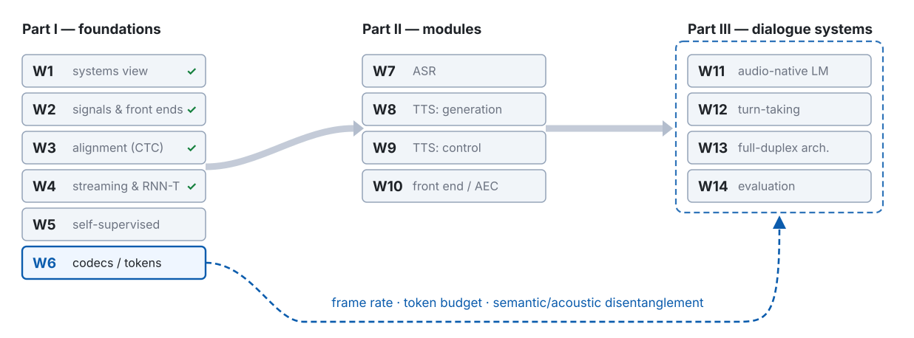

<!-- 此檔由 bin/publish_slides.py 從投影片正本產生（中文講稿區塊已剝除），請勿直接編輯。正本在 private repo 的 <course>/slides/。 -->

# No transcript, and a hole to fill {.section-title}

## Where we are: week 5 of 14

{width="100%"}

## Last week, in one picture



::: {.claim}
**Week 4 opened the box.** It never said where the box's ability comes from — and every loss it used read a transcript.
:::

::: {.footer}
W4 p5 the box · p20 $D_{\text{alg}}$ · p56 three alignments, three losses
:::

## The problem this week handles, in one picture



::: {.claim}
One pipeline, one question: **what is the answer for the masked frame — and who wrote it down?**
:::

::: {.footer}
Route: contrast → a teacher → the layers → the units → what the target does not decide
:::

## Notation for today

| Symbol | Meaning |
|:--|:--|
| $\mathbf{x}$, $\Delta$, $s$ | waveform; W2's hop (10 ms); subsampling (W4). One SSL frame is $s\Delta = 20$ ms, $s = 2$ |
| $\mathbf{z}_t \in \mathbb{R}^d$, $\mathbf{c}_t$, $\mathbf{q}_t$ | CNN latent; Transformer output (context); quantised latent |
| $G$, $V$, $\mathbf{e}_{g,v}$; $\mathbf{e}_k$ | codebook groups, entries per group, codeword; HuBERT's unit embedding |
| $k_t \in \{1, \dots, K\}$, $K$ | cluster id and cluster count (**not** W4's $u$, a lattice index) |
| $M$, $\tilde{\mathbf{X}}$ | masked positions; the masked input |
| $\mathcal{Z}$ ($\mathcal{Z}_t$), $N = \lvert\mathcal{Z}\rvert$, $\mathrm{sim}$, $\kappa$, $\tau$ | InfoNCE sample set (one per masked step); cosine; **contrastive** temperature; **Gumbel** temperature |
| $l = 0, \dots, n_{\text{layer}}$, $\mathbf{h}^{(l)}_t$, $\mathbf{w} = \mathrm{softmax}(\boldsymbol{\theta})$ | layer index ($0$ = CNN output), its output, SUPERB's layer weights |
| $I(\cdot\,;\cdot)$, $H(\cdot)$, $\mathcal{L}_m$, $\mathcal{L}_d$, $\mathcal{L}_N$ | mutual information, entropy; masked-prediction, diversity, $N$-sample InfoNCE losses |

::: {.footer}
Logs are $\ln$ · two temperatures: $\kappa$ divides a similarity, $\tau$ a Gumbel logit
:::

## Five things to leave with today

1. **InfoNCE is a lower bound on mutual information**: the best critic is a density ratio; substitute it back and $I(\mathbf{z};\mathbf{c}) \geq \ln N - \mathcal{L}_N$. The bound can never exceed $\ln N$ — and that decides what negatives can and cannot buy.
2. **Four ways to build the target** — wav2vec 2.0, HuBERT, data2vec, BEST-RQ — and for each: who builds it, does it move, what stops collapse, how it fails.
3. **Gumbel-softmax with a straight-through gradient**, and a diversity loss that is an entropy: the two pieces W6 will reuse under a harsher name, codebook collapse.
4. **Layers are not a ladder**: speaker low, phones in the middle, and a pre-trained top that can turn back toward the input. *Which layer* is a representation decision; a learned weighted sum tells you some of it.
5. **How to read an SSL comparison**: data size, domain and model size confound every claim; frozen benchmarks favour a kind of model; and HuBERT's units are not phonemes.

# Targets, first kind: contrast {.section-title}

## The pipeline every method shares



::: {.claim .fragment fragment-index=1}
**A learned filterbank on W2's clock — 25 ms window, 20 ms hop — fixed at pre-training, before any downstream task exists.**
:::

::: {.footer}
CNN = convolutional neural network · wav2vec 2.0 §2, §3.3 · same front end: HuBERT, data2vec
:::

## At a glance: Contrastive Predictive Coding (CPC)

::: {.prose}
| | |
|:---|:-----------------|
| **Name** | **Contrastive Predictive Coding** (CPC), Oord, Li & Vinyals, arXiv 2018. Its loss is **InfoNCE**: "a loss based on NCE", noise-contrastive estimation. |
| **The question** | With no transcript, what can a model be asked to predict about speech? |
| **The idea** | Fold the past into $\mathbf{c}_t$ with a causal GRU (gated recurrent unit), then pick the true future latent $\mathbf{z}_{t+k}$ out of a set of distractors — a classification, not a reconstruction. |
| **What it added** | No labels, and no model of the waveform itself: the best classifier learns a density ratio, and its loss bounds the mutual information $I(\mathbf{z};\mathbf{c})$ from below. |
| **What it leaves open** | The context sees only the past, and only a narrow band of $k$ is useful; wav2vec 2.0 fills a hole instead (p17). |
:::

::: {.footer}
CPC §2.3: "a loss based on NCE, which we will call InfoNCE" · the mechanism: p11–p13
:::

## CPC: predict the future, against negatives



$$\mathcal{L}_N = -\mathbb{E}\!\left[\ln \frac{\exp(\mathrm{sim}(\mathbf{c}_t, \mathbf{z}_{t+k})/\kappa)}{\sum_{\tilde{\mathbf{z}} \in \mathcal{Z}} \exp(\mathrm{sim}(\mathbf{c}_t, \tilde{\mathbf{z}})/\kappa)}\right], \qquad \lvert\mathcal{Z}\rvert = N:\ \text{one positive, } N - 1 \text{ negatives}$$

::: {.footer}
Oord, Li & Vinyals 2018, eq. 4 · Table 1: phone probe 64.6% vs MFCC 39.7%
:::

## InfoNCE, step 1: the best critic is a density ratio



::: {.footer}
CPC §2.3, eq. 4 (the loss) and eq. 5 (its optimum)
:::

## InfoNCE, step 2: substitute back, get $\ln N - I$



::: {.claim .fragment fragment-index=3}
**Read it:** $\mathcal{L}_N \geq 0$, so the bound never exceeds $\ln N$ — 100 negatives cannot show more than $\ln 101 \approx 4.6$ nat.
:::

::: {.footer}
CPC App. A.1, eq. 6–11 · a proof without the $\approx$ and $\geq$: Poole et al. 2019
:::

## Before Demo 3: InfoNCE on data with a known answer

::: {.prose}
| | |
|:---|:-----------------|
| **Why** | The last slide gave two inequalities: $I(\mathbf{z};\mathbf{c}) \geq \ln N - \mathcal{L}_N$ for any critic, and a ceiling at $\ln N$ because $\mathcal{L}_N \geq 0$. To see how a trained critic actually behaves under them, use data whose mutual information is known. |
| **What runs** | Pure numpy, a terminal and one plot window. Two 8-dimensional Gaussian vectors with correlation 0.7 in every dimension, so the mutual information has a closed form: 2.69 nat. A critic is trained with InfoNCE at each $N = 2, 4, \dots, 1024$, and $\ln N - \mathcal{L}_N$ is averaged over 200 held-out batches. |
| **Watch for** | The estimate against two lines, the truth and $\ln N$, as $N$ goes from 2 to 1024 — and what each doubling of $N$ buys. |
:::

::: {.footer}
Demo 3 · code: `demos/w05_d3_infonce_bound` · numpy only, CPU
:::

## Demo 3 — the ceiling at $\ln N$

::: {.ask}
**Demo 3.** Before the curve appears: at $N = 8$, can the estimate reach the true value?
:::



::: {.footer}
Demo 3 · `demos/w05_d3_infonce_bound` recomputes this curve live (seed 20261011) · numbers: w05-data.json
:::

## MC 1 — "more negatives is always better"

| | what the bound says | what happens in practice |
|:--|:--|:--|
| few negatives | the ceiling $\ln N$ sits **below** the truth: you cannot see the information you want | the estimate is pinned under the ceiling (Demo 3: $N = 8$ gives $1.54$ against a ceiling of $2.08$ and a truth of $2.69$) |
| many negatives | the ceiling clears the truth; the bound can tighten | the ceiling rises only as $\ln N$: one more nat costs $e$ times the negatives; past the truth, more buys only a smaller variance (Demo 3) |
| wav2vec 2.0 | $N - 1 = 100$ distractors — a ceiling of $\ln 101 \approx 4.6$ nat | sampled from the **same utterance**: same speaker, same channel — only content can separate them |

::: {.claim}
**Hard beats many.** The negatives decide what the critic is forced to attend to; their number only decides how high the ceiling is.
:::

::: {.footer}
wav2vec 2.0 §4.2, App. F (whole-batch negatives hurt) · Poole et al. 2019 §2.3
:::

## From predicting the future to filling a hole



::: {.claim}
Two moves from CPC to wav2vec 2.0: **predict the masked, not the future** — and **quantise the target**, so the model cannot make the contrast easy by moving both sides.
:::

::: {.footer}
vq-wav2vec, ICLR 2020 · BERT = Bidirectional Encoder Representations from Transformers
:::

# wav2vec 2.0: the model quantises its own target {.section-title}

## At a glance: wav2vec 2.0

::: {.prose}
| | |
|:---|:-----------------|
| **Name** | **wav2vec 2.0**, Baevski, Zhou, Mohamed & Auli, NeurIPS 2020. Not an acronym: the second of a line, after wav2vec (2019, purely convolutional, contrastive) and vq-wav2vec (2020: quantise first, then run BERT). |
| **The question** | If the target is the model's own latent, how do you stop the model from making the contrast easy? |
| **The idea** | Mask spans of the CNN latents; at each masked step a Transformer must pick the **vector-quantised** (VQ) latent $\mathbf{q}_t$ out of distractors from the same utterance. |
| **What it added** | Masking and quantisation in one model, trained end to end — and fine-tuning on ten minutes of labels, the result its abstract leads with. |
| **What it leaves open** | The quantiser has no gradient, and a target that moves can collapse. One picture of the whole model first; then the next slides take both: Gumbel-softmax, then the diversity loss. |
:::

::: {.footer}
wav2vec, Interspeech 2019 · vq-wav2vec, ICLR 2020 · the ten-minute numbers: p52
:::

## wav2vec 2.0: two paths that meet only at the masked steps



::: {.claim .fragment fragment-index=3}
**The quantiser sees the latent before it is masked; the Transformer sees the hole.** They meet only at the masked steps — the loss on p24 writes exactly this.
:::

::: {.footer}
wav2vec 2.0 Fig. 1, §2–3.1 · 100 distractors: §4.2 · fine-tuning uses $\mathbf{c}_t$, not $\mathbf{q}_t$ (§5.4)
:::

## Gumbel-softmax and the straight-through gradient



::: {.fragment fragment-index=2}
$$\text{forward (hard):}\quad v^{*} = \arg\max_v\,(l_{g,v} + n_{g,v}),\qquad P(v^{*} = v) = \mathrm{softmax}(l_g)_v\quad\text{(Gumbel-max)}$$
:::

::: {.fragment fragment-index=3}
$$\text{backward (soft):}\quad \hat{p}_{g,v} = \frac{\exp\big((l_{g,v} + n_{g,v})/\tau\big)}{\sum_{v'} \exp\big((l_{g,v'} + n_{g,v'})/\tau\big)},\qquad \frac{\partial\,(\text{one hot})}{\partial l} := \frac{\partial \hat{p}}{\partial l},\qquad \tau\colon 2 \to 0.5$$
:::

::: {.claim .fragment fragment-index=3}
**Straight-through is biased by construction** — it pretends the quantiser is the identity. W6's VQ-VAE (vector-quantised variational autoencoder) reuses it.
:::

::: {.footer}
Jang, Gu & Poole 2017 · Bengio et al. 2013 · wav2vec 2.0 §4.2: $G = 2$, $V = 320$, $102{,}400$ codes
:::

## The diversity loss is an entropy



$$\mathcal{L}_d = \frac{1}{GV}\sum_{g=1}^{G}\big(-H(\bar{p}_g)\big) = \frac{1}{GV}\sum_{g=1}^{G}\sum_{v=1}^{V}\bar{p}_{g,v}\ln\bar{p}_{g,v}$$

::: {.small}
$\bar{p}_{g,v}$ is the batch mean of $\mathrm{softmax}(l_g)_v$ over the raw logits — no Gumbel noise, no temperature (wav2vec 2.0 §3.2).
:::

::: {.footer}
wav2vec 2.0 eq. 4 · $\mathcal{L} = \mathcal{L}_m + \alpha\mathcal{L}_d$, $\alpha = 0.1$ · W6: the same disease, no contrast to help
:::

## MC 2 — "no negatives means collapse"



::: {.claim}
Collapse is a property of **online targets**, not of "non-contrastive". A fixed target cannot collapse and needs no negatives; a moving target can — with or without them.
:::

::: {.footer}
BYOL = Bootstrap Your Own Latent (Grill et al., NeurIPS 2020) · EMA = exponential moving average
:::

## The whole loss, and where the negatives come from

$$\mathcal{L} = \mathcal{L}_m + \alpha\,\mathcal{L}_d, \qquad \mathcal{L}_m = -\sum_{t \in M}\ln\frac{\exp(\mathrm{sim}(\mathbf{c}_t, \mathbf{q}_t)/\kappa)}{\sum_{\tilde{\mathbf{q}} \in \mathcal{Z}_t}\exp(\mathrm{sim}(\mathbf{c}_t, \tilde{\mathbf{q}})/\kappa)}$$

| piece | wav2vec 2.0 BASE | why |
|:--|:--|:--|
| target | $\mathbf{q}_t = \mathrm{VQ}(\mathbf{z}_t)$ at masked $t$; $G = 2$, $V = 320$ | discrete, finite freedom (p17) |
| negatives $\mathcal{Z}_t \setminus \{\mathbf{q}_t\}$ | $N - 1 = 100$, **other masked steps of the same utterance** | same speaker, same channel: only content separates them |
| temperatures | $\kappa = 0.1$ (contrast); $\tau\colon 2 \to 0.5$ (Gumbel) | two knobs, two jobs |
| masking | spans of 10 steps, start prob. 0.065; $\approx 49\%$ of steps masked | long enough that interpolation fails |
| regulariser | $\alpha = 0.1$ on $\mathcal{L}_d$ | keep the codebook in use |

::: {.ask}
**Stop.** Why *must* the negatives come from the same utterance? What would the critic learn if they came from other speakers?
:::

::: {.footer}
wav2vec 2.0 §3.2–3.3, §4.2; App. F
:::

## What it costs to build one

::: {.metrics}
::: {.metric}
[64 $\times$ V100]{.num} [wav2vec 2.0 BASE · 1.6 days · LS-960]{.lab}
:::
::: {.metric}
[128 $\times$ V100]{.num} [LARGE · 2.3 days (LS-960) · 5.2 days (LV-60k)]{.lab}
:::
::: {.metric}
[32 → 256 GPUs]{.num} [HuBERT BASE → X-LARGE · 250k–400k steps per iteration]{.lab}
:::
:::

| | pre-training | today's demos |
|:--|:--|:--|
| what runs | tens to hundreds of GPUs, days, 960 h–60k h of audio | inference only: a pre-trained encoder, `output_hidden_states=True` |
| what it needs | the whole cluster | an M5 Max with 64 GB — and no CUDA |
| what it teaches | — | **feasibility is bound to hardware (W1)**: the first thing this course cannot run even on the instructor's machine |

::: {.claim}
Nothing today is training. Not a ten-minute toy either — it would show "it does not finish", not the phenomenon.
:::

::: {.footer}
LS-960 = LibriSpeech 960 h · LV-60k = Libri-light 60k h · wav2vec 2.0 App. B · HuBERT §IV-C
:::

# Targets, second kind: a teacher {.section-title}

## At a glance: Hidden-Unit BERT (HuBERT)

::: {.prose}
| | |
|:---|:-----------------|
| **Name** | **Hidden-Unit BERT** (HuBERT), Hsu et al., IEEE/ACM TASLP 2021. The hidden units are what it predicts: cluster ids found offline, the way BERT predicts masked words. |
| **The question** | What if the answer for each masked frame is written down before training starts, and never moves? |
| **The idea** | Cluster frames with k-means; predict the cluster id of every masked frame (a $K$-way classification); then cluster a middle layer of the trained model and train again. |
| **What it added** | No negatives and no collapse by construction; a target that improves by iteration; and a consistent teacher matters more than an accurate one. |
| **What it leaves open** | How good must the first teacher be — and what does a "hidden unit" actually hold? The next two slides, and the units section from p43. |
:::

::: {.footer}
Hsu et al., arXiv abstract: "the Hidden-Unit BERT (HuBERT) approach" · TASLP 29:3451–3460
:::

## HuBERT: a fixed teacher, then a better one



$$\mathcal{L}_m = -\sum_{t \in M}\ln p(k_t \mid \tilde{\mathbf{X}}, t), \qquad p(k \mid \tilde{\mathbf{X}}, t) = \frac{\exp(\mathrm{sim}(\mathbf{A}\mathbf{c}_t, \mathbf{e}_k)/\kappa)}{\sum_{k'=1}^{K}\exp(\mathrm{sim}(\mathbf{A}\mathbf{c}_t, \mathbf{e}_{k'})/\kappa)}$$

::: {.footer}
Hsu et al., TASLP 2021, eq. 3 ($\kappa = 0.1$; $\tau$ there) · §IV-C: layer 6, then 9 · v1 §V-C Fig. 2: why 6
:::

## How good is a teacher? Three purities



::: {.footer}
PNMI = phone-normalized mutual information (HuBERT §IV-E) · MFCC teacher, $K = 100$: 0.099 · 0.335 · 0.255 (v1 §V-C)
:::

## MC 3 — "the k-means must be right to teach"

| teacher ($\mathcal{L} = \alpha\mathcal{L}_m + (1-\alpha)\mathcal{L}_u$) | $\alpha = 1$ masked only | $\alpha = 0.5$ | $\alpha = 0$ unmasked only |
|:--|--:|--:|--:|
| MFCC k-means, $K = 100$ | **17.86** | 29.57 | 96.37 |
| HuBERT it. 1 layer 6, $K = 500$ | **11.91** | 13.47 | 23.29 |
| chenone (supervised, for reference) | 10.38 | **9.16** | 9.79 |

::: {.small}
dev-other word error rate (WER) after fine-tuning, HuBERT Table V. $\mathcal{L}_u$ is the same loss on the *unmasked* frames.
:::

::: {.claim}
"HuBERT relies primarily on the **consistency** of the unsupervised clustering step rather than the intrinsic quality of the assigned cluster labels." A bad teacher who answers the same way twice can be learned past — if you only listen to it where you cannot see.
:::

::: {.footer}
Hsu et al., TASLP 2021, abstract and Table V · the ICASSP 2021 "bad teacher" paper
:::

## WavLM: same target, two more tasks, and more data

| | HuBERT | WavLM |
|:--|:--|:--|
| target | k-means ids (it. 2, layer 6 / layer 9) | the **same** masked prediction of k-means ids |
| input | clean utterance, masked | utterance **mixed with noise or another speaker**, masked — predict the clean target |
| position | a convolutional relative positional embedding (wav2vec 2.0's) | adds a **gated relative position bias** inside attention |
| pre-training data (LARGE) | 60k h Libri-light | **94k h** Libri-light + GigaSpeech + VoxPopuli |
| what it buys | content | content, plus a representation that already separates speakers and ignores noise |

::: {.claim}
Two things changed at once — the auxiliary task **and** the data. When WavLM wins a benchmark, you cannot tell which one paid. Keep that for p54.
:::

::: {.footer}
Chen et al., IEEE JSTSP 2022 (abstract: denoising, gated position bias, 60k → 94k h)
:::

## data2vec: the teacher is the student, smoothed



::: {.fragment fragment-index=1}
$$\mathbf{y}_t = \frac{1}{K_{\ell}}\sum_{l = n_{\text{layer}} - K_{\ell} + 1}^{n_{\text{layer}}} \mathrm{IN}\big(\mathbf{h}^{(l),\,\text{teacher}}_t\big),\qquad K_{\ell} = 8\colon\ \text{continuous, contextualised, moving}$$
:::

::: {.fragment fragment-index=2}
$$\boldsymbol{\theta}_{\text{teacher}} \leftarrow \tau_{\text{ema}}\,\boldsymbol{\theta}_{\text{teacher}} + (1 - \tau_{\text{ema}})\,\boldsymbol{\theta}_{\text{student}},\qquad \tau_{\text{ema}}\colon 0.999 \to 0.9999$$
:::

::: {.footer}
Baevski et al. 2022 §4.2 · BASE: $K_{\ell} = 8$, instance norm, L2 at $t \in M$ · $\tau_{\text{ema}}$ rises over 30k updates, then fixed
:::

## BEST-RQ: a teacher that knows nothing



::: {.claim}
**A target has to be consistent, not meaningful.** The quantiser is frozen noise; the encoder learns to predict that noise from context — HuBERT's student's job, with a teacher who knows even less.
:::

::: {.footer}
Chiu et al., ICML 2022 · codebook $8192 \times 16$ · a streaming variant is evaluated (§4)
:::

## Four targets in one row



::: {.claim}
Who builds the target and whether it moves decide three things at once: **can it collapse, does it need negatives, can it be iterated.** The objective's name — contrastive, predictive — is downstream of that.
:::

::: {.footer}
Mohamed et al. 2022 sort by objective; today sorts by target
:::

## MC 4 — "self-supervised means no labels"

| stage | labels? | what SSL changed |
|:--|:--|:--|
| pre-training | none — but HuBERT's $k_t$ are **pseudo-labels** from a teacher a human designed | the target is built, not annotated |
| fine-tuning | yes: 10 min, 1 h, 10 h, 100 h, 960 h | **the marginal value of a labelled hour** — wav2vec 2.0's abstract sells ten minutes |
| evaluation | yes, always — WER needs a transcript, purity needs phones, a probe needs speakers | nothing |

::: {.claim}
SSL moved the labels from the loss to the **fine-tuning and the evaluation**. It bent the curve of "what an hour of labels buys"; it did not remove the hour.
:::

::: {.footer}
wav2vec 2.0 Table 1 (10 min → 960 h) · "pseudo-labels" is our word; HuBERT says "cluster assignments"
:::

# What the target does to the layers {.section-title}

## Training and use are two different pictures



::: {.claim .fragment fragment-index=2}
**At use time the target machinery is gone.** What is left is one forward pass — CNN, Transformer, thirteen layer outputs — the same for all four methods except for the parameters. The first downstream decision is which layer to read.
:::

::: {.footer}
wav2vec 2.0 §3.3, §5.4 · HuBERT §II-E · $l = 0$ is the CNN output; BASE has twelve blocks
:::

## Before Demo 1: what does each layer know?

::: {.prose}
| | |
|:---|:-----------------|
| **Why** | An SSL encoder gives thirteen representations, not one: the CNN output and twelve blocks. Which layer holds the speaker, which holds the phones, and which still resembles the input decides which layer a downstream task should read. |
| **What runs** | HuBERT-base, then wav2vec 2.0 base, pre-trained and not fine-tuned, on 400 dev-clean utterances from 40 speakers. For every layer, three numbers: a linear speaker probe, a linear phone probe (labels from the Montreal Forced Aligner, MFA), and PWCCA — projection-weighted canonical correlation analysis — with layer 0. Probes and PWCCA are plain numpy; the curves appear point by point. |
| **Watch for** | If the last layer were the best for everything, all three curves would climb to the top. Watch where each one peaks, and whether any of them peaks at the top. |
:::

::: {.footer}
Demo 1 · code: `demos/w05_d1_layer_probe` · torch 2.14.0, transformers 5.17.0
:::

## Demo 1 — three curves across thirteen layers

::: {.ask}
**Demo 1.** Thirteen layers ($l = 0$ is the CNN), three numbers each. Before the curves appear: which layer wins each?
:::



::: {.fragment}
| | speaker probe: low peak · min · top | phone probe: peak · top | CCA with layer 0: min / top |
|:--|--:|--:|--:|
| HuBERT-base | 2 (0.94) · 8 (0.39) · 0.78 | 11 (0.81) · 0.80 | 0.30 (l9) / 0.36 |
| wav2vec 2.0 base | 2 (0.89) · 8 (0.54) · **0.94** | 9 (0.80) · 0.56 | 0.21 (l7) / 0.29 |
:::

::: {.footer}
Demo 1 · demos/w05_d1_layer_probe · curves schematic · table: M5 Max 2026-10-11, w05-metrics.json
:::

## Why the top layers turn back

| | wav2vec 2.0 (pre-trained) | HuBERT / WavLM (pre-trained) | any model, fine-tuned for ASR |
|:--|:--|:--|:--|
| the target the top layer serves | $\mathbf{q}_t = \mathrm{VQ}(\mathbf{z}_t)$: **local**, a function of one CNN frame | $k_t$: k-means on an **intermediate layer** of the previous model | characters / phones |
| so the top layer becomes similar to | the CNN output (layer 0) — "as if reconstructing the input" | that intermediate layer | the transcript; the turn-back disappears |
| where phone content peaks | middle layers, then drops | higher layers | top |

::: {.claim}
A layer looks like whatever it is asked to predict. The top of a pre-trained encoder is shaped by the pre-training target, not by your task — **so "the last layer" is a choice someone else made.**
:::

::: {.footer}
Pasad, Chou & Livescu, ASRU 2021 (Fig. 3) · Pasad, Shi & Livescu, ICASSP 2023 (seven models)
:::

## MC 5 — "the last layer is the best one"

| if your task is… | read… | because… |
|:--|:--|:--|
| speaker verification, emotion | **low** layers — or the turned-back top (Demo 1) | the information is acoustic and gets diluted upward, then partly comes back with the turn-back |
| phone recognition, ASR with a frozen encoder | **middle** layers (wav2vec 2.0) · higher (HuBERT) | content needs context, then the top serves the pre-training target |
| anything, with fine-tuning | the top — after fine-tuning reshapes it | the turn-back disappears once the target is yours |

::: {.claim}
**Measure, do not guess.** Which layer is a representation decision; it depends on the model's pre-training target, and a CCA or a linear probe tells you in an afternoon (Demo 1).
:::

::: {.footer}
Pasad et al. 2023: the best single layer often matches or beats the weighted sum
:::

## SUPERB: a learned weighted sum of layers



$$\mathbf{h}_t = \sum_{l=0}^{n_{\text{layer}}} w_l\,\mathbf{h}^{(l)}_t, \qquad \mathbf{w} = \mathrm{softmax}(\boldsymbol{\theta})$$

::: {.small}
SUPERB = Speech processing Universal PERformance Benchmark. $\boldsymbol{\theta}$ is learned with the downstream head; the upstream stays frozen.
:::

::: {.footer}
Yang et al., Interspeech 2021 · Pasad et al. 2023: best single layer beats the sum by 4–9% (ASR)
:::

# What the teacher writes down: units, not phones {.section-title}

## Before Demo 2: how phone-like are the units?

::: {.prose}
| | |
|:---|:-----------------|
| **Why** | HuBERT's targets are k-means clusters, often called "phone-like units". Two questions: how well does each teacher's clustering line up with phones, and what do the units of one real sentence look like under its phone segments? |
| **What runs** | k-means with $K = 100$ (numpy) on the frames of Demo 1's subset, three times: on MFCC (HuBERT's first teacher), on HuBERT-base layer 6, on layer 9. Each is scored against the MFA phone labels with the paper's three measures. Then W3's sentence: words, phone segments, and its units, one 20 ms cell per frame. |
| **Watch for** | If units were phones, each phone segment would be one unit and unit edges would sit on phone edges. Watch how the three PNMIs order, how many units one phone takes, and whether *mister* said by four speakers gets the same units. |
:::

::: {.footer}
Demo 2 · code: `demos/w05_d2_units_vs_phones` · shares Demo 1's subset, alignments and caches
:::

## Demo 2 — three teachers, three purities, one sentence

::: {.ask}
**Demo 2.** Three teachers: MFCC, HuBERT-base layer 6, layer 9. Before the numbers appear: how do the three PNMIs order — and is layer 9 better than layer 6?
:::

:::: {.fragment}
| teacher features | phone purity | cluster purity | PNMI |
|:--|--:|--:|--:|
| MFCC (39-d) — HuBERT it. 1's teacher | 0.257 | 0.101 | 0.304 |
| HuBERT-base, layer 6 — it. 2's teacher | 0.549 | 0.275 | 0.602 |
| HuBERT-base, layer 9 — LARGE's teacher | 0.542 | 0.278 | 0.583 |

::: {.small}
Measured 2026-10-11 on held-out frames of the Demo 1 subset (7,200 test frames, k-means fitted on 16,526). Paper, LibriSpeech 960 h, $K = 100$ on MFCC: 0.335 / 0.099 / 0.255 — a different setting; compare the direction, not the digits.
:::
::::

::: {.footer}
Demo 2 · demos/w05_d2_units_vs_phones · $K = 100$, numpy k-means · phone labels: the MFA alignments of Demo 1 · → w05-metrics.json
:::

## A sentence, in phones and in units



::: {.claim}
**One phone, several units; one unit, several contexts; two speakers, about half the runs in common.** The next slide puts Demo 2's numbers on each.
:::

::: {.footer}
schematic (hand-written ids) · Demo 2 key `2` draws it with real units · phone boundaries from the MFA alignment, not CTC spikes
:::

## What Demo 2 measured on that sentence

::: {.prose}
| | the schematic shows | Demo 2 measured (layer 6, $K = 100$) |
|:--------|:-------------|:--------------------|
| **finer than phones** | one IH → two units (12, 88) | 2.6 units per phone segment; 11% of segments keep one unit |
| **edges do not line up** | 12 starts inside M; 0 runs into K | 25% of unit edges fall on a phone edge; chance is 22% |
| **speaker reduced, not gone** | a few cells differ (red) | *mister*, four speakers: half the runs shared (MFCC: a quarter) |
| **F0 largely absent** | not drawn | not measured here; Polyak et al. 2021 add F0 back as its own stream |
:::

::: {.claim}
**Finer, context-bound, redundant — and without F0.** What the teacher writes down is not a phonetic transcription.
:::

::: {.footer}
Demo 2 keys `2`, `3` → w05-metrics.json demo2.sentence · redundancy: Sicherman & Adi 2023
:::

## MC 6 — "a discrete unit is a phoneme"

| phoneme | HuBERT unit |
|:--|:--|
| a linguistic category: ~39 for English, defined by contrast between words | a k-means cell: $K = 50$–$500$, defined by distance in a layer's feature space |
| one symbol per segment, variable duration | one id per 20 ms frame — **finer**, many ids per segment |
| context-independent by definition | **context-dependent**: the same phoneme lands on different ids |
| no redundancy by construction | **redundant** ids (Sicherman & Adi 2023) |
| carries no speaker, no F0 | speaker **reduced, not gone**; F0 **largely absent** — by design, not by accident (next slide) |

::: {.claim}
Units correlate strongly with phonemes and that is exactly what makes the confusion tempting. They are a **quantised, contextual, redundant** code — the raw material of W6's tokens and W11's unit LM, not a phonetic transcription.
:::

::: {.footer}
GSLM = generative spoken language modeling, Lakhotia et al. 2021 · Sicherman & Adi 2023
:::

## Where speaker and F0 went: three streams



::: {.claim}
For English, splitting content / prosody / speaker is a sensible disentanglement. For Mandarin, Taiwanese and Hakka, **tone is lexical content and lives in the F0 stream** — the units may carry less of the word than they do in English. A prediction, not a measurement; W6 and W11 return to it.
:::

::: {.footer}
Polyak et al., Interspeech 2021 (abstract: content, prosody, speaker extracted separately)
:::

# What the target does not decide {.section-title}

## Three confounders under every leaderboard



::: {.claim .fragment fragment-index=4}
**Match all three before reading the row** — and multilingual does not even guarantee a win (ML-SUPERB, the multilingual SUPERB).
:::

::: {.footer}
wav2vec 2.0 Table 1 · Robust wav2vec 2.0, Interspeech 2021 · ML-SUPERB, Interspeech 2023
:::

## MC 7 — "A beats B, so A's architecture wins"

| model | pre-training data | 10 min labels, test-clean / test-other | 100 h labels, test-clean / test-other |
|:--|:--|--:|--:|
| wav2vec 2.0 LARGE | LibriSpeech 960 h | 6.8 / 10.8 | 2.3 / 5.0 |
| wav2vec 2.0 LARGE — **same architecture** | Libri-light 60k h | 4.8 / 8.2 | 2.0 / 4.0 |

::: {.small}
WER (%) with a Transformer LM, wav2vec 2.0 Table 1. One row to the next: the objective, the architecture, the fine-tuning recipe are identical.
:::

::: {.claim}
Before crediting an architecture, line up the pre-training hours, the domain and the size. HuBERT LARGE and WavLM LARGE are **60k-hour-plus models**; a comparison with a 960-hour BASE says little about objectives.
:::

::: {.footer}
Baevski et al., NeurIPS 2020, Table 1 · HuBERT / WavLM LARGE: 60k h / 94k h
:::

## Domain shift: pre-train on what you will test on

| mismatch | what the paper varied | what it found (abstract) |
|:--|:--|:--|
| pre-train $\neq$ test | read audiobooks vs conversational / far-field / other corpora, in pre-training, fine-tuning and test | adding **unlabelled target-domain data to pre-training** "leads to large performance improvements" |
| how much is recovered | — | the gap to in-domain pre-training closes by **66–73 %** |
| what this course needs | Part III is conversational speech: overlap, laughter, fillers, far-field | the pre-training set of the encoder you pick is a design decision for W10 and W12 |

::: {.claim}
The cheapest hour of data you can add is an **unlabelled hour from the right domain**. This is the supervision axis's second lesson today: labels moved to fine-tuning, and domain moved into pre-training.
:::

::: {.footer}
Hsu et al., Robust wav2vec 2.0, Interspeech 2021 — numbers from the abstract
:::

## MC 8 — "higher SUPERB score, better encoder"

::: {.ask}
**Stop.** The upstream is frozen, the head is light, the input is a learned weighted sum. *What kind of model does this protocol favour?*
:::

| the protocol's choice | what it favours | what it penalises |
|:--|:--|:--|
| frozen upstream | information that is **already linearly readable** | models that need fine-tuning to show what they know |
| light downstream head | the same | tasks whose head must do real work |
| one weighted sum per task | models whose layers specialise cleanly | models with one strong layer and noisy others |
| the leaderboard itself | **WavLM** — 94k h, denoising task, gated bias: three changes, one score | — |

::: {.claim}
A benchmark measures a model **under a protocol**. WavLM's lead is partly data and partly the auxiliary task; the protocol cannot split them, and neither can you from the score.
:::

::: {.footer}
The two "partly"s are this course's judgement, not a paper's conclusion
:::

## ML-SUPERB, Dynamic-SUPERB: the biases move, not vanish

| | what changed | what it showed | the bias it kept, or swapped in |
|:--|:--|:--|:--|
| **ML-SUPERB** (Interspeech 2023) | 143 languages, few-shot and full | multilingual pre-training does **not** always beat monolingual — "more data" is not a guarantee either | still frozen upstream; language coverage of the pre-training set is now the hidden axis |
| **Dynamic-SUPERB** (ICASSP 2024) | instruction-tuned tasks, collaborative task pool | models judged by following instructions, not by a probe | favours models trained to follow instructions; the probe bias is traded for a prompt bias |

::: {.claim}
Changing the benchmark changes **which** bias you are measuring under. Read the protocol before the row.
:::

::: {.footer}
Shi et al. 2023 (143 languages; multilingual $\neq$ always better) · Huang et al. 2024
:::

## MC 9 — "an SSL encoder streams as it is"

| | a standard SSL encoder | what streaming needs | the bill (W4's accounting) |
|:--|:--|:--|:--|
| attention | bidirectional, whole utterance | a causal or chunked mask (W4's $C$, $m$, $H$) | retrain or fine-tune with the mask; a quality cost (W4 p21–p22) |
| frame rate | $s\Delta = 20$ ms, fixed by the CNN | W4's Conformer ran at 40 ms | **twice the frames**: $T$ doubles, $T^2$ quadruples, KV cache doubles |
| compute per frame | ~100M (BASE) to ~300M (LARGE) parameters every 20 ms | a term $D_{\text{comp}}$ did not have | measure it (W3 Demo 3's MPS number is one forward of one short utterance) |

::: {.small}
Only BEST-RQ among today's papers evaluates a streaming variant — pre-trained with a streaming objective, not converted afterwards.
:::

::: {.claim}
"Pre-trained encoder" does not mean "ready for the budget". The non-causal box of W4 is the default here — and the 20 ms clock was set before you arrived.
:::

::: {.footer}
BEST-RQ §4 · W4 p13 ($s$), p20 ($D_{\text{alg}}$), p58 (KV cache) · W1 p36 budget
:::

## MC 10 — "Whisper is self-supervised too"

| | this week's models | Whisper (W4 Demo 3's model) |
|:--|:--|:--|
| training signal | none — a target the model or a teacher builds | **680k hours of transcribed audio**: weak supervision, but supervision |
| architecture | encoder only; a head is added later | encoder–decoder, trained end-to-end to emit text |
| what it learned | a representation; what it is *for* is decided downstream | ASR and translation directly |
| how to compare | on a frozen-upstream benchmark, or after fine-tuning | as an ASR system; its encoder *can* be probed, but it was never trained without text |

::: {.claim}
Two roads to a speech foundation model: **no transcripts and a built target** (today), or **a great many transcripts** (Whisper). W7 puts them side by side; do not file them under one name.
:::

::: {.footer}
W4 p52 (Whisper cross-attention heads) · W7 compares the two roads
:::

# Back to the three axes {.section-title}

## Representation: W2's middle slot, filled in

| | W2 / W4 | today |
|:--|:--|:--|
| the three representations (W2 p67) | log-mel · *SSL feature* · *discrete token* — two of them placeholders | the middle one is $\mathbf{c}_t$ or $\mathbf{h}^{(l)}_t$; the third has a prototype: the k-means unit $k_t$ |
| who decides the frame rate | the hop, then $s$ (W4: a design choice) | **the CNN's stride, chosen at pre-training**: 20 ms, before any task exists |
| what the representation carries | whatever the loss asked for | content, strongly; speaker, reduced; F0, largely not — and that is a *decision* (three streams) |
| which layer | — | **a representation decision**: speaker low, phones middle, top shaped by the target |

::: {.claim}
The middle of the trio is not one vector but thirteen, and the choice among them belongs to the representation axis. W6 takes the unit and asks it to **reconstruct**, not predict.
:::

## Latency and supervision: the answer changes

| Axis | What today added | The price, or the lesson |
|:--|:--|:--|
| **Latency** | a bidirectional encoder as the default; a 20 ms clock set by the CNN; $10^8$–$3 \times 10^8$ parameters per frame | streaming is a retrain, not a switch; $T$ doubles against W4's 40 ms; a new term in $D_{\text{comp}}$ |
| **Supervision** | pre-training with **no transcript**: the target is built by a quantiser, a teacher, an EMA copy, or a random matrix | labels moved to fine-tuning and evaluation; their marginal value changed; **domain moved into pre-training** (unlabelled target-domain hours) |

::: {.claim}
W3 and W4 asked "where does the alignment come from"; today asked **"where does the target come from"** — and the answer "the model builds it" continues into W6's codecs and W11's unit language models.
:::

## What this week put on the three axes

::: {.prose}
| Axis | What we now know |
|:--|:--|
| **Representation** | The middle of W2's trio is thirteen layers, not one; the frame rate was fixed at pre-training; the k-means unit is the first discrete token, and not a phoneme. |
| **Latency** | Bidirectional by default; a 20 ms clock; $10^8$ parameters per frame. Streaming is a retrain. |
| **Supervision** | No transcript: the target is built. Labels moved to fine-tuning and evaluation; domain moved into pre-training. |
:::

::: {.claim}
**Who writes the answer down** decides whether training can collapse, what each layer ends up holding, and what a unit is. It decides nothing about **the data, the domain or the clock** — check those before crediting it.
:::

## Reading, and next week

**Read this week**

- Mohamed et al., *Self-Supervised Speech Representation Learning: A Review*, IEEE JSTSP 2022 — the survey; read the taxonomy section, then re-sort it by target as we did today
- Hsu et al., *HuBERT*, IEEE/ACM TASLP 2021 — §II for the loss, §IV-E for the three purities, Table V for the $\alpha$ ablation you saw
- Baevski et al., *wav2vec 2.0*, NeurIPS 2020 — §2–3 and Appendix B; look at Table 1 with p52 in mind

**If one thing today was new to you, make it this one**

- Pasad, Chou & Livescu, *Layer-wise Analysis of a Self-supervised Speech Representation Model*, ASRU 2021 — Fig. 1 and Fig. 3 are the whole "layers" section in two pictures

**Next week — neural audio codecs and discrete tokens**

Today's unit was *predicted*; next week's token is *reconstructed*. What changes when the target is the waveform itself: residual VQ, codebook collapse in its harsher form, bitrate against intelligibility — and why W6 is the hinge of the course.

## Acronyms in this deck, A–I

| | |
|:----|:----------------|
| ASR | automatic speech recognition (W1) |
| BERT | Bidirectional Encoder Representations from Transformers (p17) |
| BEST-RQ | BERT-based Speech pre-Training with Random-projection Quantizer (p33) |
| BYOL | Bootstrap Your Own Latent (p23) |
| CCA, PWCCA | canonical correlation analysis; projection-weighted CCA (p38) |
| CNN | convolutional neural network (p9) |
| CPC | Contrastive Predictive Coding (p10) |
| CTC | connectionist temporal classification (W3) |
| EMA | exponential moving average (p23) |
| GRU | gated recurrent unit (p10) |
| GSLM | generative spoken language modeling (p48) |
| HuBERT | Hidden-Unit BERT (p27) |
| InfoNCE | CPC's loss, "based on NCE": noise-contrastive estimation (p10) |

## Acronyms in this deck, K–W

| | |
|:----|:----------------|
| KV | key–value: the cache a Transformer keeps (W4) |
| LM | language model |
| LS-960, LV-60k | LibriSpeech, 960 h; Libri-light, 60k h (p25) |
| MC | misconception: a belief that sounds right, and what breaks it |
| MFA | Montreal Forced Aligner (p38) |
| MFCC | mel-frequency cepstral coefficients (W2) |
| ML-SUPERB | multilingual SUPERB (p51) |
| MPS | Metal Performance Shaders: Apple's GPU backend (W3) |
| PNMI | phone-normalized mutual information (p29) |
| SSL | self-supervised learning |
| SUPERB | Speech processing Universal PERformance Benchmark (p42) |
| VQ, VQ-VAE | vector quantisation (p19); vector-quantised variational autoencoder (p21) |
| WER | word error rate (p30) |
