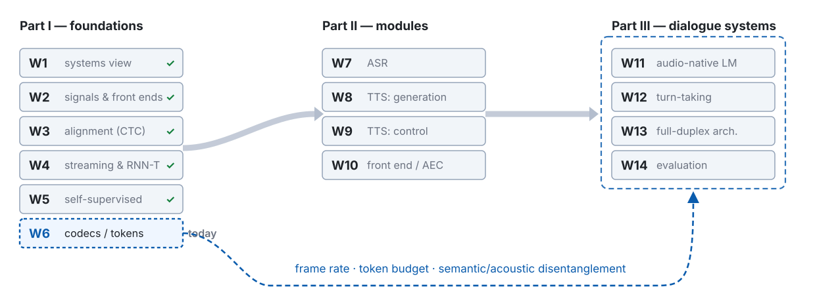

---
# 此檔由 bin/publish_slides.py 從投影片正本產生（中文講稿區塊已剝除），請勿直接編輯。正本在 private repo 的 <course>/slides/。
title: "Neural Audio Codecs and Discretization: Turning Speech into a Language"
subtitle: "Speech Processing & Human–Machine Interaction · Week 6"
author: "Hung-Shin Lee"
lang: en
format:
  revealjs:
    theme: [default, theme.scss]
    slide-number: c/t
    show-slide-number: all
    # 目標顯示尺寸：1280×800（16:10）。設成剛好填滿。
    # margin 預設 0.1 會把 deck 縮到 90% 才顯示（1152×720），白白損失一成字級。
    width: 1280
    height: 800
    margin: 0.04
    center: false
    progress: true
    transition: none
    # 章節標題會產生垂直堆疊；linear 讓左右鍵逐張前進，講課時才不會跳章
    navigation-mode: linear
    incremental: false
    # inline SVG 的 fragment（）在 ?print-pdf 裡要全部可見，不要每個 fragment 一頁
    pdf-separate-fragments: false
    chalkboard:
      buttons: true
    html-math-method:
      method: katex
      url: "https://cdn.jsdelivr.net/npm/katex@0.18.7/dist/"
    # 講稿（notes 區塊）裡的數學只輸出 MathML（與 w02.qmd～w05.qmd 相同的做法）。
    # presenter view 是另一個視窗，沒有 KaTeX 的 CSS；KaTeX 預設同時輸出 HTML 與 MathML，
    # 沒有 CSS 時兩份都會顯示，符號就重複了（例如 ℓℓ）。MathML 由瀏覽器原生排版，不需要 CSS。
    include-after-body:
      - text: |
          
---

# A language for speech {.section-title}

## Where we are: week 6 of 14

{width="100%"}

## Last week, in one picture



::: {.claim}
**Week 5 built a target out of nothing — and never rebuilt the waveform.** Change the target to the waveform, and three things change with it.
:::

::: {.footer}
W5 p34 four targets in one row · W5 p62's last sentence
:::

## The problem this week handles, in one picture



::: {.claim}
A codec **invents an alphabet for speech** — and every choice in it is a trade among the quantiser, the objective, and the frame rate.
:::

::: {.footer}
Route: quantiser → stacking + objective → listen, count → voice and words → frame rate
:::

## Notation for today

| Symbol | Meaning |
|:--------|:------------------|
| $\mathbf{x}$, $f_s$, $\hat{\mathbf{x}}$ | waveform (W2's sampling rate); its reconstruction |
| $s_{\text{c}}$, $f_r = f_s / s_{\text{c}}$ | the encoder's total stride; **frame rate** in Hz (**not** W4's $s$, an ASR subsampling factor) |
| $\mathbf{z}_t \in \mathbb{R}^d$, $\mathbf{q}_t$, $\hat{\mathbf{z}}_t$ | latent; quantised latent; the sum of $n_q$ stages (W5's $\mathbf{z}_t$, $\mathbf{q}_t$) |
| $V$, $\mathbf{e}_v$, $\mathbf{e}^{(i)}_v$, $k_{t,i}$ | codebook size and codeword (W5); stage-$i$ codeword; chosen index at stage $i$ |
| $N_q$, $n_q \leq N_q$, $\mathbf{r}_{t,i}$ | RVQ stages (**not** W5's $N$, a sample count; **not** W4's $\mathbf{Q}$); stages used; residual after stage $i$ |
| $\mathrm{sg}[\cdot]$, $\beta$, $\mu$, $c_v$, $\mathbf{m}_v$, $n_v$ | stop-gradient; commitment weight (VQ-VAE); EMA decay (the paper's $\gamma$); EMA count and sum; hits of code $v$ in one step |
| $\Lambda_j$ | FSQ levels per dimension (the paper's $L$; our $L$ is W2's window) |
| $B$, $R_{\text{tok}}$, $\mathcal{L}_{\cdot}$, $\lambda_{\cdot}$, $\Phi_j$ | bitrate; token rate; losses and weights; discriminator $j$ (**not** $D$ — W1's delays) |

::: {.footer}
$\log_2$ for bits, $\ln$ otherwise · vectors bold, scalars italic, functions upright
:::

## Five things to leave with today

1. **The VQ-VAE loss has three terms and each moves one group of parameters.** Straight-through copies a gradient from $\mathbf{q}_t$ to $\mathbf{z}_t$ — biased by the gap $\lVert \mathbf{z}_t - \mathbf{e}_{k_t} \rVert$ — and the commitment term shrinks that gap. The EMA update is online k-means.
2. **Residual VQ and its bill**: $B = f_r N_q \log_2 V$; residual energy decays stage by stage, so the first stages buy the most, quantizer dropout makes one model serve many bitrates — and *most energy* in stage 1 is not *the semantics*.
3. **Codebook collapse has two causes and five remedies**, and FSQ removes it by construction at the price of a low-dimensional bottleneck.
4. **Two kinds of token**, acoustic and semantic, each missing half; three ways to unify them (distillation, split RVQ, one big codebook) — and why AudioLM stacked them.
5. **The arithmetic**: token rate, 30 minutes of context, decoding steps per second, and a latency floor of $1/f_r$ — the cell of W1's budget we fill today.

# VQ-VAE: inventing the alphabet {.section-title}

## Why discrete: an LM reads an index, not a vector



::: {.claim .fragment fragment-index=2}
The decoder never sees $\mathbf{z}_t$. Everything downstream — W8's TTS, W11's LM — sees only the **integer matrix** $N_q \times T$.
:::

::: {.footer}
SoundStream / EnCodec: 75 Hz at 24 kHz, strides $(2, 4, 5, 8)$ · Mimi: 12.5 Hz
:::

## At a glance: Vector-Quantised VAE (VQ-VAE)

::: {.prose}
| | |
|:---|:-----------------|
| **Name** | **Vector Quantised-Variational AutoEncoder** (VQ-VAE), van den Oord, Vinyals & Kavukcuoglu, NeurIPS 2017. Three years before wav2vec 2.0's Gumbel quantiser (W5 p21), and without its softmax. |
| **The question** | An autoencoder whose bottleneck is a choice among $V$ codewords: how do you train through a choice that has no gradient? |
| **The idea** | Snap each $\mathbf{z}_t$ to its nearest codeword, copy the decoder's gradient straight through the snap, and add two terms that pull the codebook and the encoder toward each other. |
| **What it added** | A **discrete** code with a separately learned prior. The abstract: the encoder "outputs discrete, rather than continuous, codes; and the prior is learnt rather than static." Every codec today keeps that split. |
| **What it leaves open** | The copied gradient is biased (p12); a codeword nobody picks never moves (p14); one codebook is far too small for a waveform (p20). |
:::

::: {.footer}
van den Oord et al., NeurIPS 2017, abstract · straight-through: W5 p21 · the mechanism: p11–p13
:::

## The three-term loss, and which parameters each term moves



::: {.fragment fragment-index=1}
$$\mathcal{L} = \underbrace{\mathcal{L}_{\text{rec}}(\mathbf{x}, \hat{\mathbf{x}})}_{\text{decoder; encoder via straight-through}} + \underbrace{\lVert \mathrm{sg}[\mathbf{z}_t] - \mathbf{e}_{k_t} \rVert_2^2}_{\text{codebook only}} + \beta\,\underbrace{\lVert \mathbf{z}_t - \mathrm{sg}[\mathbf{e}_{k_t}] \rVert_2^2}_{\text{encoder only}}$$
$$\mathbf{q}_t = \mathbf{e}_{k_t},\qquad k_t = \arg\min_v \lVert \mathbf{z}_t - \mathbf{e}_v \rVert_2$$
:::

::: {.footer}
van den Oord et al. 2017 §3.2 · $\beta = 0.25$, insensitive from 0.1 to 2.0
:::

## Straight-through: where the bias is, what commitment buys



::: {.claim .fragment fragment-index=3}
**Same trick as W5, different ending.** Gumbel-VQ's backward pass is a softmax at temperature $\tau$, annealed toward the hard choice; VQ-VAE's is the identity, with no knob — so the bias can only be squeezed, by $\beta$.
:::

::: {.footer}
VQ-VAE §3.2: without it the encoder output "can grow arbitrarily" · W5 p21
:::

## The EMA codebook update is online k-means

::: {.fragment fragment-index=0}
$$c_v^{(\tau)} = \mu\, c_v^{(\tau-1)} + (1-\mu)\, n_v^{(\tau)},\qquad \mathbf{m}_v^{(\tau)} = \mu\, \mathbf{m}_v^{(\tau-1)} + (1-\mu) \sum_{t:\,k_t = v} \mathbf{z}_t$$
$$\mathbf{e}_v \leftarrow \mathbf{m}_v / c_v \qquad\text{— a decaying average of every latent assigned to } v$$
:::

::: {.fragment fragment-index=1}
$$\text{k-means M-step:}\quad \mathbf{e}_v \leftarrow \frac{1}{\lvert \{t : k_t = v\} \rvert} \sum_{t:\,k_t = v} \mathbf{z}_t \qquad\text{— the same mean, over the whole data set}$$
:::

::: {.claim .fragment fragment-index=2}
**Replace the codebook loss by this and nothing is lost**: the codebook was always doing k-means. $\mu \to 1$ recovers the batch M-step; W5's HuBERT ran the same algorithm offline and called the result a *teacher*. Today it is an *alphabet*.
:::

::: {.footer}
VQ-VAE App. A.1, eqs. 6–8 · VQ-VAE-2 §2.1 · "online k-means" is our reading
:::

## MC 1 — "a bigger codebook is a better codebook"

| | what you set | what you get, if nothing is done about it |
|:---|:----------|:---------------|
| **init** | $V = 1024$, $d = 1024$, random | most codewords start **far from the data** and are never the nearest neighbour |
| **update** | the codebook loss, or EMA | moves **only the codeword that was chosen** — an unchosen code never moves |
| **size** | a bigger $V$ | more codes that are never chosen; the *effective* alphabet is the number of codes in use |
| **W5's fix** | the diversity loss | needs a soft, contrastive setting to push against; we know of no codec that uses it |

::: {.claim}
**Codebook collapse has two causes**: an initialisation outside the data's support, and an update rule that only touches winners. Capacity is the alphabet you *use*, not $V$.
:::

::: {.footer}
DAC (Descript Audio Codec) §3.2: 8-d $\ell_2$ lookups "significantly improve codebook usage"
:::

## Before Demo 3: dead codes you can see

::: {.prose}
| | |
|:---|:-----------------|
| **Why** | The last slide named two causes of collapse — a codebook initialised outside the data, and an update that only moves the chosen code — and the slide before it claimed EMA is online k-means. In two dimensions all of this is visible. |
| **What runs** | Pure numpy, a terminal and one plot window. Four Gaussian clusters inside $[3, 6]^2$, a codebook of $V = 16$ initialised from $\mathcal{N}(\mathbf{0}, \mathbf{I})$ — deliberately outside the data. Five ways to train it, 200 steps each: gradient on the codebook loss; EMA; k-means initialisation; dead-code reset; FSQ with $\Lambda = (4, 4)$. Each prints how many codes are used and the quantisation error. |
| **Watch for** | Whether EMA alone revives any code. Where the used codes sit relative to the dashed data box. What FSQ does without any codebook at all. |
:::

::: {.footer}
Demo 3 · code: `demos/w06_d3_dead_codes` · numpy only, CPU
:::

## Demo 3 — sixteen codes, four clusters, five ways to train

::: {.ask}
**Demo 3.** Before the panels appear: the random-init codebook uses 2 of 16 codes with gradient updates. Switch to EMA — how many does it use?
:::



::: {.footer}
Demo 3 · demos/w06_d3_dead_codes · seed 20261017 · numbers: w06-data.json
:::

## Five remedies in one row

| remedy | what it fixes | source |
|:------|:--------------|:-------|
| **EMA update** | gradient noise on the codebook — *not* collapse (Demo 3, panel 2) | VQ-VAE App. A.1; VQ-VAE-2 |
| **k-means initialisation** | the first cause: start every code inside the data (first batch) | SoundStream §III-C; Łańcucki et al. 2020 |
| **dead-code reset** | the second cause: a code unassigned for several batches is replaced by a random input frame of the current batch | Jukebox; SoundStream §III-C |
| **low-dim, $\ell_2$-normalised lookup** | far-away codes: in 8 dimensions with unit norm the nearest neighbour is a cosine, and no code is "too far" | ViT-VQGAN §3.2 (32 / 8-d); DAC §3.2 |
| **FSQ** (finite scalar quantization) | removes the codebook, hence the problem — at a price (next slide) | Mentzer et al., ICLR 2024 |

::: {.footer}
all five act on the quantiser freedom · the objective and the frame rate come next
:::

## FSQ: no codebook, no collapse — and what it costs



::: {.fragment fragment-index=0}
$$\hat{z}_j = \mathrm{round}\!\big(\lfloor \Lambda_j / 2 \rfloor \tanh z_j\big),\qquad j = 1, \dots, d,\qquad \text{implicit codebook size } {\textstyle \prod_j \Lambda_j}$$
:::

::: {.claim .fragment fragment-index=2}
**Low dimension is the remedy, in both DAC and FSQ**: DAC looks its codebook up in 8 dimensions; FSQ has none and lives in $d \approx \log_3 V$ to $\log_8 V$.
:::

::: {.footer}
Mentzer §5.3: 99% usage · TAAE (Transformer Audio AutoEncoder): FSQ, 400 / 700 bps
:::

# Stacking the letters, and what the objective puts in them {.section-title}

## At a glance: Residual Vector Quantisation (RVQ)

::: {.prose}
| | |
|:---|:-----------------|
| **Name** | **Residual vector quantisation** (RVQ), SoundStream's "a.k.a. multi-stage vector quantizer": Juang & Gray built it for speech coding (ICASSP 1982); SoundStream put it in a neural codec (TASLP 2022). |
| **The question** | 6 kbps at 75 frames a second is 80 bits a frame. One codebook would need $2^{80}$ codewords — "obviously unfeasible". How else can 80 bits be spent? |
| **The idea** | Quantise, subtract, quantise what is left: $N_q$ small codebooks in a chain, each on the residual of the stage before; the decoder sums the stages. |
| **What it added** | $V^{N_q}$ effective codewords for $N_q V d$ parameters — eight stages of 1024 are exactly those 80 bits — and coarse-to-fine stages, so one model can stop at any $n_q$ (p23). |
| **What it leaves open** | $N_q$ tokens per step, dependent by construction: the LM's problem (W13). And the stage with the most energy need not carry the meaning (MC 2, p24). |
:::

::: {.footer}
SoundStream §III-C · Juang & Gray, ICASSP 1982 · the mechanism: p21–p23
:::

## Residual VQ: big letters first, then the corrections



::: {.fragment fragment-index=3}
$$\mathbf{r}_{t,0} = \mathbf{z}_t,\qquad \mathbf{q}_{t,i} = \mathrm{VQ}_i(\mathbf{r}_{t,i-1}),\qquad \mathbf{r}_{t,i} = \mathbf{r}_{t,i-1} - \mathbf{q}_{t,i},\qquad \hat{\mathbf{z}}_t = \sum_{i=1}^{n_q} \mathbf{q}_{t,i},\qquad B = f_r\, N_q \log_2 V$$
:::

::: {.footer}
Juang & Gray, ICASSP 1982 · SoundStream §III-C · $V^{N_q}$ codewords, $N_q V d$ parameters
:::

## The residual shrinks: making change, and where it fails



::: {.fragment fragment-index=2}
$$R(\mathcal{D}) = \tfrac{1}{2}\log_2\!\big(\sigma^2 / \mathcal{D}\big)\qquad\text{— one more bit per dimension halves the distortion}$$
:::

::: {.footer}
measured by Demo 2 (2026-10-18) · Cover & Thomas, Ch. 10, for the Gaussian line
:::

## Quantizer dropout: one model, one knob, five bitrates



::: {.claim .fragment fragment-index=1}
Because the late residual is nearly noise, **dropping the late stages costs little** — and a decoder that has seen every truncation can decode any prefix. One model covers 1.5 to 24 kbps.
:::

::: {.footer}
SoundStream §III-C · EnCodec §3.2: codebooks a multiple of 4 · DAC: $p = 0.5$
:::

## MC 2 — "the first codebook carries the semantics"

| | what the residual curve shows | what it does *not* show |
|:---|:----------|:---------------|
| **stage 1** | carries the most **energy** — the coarse spectral envelope and pitch | that it carries the **content** |
| **later stages** | carry less, and the late ones look like noise | that they are "detail" in any linguistic sense |

::: {.claim}
**Most energy $\neq$ the semantics.** AudioLM had to put w2v-BERT's semantic tokens *on top of* SoundStream's 12 acoustic stages because the first acoustic stage was not semantic enough; and from semantic tokens alone the speaker was gone — speaker classification 3.2%. "Stage 1 = semantics" becomes true only through **distillation** (p39).
:::

::: {.footer}
AudioLM §IV-B, §IV-D Table III · this outline's own old version got this wrong
:::

## SoundStream, EnCodec, DAC: three codecs, one table

| | SoundStream (2021) | EnCodec (2022) | DAC (2023) |
|:--|:--|:--|:--|
| $f_s$, strides, $f_r$ | 24 kHz, $(2,4,5,8)$, 75 Hz | 24 kHz, $(2,4,5,8)$, 75 Hz (48 kHz: 150) | 44.1 kHz, stride 512, 86 Hz |
| $N_q$, $V$ | RVQ, $V = 1024$ | up to 32 codebooks, $V = 1024$ | 9 codebooks, 10 bit ($V = 1024$) |
| bitrate | 3 kbps and up | 1.5 / 3 / 6 / 12 / 24 kbps | 8 kbps |
| codebook care | k-means init, dead-code reset | EMA (0.99) + dead-code reset, "the same training procedure" as Jukebox / SoundStream | **8-dim $\ell_2$ lookup**, dropout $p = 0.5$ |
| discriminators | multi-res. waveform + STFT | **multi-scale STFT** (MS-STFT) | multi-period + **multi-band** |
| what it added | the recipe | the loss balancer; streamable / non-streamable | codebook usage; multi-scale mel loss |

::: {.footer}
SoundStream §III · EnCodec §3.1–3.4 · DAC Table 1, §3.2
:::

## Why a reconstruction loss is not enough: the recipe



::: {.fragment fragment-index=0}
$$\mathcal{L}_{\text{spec}} = \sum_{\text{scale}} \lVert \log\mathrm{mel}(\mathbf{x}) - \log\mathrm{mel}(\hat{\mathbf{x}}) \rVert_1$$
:::

::: {.fragment fragment-index=1}
$$\mathcal{L}_{\text{adv}} = \sum_j \mathbb{E}\max\big(0,\, 1 - \Phi_j(\hat{\mathbf{x}})\big),\qquad \mathcal{L}_{\text{feat}} = \sum_j \sum_{\ell} \lVert \Phi_j^{(\ell)}(\mathbf{x}) - \Phi_j^{(\ell)}(\hat{\mathbf{x}}) \rVert_1$$
:::

::: {.fragment fragment-index=2}
$$\mathcal{L} = \lambda_{\text{spec}}\mathcal{L}_{\text{spec}} + \lambda_{\text{adv}}\mathcal{L}_{\text{adv}} + \lambda_{\text{feat}}\mathcal{L}_{\text{feat}} + \mathcal{L}_{\text{VQ}}\ (+\ \mathcal{L}_{\text{dist}})$$
:::

::: {.footer}
SoundStream §III-E · MelGAN · HiFi-GAN · W2 p52: the three reasons a vocoder exists
:::

## MC 3 — "the discriminator is just for sound quality"

::: {.ask}
**Before the answer:** take the discriminators away and train the same codec with $\mathcal{L}_{\text{spec}}$ alone, at the same bitrate. Do the tokens now carry **more** information or **less**?
:::

::: {.fragment}
| | with the adversary | without it |
|:---|:----------|:---------------|
| **phase, fine structure** | the decoder invents them; tokens only **condition** them | the decoder must reproduce them; tokens must **encode** them |
| **at a fixed bitrate** | tokens are more abstract, the output is crisp | bits go to detail, and the output is still over-smoothed (W2) |
| **Mimi's extreme** | an experiment with **only** the feature and discriminator losses: "a remarkable boost in audio quality", MUSHRA 81.0 vs 58.8 | — |
:::

::: {.footer}
Moshi §3.3.1, Table 4 · whether the released Mimi is that variant: not stated · W2 p52
:::

## Training and use: the losses leave, both halves stay — apart



::: {.claim .fragment fragment-index=2}
**Unlike W5, nothing is thrown away** — but the two halves never run together again, and what the objective put into the matrix is all the LM ever gets.
:::

::: {.footer}
SoundStream Fig. 2: transmitter / receiver · W5 p37 · W8, W11
:::

## MC 4 — "neural codecs beat Opus — their tables say so"

| | the sentence | what it actually claims |
|:--|:--------------|:--------------|
| **SoundStream**, abstract | 3 kbps "outperforms Opus at 12 kbps and approaches EVS at 9.6 kbps" | **a quarter of the bitrate**, in their own listening test |
| **EnCodec** §4.5 | 3 kbps "better … on average than Lyra-v2 using 6 kbps and Opus at 12 kbps" | an average; on clean speech Opus 12 kbps still beats EnCodec 3 kbps |
| **RFC 6716** §2 | Opus: frames 2.5–60 ms, algorithmic delay 5–65.2 ms | Opus's edge is **delay**, compute and a standard — not contested |
| **the scores** | MUSHRA, each paper's own listeners, anchors and grid; the same EVS scored twice | **re-anchored every time**: compare only inside one table, or one shared benchmark |

::: {.small}
MUSHRA = Multi Stimulus test with Hidden Reference and Anchor (ITU-R BS.1534) · shared benchmarks: Codec-SUPERB (Findings of ACL 2024), ESPnet-Codec (SLT 2024), DASB = Discrete Audio and Speech Benchmark (TMLR 2026)
:::

::: {.claim}
Neural codecs win on **quality per bit at low bitrates**, in tests that do not cross papers — "better" needs a bitrate, a latency budget and one table.
:::

::: {.footer}
SoundStream abstract · EnCodec §4.5, Table 1 · RFC 6716 · EVS = Enhanced Voice Services (3GPP)
:::

# What each stage holds: listen, then count {.section-title}

## At a glance: Mimi

::: {.prose}
| | |
|:---|:-----------------|
| **Name** | **Mimi**, Kyutai's streaming codec: the tokenizer inside Moshi (Défossez et al., technical report, 2024, §3.3). Moshi itself is W11 and W13. |
| **The question** | Can one tokenizer give an LM few tokens a second, hold the words, rebuild the voice — and stream? |
| **The idea** | 24 kHz in, 12.5 Hz out; every convolution causal, a Transformer on each side of the bottleneck. Each 80 ms frame gets a plain VQ distilled toward WavLM (W5 p31), beside a 7-stage acoustic RVQ: 8 tokens, $V = 2048$. |
| **What it added** | A frame rate six times below EnCodec's — 1.1 kbps, 100 tokens a second — with a *semantic* and an *acoustic* stream from one model. Moshi is trained on these tokens. |
| **What it leaves open** | Does the distilled codebook alone hold the words? Demo 1, next. Why split, instead of distilling into stage 1 of one RVQ? p39. |
:::

::: {.footer}
Moshi §3.3.1–3.3.2: $D = 512$, $N_q = 8$, $V = 2048$, causal · the bill at 12.5 Hz: p44
:::

## Before Demo 1: adding the letters back, one stage at a time

::: {.prose}
| | |
|:---|:-----------------|
| **Why** | Every claim so far about what the stages carry — energy first, detail later, content only through distillation — can be heard. Reconstruct the same sentence with more and more stages, and with stage 1 alone. |
| **What runs** | Three codecs through `transformers`: Mimi at $n_q = 1, 2, 4, 8$; EnCodec 24 kHz at 1.5 / 3 / 6 / 12 / 24 kbps; DAC at $n_q = 1, 2, 4, 8$. Two inputs: the W3 LibriSpeech sentence, and one Mandarin sentence recorded by me. One key per setting; the screen shows $f_r$, $n_q$, $B$ and the reconstruction's log-mel. |
| **Watch for** | With Mimi's stage 1 alone: is the content intelligible, and what happens to the voice? For the Mandarin sentence: are the four tones still there? |
:::

::: {.footer}
Demo 1 · code: `demos/w06_d1_layer_listen` · inference only · my recording is not published
:::

## Demo 1 — Mimi 1 / 2 / 4 / 8, EnCodec 2 … 32, DAC: listen

::: {.ask}
**Demo 1.** Before playing: Mimi with stage 1 only, at 137 bps. What do you expect to hear?
:::

::: {.fragment}
| setting | $f_r$ | $n_q$ | $B$ | what we heard (rehearsal) |
|:--------|----:|------:|---------:|:-------------|
| Mimi, 1 / 2 / 4 / 8 | 12.5 Hz | 1 / 2 / 4 / 8 | 0.14 / 0.28 / 0.55 / 1.1 kbps | stage 1: **neither words nor voice** (prediction failed); back by stage 8 |
| EnCodec 24 kHz | 75 Hz | 2 / 4 / 8 / 16 / 32 | 1.5 / 3 / 6 / 12 / 24 kbps | 1.5 kbps: words **and** voice clearer than Mimi stage 1 — tenfold bitrate wins |
| DAC 24 kHz, 1 / 2 / 4 / 8 | 75 Hz | 1 / 2 / 4 / 8 | 0.75 / 1.5 / 3 / 6 kbps | 750 bps: also clearer than Mimi stage 1 |
:::

::: {.footer}
Demo 1 · demos/w06_d1_layer_listen · $B = f_r n_q \log_2 V$ · last column: rehearsal 2026-10-19, one listener
:::

## Demo 1 — stage 1 only, in Mandarin: is the tone still there?

::: {.ask}
**Demo 1, second input.** Four tones, stage 1 only. Can you still tell 媽 / 麻 / 馬 / 罵 apart? Write down yes or no before it plays.
:::

::: {.fragment}
| | prediction from the design | what we heard (rehearsal) | $F_0$ track |
|:------|:--------------|:--------------|:------|
| Mimi, $n_q = 1$ | tone **flattened**: W5's units carry little $F_0$, and distillation carries that over | **flattened** — the four tones could not be told apart, and the words went with them | RMSE 57 Hz, voicing agreement 0.49 |
| Mimi, $n_q = 8$ | tone back, carried by stages 2–8 | tones **back** | RMSE 5.4 Hz, 0.86 |
| EnCodec, 1.5 kbps | tone **kept**: pitch is where the energy is | tones **kept** | RMSE 23 Hz, 0.86 |
:::

::: {.claim .fragment}
$F_0$ is a physical quantity, pitch is a percept (W2 p56): the plot is a reference, **the ear is the judge** — and whatever we hear, we say it out loud.
:::

::: {.footer}
prediction from the design · heard: rehearsal 2026-10-19, one sentence, one listener · W2 p56, p62 · W5 p49 · unit-level evidence: p42
:::

## Before Demo 2: what the letters look like

::: {.prose}
| | |
|:---|:-----------------|
| **Why** | We have heard what the stages carry; now look at the tokens themselves. Three claims so far rest on a picture or a sentence — the residual curve (p22), "stage 1 is the most language-like", and how many codes are actually used — and all three are measured on real codecs here: the curve on p22 already came from this demo. |
| **What runs** | The same sentence through Mimi, EnCodec and DAC: the $N_q \times T$ matrix printed in the terminal. Then, on the W5 dev-clean subset (40 speakers × 10 sentences, cached): per stage, the number of codes used and the unigram entropy over $\log_2 V$; the residual-energy curve $\mathbb{E}\lVert \mathbf{r}_{t,i} \rVert^2 / \mathbb{E}\lVert \mathbf{z}_t \rVert^2$; and, for stage 1, the bigram conditional entropy against the unigram one. |
| **Watch for** | Which stage has the longest runs of repeated tokens. Whether the usage and entropy ratios fall with the stage — and what that says about the late residual. Where Mimi's semantic path sits relative to its acoustic path. |
:::

::: {.footer}
Demo 2 · code: `demos/w06_d2_token_matrix` · the arithmetic half comes at p44
:::

## Demo 2 — token matrix, codebook usage, residual curve

::: {.ask}
**Demo 2.** Before the numbers: EnCodec has 8 stages of 1024 codes at 6 kbps. Guess the usage ratio of stage 1 and of stage 8.
:::

::: {.fragment}
| | codes used / $V$, stage 1 / 2 / 4 / 8 / 32 | $H_1 / \log_2 V$, stage 1 / 2 / 4 / 8 / 32 | residual energy after stage 1 / 2 / 4 / $N_q$ | $H_2 / H_1$, stage 1 |
|:--|:--|:--|:--|:--|
| Mimi (S + 31 RVQ in the weights) | 0.71 · 0.82 · 0.96 · 0.98 · 0.92 | 0.90 · 0.89 · 0.91 · 0.92 · 0.94 | S 0.36 · A 0.17 / 0.13 / 0.09 / 0.01 | 0.36 (S), 0.46 (A1) |
| EnCodec 24 kHz, 32 stages | 0.78 · 0.95 · 0.98 · 0.90 · **0.50** | 0.78 · 0.85 · 0.86 · 0.86 · 0.85 | 0.03 / 0.03 / 0.02 / 0.001 | 0.67 |
| DAC 24 kHz, 32 stages | 0.94 · 1.00 · 1.00 · 1.00 · 1.00 | 0.78 · 0.92 · 0.98 · 0.99 · 1.00 | 0.67 / 0.60 / 0.49 / **0.72** (min 0.40 at 9) | 0.80 |
:::

::: {.footer}
Demo 2 · demos/w06_d2_token_matrix · dev-clean 40 × 10 · measured 2026-10-18
:::

# Can one alphabet hold both the voice and the words? {.section-title}

## Predicted and reconstructed: two tokens, each missing half



::: {.claim .fragment fragment-index=1}
Acoustic tokens can rebuild the voice but entangle **who, where and what**; semantic tokens keep *what* and lose the voice. **Every tokenizer since 2023 asks whether one tokenizer can do both.**
:::

::: {.footer}
W5 p49 · AudioLM, TASLP 2023 · the alphabet's second failure: letters hold only content
:::

## SpeechTokenizer and Mimi: W5's unit, back inside the codec



::: {.claim .fragment fragment-index=2}
**Why split:** distilling into stage 1 of one RVQ hurts quality — stage 1 is pushed to look like WavLM and the other seven must make up the rest. So Mimi pulls the semantic VQ out and runs the acoustic RVQ beside it.
:::

::: {.footer}
SpeechTokenizer §3.2, App. E · Moshi §3.3.2 · $\mathcal{L}_{\text{dist}}$: a cosine distance
:::

## MC 5 — "a semantic token is a phoneme"

| | W5 measured | this week adds |
|:---|:----------|:---------------|
| **the unit** | HuBERT units are not phonemes: one id per 20 ms, context-dependent, redundant (W5 p46) | Mimi's first codebook is a VQ trained to be **cosine-close to WavLM**, not a phone classifier |
| **the probe** | purity was measured, not assumed (Demo 2) | on TIMIT, segmental information is **not confined to codebook 1**, and its tokens correspond to **allophones**, not phonemes |

::: {.claim}
Demo 1 did **not** go as predicted: stage 1 alone kept neither the words nor the voice. "Semantic" names what the codebook was trained *towards*, not what the ear gets back from it alone — and the tone answer is on p34.
:::

::: {.footer}
Saloev et al., ICNLSP 2026 (TIMIT) · W5 p45–p48 · "semantic" names a target, not a claim
:::

## One codebook, no residual: WavTokenizer, BigCodec, TAAE

| | WavTokenizer (ICLR 2025) | BigCodec (2024, preprint) | TAAE (ICLR 2025) |
|:--|:--|:--|:--|
| quantiser | one codebook, $V = 4096$ | one codebook, $V = 8192$ | FSQ bottleneck |
| rate | 40 or 75 tokens / s at 24 kHz | 1.04 kbps at 16 kHz | 400 / 700 bps at 16 kHz |
| bitrate at 75 Hz | 0.9 kbps | — | — |
| how usage is kept | k-means initialisation | a low-dimensional VQ | no codebook |
| decoder | iSTFT (Vocos) with attention | — | a Transformer codec |

::: {.claim}
The third answer: **make the one codebook big and the frame rate low**, so a time step is one token and the LM needs no depth transformer. The cost is paid by the decoder — and by everything a single code must now carry.
:::

::: {.footer}
Ji et al. · Xin et al. · Parker et al. · Vocos, ICLR 2024 · other frame rates are derived
:::

## Tone: evidence at the unit level, a blank at the codec level

::: {.ask}
**Before the answer:** distil WavLM into the first codebook. Where does lexical tone go?
:::



::: {.claim .fragment fragment-index=2}
At the unit level this is **measured**; at the codec level it is a **prediction** — and p34 is where we listened. For Mandarin, Taiwanese and Hakka, a token that drops tone drops the word.
:::

::: {.footer}
Osakuade & King, Speech Prosody 2026 · Saloev et al. 2026 · W2 p62 · W5 p49
:::

# How many letters per second, and who pays {.section-title}

## Demo 2 — the bill: token rate, context, steps, and the floor

::: {.ask}
**Demo 2, second half.** A 30-minute conversation. Before the table: how many Mimi tokens — and how many text tokens?
:::

::: {.fragment}
| | $f_r$ | $N_q$ | $R_{\text{tok}} = f_r N_q$ | context, 30 min | steps / s, flatten | steps / s, RQ-Transformer | $1/f_r$ |
|:--|--:|--:|--:|--:|--:|--:|--:|
| EnCodec 24 kHz, 6 kbps | 75 Hz | 8 | 600 /s | 1.08 M | 600 | 75 | 13 ms |
| SpeechTokenizer | 50 Hz | 8 | 400 /s | 720 k | 400 | 50 | 20 ms |
| Mimi | 12.5 Hz | 8 | 100 /s | 180 k | 100 | 12.5 | 80 ms |
| text (Gemma 4 tokenizer) | — | — | 2.8 /s | 5.1 k | 2.8 | — | — |
:::

::: {.claim .fragment}
Every column is a function of the three freedoms. **Speech tokens outnumber text tokens by one to two orders of magnitude** — the other half of W11's modality gap — and the floor rises exactly as the token rate falls.
:::

::: {.footer}
Demo 2 · codecs: arithmetic · text: one sentence × 30 min, 2026-10-18 · RQ = residual-quantized
:::

## MC 6 — "lower bitrate is always better"

::: {.ask}
**Stop and ask:** Mimi chose 12.5 Hz for the LM's sake. Why not 6.25 Hz?
:::

| | a lower $f_r$ (or fewer stages) buys | and costs |
|:---|:----------|:---------------|
| **tokens** | fewer per second, shorter context, fewer decoding steps | intelligibility and quality: one 80 ms frame may hold a whole short syllable, which one codebook cannot carry alone |
| **latency** | a cheaper LM | a higher floor $1/f_r$: 80 ms at 12.5 Hz, 160 ms at 6.25 Hz — before anything else in the budget |
| **reaction** | — | coarser: W13's model decides once per frame |

::: {.claim}
Three goals pull against each other — feed the LM, keep the voice, react fast — and **that conflict is why split RVQ and semantic / acoustic streams exist at all.**
:::

::: {.footer}
Moshi §3.3.1 · Gichamba & Busogi 2026 on the 6.25 Hz cliff · the course's misconception list
:::

## MC 7 — "frame rate is an implementation detail"



::: {.fragment fragment-index=2}
$$D_{\text{codec}} \geq 1/f_r + \text{lookahead}$$
:::

::: {.claim .fragment fragment-index=2}
**Frame rate is a first-order design choice** — context, step count, latency floor and reaction granularity, all at once. Mimi chose it *for the LM*, not for the signal.
:::

::: {.footer}
arithmetic (w06-data.json) · W2: the hop · W4 / W5: the stride · W6: somebody chose
:::

## 2026: letters that do not align — dynamic frame rates

| | the failure of the alphabet metaphor | the 2026 answer |
|:---|:----------|:---------------|
| **a fixed grid** | one token every 80 ms, whether that holds half a syllable or a pause | **FlexiCodec** (ICLR 2026): merge semantically similar frames; 3–12.5 Hz controllable at inference |
| **a fixed rate** | for a signal whose information rate is not fixed | **CodecSlime** (ICASSP 2026): a dynamic-frame-rate plug-in; an 80 Hz backbone run at 40 Hz |
| **no alignment** | letters that align to nothing linguistic | **DyCAST** (2026, preprint): tokens roughly aligned to characters, 6–18 Hz |
| **"lower is worse"** | the quality cliff at 6.25 Hz | **Gichamba & Busogi** (Interspeech 2026): it comes from the training setup — too few tokens per fixed-length clip — not from the rate |

::: {.footer}
Li et al. · Wang et al. · Della Libera et al. · Gichamba & Busogi · all 2026
:::

# Two last misconceptions, then back to the three axes {.section-title}

## MC 8 — "a good PESQ makes a good LM input"

| | reconstruction metrics | LM-friendliness |
|:---|:----------|:---------------|
| **what is measured** | the **decoder's output**: PESQ, ViSQOL, MUSHRA, UTMOS | the **token sequence**: its entropy, long-range structure, drift across speakers |
| **so** | a high-fidelity codec can score top here | and still give tokens that are high-entropy and weakly structured — hard to model |

::: {.small}
PESQ: Perceptual Evaluation of Speech Quality (ITU-T P.862) · ViSQOL: Virtual Speech Quality Objective Listener · UTMOS: a learned MOS predictor (W9)
:::

::: {.claim}
Benchmarks that measure the two **separately** exist for this reason: Codec-SUPERB and DASB report reconstruction and downstream tasks apart; DASB's abstract: *"semantic tokens generally outperform acoustic tokens, but a gap remains between discrete tokens and continuous features."* Park et al. measure the tokens' own language statistics — Zipf, Heaps, entropy — and their correlation with WER and UTMOS.
:::

::: {.footer}
Codec-SUPERB 2024 · DASB, TMLR 2026, §5 · Park et al., ASRU 2025
:::

## MC 9 — "a codec token is like a text token"

| | text token | codec token |
|:---|:----------|:---------------|
| **rate** | ~2–3 per second of speech, read aloud | **10–100× more**: 100 to 600 per second |
| **per step** | one token | **$N_q$ tokens** — and the LM must decide how to order them |
| **dependence** | independent symbols | stage $i$ is the residual of stages $1 \dots i-1$: **dependent by construction** |
| **drift** | the same word is the same token for everyone | the distribution **drifts** with speaker, room and microphone |

::: {.claim}
Four differences, and the next two Parts are built on them: W11's modality gap comes from the first and the last; W13's multi-stream, RQ-Transformer and delay-pattern architectures are three answers to the second and third.
:::

::: {.footer}
W11 modality gap · W13: RQ-Transformer (Lee et al. 2022), delay pattern (MusicGen), Moshi
:::

## Representation: the rightmost slot, and a chosen clock

| W2's trio | who decided the frame rate | what the representation is |
|:------|:-----------|:---------------|
| log-mel (W2) | the hop: 10 ms, 100 Hz | a filterbank, fixed by hand |
| SSL feature (W5) | the CNN stride: 20 ms, 50 Hz | thirteen layers to choose from; a unit that is not a phoneme |
| **discrete token (W6)** | **a design choice**: 75 Hz for quality, 12.5 Hz for the LM | an integer matrix $N_q \times T$; what it carries depends on the objective |

::: {.claim}
The rightmost slot is filled — and for the first time the clock was **chosen**, not inherited. W5's unit came back as the first codebook; the other seven carry what it left out.
:::

::: {.footer}
W2 p67 · W5 p59 · Mimi: 12.5 Hz for the LM's sequence length, Moshi §3.3.1
:::

## Latency: the cell in W1's budget, filled in



::: {.claim .fragment fragment-index=2}
**A codec adds at least one frame**: $1/f_r$ plus any encoder lookahead. A causal codec drives the lookahead to zero at a price in quality — and the frame is also how often a full-duplex model may change its mind.
:::

::: {.footer}
W1 p36 · W4 p21 $D_{\text{alg}}$ · EnCodec streamable vs not · Mimi: causal, 80 ms frame
:::

## The three axes, and supervision's second answer

::: {.prose}
| Axis | What we now know |
|:---|:-----------------|
| **Representation** | W2's rightmost slot is filled: an integer matrix $N_q \times T$, a frame rate that was *chosen*, content that follows the objective; W5's unit returns as a distilled first codebook. |
| **Latency** | At least one frame, $1/f_r$, plus lookahead; causal codecs trade quality for zero lookahead; the frame rate is W13's reaction granularity. |
| **Supervision** | Still no labels, but a new target — **the waveform plus an adversary** — and a **teacher**: W5's trained model, distilled in. The answer to "where does the supervision come from" changes a second time. |
:::

::: {.claim}
**Three choices that constrain each other**: the quantiser decides whether the letters get used, the objective what they hold — the voice or the words, rarely both — and the frame rate writes **the bill** for every later week.
:::

## Reading, and next week

**Read this week**

- Zeghidour et al., *SoundStream*, IEEE/ACM TASLP 2022 — §III for the recipe (RVQ, quantizer dropout, k-means init and dead-code reset, the three losses); the abstract's sentence about Opus, read with p29 in mind
- Défossez et al., *Moshi*, 2024 (a technical report) — **§3.3 only**: Mimi — the split RVQ, the WavLM distillation, 12.5 Hz; keep §3.4 and §5 for W13
- van den Oord et al., *Neural Discrete Representation Learning*, NeurIPS 2017 — §3.2 and Appendix A.1: the three terms and the EMA update you derived today

**If one thing today was new to you, make it this one**

- Mentzer et al., *Finite Scalar Quantization: VQ-VAE Made Simple*, ICLR 2024 — §3 and Table 1: a quantiser with no codebook at all

**Next week — ASR: three paradigms, streaming, and the LLM turn**

Back to a world with transcripts. The encoder is W5's; the input may be W2's log-mel or today's tokens; and the three alignments of W3–W4 become three products. Every latency number from W1 and today comes due.

## Acronyms in this deck, A–H

| | |
|:----|:----------------|
| ASR | automatic speech recognition (W1) |
| BERT | Bidirectional Encoder Representations from Transformers (W5) |
| BPE | byte-pair encoding: a text tokenizer (W3) |
| CNN | convolutional neural network (W5) |
| DAC | Descript Audio Codec: the release name of "Improved RVQGAN" (p14) |
| DASB | Discrete Audio and Speech Benchmark (p29) |
| EMA | exponential moving average (W5) |
| EVS | Enhanced Voice Services: 3GPP's speech codec for LTE (p29) |
| FSQ | finite scalar quantization (p17) |
| HuBERT | Hidden-Unit BERT (W5) |

## Acronyms in this deck, L–R

| | |
|:----|:----------------|
| LLM, LM | large language model (W1); language model |
| MC | misconception: a belief that sounds right, and what breaks it |
| MOS | mean opinion score (W1) |
| MS-STFT | multi-scale STFT: EnCodec's discriminator (p25) |
| MSE, RMSE | mean squared error; its square root |
| MUSHRA | Multi Stimulus test with Hidden Reference and Anchor (p29) |
| PESQ | Perceptual Evaluation of Speech Quality (p49) |
| RFC | Request for Comments: the Internet's standards documents; RFC 6716 is Opus |
| RQ-Transformer | residual-quantized Transformer (p44) |
| RVQ | residual vector quantisation (p20) |

## Acronyms in this deck, S–W

| | |
|:----|:----------------|
| SSL | self-supervised learning |
| ST | SpeechTokenizer, in the p28 and p46 figures |
| STFT, iSTFT | short-time Fourier transform (W2); its inverse |
| TAAE | Transformer Audio AutoEncoder (p18) |
| TTS | text-to-speech (W1) |
| UTMOS | a learned MOS predictor, from UTokyo-SaruLab (p49) |
| ViSQOL | Virtual Speech Quality Objective Listener (p49) |
| VQ, VQ-VAE | vector quantisation (W5); Vector Quantised-Variational AutoEncoder (p10) |
| WER | word error rate (W5) |
