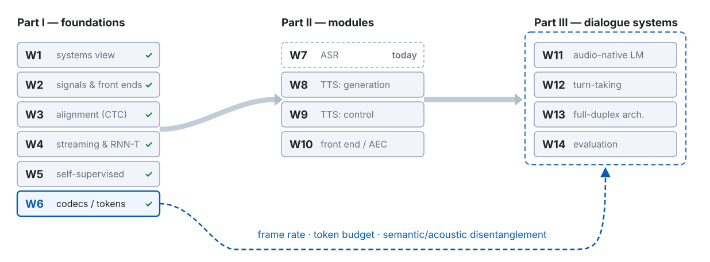

---
# 此檔由 bin/publish_slides.py 從投影片正本產生（中文講稿區塊已剝除），請勿直接編輯。正本在 private repo 的 <course>/slides/。
title: "Speech Recognition: Where the Prior Lives — Three Paradigms, Decoding, Biasing, and the LLM Turn"
subtitle: "Speech Processing & Human–Machine Interaction · Week 7"
author: "Hung-Shin Lee"
lang: en
format:
  revealjs:
    theme: [default, theme.scss]
    slide-number: c/t
    show-slide-number: all
    # 目標顯示尺寸：1280×800（16:10）。設成剛好填滿。
    # margin 預設 0.1 會把 deck 縮到 90% 才顯示（1152×720），白白損失一成字級。
    width: 1280
    height: 800
    margin: 0.04
    center: false
    progress: true
    transition: none
    # 章節標題會產生垂直堆疊；linear 讓左右鍵逐張前進，講課時才不會跳章
    navigation-mode: linear
    incremental: false
    # inline SVG 的 fragment（）在 ?print-pdf 裡要全部可見，不要每個 fragment 一頁
    pdf-separate-fragments: false
    chalkboard:
      buttons: true
    html-math-method:
      method: katex
      url: "https://cdn.jsdelivr.net/npm/katex@0.18.7/dist/"
    # 講稿（notes 區塊）裡的數學只輸出 MathML（與 w02.qmd～w06.qmd 相同的做法）。
    # presenter view 是另一個視窗，沒有 KaTeX 的 CSS；KaTeX 預設同時輸出 HTML 與 MathML，
    # 沒有 CSS 時兩份都會顯示，符號就重複了（例如 ℓℓ）。MathML 由瀏覽器原生排版，不需要 CSS。
    include-after-body:
      - text: |
          
---

# Where does the language prior live? {.section-title}

## Where we are: week 7 of 14

{width="100%"}

## Last week, in one picture



::: {.claim}
**Back to a world with transcripts**: W5's encoder, any of W2's three inputs, text out — and between them, the question of the week.
:::

::: {.footer}
W6 p54's last paragraph · W6 p20 RVQ · W6 p53 three axes
:::

## The problem this week handles, in one picture



::: {.claim}
Every ASR is **one way of writing $P(\mathbf{X} \mid \ell)\,P(\ell)$** — where does the prior live, how strong is it, how does it meet the evidence?
:::

::: {.footer}
Route: four places → two roads → hallucination → decoding → biasing → LLM → WER
:::

## Notation for today

| Symbol | Meaning |
|:--------|:------------------|
| $\mathbf{X}$, $\mathbf{x}_t$, $T$; $\ell = (\ell_1, \dots, \ell_U)$, $U$, $\mathcal{V}$, $\varnothing$, $\mathcal{V}'$ | frames; the label sequence, its length, the vocabulary, blank, the vocabulary with blank (W3) |
| $y^t_k$, $\pi$, $\mathcal{B}$; $\mathbf{f}_t$, $\mathbf{g}_u$, $\psi$, $\mathbf{c}_u$; $s$ | CTC output, path, collapse (W3); encoder output, prediction network, joint, AED context (W4); W4's subsampling |
| $\hat{\ell}$; a prefix is also written $\ell$ | the decoded hypothesis; a label string that is not finished yet |
| $p_b(\ell, t)$, $p_{nb}(\ell, t)$, $p = p_b + p_{nb}$; $N_{\text{beam}}$ | prefix probability over paths ending in blank / not; beam width (**not** $K$ — W5's clusters; **not** $W$ — W3's word sequence) |
| $P_{\text{ASR}}$, $P_{\text{LM}}$, $P_{\text{ILM}}$, $P_{\text{S}}$, $P_{\text{T}}$; $\lambda$, $\mu$, $\eta$ | the model's posterior, external LM, internal LM, source / target domain; LM weight, ILM weight (**not** W6's EMA $\mu$), length reward per token |
| $\mathbf{p}$; $\mathrm{Proj}$, $s_{\text{a}}$, $\mathbf{e}_j$, $J$ | control tokens / text prompt; adapter, frames stacked per LLM input (total rate $s \cdot s_{\text{a}}$), LLM input embeddings |
| $\mathcal{C}$, $\delta$, $\mathbf{h}^{\text{bias}}_i$; $S$, $D$, $I$, $N$, $d_{i,j}$ | biasing list (**not** W4's chunk $C$), per-token bonus, bias vector; WER counts and the Levenshtein table |

::: {.footer}
$\ln$ throughout · vectors bold, scalars italic, functions upright
:::

## Five things to leave with today

1. **One factorisation, four special cases.** CTC, RNN-T, AED and LLM-based ASR differ in *which term on the output side reads $\ell_{<u}$* and *what data that term was trained on* — and that decides latency, biasing, data and cost.
2. **Decoding is how the two sides are combined.** Prefix beam search merges paths into prefixes; shallow fusion adds a prior; the density ratio says why the model's own prior must be subtracted; the length reward exists because every term is a log-probability.
3. **Two roads to one encoder, and what each breaks.** 680,000 weakly labelled hours versus ten minutes on an SSL encoder; hallucination as a structural consequence of "flat evidence, strong prior", with three triggers and three countermeasures.
4. **Three ways to add a name at run time**, each at a different layer — the score, the decoder input, the prompt — each needing something different, each behaving differently when the list changes every turn.
5. **WER, its four holes, and what to do about Mandarin**: the alignment DP, $(S + D + I)/N$, normalisation, CER and MER, and an error taxonomy that traces each error back to the paradigm, the decoding or the data.

# One factorisation, four places for the prior {.section-title}

## Bayes, then the hybrid era: two terms, two models

::: {.fragment fragment-index=0}
$$P(\ell \mid \mathbf{X}) = \frac{P(\mathbf{X} \mid \ell)\,P(\ell)}{P(\mathbf{X})} \qquad\Longrightarrow\qquad \hat{\ell} = \arg\max_{\ell}\ \big[\ln P(\mathbf{X} \mid \ell) + \ln P(\ell)\big]$$
:::

::: {.fragment fragment-index=1}
$$\text{hybrid (W3):}\quad \underbrace{\ln P(\mathbf{X} \mid \ell)}_{\text{HMM + DNN acoustic model}} \;+\; \underbrace{\ln P(\ell)}_{n\text{-gram, trained on text alone}}$$
:::

::: {.claim .fragment fragment-index=2}
An end-to-end model learns $P(\ell \mid \mathbf{X})$ **directly, with the two terms fused** — but you can still ask of its output side: *does any term read $\ell_{<u}$, and on what data was it trained?*
:::

::: {.footer}
W3 p22 the hybrid recipe · the question is ours, not the survey's (§II)
:::

## Four paradigms: what on the output side reads $\ell_{<u}$?



::: {.footer}
CTC: W3 p26 · RNN-T: W4 p29 · AED: W4 p55 · SLAM-ASR §3.1.3 · colouring ours
:::

## Ten seconds of silence: what does each one write?

::: {.ask}
**Predict before the table appears.** Same four models, the input is ten seconds of nothing. Write down one line per model.
:::

::: {.fragment fragment-index=1}
| | the evidence is flat, so the output side decides by … | so it outputs |
|:---|:-----------|:-----------|
| **CTC** | each $y^t$'s $\arg\max$: blank almost everywhere (W3 p48) | **the empty string**, or a few fragments |
| **RNN-T** | $\mathbf{g}_u$: a small prior over paired transcripts | a short, common string — or nothing |
| **AED · Whisper** | the decoder: **the most probable sentence under $P(\ell)$** | a fluent sentence, unless $\langle\text{nospeech}\rangle$ beats it |
| **LLM-based** | the LLM: a fluent continuation of the prompt | a fluent sentence |
:::

::: {.claim .fragment fragment-index=2}
With flat evidence, $\arg\max_\ell P(\mathbf{X} \mid \ell)\,P(\ell) = \arg\max_\ell P(\ell)$: **the stronger the prior, the more fluent the transcript of nothing.** Our reading; Demo 1 tests it.
:::

::: {.footer}
our reading of the factorisation · evidence: Koenecke 2024; Kumar 2026
:::

## Four paradigms on four axes: latency, biasing, data, cost

| | **CTC** | **RNN-T** | **AED · Whisper** | **LLM-based** |
|:---|:-----|:-----|:-----|:-----|
| **prior** | none on the output side | $\mathbf{g}_u$, small | the decoder | a text LLM |
| **trained on** | — | paired transcripts | paired (Whisper: 680k h) | text alone |
| **streams** | yes | **yes** (W4 p49) | no: 30 s windows | no: read / write (p60) |
| **biasing** | score (p46) | score, deep (p47) | + prompt (p48) | **prompt, first-class** |
| **data** | minutes, on an SSL encoder | hundreds of hours | 680k h, weak | LLM + encoder + hours |
| **cost** | one encoder pass | + a small decoder | + a decoder | + **an LLM per token** |

::: {.claim}
Left to right: **more prior buys fluency and control, and costs latency, compute, and the risk of hearing what was never said.**
:::

::: {.footer}
each cell is a slide of W3, W4 or this week · paired = the ASR training set
:::

## MC 1 — "CTC is obsolete"

| | where | why a CTC head |
|:---|:--------------|:---------|
| **timestamps** | WhisperX aligns Whisper's text with a wav2vec 2.0 phoneme model; Qwen3-ASR ships a separate aligner | attention is not an alignment (W4 p58); a frame-synchronous head is |
| **joint decoding** | hybrid CTC / attention (Watanabe et al. 2017), ESPnet's default | the CTC term stops the decoder skipping or looping |
| **data cleaning** | OWSM v4 (Open Whisper-style Speech Model) segments and filters web audio with CTC | a model with no prior does not "fix" what it checks |
| **control group** | Demo 1: the same noise, CTC vs. Whisper | no prior block → fragments, never a sentence |

::: {.claim}
CTC's job changed: **the one head whose output is about the audio** — this week's control group.
:::

::: {.footer}
WhisperX §2.4 · Watanabe 2017 Eq. 45, 48 · OWSM v4 §2.1 · Qwen3-ASR TR
:::

# Two roads to the encoder: 680,000 hours, or ten minutes {.section-title}

## At a glance: Whisper

::: {.prose}
| | |
|:---|:-----------------|
| **Name** | **Robust Speech Recognition via Large-Scale Weak Supervision** — "Whisper", Radford, Kim, Xu, Brockman, McLeavey & Sutskever, ICML 2023. An encoder–decoder Transformer (W4 p55), nothing new in the architecture. |
| **The question** | Can an ASR system be trained on **transcripts nobody has checked**, scraped at a scale no labelling team could reach — and come out more robust, not less? |
| **The idea** | 680,000 hours of audio with web transcripts, filtered by heuristics rather than by people; one decoder for transcription, translation, language ID and timestamps, steered by **control tokens** in front of the text. |
| **What it added** | A decoder that has read more transcribed speech than any before it; zero-shot use across datasets ("effective robustness", p18); and the first ASR whose behaviour you change by writing a prompt. |
| **What it leaves open** | The prior is now strong enough to speak on its own (p24); long audio must be cut into 30 s windows and the windows chained (p29); traditional versus simplified Chinese is left to the prior (p66). |
:::

::: {.footer}
Radford et al., ICML 2023 · W4 Demo 3 used it · W5 p59: Whisper is not SSL
:::

## Weak supervision: the data arithmetic, and the filter

| | hours | what it is |
|:---|-----:|:--------------|
| English transcription | ≈ 438,000 | audio paired with English text from the web |
| other languages, transcription | 117,000 | 96 languages |
| $X \to$ English translation | 125,000 | audio in another language, English text |
| **total** | **680,000** | none of it labelled by a person for this purpose |

::: {.small}
**The filter is heuristic, not human**: drop transcripts that look machine-generated — an all-uppercase or all-lowercase transcript, missing the complex punctuation and capitalisation a person writes; drop pairs whose spoken language disagrees with the text language — unless the text is English, in which case the pair becomes $X \to$ English translation data.
:::

::: {.claim}
"Weak" names the **quality** of each label, not the quantity: the bet is that 680,000 hours of unchecked transcripts beat a few thousand checked ones — and the same bet turns the prior into something that can speak on its own.
:::

::: {.footer}
Whisper §1 (hours), §2.1 (filter) · OWSM: public-data replications (p13)
:::

## The multitask format: one line, and the first prompt



::: {.claim .fragment fragment-index=2}
**The control tokens are a prompt**: a few symbols in front of the text that change what the prior does — language, task, timestamps. Everything in the LLM section (p48, p55) is this slot, grown up.
:::

::: {.footer}
Whisper §2.3, Fig. 1 · 99 language tokens · "the first prompt" is our reading
:::

## Effective robustness: how to read Whisper's table

| | on LibriSpeech test-clean | on the other datasets |
|:---|:-----|:-----|
| a model **trained on** LibriSpeech, same clean WER | ≈ the same | much worse: it learned the dataset |
| **Whisper, zero-shot** | ≈ the same | **55.2% fewer errors on average** (§3.3) |

::: {.claim}
Whisper's claim is not "lowest WER" — on LibriSpeech the specialised models win. It is **the smallest drop when the test set changes**: a prior trained on everything is hard to surprise. Judge any ASR on the *gap* between its home benchmark and the rest.
:::

::: {.footer}
Whisper §3.3, Table 2 · Likhomanenko et al. 2021: average over many test sets
:::

## The other road: W5's encoder, a CTC head, and ten minutes of labels

| labelled data (Libri-light) | test-clean | test-other | what the number says |
|:---|-----:|-----:|:-------------|
| **10 min**, LARGE LV-60k, + Transformer LM | 4.8 | 8.2 | an encoder that already knows the phones needs very few examples of the spelling |
| 10 min, same model, **no LM** | 40.2 | 38.7 | without a prior on the output side, ten minutes is not enough to learn the spelling |
| 10 min, + 4-gram | 6.6 | 10.3 | a small prior buys most of the gap |
| 960 h, + Transformer LM | 1.8 | 3.3 | the full-data reference (Table 2) |

::: {.claim}
Two things in one table: **W5's encoder makes the labelled data almost optional** — and on this road **the prior is bolted on from outside**, by shallow fusion; the gap between 40.2 and 4.8 is the prior's share, measured.
:::

::: {.footer}
wav2vec 2.0 Tables 1, 2, 9 · LibriSpeech, WER % · W5 p19
:::

## Two roads, one table

::: {.prose}
| | **weak supervision** (Whisper) | **SSL + fine-tuning** (wav2vec 2.0, HuBERT, WavLM) |
|:---|:--------|:--------|
| **pre-training signal** | 680k h of (audio, web transcript) pairs: labelled, unchecked | 60k h of audio alone; the model makes the target (W5) |
| **labels needed after** | none: zero-shot | minutes to hundreds of hours, for the CTC head and the domain |
| **where the prior lives** | the decoder, inside the model | outside: an LM in shallow fusion, or none |
| **strength** | robust across datasets; many languages and tasks in one model | data-efficient; **domain-adaptable** with a hundred hours; an order of magnitude cheaper to run |
| **failure mode** | **hallucination**, loops, wrong language (p24–p31) | spelling and **homophones**: little or no prior (W3) |
| **is it SSL?** | **no** (W5 p59) | yes (W5) |
:::

::: {.footer}
Radford et al. 2023 · W5; Baevski et al. 2020 · failure modes: p24–p31 vs. W3
:::

## MC 2 — "big and zero-shot always beats small and fine-tuned"

| | what the big model wins | what the small fine-tuned model wins |
|:---|:--------|:--------|
| **its own table** | Whisper on *other* datasets (55.2% fewer errors, p18) | the LibriSpeech-trained models **on LibriSpeech** — Whisper's paper says so |
| **a narrow domain** | vocabulary it has seen somewhere | medical, call-centre, one accent: a hundred labelled hours of *that* beat the prior's guesses |
| **cost** | — | latency and compute an order of magnitude lower |
| **the 2026 case** | — | Kumar et al. 2026: a bank's call data, **only synthetic speech** to adapt on; reinforcement learning (RL) with $1 - \text{WER}$ as reward took WER from 36.7 to 22.1 |

::: {.claim}
"Beats" needs a test set: a strong prior wins **when the domain is unknown**, in-domain labels **when it is known**.
:::

::: {.footer}
Whisper §3.3 · Kumar et al., SLT 2026 (WER 36.71 → 22.09)
:::

## Discrete units as input: W6's alphabet, recycled

| input (LibriSpeech, WER %) | dev-clean | test-clean | dev-other | test-other | what goes in |
|:---|----:|----:|----:|----:|:-----------|
| **FBank** (filterbank: W2's log-mel) | 2.5 | 6.3 | 2.6 | 6.2 | 100 Hz frames |
| **discrete units** | 2.2 | 4.5 | 2.4 | 4.6 | k-means on WavLM-large layer 21, de-duplicated, then BPE: **≈ 60% shorter** |
| **continuous SSL** | 1.9 | 3.7 | 1.9 | 3.7 | 50 Hz features |

::: {.claim}
All three of W2's representations have now been ASR inputs. Units sit **between** log-mel and continuous features — and DASB finds the same order: semantic tokens close to continuous features, acoustic (codec) tokens far behind. **What the quantiser kept decides what the ASR gets.**
:::

::: {.footer}
Chang et al., ICASSP 2024, Table 1 (one recipe) · DASB, TMLR 2026 · W6 p38
:::

# When the prior speaks on its own: hallucination {.section-title}

## Flat evidence: the argmax falls to the prior



::: {.footer}
our reading of $P(\mathbf{X} \mid \ell)\,P(\ell)$ · bars schematic · the numbers: next slide
:::

## Careless Whisper: three numbers

::: {.metrics}
::: {.metric}
[1.4%]{.num}
[of the transcriptions contain a hallucinated sentence: 312 cases ("roughly 1%" in the abstract)]{.lab}
:::
::: {.metric}
[38%]{.num}
[of those carry an explicit harm: violence 19%, false associations 13%, false authority 8%]{.lab}
:::
::: {.metric}
[41% vs 15%]{.num}
[non-vocal time in files that hallucinated versus files that did not; aphasia 1.7% vs controls 1.2%]{.lab}
:::
:::

::: {.claim}
The third number is the mechanism, measured: **the longer the evidence is flat, the more often the prior speaks.** In a full-duplex system (W12) that sentence can trigger a reply nobody asked for.
:::

::: {.footer}
Koenecke et al., FAccT 2024 §3, §4.2 · Whisper API, temperature 0, 2023
:::

## Before Demo 1: what does a prior say when there is nothing to hear?

::: {.prose}
| | |
|:---|:-----------------|
| **Why** | p24 said the mechanism and p25 the statistics; this is the same thing on this laptop, with the control group p24 promised: **the same audio into a model with a prior and into one without.** |
| **What runs** | `transformers` 5.17.0 (Whisper on CPU, wav2vec2 on MPS). Three panels: (1) 10 s of silence, 10 s of white noise at two or three SNRs, W3's sentence `1272-128104-0000` followed by 30 s of silence (so that the second 30 s window is silence only), and one non-speech clip (music or a cough, my own recording) — each through Whisper `small`; the screen prints the transcript, every token's log-probability, `no_speech_prob`, the compression ratio, and — with the fallback switched on — every attempt and which §4.5 rule fired. (2) The same files through wav2vec2-base-960h (W3 Demo 3's model), greedy. (3) Whisper's encoder output replaced by zeros, the decoder left to generate a few beams — an approximation of p38's internal-LM estimation (ILME). |
| **Watch for** | What Whisper writes for ten seconds of nothing. How many of those words have a log-probability near zero. What the CTC model writes for the same ten seconds. Whether the third panel's sentences resemble the first panel's. |
:::

::: {.footer}
Demo 1 · code: `demos/w07_d1_hallucination` · rehearsed 2026-11-01 · Whisper on CPU, CTC on MPS
:::

## Demo 1 — silence, noise, and a zeroed encoder

::: {.ask}
**Demo 1.** Ten seconds of white noise into Whisper `small`. Before the output appears: how many words will it write, and will any of them have a log-probability above $-0.5$?
:::

::: {.fragment fragment-index=1}
| input | Whisper `small`, $T = 0$: transcript | mean log-prob · `no_speech_prob` | wav2vec2 CTC, greedy |
|:---|:---------|:------|:--------|
| 10 s silence | `you` — one token, log-prob $-1.05$ | $-0.53$ · $0.94$ → **passes §4.5** | blank 100%: `""` |
| 10 s white noise, SNR 0 / 20 / 40 dB | `you` / `you` / `you` | $-1.95$ / $-1.56$ / $-1.28$ · $0.81$–$0.90$ → gated | blank 100%: `""` |
| W3's sentence + 30 s silence (window 2) | with the prompt: `You`; without: `you` | $-1.14$ · $0.97$ / $-0.53$ · $0.94$ | the sentence, then nothing |
| my own non-speech clip | `I` | $-3.10$ · $0.52$ | `E` |
:::

::: {.footer}
Demo 1 · demos/w07_d1_hallucination · rehearsed 2026-11-01 · w07-metrics.json → demo1
:::

## Demo 1 — the prior alone: encoder zeroed, and the fallback at $T = 1.0$

::: {.gen .hit}
[encoder zeroed · beam 5, all five beams · $-0.18$ per token]{.n}
I'm sorry, I'm sorry, I'm sorry, I'm sorry, I'm sorry, … (× 40, to the token limit) 
[sampled, $T = 0.8$]{.n} As the weather has gotten worse, and that has been so hot lately, I'm sure we'll finish it in about 4 hours. 
[noise, fallback on, $T = 1.0$]{.n} I kind of took that picture, because the burnwasty was really fine
:::

::: {.claim}
With the evidence removed, the decoder's most confident output is a loop of the commonest caption; with the temperature raised on noise, a fluent sentence about nothing. **These are samples of $P_{\text{ILM}}$** (p38).
:::

::: {.footer}
Demo 1 · demos/w07_d1_hallucination · rehearsed 2026-11-01 · w07-metrics.json → demo1
:::

## Long-form: one window's hallucination primes the next



::: {.footer}
Whisper §4.5 thresholds · "the ratio catches loops" is our reading · W4 p60
:::

## Three triggers, three countermeasures

| trigger | why the evidence goes flat | countermeasure | what it costs |
|:---|:------|:----------|:------|
| **non-speech** | silence, noise, music, pauses: nothing to condition on (p24) | a VAD first, ≤ 30 s segments (WhisperX); `no_speech` **with** the log-prob | a VAD has its own errors (W10) |
| **carry-over** | one window's hallucination primes the next (p29) | fallback; ratio and log-prob gates; drop the previous text | outputs no longer reproducible |
| **stopping** | end-of-text must beat one more fluent token | timestamps from alignment (WhisperX, CrisperWhisper); RL that calibrates stopping (p62) | a second model, or a training run |

::: {.claim}
Each countermeasure removes one place where the evidence was allowed to go flat. **None weakens the prior** — that would cost the robustness of p18.
:::

::: {.footer}
WhisperX §2.2, §3.4.3 · CrisperWhisper §3.2 · Whisper §4.5 · Kumar 2026
:::

## MC 3 — "hallucination is an accident of dirty data"

| if it were an accident of the data … | what we actually see |
|:---|:--------|
| it would be rare and unpatterned | it tracks **non-vocal time**: 41% vs 15% (p25); more in aphasia than in controls |
| cleaner training data would remove it | CrisperWhisper **added** noise clips with empty transcripts to its training data to reduce it |
| a model without the prior would do it too | **CTC does not**: Demo 1's control writes fragments, never a sentence |
| it would be unrelated to decoding | it is reduced by **changing the decoder's stopping**: RL that calibrates stopping cuts insertions (p62); the compression-ratio gate catches loops |

::: {.claim}
Hallucination is **the price of the prior**, paid wherever the evidence is flat. The same prior buys the robustness of p18. You do not remove it; you decide where it is allowed to speak — which is the next section.
:::

::: {.footer}
Koenecke 2024 · CrisperWhisper §3.2 · Kumar 2026 §V-B · our framing (p24)
:::

# Combining the two sides: decoding {.section-title}

## Greedy is not the argmax: paths versus prefixes



::: {.footer}
`w07-data.json → prefix_example`: our numbers, enumerated · W3 p28
:::

## CTC prefix beam search: two accumulators, four rules



::: {.footer}
Hannun et al. 2014, Algorithm 1 · Graves & Jaitly 2014 §5 · W3 p30
:::

## The same lattice, a third time: $\max$, $\sum$, and top-$N_{\text{beam}}$

| | per column | across columns | gives |
|:---|:------|:------|:------|
| **greedy** | $\max_k y^t_k$ | concatenate, then $\mathcal{B}$ | the best **path** |
| **prefix beam** | $\sum$ over paths into each prefix | keep the top $N_{\text{beam}}$ | ≈ the best **label sequence** |
| **Viterbi** | $\max$ over the paths of one $\ell$ | keep all | the best **alignment** |

| | what each prefix in the beam carries |
|:---|:-----------------|
| **CTC** | $p_b$ and $p_{nb}$ — no state: the outputs are conditionally independent |
| **RNN-T** | the two numbers **plus its own prediction-network state** (W4 p33) |
| **AED** | an ordinary token-by-token beam: no blank, no twin tracks (W4 p55) |

::: {.claim}
Greedy is a $\max$ per column; prefix beam a pruned $\sum$ per prefix — **W3's semiring again**, and the $\sum$ that $P(\ell \mid \mathbf{X}) = \sum_\pi$ demands.
:::

::: {.footer}
W3 p13 · W3 p18 forward · W3 p19 Viterbi · W3 p44 · W4 p33
:::

## Shallow fusion: one line, four knobs

$$\hat{\ell} = \arg\max_{\ell}\ \ \ln P_{\text{ASR}}(\ell \mid \mathbf{X}) \;+\; \lambda \ln P_{\text{LM}}(\ell) \;-\; \mu \ln P_{\text{ILM}}(\ell) \;+\; \eta\,|\ell|$$

| term | what it is | the courtroom |
|:---|:---------|:---------|
| $\ln P_{\text{ASR}}(\ell \mid \mathbf{X})$ | the end-to-end model's own score | the verdict the court already reached — evidence *and* record, fused |
| $+\,\lambda \ln P_{\text{LM}}(\ell)$ | an external LM trained on text alone: **shallow fusion** (Gulcehre et al. 2015) | a second file of prior convictions, added at sentencing |
| $-\,\mu \ln P_{\text{ILM}}(\ell)$ | the model's **internal** LM, estimated and subtracted (p37–p38) | the first file was already in the verdict — count it once |
| $+\,\eta\,\lvert \ell \rvert$ | a reward per token (p39) | every term is a log-probability, so short verdicts come cheap |

::: {.footer}
Gulcehre 2015 §4.1 · Hannun 2014 Eq. 8 · Kannan 2018 · the courtroom is ours
:::

## Density ratio: why subtract — Bayes, three steps

::: {.fragment fragment-index=0}
**1 · What the model learned, in its source domain S**
$$P_{\text{S}}(\ell \mid \mathbf{X}) \;\propto\; P(\mathbf{X} \mid \ell)\,P_{\text{S}}(\ell)$$
:::

::: {.fragment fragment-index=1}
**2 · What we want, in the target domain T — same acoustics, another prior**
$$P_{\text{T}}(\ell \mid \mathbf{X}) \;\propto\; P(\mathbf{X} \mid \ell)\,P_{\text{T}}(\ell)$$
:::

::: {.fragment fragment-index=2}
**3 · Divide: $P(\mathbf{X} \mid \ell)$ cancels**
$$P_{\text{T}}(\ell \mid \mathbf{X}) \;\propto\; P_{\text{S}}(\ell \mid \mathbf{X}) \cdot \frac{P_{\text{T}}(\ell)}{P_{\text{S}}(\ell)} \quad\Longrightarrow\quad \ln P_{\text{ASR}} + \lambda \ln P_{\text{LM}} - \mu \ln P_{\text{ILM}}$$
:::

::: {.claim .fragment fragment-index=3}
The denominator is **the prior the model already carries** — its internal LM; with $\mu = 0$ the source prior is counted twice. **The courtroom fails here**: $P_{\text{S}}(\ell \mid \mathbf{X})$ cannot be taken apart, so $P_{\text{S}}(\ell)$ must be *estimated*.
:::

::: {.footer}
McDermott, Sak & Variani, ASRU 2019 §3.1, §3.4 Eq. 11
:::

## Estimating the denominator: density ratio, ILME, HAT

| | how $P_{\text{ILM}}$ is obtained | needs |
|:---|:---------|:------|
| **density ratio** | a separate LM on the source domain's **text**, standing in for $P_{\text{S}}(\ell)$ | the transcripts, one more LM |
| **ILME** | **remove the acoustic term** and renormalise: an AED drops $\mathbf{c}_u$; an RNN-T feeds the joint $\mathbf{g}_u$ only and drops blank | nothing: the trained model |
| **HAT** | **build it in** (hybrid autoregressive transducer): a Bernoulli for blank-or-emit, a softmax for what; the softmax without $\mathbf{f}_t$ is an ILM | a transducer built so from the start |

::: {.claim}
The prior **cannot be read off** an end-to-end model, so it is imitated, probed, or built to be separable. Demo 1's zeroed encoder probed Whisper the ILME way: those sentences *are* samples of $P_{\text{ILM}}$.
:::

::: {.footer}
McDermott 2019 · Meng et al., SLT 2021 §4 · Variani et al. 2020 §3 · survey §VI-B.4
:::

## The length reward, and the empty string

::: {.metrics}
::: {.metric}
[51.8%]{.num}
[of WMT15 En–De sentences: under exact search, the empty translation has the best model score (Table 1)]{.lab}
:::
::: {.metric}
[57.7%]{.num}
[of beam-10 outputs were search errors — the beam had not found the model's own argmax]{.lab}
:::
:::

| patch | what it does | what it does not do |
|:---|:---------|:---------|
| $\eta\,\lvert\ell\rvert$ | every term is $\ln P \leq 0$, so it pays a hypothesis back for its length | fix *why* the model prefers short |
| **coverage** | penalises a hypothesis whose attention never covered part of the audio | the same: a patch on the model |

::: {.claim}
**Hallucination and the empty string are one miscalibration, seen from two sides**: with flat evidence the model says too much; with a wide beam on strong evidence, too little.
:::

::: {.footer}
Stahlberg & Byrne 2019 (translation) · Hannun 2014 · Chorowski & Jaitly 2017 · duality ours
:::

## MC 4 — "add an LM, widen the beam: both always help"

| belief | what breaks it | mechanism |
|:---|:--------|:--------|
| **bigger $\lambda$** | words the LM likes and the audio lacks | the internal LM is counted twice (p37) |
| **any LM helps** | rare words flattened; wrong-domain text hurts | only a target-domain LM is the target prior |
| **wider beam** | on AED, shorter outputs, down to $\varnothing$ (p39) | a model error, exposed by better search |
| **greedy is enough** | the $\arg\max$ path $\neq$ the $\arg\max$ label (p33) | it ignores the $\sum$ in $P(\ell \mid \mathbf{X})$ |

::: {.ask}
**Stop.** Does a CTC model need the ILM subtraction? Argue from p10.
:::

::: {.claim}
Almost not: nothing on CTC's output side reads $\ell_{<u}$, so there is almost no internal prior to subtract — **conditional independence as an advantage**, and why Demo 3 sweeps $\lambda$ on CTC.
:::

::: {.footer}
density ratio §4 · ILME §5 · "almost": CTC's encoder still sees context
:::

## Before Demo 3: how heavy should the prior be?

::: {.prose}
| | |
|:---|:-----------------|
| **Why** | p36 wrote one line with four knobs; p40 said two of them are not monotone. This demo turns one knob, $\lambda$, on a model with almost no internal prior, and plots what happens — then takes the same model to Mandarin, where W3 said conditional independence should bite hardest. |
| **What runs** | (1) wav2vec2-base-960h log-probabilities for 30 dev-clean sentences (one per speaker from W5 Demo 1's subset; 10 more fixed $\eta$ once), the numpy prefix beam search (Hannun 2014, Algorithm 1; 32 beams) with a word-level LM applied at spaces — the official LibriSpeech 3-gram pruned ARPA, read by our own code, no `kenlm`; $\lambda$ from 0 to 4 with $N_{\text{beam}}$ and $\eta$ fixed; WER against $\lambda$, plus greedy, plus the p33 example checked in code. (2) One Mandarin sentence (W1 Demo 2's ticket-booking sentence) through `mms-1b-all`'s CTC with the `cmn-script_simplified` adapter (mapped to traditional for display), through Whisper `small` and Qwen3-ASR; every substituted character classified as homophone or not. |
| **Watch for** | The shape of WER against $\lambda$. Where greedy sits on it. Which words change when $\lambda$ grows past the minimum. In Mandarin: whether the CTC output's errors are *homophones* — right sound, wrong character — and whether Whisper's are. |
:::

::: {.footer}
Demo 3 · code: `demos/w07_d3_decoding` (rehearsed 2026-11-02) · openslr 11 3-gram · wav2vec2 and MMS on MPS, 9 s for the sweep
:::

## Demo 3 — a $\lambda$ sweep, and Mandarin homophones

::: {.ask}
**Demo 3.** WER against $\lambda$, same beam, same $\eta$. Before the curve appears: what shape, and is $\lambda = 0$ the best point?
:::

::: {.fragment fragment-index=1}
| decoding | WER % on 30 dev-clean sentences, 563 words ($\eta = 0$, 32 beams) |
|:---|:-----------|
| **greedy**, no LM | 2.66 (S 13, D 1, I 1) |
| **prefix beam**, $\lambda = 0$ | 2.66 — the same 30 outputs |
| **prefix beam**, best $\lambda = 0.2$ (0.2–0.3) | **1.60** (S 8, D 1) |
| **prefix beam**, $\lambda = 2$ · $\lambda = 4$ | 2.84 (S 11, D 4) · **51.7** (S 71, **D 219**) |
| **p33's example**, in code | greedy → "b"; prefix beam → "a" — matches `w07-data.json` |
:::

::: {.fragment fragment-index=2}
::: {.gen}
[W1's ticket-booking sentence 我想訂一張下週三去台南的票 · MMS-1B-all CTC (cmn adapter, → traditional): 我想**定**一張下周**山**去臺南的票 — 訂→定 homophone, 三→山 not · Whisper small, Qwen3-ASR: 0 errors]{.n}
[Demo 2's sentence (three names): MMS 9 substitutions, **7 homophones** · Whisper 1 (homophone) · Qwen3-ASR 2 (homophones) — all on the same name]{.n}
:::
:::

::: {.footer}
Demo 3 · demos/w07_d3_decoding · rehearsed 2026-11-02 (M5 Max, transformers 5.17.0) · w07-metrics.json → demo3
:::

# Adding a prior at run time: contextual biasing {.section-title}

## At a glance: Contextual Listen, Attend and Spell (CLAS)

::: {.prose}
| | |
|:---|:-----------------|
| **Name** | **Deep Context: End-to-End Contextual Speech Recognition** — the model is **CLAS**, Contextual Listen, Attend and Spell, Pundak, Sainath, Prabhavalkar, Kannan & Zhao, SLT 2018. "LAS" is the AED of W4 p54. |
| **The question** | The user's contacts, the song titles on screen, the names in this meeting: they change every turn and never appear in the training transcripts. How does an end-to-end model use a **list it is handed at run time**? |
| **The idea** | A second encoder embeds each phrase on the list into a vector; the decoder attends over those vectors (plus a learnable "no bias" vector) at every step and feeds the result in next to the acoustic context. |
| **What it added** | **Biasing inside the model**: the list enters the decoder's input, not the score — so it works while streaming and needs no external decoder; trained by sampling random lists so the model learns *to look*. |
| **What it leaves open** | It must be trained for. The other two routes — a bonus on the score (p46), the list in the prompt (p48) — need no training, and each pays something else. |
:::

::: {.footer}
Pundak et al., SLT 2018 §3.1, Eq. 6–7 · streaming RNN-T: Le et al. 2021
:::

## Three ways to add a name: where each one enters



::: {.footer}
Zhao 2019 · Pundak 2018 · Lakomkin 2024; Whisper's prompt slot
:::

## Contextual WFST: the failure arc gives the bonus back



::: {.claim .fragment fragment-index=2}
A contextual **weighted finite-state transducer** (WFST) is **the external LM of p36, built from a list**: $+\delta$ per token on a path of $\mathcal{C}$, refunded if the path is abandoned, applied **before** pruning so the name survives the beam.
:::

::: {.footer}
Zhao et al., Interspeech 2019 §2.1–2.3 · for CTC: pyctcdecode hotwords
:::

## Deep biasing: the decoder looks at the list

$$\mathbf{h}^{\text{bias}}_i = \mathrm{BiasEnc}(\text{phrase}_i),\ i = 1..|\mathcal{C}|;\qquad \mathbf{h}^{\text{bias}}_0 = \mathbf{h}^{\text{no-bias}}\ \text{(learned)}$$
$$a^{\text{bias}}_{u,i} = \mathrm{softmax}_i\big(\mathrm{score}(\mathbf{s}_u, \mathbf{h}^{\text{bias}}_i)\big),\qquad \mathbf{c}^{\text{bias}}_u = \sum_{i} a^{\text{bias}}_{u,i}\,\mathbf{h}^{\text{bias}}_i,\qquad \text{input: } [\mathbf{c}_u;\ \mathbf{c}^{\text{bias}}_u]$$

| | CLAS (2018) | on a streaming RNN-T (Le et al. 2021) |
|:---|:------|:------|
| **where** | the AED decoder's input, next to $\mathbf{c}_u$ | the prediction network's side of the joint |
| **training** | random lists; the true phrase kept with $P_{\text{keep}} = 0.5$ | the same, plus shallow fusion and a contextual LM |
| **run time** | re-encode the list per turn; one attention per step | the same, **while streaming** |
| **off-list names** | nothing helps — that is the LLM's job (p54) | the same |

::: {.footer}
Pundak et al. 2018 §3.1–3.2, Eq. 6–7 · Le et al., Interspeech 2021
:::

## Prompt-based: the list goes into $\mathbf{p}$

| | where the text goes | what it is, really |
|:---|:--------|:--------|
| **Whisper** | the previous-text slot (p17): `prompt_ids` | the decoder treats your text as the last window's transcript and continues *in its style* — vocabulary, script, punctuation |
| **Lakomkin 2024** | the title and description of the video, as a text prompt in front of the audio tokens; LLaMA-7B frozen + low-rank adapters (LoRA) | the LLM's ordinary prompt; biasing is a change of input, not of model |
| **Qwen3-ASR** | context tokens in the system prompt, **trained in by supervised fine-tuning (SFT)**; it does not follow natural-language instructions | a prompt slot the model was taught to use as background — not a chat |

::: {.claim .warn}
**Where the prompter's card fails**: the actor may read it aloud. Over speech, Demo 2 could not make it happen; over 8 s of near-silence, **both Whisper and Qwen3-ASR transcribed the card itself** (p52).
:::

::: {.footer}
Whisper §2.3 · Lakomkin et al., ICASSP 2024 §1, §3 · Qwen3-ASR TR
:::

## What each needs, and whether it streams

| | **(a) score** | **(b) deep (CLAS)** | **(c) prompt** |
|:---|:------|:------|:------|
| **needs** | per-token scores + a list | a model trained with lists | text only |
| **retraining** | none | once | none |
| **streams** | yes, per token | yes, per step | no: the prompt is fixed per window |
| **per-turn list** | swap the FST: instant | re-encode: cheap | rewrite: free; re-read every window |
| **off-list name** | nothing | nothing | the LLM may know it (p54) |
| **failure** | $\delta$ too large: homophones become names | trusts the list when it should not | read aloud, or ignored |

::: {.claim}
"Biasing is adding words to the prompt" names one layer of three. **In full duplex the list changes every turn** (W12–W13) — and none of the three helps with a name not on it.
:::

::: {.footer}
W12–W13 for the per-turn list · Demo 2 runs (a) and (c)
:::

## Before Demo 2: does the list reach the output?

::: {.prose}
| | |
|:---|:-----------------|
| **Why** | p45–p49 described three layers; two need no training and run here. The question is not whether biasing *can* work but **what each layer does to the words not on the list** — and what a prompt does when it is written like a sentence. |
| **What runs** | An English dev-clean sentence with proper names, and a Mandarin sentence of mine with three or four (not published). (1) Whisper `small`: `prompt_ids` empty, the list, a prompt in **traditional** characters, a prompt written as a line of dialogue. (2) wav2vec2-base-960h logits through a CTC prefix beam search with the list in a trie: $+\delta$ per character on the path, refunded if abandoned; $\delta$ = 1 / 6 / 24, $\delta = 0$ as control. (3) Qwen3-ASR 1.7B: the same list in its context slot. (4) The dialogue prompts again over 8 s with nothing to hear. |
| **Watch for** | Which names the plain model gets wrong and which the list fixes. Whether the script flips to traditional. Whether the dialogue prompt shows up *in the transcript*. At the largest $\delta$, which ordinary words turn into names. What each model writes when the prompt is all it has. |
:::

::: {.footer}
Demo 2 · code: `demos/w07_d2_biasing` · Qwen3-ASR 1.7B-hf runs on this machine (MPS, bf16)
:::

## Demo 2 — the same audio, with and without the list

::: {.ask}
**Demo 2.** The dialogue-style prompt goes in — over the sentence, then over 8 s of near-silence. Before the output: does its wording show up in the transcript, and in which of the two?
:::

::: {.fragment fragment-index=1}
| | Whisper, no prompt | + list | + traditional-script prompt | + a line of dialogue | CTC: greedy / $\delta$ = 1, 6 / 24 | Qwen3-ASR: no context / list / traditional |
|:---|:---|:---|:---|:---|:---|:---|
| English: *Lady Glenarvan, Mary Grant* | Glenarv**i**n · $-0.34$ | Glenarv**a**n · $-0.12$ | — | Glenarv**i**n; nothing leaked, only the punctuation changed | GLENARV**I**N / GLENARV**A**N at $\delta = 1$, nothing else at 6 / at 24 *LADY* → GLENARVAN | Glenarv**a**n **without** a list / same / — |
| Mandarin, my sentence, 3 names | 2 / 3 · traditional | **3 / 3** · $-0.13 \to -0.04$ | 2 / 3 · 台 → **臺** | 2 / 3; nothing leaked | — | 2 / 3 · **simplified** / 3 / 3 · simplified / 2 / 3 · **traditional** |
:::

::: {.footer}
Demo 2 · demos/w07_d2_biasing · rehearsed 2026-11-01 · w07-metrics.json
:::

## Demo 2 — the card read aloud: 8 s of near-silence

::: {.gen .hit}
[8 s of near-silence · Whisper small, en · prompt = a line of dialogue]{.n} Thanks for watching, and don't forget to subscribe to the channel. — **the card, verbatim** (zh: most of it) 
[same clip · Qwen3-ASR 1.7B · context = any of the three lines]{.n} the context, **verbatim**, every time
:::

::: {.claim .warn}
Over speech the evidence held the card down; with nothing to hear, **the prompt is the prior, and the prior is the output** — Demo 1's mechanism (p24) with a prior you wrote yourself.
:::

::: {.footer}
Demo 2 · demos/w07_d2_biasing · rehearsed 2026-11-01 · key `0`: synthetic near-silence
:::

# Making the prior as large as it gets: the LLM turn {.section-title}

## At a glance: LLM-based ASR — the SLAM-ASR recipe

::: {.prose}
| | |
|:---|:-----------------|
| **Name** | **An Embarrassingly Simple Approach for LLM with Strong ASR Capacity** ("SLAM-ASR"), Ma et al., 2024, preprint — the generic recipe: an encoder, a projector, a text LLM. Earlier: Fathullah et al. 2024; in production: Qwen3-ASR, 2026. |
| **The question** | A text LLM already carries the strongest language prior there is. Can it **be** the ASR decoder — and how little must be trained to make it one? |
| **The idea** | Freeze the encoder and the LLM; stack every $s_{\text{a}} = 5$ encoder frames, project them (Linear–ReLU–Linear) into the LLM's embeddings, and train **only the projector** with next-token cross-entropy. |
| **What it added** | The prior comes from **text alone**; paired speech trains an adapter, not a language model. The prompt is a first-class input — biasing for free (p48). |
| **What it leaves open** | Every token is an LLM pass (p57, p59); no natural streaming (p60); no attention to read a timestamp from (p61); and it hallucinates too (p24). |
:::

::: {.footer}
Ma et al. 2024 §3.1, Table 4 · Fathullah et al. 2024 · Qwen3-ASR TR 2026
:::

## The architecture: encoder → adapter → prompt → LLM



::: {.claim .fragment fragment-index=2}
$$P(\ell \mid \mathbf{X}) = \prod_u P_{\text{LLM}}\big(\ell_u \mid \mathbf{e}_{1:J},\ \mathbf{p},\ \ell_{<u}\big)$$
:::

::: {.footer}
SLAM-ASR §3.1.3 · SALMONN §3.1 · Qwen3-ASR TR · p10's fourth column, drawn
:::

## Training and use: one picture, two uses



::: {.footer}
SLAM-ASR §3.1.3 · Fathullah 2024 (LoRA) · W5 p39 · W6 p28
:::

## The token budget: $s \cdot s_{\text{a}}$, and who sets the frame rate now



::: {.footer}
arithmetic from the papers (`w07-data.json`) · W4 p14 · W6 p44
:::

## MC 5 — "LLM-based ASR is Whisper with a bigger decoder"

| | Whisper (AED) | LLM-based ASR |
|:---|:------|:------|
| **prior learned** | on 680k h of **paired** transcripts | on **text alone**; paired data trains the adapter |
| **prompt** | a previous-text slot, a few control tokens | a **first-class input**: instructions, language, lists |
| **timestamps** | hand-picked attention heads + DTW (W4 p59) | **nothing to read**: a separate aligner (p61) |
| **streaming** | 30 s windows, chained | a read / write policy to learn (p60) |
| **the same** | a strong prior; hallucinates on flat evidence | the same, further along the axis |

::: {.claim}
Four differences, all from **a prior that arrives from outside the paired data** — and one sameness: the week's axis.
:::

::: {.footer}
SLAM-ASR · Qwen3-ASR TR · W4 p59
:::

## The ASR tail, in three shapes



::: {.footer}
W1 p36 · W4 Demo 2: 220 ms · W1 Demo 2: 68 ms · widths schematic
:::

## Streaming a decoder-only model: when to read, when to write

| | how it streams | the cost |
|:---|:--------|:--------|
| **RNN-T** (W4) | emit-or-advance is inside the loss | emission delay: 220 ms (W4 Demo 2) |
| **Tsunoo 2024** | block-wise speech prompts grow the prefix; CTC drops blank frames | ≈ 8% rel. WER on test-other; 2× faster |
| **Wan 2026** | speech segments interleaved with text; a read / write policy + monotonic chunkwise attention (MoChA) | latency traded against CER |
| **TRADE 2026** | Transducer-Augmented Decoder: a transducer branch on the LLM's hidden states | one checkpoint, offline or streaming |
| **Qwen3-ASR** | a dynamic 1–8 s window; vLLM only | WER 4.40 vs 3.48 offline (0.6B, model card) |

::: {.claim}
"Streaming is a causal mask" misses a third thing: a decoder-only model must **learn when to read and when to write** — W4's emit-or-advance, now a policy to train. It costs WER.
:::

::: {.footer}
Tsunoo 2024 · Wan 2026 · Tang 2026 · Qwen3-ASR model card · W4 p17 · W4 p23
:::

## MC 6 — "the timestamps come from the decoder"

| | where the time comes from | what can go wrong |
|:---|:--------|:--------|
| **CTC** | the frame index of each spike — frame-synchronous by construction | peaky: the spike sits late in the segment (W3 p49, W3 p52) |
| **RNN-T** | the frame at which each label was emitted | emission delay: systematically late (W4 p49) |
| **Whisper (AED)** | timestamp *tokens* the decoder predicts, or DTW over **hand-picked cross-attention heads** | attention is not an alignment (W4 p58); the heads are chosen per model |
| **LLM-based** | **nothing to read**: no cross-attention, no frame-synchronous output | a second branch: a CTC aligner (WhisperX's recipe), or a separate non-autoregressive model (Qwen3-ForcedAligner: 80 ms slots, predicted directly) |

::: {.claim}
For W12's turn-taking the system must know **when each word ended**. The paradigm with the strongest prior has the weakest answer — a structural hole, filled by bolting on exactly the frame-synchronous head the prior did away with.
:::

::: {.footer}
W3 p49 · W3 p52 · W4 p49 · W4 p58 · W4 p59 · Qwen3-ASR TR
:::

## Post-training with WER as the reward: GRPO, after MWER, after YD

| | objective | what it moves |
|:---|:------|:------|
| **MMI, sMBR** (YD Ch 7) | push the right word sequence above its lattice competitors | the hybrid acoustic model |
| **MWER** (2018) | minimum word error rate: the expected errors over an AED's $N$-best | the end-to-end model, after cross-entropy |
| **GRPO** (2026) | group relative policy optimisation: sample transcripts, reward $1 - \text{WER}$, move toward the better ones | a LoRA on an LLM-based ASR |

::: {.claim}
Same idea three times: **train on the metric, not the next token.** New in 2026: GRPO cut mostly **insertions**, by calibrating when to stop — supervision's fourth answer, **a reward**.
:::

::: {.footer}
YD Ch 7–8 · Prabhavalkar 2018 · Kumar 2026 §II-D, §V-B · HyPoradise 2023
:::

# Did we choose right? Measuring {.section-title}

## WER: a dynamic-programming (DP) alignment, then $(S + D + I)/N$



::: {.footer}
`w07-data.json → wer_example` · Morris et al. 2004 §1 · JM3 Ch 16
:::

## Four holes in one number

| hole | what it means | the evidence |
|:---|:--------|:--------|
| **normalisation** | case, punctuation, numbers, contractions, script — part of the metric | Whisper's Table 2 is "after applying our text normalizer" |
| **equal weights** | a dropped "the" counts as much as "don't" heard as "do" | no semantic term; semantic distance (SemDist) measures meaning (W14) |
| **the unit** | Mandarin: **CER** (character error rate); code-switching: **MER** (mixed error rate) | rankings change across WER, CER and MER (p66) |
| **significance** | 0.1 point on $N \approx 5 \times 10^4$ words is 50 words | Gillick & Cox 1989: matched pairs; or bootstrap |

::: {.claim}
A WER without its normaliser, test-set version and significance test has **no unit** — and "low WER = good dialogue ASR" is a fifth hole, kept for W14.
:::

::: {.footer}
Whisper Table 2; its normaliser's source code · Kim 2021 · Gillick & Cox 1989
:::

## MC 7 — "Mandarin uses WER, of course"

| | the issue | what to do |
|:---|:--------|:--------|
| **word boundaries** | none in Mandarin: two segmenters, two WERs | **CER** (Japanese and Thai too) |
| **code-switching** | "我 download 了 file": words or characters? | **MER**: characters for Chinese, words for English |
| **script** | Whisper switches; MMS's Mandarin adapter is simplified only | convert before scoring — or prompt in traditional (Demo 2) |
| **coverage** | Whisper: no Taiwanese, no Hakka · MMS: `nan`, `hak` · Qwen3-ASR: "Minnan", no Hakka | local data: FSR Challenge, TAT (2020), Hakka Across Taiwan (2025) |

::: {.claim}
The unit, the script and the language table are **part of the metric** — and Demo 3's conversion to traditional is itself a normalisation step that can be wrong.
:::

::: {.footer}
SEAME · whisper/tokenizer.py · MMS card · Qwen3-ASR TR · FSR: Liao 2020, 2025
:::

## Error-analysis workshop: one transcript, as the systems wrote it

::: {.gen}
[one page, handed out · ten segments assembled from Demo 1–3's rehearsal outputs (2026-11-02) · reference on the back]{.n}
1 Mr. Quilter is the apostle of the middle classes, and we are glad to welcome his gospel. 
2 I am the one to go after Walt. If any one has top, I'll go down, Mister Thomas. 
3 None might exert or confess or in any way meal with the religious experience of another. 
4 Colonel Leonidas Talbot regarded the white flag with feelings which triumph and sadness were mingled strangely. 
5 Think of Glenarvan Glenarvan. Think of Mary Grant. 
6 我想定一張下周山去臺南的票 
7 我想订一张下周三去台南的票。 
8 I kind of took that picture, because the burnwasty was really fine 
9 I'm sorry, I'm sorry, I'm sorry, I'm sorry, I'm sorry, I'm sorry, I'm sorry, … 
10 Thanks for watching, and don't forget to subscribe to the channel.
:::

::: {.footer}
front: this page · back: the reference for each segment · mark every error, name its kind, trace it to paradigm, decoding or data
:::

## Error-analysis workshop: seven kinds, how to spot them, where they come from

| kind | how to spot it | trace it back to |
|:---|:--------|:--------|
| **S / D / I** | the alignment of p64 | acoustics, or a weak prior (CTC without LM) |
| **hallucination** | fluent, no counterpart in the audio; often in a pause | a strong prior on flat evidence (p24) |
| **repetition loop** | the same phrase several times | long-form context carried over (p29) |
| **language misidentification** | a whole segment in the wrong language or script | the first token of $\mathbf{p}$ (p17) |
| **normalisation false error** | 後 / 后, "twenty" / "20", "Dr." / "Doctor" | the scorer, not the model (p65) |
| **prompt leakage** | the prompt's wording in the output | the card read aloud (p48) |
| **homophone** | right sound, wrong character | conditional independence (W3; Demo 3) |

::: {.footer}
take-home if time is short · W14 returns to this transcript
:::

# Back to the three axes {.section-title}

## Representation: all three inputs, and a clock set by the LLM

| W2's trio | as an ASR input this week | who decides the frame rate into the model |
|:------|:-----------|:---------------|
| log-mel (W2) | Whisper's encoder reads it directly | the hop, then the encoder's $s$ (W4 p14) |
| SSL feature (W5) | wav2vec 2.0 + CTC head; SLAM-ASR's encoder | the CNN stride (W5), then the adapter's $s_{\text{a}}$ |
| discrete token (W6) | k-means units, de-duplicated and BPE'd — between log-mel and continuous features (p22) | the codec's $f_r$, then de-duplication |
| **→ the LLM** | whatever came in, stacked to 10–12.5 Hz | **the LLM's context length and decoding budget**: $s \cdot s_{\text{a}}$ (p57) |

::: {.claim}
All three slots have now served as input, and the clock moved one more time: W2 the hop, W5 the stride, W6 a choice — **W7 the LLM's budget**. Mimi's 12.5 Hz and Qwen3-ASR's 12.5 Hz are the same number for the same reason.
:::

::: {.footer}
W2 p68 · W5 p61 · W6 p51 · this week: p22, p57
:::

## Latency: the ASR-tail cell in W1's budget, filled in



::: {.footer}
W1 p36 · W1 p41 · W4 Demo 2 · W1 Demo 2 · W6 p52 · W11, W12
:::

## The three axes, and supervision's four answers

::: {.prose}
| Axis | What we now know |
|:---|:-----------------|
| **Representation** | All three of W2's slots have been ASR inputs; the frame rate into the model is now set by the **LLM's budget**, $s \cdot s_{\text{a}}$ — Mimi's number, for Mimi's reason. |
| **Latency** | The ASR-tail cell has three shapes: emission delay + endpoint; the whole decode; prefill + first token + tokens. More prior on the output side pushes more work past the moment the user stops. |
| **Supervision** | **Four answers side by side**: 680,000 unchecked hours; an SSL encoder plus ten minutes; a text LLM plus an adapter; a reward of $1 - \text{WER}$. Where the labels come from decides where the prior lives. |
:::

::: {.claim}
**Where the prior lives, how strong it is, how it meets the evidence.** Too little and homophones are guessed from sound; too much and the system hears what was never said. Decoding sets the weights, biasing adds a list, WER counts the words without saying which side was right.
:::

## Reading, and next week

**Read this week**

- Prabhavalkar, Hori, Sainath, Schlüter & Watanabe, *End-to-End Speech Recognition: A Survey*, IEEE/ACM TASLP 2024 — §II for the three paradigms, §VI-B for LM fusion and internal-LM estimation, §III-B for contextual biasing; the week's "if you read one paper"
- Radford et al., *Robust Speech Recognition via Large-Scale Weak Supervision* (Whisper), ICML 2023 — §2.1 the data, §2.3 the format, §3.3 effective robustness, §4.5 the long-form heuristics; read §4.5 with p29 in mind
- McDermott, Sak & Variani, *A Density Ratio Approach to Language Model Fusion*, ASRU 2019 — §3, three steps you derived today

**If one thing today was new to you, make it this one**

- Koenecke et al., *Careless Whisper: Speech-to-Text Hallucination Harms*, FAccT 2024 — §3 and §4.2: what a prior does in a pause, measured on people who pause

**Next week — TTS I: generation paradigms, and streaming synthesis**

The prior learned to listen; next it has to **speak**. The same question turns around: given text, which $\mathbf{X}$ — and the output is now W6's tokens, decoded by W6's vocoder, under W1's budget for the first packet.

## Acronyms in this deck, A–D

| | |
|:----|:----------------|
| AED | attention-based encoder–decoder (W4) |
| ARPA | the text file format of an $n$-gram LM |
| ASR | automatic speech recognition (W1) |
| AuT | Audio Transformer: Qwen3-ASR's encoder (named in the Qwen3-Omni report; p55) |
| BPE | byte-pair encoding: a text tokenizer (W3) |
| CER, MER, WER | character / mixed / word error rate (p65) |
| CLAS | Contextual Listen, Attend and Spell (p44) |
| CNN | convolutional neural network (W5) |
| CTC | connectionist temporal classification (W3) |
| DASB | Discrete Audio and Speech Benchmark (W6) |
| DNN, HMM | deep neural network; hidden Markov model (W3) |
| DP | dynamic programming (p64) |
| DTW | dynamic time warping (W4) |

## Acronyms in this deck, E–L

| | |
|:----|:----------------|
| EMA | exponential moving average (W5) |
| FBank | filterbank features: W2's log-mel (p22) |
| GPU, MPS | graphics processing unit; Metal Performance Shaders, PyTorch's GPU backend on Apple silicon (W3) |
| GRPO | group relative policy optimisation (p62) |
| HAT | hybrid autoregressive transducer (p38) |
| ILM, ILME | internal language model (p36); internal-LM estimation (p26) |
| LAS | Listen, Attend and Spell: an AED (p44) |
| LLM, LM | large language model (W1); language model |
| LoRA | low-rank adaptation (p48) |

## Acronyms in this deck, M–R

| | |
|:----|:----------------|
| MC | misconception: a belief that sounds right, and what breaks it |
| MMI, sMBR | maximum mutual information; state-level minimum Bayes risk — hybrid-era sequence-discriminative criteria (YD Ch 7; p62) |
| MMS | Massively Multilingual Speech (W3) |
| MoChA | monotonic chunkwise attention (p60) |
| MWER | minimum word error rate training (p62) |
| OWSM | Open Whisper-style Speech Model (p13) |
| Q-Former | Querying Transformer: the adapter SALMONN uses (p55) |
| RL | reinforcement learning (p21) |
| RNN-T | recurrent neural network transducer (W4) |
| RVQ | residual vector quantisation (W6) |

## Acronyms in this deck, S–Y

| | |
|:----|:----------------|
| SALMONN | an audio LLM with a Q-Former adapter: a release name |
| SemDist | semantic distance (p65) |
| SFT | supervised fine-tuning (p48) |
| SLAM-ASR | the SLAM-LLM group's ASR recipe: a release name (p54) |
| SNR | signal-to-noise ratio (W2) |
| SSL | self-supervised learning (W5) |
| TR | technical report (in the footers) |
| TRADE | Transducer-Augmented Decoder for speech LLMs (p60) |
| TTS | text-to-speech (W1) |
| VAD | voice activity detection (W1) |
| WFST, FST | weighted finite-state transducer (p46); finite-state transducer |
| YD | the course's hybrid-era textbook (Yu & Deng), cited by chapter |
