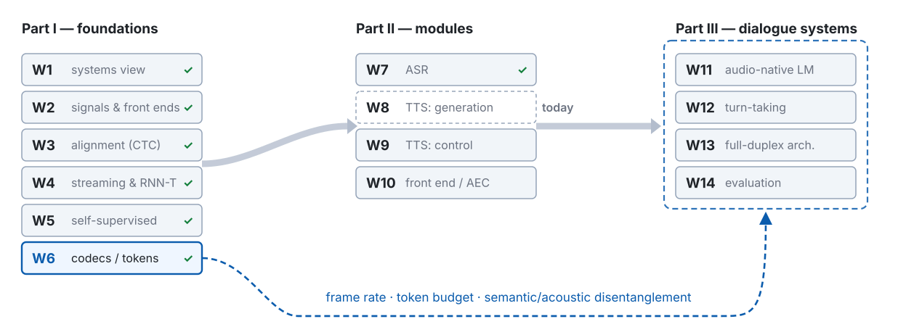

---
# 此檔由 bin/publish_slides.py 從投影片正本產生（中文講稿區塊已剝除），請勿直接編輯。正本在 private repo 的 <course>/slides/。
title: "Speech Synthesis I: From a Line of Text to a Stretch of Sound — Where Length, Variation, Waveform and Latency Are Decided"
subtitle: "Speech Processing & Human–Machine Interaction · Week 8"
author: "Hung-Shin Lee"
lang: en
format:
  revealjs:
    theme: [default, theme.scss]
    slide-number: c/t
    show-slide-number: all
    # 目標顯示尺寸：1280×800（16:10）。設成剛好填滿。
    # margin 預設 0.1 會把 deck 縮到 90% 才顯示（1152×720），白白損失一成字級。
    width: 1280
    height: 800
    margin: 0.04
    center: false
    progress: true
    transition: none
    # 章節標題會產生垂直堆疊；linear 讓左右鍵逐張前進，講課時才不會跳章
    navigation-mode: linear
    incremental: false
    # inline SVG 的 fragment（）在 ?print-pdf 裡要全部可見，不要每個 fragment 一頁
    pdf-separate-fragments: false
    chalkboard:
      buttons: true
    html-math-method:
      method: katex
      url: "https://cdn.jsdelivr.net/npm/katex@0.18.7/dist/"
    # 講稿（notes 區塊）裡的數學只輸出 MathML（與 w02.qmd～w07.qmd 相同的做法）。
    # presenter view 是另一個視窗，沒有 KaTeX 的 CSS；KaTeX 預設同時輸出 HTML 與 MathML，
    # 沒有 CSS 時兩份都會顯示，符號就重複了（例如 ℓℓ）。MathML 由瀏覽器原生排版，不需要 CSS。
    # 本 deck 自用（2026-11-18，同 w09.qmd）：表格首欄允許換行——theme 的 .reveal table 首欄是 nowrap，首欄是句子的表要包在 ::: {.wrap1} 裡。
    include-in-header:
      - text: |
          
    include-after-body:
      - text: |
          
---

# Where does "which reading" get decided? {.section-title}

## Where we are: week 8 of 14

{width="100%"}

## Last week, in one picture



::: {.claim}
**The arrow turns around**: given $\ell$, which $\mathbf{X}$ — and the output can be W6's tokens, W2's mel, or the waveform itself.
:::

::: {.footer}
W7 p5 · W7 p87's last paragraph · W6 p24 RVQ · W6 p62
:::

## The problem this week handles, in one picture



::: {.fragment fragment-index=3}
::: {.small}
The variation question has only two answers — and the 2026 recipe uses one of each, on its own layer.
:::
:::

::: {.claim}
Every TTS system is **one way of placing the decision "which reading"** in four places: length, variation, waveform, and the wait before the first packet.
:::

::: {.footer}
Route: not regression → length → AR tokens → flow matching → vocoder → first packet → axes
:::

## Today's route: six stops, in two halves



::: {.claim .fragment fragment-index=2}
**First:** not the mean; the length; tokens. **Then:** a flow; the waveform; the wait.
:::

::: {.footer}
six stops = the six section pages · half-time: p40 · answered: p90
:::

## Notation for today

| Symbol | Meaning |
|:--------|:------------------|
| $\ell$, $U$; $\mathbf{x}_t$, $\mathbf{X}$, $T$; $\Delta$; $\mathbf{x}$ | the text and its length; mel frames, the mel, its length — **not known in advance this week**; frame shift (W2); the waveform (W6) |
| $k_{t,i}$, $\mathbf{k}$, $f_r$, $N_q$, $V$, $R_{\text{tok}}$; $\Phi_j$, $\lambda_{\cdot}$ | W6's tokens, frame rate, levels, codebook size, token rate; W6's discriminators and loss weights |
| $\mathbf{k}^{\text{p}}$, $\mathbf{X}^{\text{p}}$, $\ell^{\text{p}}$ | the prompt's tokens, mel, text (**not** W7's $\mathbf{p}$, a control token) |
| $\tau$; $\mathbf{X}_0$, $\mathbf{X}_1$, $\mathbf{X}_\tau$; $p_\tau$, $p_\tau(\cdot \mid \mathbf{X}_1)$ | flow time in $[0, 1]$ (**not** $t$, the frame index); noise end, data end, a point on the path; marginal, conditional density |
| $\mathbf{u}_\tau(\mathbf{X})$, $\mathbf{u}_\tau(\mathbf{X} \mid \mathbf{X}_1)$, $\mathbf{v}_\theta(\mathbf{X}_\tau, \tau, \mathbf{c})$; $w$; $N_{\text{FE}}$, $h$ | marginal field, conditional field, the model with condition $\mathbf{c}$ (unconditional: no $\mathbf{c}$, **not** $\varnothing$); CFG weight; function evaluations, Euler step $1/N_{\text{FE}}$ |
| $\alpha_\tau$, $\sigma_\tau$, $\sigma_{\min}$; $\nabla_{\mathbf{X}} \ln p_\tau$; $\bar{\mathbf{u}}(\mathbf{X}, r, \tau)$ | schedule; the score; MeanFlow's average velocity over $[r, \tau]$ |
| $d_u$, $\mathbf{h}_u$, $a_{t,u}$; $\langle\text{eos}\rangle$; $C$; $D_{\text{fwd}}$, $D_{\text{voc}}$, $D_{\text{buf}}$, $D_{\text{token}}$, $D_{\text{fp}}$ | duration, text-encoder output, decoder attention; stop symbol; chunk size (W1); W1's delay family: forward pass, vocoder, buffer, token (W7), first packet |

::: {.footer}
$\ln$ throughout · vectors bold, scalars italic, functions upright · the outline's notation, verbatim
:::

## Six things to leave with today

1. **TTS is sampling, not regression.** Regressing to $\mathbb{E}[\mathbf{X} \mid \ell]$ returns the average reading — the over-smoothed spectrum W2 promised — and ten years of systems are three decisions moving house: who sets the length, who generates the variation, who renders the waveform.
2. **Four answers to the length question**: attention (and how it fails), a duration predictor whose teacher is MFA or MAS — W3's Viterbi without the blank — the autoregressive stop symbol, and a length handed in from outside.
3. **The conditional flow-matching objective, derived**: why the CNF likelihood is expensive, why regressing on the conditional field has the same gradient as the marginal one, the straight-line loss, Euler sampling, score ↔ velocity, CFG and its sound, and why reflow and MeanFlow bring $N_{\text{FE}}$ to 1–2.
4. **VALL-E's AR + NAR factorisation**, cloning as continuation, length instability from a learned $\langle\text{eos}\rangle$, and the three 2026 configurations placed on the four-decision table.
5. **HiFi-GAN's three losses in W6's notation**, why the MPD folds the waveform, what the ablation measured, and how iSTFT vocoders dodge phase wrapping.
6. **The first packet in W1's notation**: three shapes, numbers with their conditions, the per-chunk RTF constraint, and why chunk-aware flow matching must see the mask in training.

# One line of text, many readings: why TTS is not regression {.section-title}

## One-to-many: what a regression returns

$$
\arg\min_{\hat{\mathbf{X}}}\ \mathbb{E}\,\lVert \mathbf{X} - \hat{\mathbf{X}}(\ell) \rVert^2 \;=\; \mathbb{E}[\mathbf{X} \mid \ell]
\qquad \text{for any deterministic } \hat{\mathbf{X}}(\ell)
$$



::: {.fragment fragment-index=2}
::: {.small}
19 teeth: the three shared ones (720, 1440, 2160 Hz) add up, the other 16 are half-height — no voice has this spectrum.
:::
:::

::: {.claim}
Two distant modes: their mean **is not a legitimate sample** — harmonics at different positions average into a smear.
:::

::: {.footer}
L1 gives the conditional median, same problem · W2 p53, p54 · W6 p30
:::

## Two exits: discretise and sample, or carry noise to a sample



::: {.claim}
Neither exit predicts the mean. One moves the randomness into **a token draw**, the other into **the starting noise** — and the 2026 recipe uses one of each.
:::

::: {.footer}
exit 1: §3 (VALL-E, CosyVoice, Qwen3-TTS) · exit 2: §4 (Voicebox, E2, F5, Matcha)
:::

## Before Demo 1: the average reading, and three draws

::: {.prose}
| | |
|:---|:-----------------|
| **Why** | p10 derived what a regression returns and p11 named the two exits; this looks at them, and listens, on this laptop. **The same sentence, once through a model that regresses the mel and once through a model that draws it** — and the second one three times. |
| **What runs** | W3's sentence, text only. (1) SpeechT5 (`microsoft/speecht5_tts`): regresses an 80-bin log-mel, stops on a learned stop token; the voice is an x-vector of *another* speaker (ARCTIC `bdl`) → its HiFi-GAN. F5-TTS (`F5TTS_v1_Base`, 32 NFE, $w = 3$, a 4.9 s prompt from the same speaker) → Vocos. Each mel in its own front end, the real recording under it. (2) F5 again, same prompt, three seeds. |
| **Watch for** | Before the mels appear: above 2 kHz, will the regressed mel keep the fine grain of the real recording, or come out smooth? After: do the three F5 draws have the same length, and where do they differ? |
:::

::: {.footer}
Demo 1 · `demos/w08_d1_mean_vs_sample` · rehearsed 2026-11-08 · nothing is trained today
:::

## Demo 1 — a regressed mel, a flow mel, three seeds

::: {.ask}
**Demo 1.** Same sentence, two models. Before the mels appear: above 2 kHz, will the regressed mel keep the fine grain of a real recording, or come out smooth?
:::

::: {.fragment fragment-index=1}
| | SpeechT5 (regression) | F5-TTS seed 1 | F5-TTS seed 2 | F5-TTS seed 3 |
|:---|:------|:------|:------|:------|
| length (s); the real recording: 5.86 | 5.28 | 5.31 | 5.31 | 5.31 |
| fine detail 2–6 kHz, % of the real recording | 64% | 100% | 102% | 93% |
| what we heard (laptop speakers) | not audibly flatter than F5 | hard to tell the three apart | ″ | ″ |
:::

::: {.footer}
Demo 1 · demos/w08_d1_mean_vs_sample · rehearsal 2026-11-08 (M5 Max) · w08-metrics.json → demo1
:::

## Ten years in one table: where each generation put the decisions

| system | length / alignment | variation | waveform |
|:---|:---------|:---------|:---------|
| concatenative (Hunt & Black 1996) | unit boundaries | pick units from a database | the recordings themselves |
| SPSS, statistical parametric synthesis (Zen et al. 2009) | HMM states | **none: averages** ("muffled") | a signal-processing vocoder |
| Tacotron 2 (2018) | **attention** + a stop token | none: regresses the mel | WaveNet, then GAN vocoders |
| FastSpeech 2 (2021) | **duration predictor** (MFA teacher) | none: regresses, + pitch / energy | HiFi-GAN |
| VITS (2021) | MAS, **stochastic** duration | a VAE + flow, inside | its own HiFi-GAN-style decoder |
| VALL-E (2023) | the **AR stop symbol** | a token draw over W6's alphabet | the codec decoder |
| F5-TTS (2025) | **given from outside** (a ratio) | the starting noise, a flow | Vocos / BigVGAN |

::: {.footer}
three more rows at p39 · Tacotron 2 abstract: MOS 4.53 vs 4.58 for recordings
:::

## MC 1 — "TTS is regression; a big enough network will learn it"

::: {.claim .warn}
No capacity fixes a structural fact: the optimum of a squared-error regression is $\mathbb{E}[\mathbf{X} \mid \ell]$, and for a multimodal $P(\mathbf{X} \mid \ell)$ that mean is not a sample.
:::

| what a bigger network buys | what it cannot buy |
|:---|:---------|
| a sharper estimate of the mean | a mean that is a legitimate reading |
| better low-frequency envelopes | harmonics that sit at one $F_0$ rather than between two |
| better pitch / energy *predictors* (FastSpeech 2) | a *choice* between two readings — a predictor still averages |

::: {.footer}
Demo 1 shows it; p10 proves it · the fix: move the randomness (§3 a token draw, §4 the noise)
:::

# Length and alignment: who decides how many frames {.section-title}

## Every TTS is four blocks



::: {.claim}
The second block is the one with **four answers** — and whichever answer a system picks decides what the other three blocks are allowed to be.
:::

::: {.footer}
outline 〈形式化〉: front end → alignment / length → acoustic → waveform · p14's columns
:::

## Tacotron 2: attention decides the length — and collapses



::: {.claim .warn}
The decoder's attention is the **only** alignment, and nothing makes it monotone or complete: W4's "attention is not alignment" costs, in TTS, **repeated and skipped words** — the hallucination of TTS.
:::

::: {.footer}
Shen et al. 2018 §2.2 · "word skipping and repeating" is FastSpeech §1's name for it · W4 p65, p65
:::

## FastSpeech: the duration predictor and the length regulator



$$
\hat{d}_u = \mathrm{DP}(\mathbf{h}_u)\ \ (\text{trained on } \ln d_u),\qquad T = \sum_u d_u,\qquad \text{then regress the whole mel at once}
$$

::: {.footer}
Ren et al. 2019 §3.2–3.3 · FastSpeech 2 §2.3: MFA, pitch, energy · 269× faster mel (Table 2)
:::

## Where the teacher durations come from: attention, MFA, MAS

| teacher | how $d_u$ is obtained | needs | used by |
|:---|:--------------|:---------|:------|
| attention | an AR teacher's attention: per token, count the frames whose peak lands on it | a trained Tacotron-style model | FastSpeech |
| MFA | Montreal Forced Aligner — W3's HMM–GMM Viterbi on the pair; phone boundaries → frame counts | grapheme-to-phoneme (G2P), a lexicon, an offline aligner | FastSpeech 2, Voicebox |
| MAS | monotonic alignment search — the best **monotone** alignment of the model's own likelihood, by DP, re-estimated as training goes | nothing external (next slide) | Glow-TTS, VITS, Grad-TTS, Matcha |

::: {.claim}
All three hand the acoustic model **one** alignment to learn from. The third one is W3's Viterbi with the blank removed.
:::

::: {.footer}
McAuliffe et al. 2017 (MFA) · Kim et al. 2020 (Glow-TTS §3.1–3.2: MAS) · W3 p21, p23
:::

## MAS is W3's Viterbi without the blank



$$
A^{*} = \arg\max_{A\ \text{monotone, onto}} \sum_t \ln \mathcal{N}\big(\mathbf{z}_t;\ \boldsymbol{\mu}_{A(t)}, \boldsymbol{\sigma}_{A(t)}\big),\qquad d_u = \big|\{t : A^{*}(t) = u\}\big|
$$

::: {.footer}
Glow-TTS §3.1–3.2 · w08-data.json → mas_example · W3 p21: the same lattice, with $\sum$ and blanks
:::

## Why TTS cannot sum the alignment away, as CTC does

| | CTC (W3) | TTS |
|:---|:---------|:---------|
| what is computed | $P(\ell \mid \mathbf{X}) = \sum_\pi P(\pi \mid \mathbf{X})$ — $\mathbf{X}$ is **given** | $\mathbf{X}$ must be **generated** |
| the alignment is | a nuisance variable: marginalise it | part of the output: **how many frames, which frame for which symbol** must be decided before any frame exists |
| so the model needs | no alignment at all — every path contributes | **one** alignment (a teacher), or a mechanism that decides it on the fly (attention, $\langle\text{eos}\rangle$), or the length from outside |
| $\max$ or $\sum$ | $\sum$ in training; $\max$ only at decoding | $\max$ (MAS) — one alignment to learn from |

::: {.claim}
Recognition can leave "where" undecided and still score the sentence. Synthesis has to put every frame somewhere — **the alignment is an output, not a latent to integrate out.**
:::

::: {.footer}
outline 〈關鍵數學 2〉, the key step · W3 p21 · p25 returns to this
:::

## VITS: one stage, no mel, and a sampled duration

| block | VITS (Kim, Kong & Son, ICML 2021) |
|:---|:---------|
| alignment / length | MAS; a **stochastic duration predictor** — the length is drawn, not predicted |
| acoustic generation | a conditional VAE (variational autoencoder): posterior from the waveform's spectrogram, prior from the text through a normalizing flow — **the first row of p14 with variation in it** |
| waveform | a HiFi-GAN-style decoder trained with W6's discriminators; no mel in between |
| descendants | MMS-TTS (`nan`, `hak`; W7, Demo 3), the Kokoro family (W1 Demo 2) |

::: {.claim}
VITS is where "length" first became something the model **samples**, and where the last two blocks fused — which is why the on-device systems of 2026 are still its children.
:::

::: {.footer}
Kim et al. 2021 §2.1–2.5 (PMLR 139) · MMS: Pratap et al. 2024 §7.1 · W6 p30
:::

## Four answers to the length question

| answer | $T$ is decided by | needs | streams? | fails as |
|:---|:---------|:---------|:---|:--------|
| (a) attention | a stop token, step by step | nothing — that is the problem | yes (AR) | repeats, skips, never stops |
| (b) duration predictor | $T = \sum_u \hat{d}_u$, before any frame | a teacher: attention / MFA / MAS | no (whole mel) | wrong rate, flat prosody |
| (c) AR $\langle\text{eos}\rangle$ | the first draw of $\langle\text{eos}\rangle$ — learned | a token vocabulary (W6) | yes | early stop, never stops, loops (p31) |
| (d) given from outside | the user, or a character-count ratio | nothing inside — the problem moved out | with chunks (§6) | stretched / squeezed when $T$ is off |

::: {.claim}
The length question never disappears: (a)–(c) answer it **inside** the model, (d) **outside**.
:::

::: {.footer}
outline 〈關鍵數學 2〉(a)–(d) · (c): §3 · (d): §4, p58
:::

## MC 2 — "TTS needs no alignment; attention learns it"

::: {.claim .warn}
Tacotron's repeats and skips **are** attention failing to learn an alignment. FastSpeech, Glow-TTS and VITS all pulled the alignment **out** into an explicit duration; E2 / F5 pushed it back **in** — and paid with a length that must be handed in and an alignment nobody can inspect.
:::

| | explicit duration (FastSpeech 2, VITS, Voicebox) | implicit, in attention (Tacotron 2, E2 / F5) |
|:---|:---------|:---------|
| can you read the alignment? | yes: $d_u$ | no |
| can you control the rate? | yes: scale $d_u$ | only by changing $T$ (F5) — crudely |
| front end | G2P + aligner, or MAS | characters, nothing else |
| what you give up | simplicity of the front end | inspectability; stability on long or odd input |

::: {.footer}
a design trade, not a generation gap · W4 p65 · p59: the three systems in a row
:::

# Variation, answer one: autoregression over W6's alphabet {.section-title}

## At a glance: VALL-E

::: {.prose}
| | |
|:---|:-----------------|
| **Name** | **Neural Codec Language Models are Zero-Shot Text to Speech Synthesizers** — "VALL-E", Wang et al. (13 authors, Microsoft), arXiv 2023; no journal version found. A decoder-only Transformer over EnCodec tokens (W6). |
| **The question** | If speech is a string of W6's letters, can TTS be **language modelling** — and can a prompt of 3 s make it speak in that voice without any training for that speaker? |
| **The idea** | Tokens: EnCodec, $f_r = 75$ Hz, $N_q = 8$, $V = 1024$. One AR model writes the first level token by token; one NAR model writes each of the other seven levels in a single pass. The prompt's tokens go into the context, and the model **continues** them. 60,000 hours of LibriLight with ASR transcripts. |
| **What it added** | Zero-shot voice cloning as **in-context learning** (the paper's term): no speaker embedding, no fine-tuning; variation from a token draw; a length decided by $\langle\text{eos}\rangle$. |
| **What it leaves open** | The stop symbol is learned, so the length is unstable (p31); eight levels at 75 Hz is 600 steps per second of speech (W6 p51) — the 2026 configurations exist to fix both (p33–p36). |
:::

::: {.footer}
Wang et al., arXiv:2301.02111 · W6 p24 RVQ, p25 first level · W7 p69: the prompt, the other way
:::

## AR + NAR: the first level decides, the other seven correct



$$
P(\mathbf{k} \mid \ell, \mathbf{k}^{\text{p}}) = \underbrace{\prod_t P_{\text{AR}}(k_{t,1} \mid \mathbf{k}_{<t,1}, \ell, \mathbf{k}^{\text{p}})}_{\text{level 1: one frame at a time}} \cdot \underbrace{\prod_{i=2}^{N_q} P_{\text{NAR}}(\mathbf{k}_{:,i} \mid \mathbf{k}_{:,<i}, \ell, \mathbf{k}^{\text{p}})}_{\text{levels } 2 \ldots 8\text{: a whole level per pass}}
$$

::: {.footer}
AR = autoregressive, NAR = non-autoregressive · Wang et al. 2023 §4.2 · W6 p26
:::

## Training and use are the same picture: cloning is continuation



::: {.claim}
Zero-shot cloning is not an extra ability: it is what a continuation model does when the prompt is **someone else's** 3 seconds.
:::

::: {.fragment fragment-index=2}
::: {.small}
W7: a text prompt steers an ASR's prior. W8: a speech prompt steers a TTS's prior — **the same slot, the other way.**
:::
:::

::: {.footer}
Wang et al. 2023 §4.3 ("in-context learning") · W7 p69 · "continuation": this course's bridge
:::

## Why continuation clones: a prior large enough to resemble

::: {.claim}
W6's tokens encode **speaker, prosody and content together**; the LM only learns "what follows this string". To keep the loss low it must keep whatever the prompt had — and with tens of thousands of speakers in 60,000 hours, what it learns is the rule "**preserve the prompt's properties**", not any one voice.
:::

| the mechanism, step by step | |
|:---|:---------|
| 1 | a token string from speaker A continues as speaker A in every training example — a token sequence that switched voice mid-sentence would be high-loss |
| 2 | so the AR model's prior over the next token is conditioned on everything audible in the prompt: timbre, rate, room, microphone |
| 3 | at use, the prior "continues" — which is why **channel leaks** too: background noise and codec artefacts in the prompt are preserved just as faithfully (W9) |

::: {.footer}
W7: a prior big enough speaks on its own — here it **resembles** on its own · W6 p45
:::

## The stop symbol is learned: length instability, two patches

$$
P\big(\langle\text{eos}\rangle \mid \mathbf{k}_{<t,1}, \ell, \mathbf{k}^{\text{p}}\big)\ \ \text{is one softmax cell}
$$

::: {.small}
W7's AED again: weak evidence stops early, a loop never stops.
:::

| failure | what the model is doing | VALL-E 2's patch (Chen et al. 2024) |
|:---|:---------|:---------|
| **never stops** | nucleus sampling with a small top-$p$ falls into an **infinite loop** of the same tokens; greedy decoding "continually generates silence codes" | **repetition-aware sampling**: detect repetition in the recent window, switch to random sampling for that step |
| long sequences degrade | 75 tokens per second: a 20 s utterance is 1,500 steps of context | **grouped code modeling**: predict a group of adjacent tokens per step — shorter sequences |
| stops early, drops words | $\langle\text{eos}\rangle$ drawn where the evidence is weak (long tails, a prompt whose style differs from the text) | not listed as a problem in the paper; addressed by CFG, repetition penalties, and W9's RL with a WER reward |

::: {.footer}
Chen et al., VALL-E 2, arXiv:2406.05370 §1 · W7 p50: the length reward · nothing ties $T$ to $\lvert\ell\rvert$
:::

## Parallel instead of autoregressive: SoundStorm, MaskGCT

| | what is parallel | what still has to be decided elsewhere |
|:---|:---------|:---------|
| **SoundStorm** (Borsos et al. 2023) | all acoustic levels, MaskGIT-style: mask, predict, keep the confident tokens, repeat — level by level over the RVQ | the **semantic tokens** it is conditioned on come from AudioLM's AR stage (W6 p45) — so does the length |
| **MaskGCT** (Wang et al., ICLR 2025) | **both** stages: text → semantic tokens and semantic → acoustic tokens are masked generation; no alignment, no phone durations | the **total length**: a separate flow-matching duration model predicts it from the text and the prompt's length (§3.2.2) |

::: {.claim}
Take the autoregression away and the length question does not go away with it — it moves to a conditioning stage or to a separate model. Row (d) of p24 again.
:::

::: {.footer}
Borsos et al. 2023 §3.3 · MaskGCT §1, §3.2 · every answer to variation answers length somewhere
:::

## At a glance: CosyVoice 2

::: {.prose}
| | |
|:---|:-----------------|
| **Name** | **CosyVoice 2: Scalable Streaming Speech Synthesis with Large Language Models** — Du et al. (19 authors, Alibaba), arXiv 2024, technical report. The 2026 recipe: an AR LM over **semantic** tokens, a flow to mel, a vocoder. |
| **The question** | Can one system be both an LLM that streams and a high-quality generator — by giving each paradigm **one layer**? |
| **The idea** | A tokenizer that is an ASR encoder with an FSQ inserted (25 Hz, 6,561 codes, 100 % used); a text LLM that writes those tokens, reading $N = 5$ text tokens for every $M = 15$ speech tokens it writes; a **chunk-aware** flow matching model that decodes each chunk of tokens to mel; HiFi-GAN to waveform. |
| **What it added** | Streaming on both ends (text in, audio out) with a first-packet formula in the paper (Eq. 11–12); a flow decoder trained with four attention masks so the same weights serve offline and streaming (§2.4). |
| **What it leaves open** | The token leans to content, so timbre and detail are the flow's job (p34); the chunk boundary is a seam the mask must cover (p78); the paper gives **no millisecond figure** — 150 ms is the GitHub README. |
:::

::: {.footer}
Du et al., arXiv:2412.10117 §2.2–2.5 · CosyVoice 1: same recipe, VQ, token rate not stated
:::

## Configuration (i): semantic tokens, then a flow — CosyVoice 2



::: {.fragment fragment-index=1}
::: {.small}
The tokenizer is an ASR encoder with a quantiser inserted (FSQ, 6,561 codes), supervised by transcripts — so the token leans to content, and the flow puts the voice and the detail back: **the more semantic the token, the more the flow repairs.** Streaming: text and speech tokens interleaved 5 : 15; the flow decodes chunk by chunk with a chunk-aware mask (§6).
:::
:::

::: {.footer}
Du et al. 2024 §2.2–2.4 · "the more semantic the token, the more the flow repairs": a dial
:::

## Configuration (ii): dual-track to waveform — Qwen3-TTS



::: {.fragment fragment-index=1}
::: {.small}
Every LM step emits all 16 codebooks of one 80 ms frame (1 semantic + 15 RVQ acoustic): the decoder needs nothing else. So the first packet waits only for a few LM steps: **97 ms = 93 ms of LM + 4 ms of decoding**, for 4 tokens = 320 ms of speech (0.6B model, vLLM, concurrency 1; the GPU is not stated — quote the number with its conditions).
:::
:::

::: {.footer}
Hu et al., Qwen3-TTS TR §2.2, §3.1, §3.4 · 97 ms = 93 + 4; 0.6B, vLLM, GPU not stated
:::

## Configuration (iii): continuous latents, a flow head — CuteTTS



::: {.fragment fragment-index=1}
::: {.small}
No codebook: variation is decided at every step by a tiny flow on a 64-dim vector (a few NFE), not by drawing a token. Two latents per patch → the LM runs at 6.25 steps/s; 49 ms mean first packet on an RTX 4090 (Table 2); guidance distilled away.
:::
:::

::: {.footer}
Zhang et al., CuteTTS §3.1, §3.3, Table 2 (49.0 ms, RTX 4090) · Meng et al., MELLE, ACL 2025 §3.2
:::

## MC 3 — "a codec LM is an LLM with the vocabulary swapped"

::: {.claim .warn}
Three things differ: **(a)** the length comes from a learned $\langle\text{eos}\rangle$ (p31); **(b)** several codebook levels force a choice — who is AR, who is NAR, or one level plus a flow; **(c)** the prompt's tokens carry timbre *and* channel, and continuation keeps both (p30).
:::

| what is the same | what is not |
|:---|:---------|
| a strong prior that writes on its own — "hallucination" here is a sound not in the text | the vocabulary is a *reconstruction* (W6 p45): every property of the prompt is in it |
| next-token cross-entropy, sampling, repetition penalties, CFG | the **unit of a step**: 12.5–75 per second of output, not per word (W6 p51) |

::: {.footer}
W6 p57 · W7 p31 (the prior speaks on its own) · the 2026 configurations differ in (b)
:::

## MC 4 — "zero-shot cloning extracts a speaker embedding"

::: {.claim .warn}
The VALL-E family has **no embedding step**: the prompt's tokens go into the context and are continued. Speaker embeddings (x-vector, ECAPA) are the *other* road — SpeechT5, the FastSpeech family, CosyVoice's speaker vector — and the two roads differ in what can be controlled and what leaks.
:::

| | continuation (prompt in context) | an embedding (a vector for the voice) |
|:---|:---------|:---------|
| what is copied | everything audible: timbre, rate, style, room, noise | what the encoder was trained to keep — timbre, mostly |
| control | change the prompt | add, interpolate, swap vectors |
| leakage | the channel comes along (p30) | less — and so does some of the voice |
| needs | 3 s of audio (and its text, for VALL-E) | an enrolment pass through the speaker encoder |

::: {.footer}
W9's first question · Demo 1: SpeechT5 uses an x-vector, F5 a prompt mel
:::

## The four decisions: the table, three more rows

| system | length | variation | waveform | first packet |
|:---|:------|:------|:------|:------|
| Tacotron 2 | attention + stop token | — (regression) | WaveNet / GAN vocoder | whole mel, AR frame by frame |
| FastSpeech 2 | duration predictor | — (regression) | HiFi-GAN | whole mel at once |
| VITS | MAS, sampled duration | VAE + flow inside | own decoder | whole utterance |
| VALL-E | AR $\langle\text{eos}\rangle$ | token draw, 8 levels | codec decoder | first level AR, 75 steps/s |
| F5-TTS | given (a ratio) | the starting noise | Vocos / BigVGAN | whole utterance, $N_{\text{FE}}$ passes |
| **CosyVoice 2** | AR $\langle\text{eos}\rangle$ | AR tokens **+** a flow | flow → mel → HiFi-GAN | first chunk + flow + vocoder |
| **Qwen3-TTS** | AR $\langle\text{eos}\rangle$ | AR over 16 levels at once | codec decoder | a few LM steps + decoder |
| **CuteTTS** | AR stop head | a flow head per step | causal VAE decoder | one patch + head + decoder |

::: {.footer}
the table of the week, complete · AR for "when", a flow or a decoder for "what it sounds like"
:::

## Half-time: tokens by AR — what is the flow half?



::: {.claim}
**So far:** the 2026 recipe is AR writes tokens, a flow decodes them — and the AR half is done. **From here:** **what is the flow half?**
:::

::: {.footer}
the route: p6 · first half: p9–p39 · second half: p41–p83 · answered: p90
:::

# Variation, answer two: flow matching {.section-title}

## At a glance: Flow Matching

::: {.prose}
| | |
|:---|:-----------------|
| **Name** | **Flow Matching for Generative Modeling** — Lipman, Chen, Ben-Hamu, Nickel & Le, ICLR 2023. Independently: *rectified flow* (Liu, Gong & Liu) and *stochastic interpolants* (Albergo & Vanden-Eijnden), both ICLR 2023. |
| **The question** | A continuous normalizing flow is a beautiful generative model whose training is too expensive (p44). Can the **velocity field** that moves noise to data be learned by plain regression — without ever computing a likelihood? |
| **The idea** | Pick a simple *conditional* path from noise to each data point (a straight line will do); regress the model's velocity onto that path's velocity, $\mathbf{X}_1 - \mathbf{X}_0$. The marginal field you actually want has **the same gradient** (Theorem 2), so the cheap loss trains the right thing. |
| **What it added** | Training as stable as any regression; a straight path that solvers cross in few steps; diffusion as a choice of schedule inside one framework (p54). In TTS: Voicebox, Matcha-TTS, E2, F5, the decoders of CosyVoice and FlashTTS. |
| **What it leaves open** | Why the field still bends, and how to straighten it (p51–p52); guidance (p55); and — for speech — the **length** must be given before the first noise is drawn (p58). |
:::

::: {.footer}
Lipman et al., arXiv:2210.02747: Eq. 5, Eq. 9, Thm 1–2, Eq. 20–21 · "if you read one paper"
:::

## The picture: a velocity field from noise to data



::: {.claim}
Training pairs one real mel with one random start and asks for the **direction**, not the destination. Averaging directions is harmless; averaging destinations was the whole problem of §1.
:::

::: {.footer}
outline analogy (b); it fails where lines cross (p51) · velocity field: everywhere, which way, how fast
:::

## Step 1 — why a continuous normalizing flow is expensive

$$
\frac{d\mathbf{X}_\tau}{d\tau} = \mathbf{v}_\theta(\mathbf{X}_\tau, \tau)
\qquad\Longrightarrow\qquad
\frac{d}{d\tau}\ln p_\tau(\mathbf{X}_\tau) = -\nabla \cdot \mathbf{v}_\theta(\mathbf{X}_\tau, \tau)
$$

$$
\ln p_1(\mathbf{X}_1) = \ln p_0(\mathbf{X}_0) - \int_0^1 \nabla \cdot \mathbf{v}_\theta(\mathbf{X}_\tau, \tau)\, d\tau
$$

::: {.claim .warn}
Maximum likelihood needs, **per training example**, the trace of a Jacobian integrated along an ODE (ordinary differential equation) — solve the ODE, then differentiate through it. Beautiful; too slow for 80-dimensional mel at scale.
:::

::: {.footer}
Chen et al., Neural ODEs, NeurIPS 2018, Thm 1, Eq. 8 · $\nabla \cdot$ is the divergence: the trace of $\partial \mathbf{v} / \partial \mathbf{X}$
:::

## Step 2 — regress the velocity field instead

$$
\mathcal{L}_{\text{FM}}(\theta) = \mathbb{E}_{\tau,\ \mathbf{X} \sim p_\tau}\ \big\lVert \mathbf{v}_\theta(\mathbf{X}, \tau) - \mathbf{u}_\tau(\mathbf{X}) \big\rVert^2
$$

| if we had | then |
|:---|:---------|
| a density path $p_\tau$ with $p_0 = \mathcal{N}(\mathbf{0}, \mathbf{I})$ and $p_1 = p_{\text{data}}$ | sample $\mathbf{X}$ from it at a random $\tau$ |
| the velocity field $\mathbf{u}_\tau$ that **generates** that path (moves $p_0$ to $p_1$) | regress $\mathbf{v}_\theta$ onto it — no ODE, no Jacobian, no likelihood |

::: {.claim .warn}
But $p_\tau$ and $\mathbf{u}_\tau$ are functions of the **whole data distribution** — we have neither. Lipman et al. Eq. 5 is a target we cannot evaluate.
:::

::: {.footer}
Lipman et al. 2023 Eq. 5 · "generates": the continuity equation holds — not derived here
:::

## Step 3 — conditional paths: the marginal field is a mean



::: {.fragment fragment-index=2}
$$
\mathbf{u}_\tau(\mathbf{X}) = \int \mathbf{u}_\tau(\mathbf{X} \mid \mathbf{X}_1)\,\frac{p_\tau(\mathbf{X} \mid \mathbf{X}_1)\,p_{\text{data}}(\mathbf{X}_1)}{p_\tau(\mathbf{X})}\,d\mathbf{X}_1
\qquad \text{(Theorem 1: this field generates } p_\tau\text{)}
$$
:::

::: {.footer}
Lipman et al. 2023 §3: Eq. 6, Eq. 8, **Theorem 1** · the weights: a posterior over the data point
:::

## Step 4 — the same gradient: the conditional loss will do

$$
\mathcal{L}_{\text{CFM}}(\theta) = \mathbb{E}_{\tau,\ \mathbf{X}_1 \sim p_{\text{data}},\ \mathbf{X} \sim p_\tau(\cdot \mid \mathbf{X}_1)}\ \big\lVert \mathbf{v}_\theta(\mathbf{X}, \tau) - \mathbf{u}_\tau(\mathbf{X} \mid \mathbf{X}_1) \big\rVert^2
$$

::: {.fragment fragment-index=1}
$$
\nabla_\theta \mathcal{L}_{\text{CFM}} = \nabla_\theta \mathcal{L}_{\text{FM}}
\qquad \text{(Theorem 2: equal up to a constant independent of } \theta\text{)}
$$
:::

::: {.fragment fragment-index=2}
| the skeleton | |
|:---|:---------|
| expand both | $\lVert \mathbf{v}_\theta \rVert^2 - 2\langle \mathbf{v}_\theta, \mathbf{u} \rangle + \text{const}$ — the quadratic term is the same in both (same $\mathbf{X} \sim p_\tau$) |
| the cross term | $\mathbb{E}_{\mathbf{X}_1}\mathbb{E}_{\mathbf{X} \mid \mathbf{X}_1}\langle \mathbf{v}_\theta, \mathbf{u}_\tau(\mathbf{X} \mid \mathbf{X}_1)\rangle = \mathbb{E}_{\mathbf{X}}\langle \mathbf{v}_\theta, \mathbf{u}_\tau(\mathbf{X})\rangle$ — by Step 3's "weighted mean" |
| the constants | $\mathbb{E}\lVert \mathbf{u}_\tau(\mathbf{X} \mid \mathbf{X}_1) \rVert^2 \neq \mathbb{E}\lVert \mathbf{u}_\tau(\mathbf{X}) \rVert^2$, but neither depends on $\theta$ |

::: {.claim}
So the cheap loss trains the right thing — and what $\mathbf{v}_\theta$ learns at each $(\mathbf{X}, \tau)$ is the MSE optimum, the **conditional expectation of the conditional velocities: the marginal field.**
:::
:::

::: {.footer}
Lipman et al. 2023 Eq. 9 (CFM: conditional flow matching), Thm 2 · the key step — stop here
:::

## Why "regress to the mean" is now a feature

| | §1: regress the **mel** | §4: regress the **velocity** |
|:---|:---------|:---------|
| the MSE (mean squared error) optimum is | $\mathbb{E}[\mathbf{X} \mid \ell]$ — the mean reading | $\mathbb{E}[\mathbf{X}_1 - \mathbf{X}_0 \mid \mathbf{X}_\tau, \tau]$ — the mean **direction** at this place and time |
| that mean is | not a sample (p10) | exactly the marginal field $\mathbf{u}_\tau$ (Step 3) |
| where the randomness went | nowhere — one output per input | into $\mathbf{X}_0$: integrate the mean direction from a random start and you land on **a** sample, not on the mean of samples |

::: {.claim}
Same optimiser, same loss, opposite outcome. The difference is what is being averaged — and **the sample is reached by integration, not by prediction**.
:::

::: {.footer}
outline 〈為什麼有效〉: "CFM 為什麼把生成變成回歸" · this is Step 4 read backwards
:::

## Step 5 — a straight line: the loss on one slide

$$
\mathbf{X}_\tau = (1 - \tau)\,\mathbf{X}_0 + \tau\,\mathbf{X}_1,\quad \mathbf{X}_0 \sim \mathcal{N}(\mathbf{0}, \mathbf{I})
\qquad\Longrightarrow\qquad
\mathbf{u}_\tau(\mathbf{X}_\tau \mid \mathbf{X}_1) = \mathbf{X}_1 - \mathbf{X}_0
$$

::: {.fragment fragment-index=1}
$$
\boxed{\ \mathcal{L}_{\text{CFM}} = \mathbb{E}_{\tau,\ \mathbf{X}_0,\ \mathbf{X}_1}\ \big\lVert \mathbf{v}_\theta(\mathbf{X}_\tau, \tau, \mathbf{c}) - (\mathbf{X}_1 - \mathbf{X}_0) \big\rVert^2\ }
$$
:::

::: {.fragment fragment-index=2}
::: {.small}
Lipman's "OT path" (§4.1 Example II): $\mu_\tau = \tau\mathbf{X}_1$, $\sigma_\tau = 1 - (1 - \sigma_{\min})\tau$ (Eq. 20), conditional field $\mathbf{u}_\tau(\mathbf{X} \mid \mathbf{X}_1) = \dfrac{\mathbf{X}_1 - (1 - \sigma_{\min})\mathbf{X}}{1 - (1 - \sigma_{\min})\tau}$ (Eq. 21); with $\sigma_{\min} \to 0$ it is the line above. Rectified flow sets $\sigma_{\min} = 0$; Matcha-TTS, Voicebox, E2 / F5 use this family.
:::
:::

::: {.footer}
one line of code: sample $\tau$, $\mathbf{X}_0$, $(\mathbf{X}_1, \mathbf{c})$; mix; predict; MSE · the target is a constant vector
:::

## Step 6 — sampling: Euler, and what each step costs

$$
\mathbf{X}_{\tau + h} = \mathbf{X}_\tau + h\,\mathbf{v}_\theta(\mathbf{X}_\tau, \tau, \mathbf{c}),\qquad h = \frac{1}{N_{\text{FE}}},\qquad \tau = 0, h, 2h, \ldots, 1
$$



::: {.footer}
NFE: forward passes per utterance · midpoint / RK4: more accuracy per step · CFG doubles each
:::

## Step 7 — why the marginal field bends: crossing lines



::: {.fragment fragment-index=2}
::: {.small}
Following the learned (marginal) field from the start bends toward the middle: it ends at another sample, not the original end (sketch) — and a curve costs many small Euler steps. **Reflow** re-pairs each start with the end actually reached: the new lines no longer cross (Liu et al. §2.1, Thm 3.3).
:::
:::

::: {.footer}
Liu, Gong & Liu, ICLR 2023 §2.1, Thm 3.3, §5.2 · the crossing is computed; the bent path is a sketch
:::

## Straightening: reflow, and MeanFlow's average velocity

| | reflow (rectified flow) | MeanFlow (Geng, Deng, Bai, Kolter & He, NeurIPS 2025) |
|:---|:---------|:---------|
| idea | generate $(\mathbf{X}_0, \hat{\mathbf{X}}_1)$ pairs with the trained model; retrain on **those** pairs — they no longer cross | change the target: learn the **average** velocity over an interval, so one step covers it |
| definition | the same loss, new pairs | $\bar{\mathbf{u}}(\mathbf{X}_\tau, r, \tau) = \dfrac{1}{\tau - r}\displaystyle\int_r^\tau \mathbf{u}_s(\mathbf{X}_s)\,ds$ (Eq. 3) |
| training target | $\hat{\mathbf{X}}_1 - \mathbf{X}_0$ | the MeanFlow identity (Eq. 6): $\bar{\mathbf{u}}(\mathbf{X}_\tau, r, \tau) = \mathbf{u}_\tau(\mathbf{X}_\tau) - (\tau - r)\dfrac{d}{d\tau}\bar{\mathbf{u}}$ — the total derivative by a JVP (Jacobian–vector product) |
| one step | still a few (straighter each round, Thm 3.7) | $\mathbf{X}_1 = \mathbf{X}_0 + \bar{\mathbf{u}}(\mathbf{X}_0, 0, 1)$ |
| in TTS | — | FlashTTS: 2-NFE token → mel (X-pred MeanFlow); Dai et al. 2026: 1-NFE token → waveform latent, RTF 0.0046 on an H20 vs 0.0775 for CosyVoice 2's 10-step token2wav |

::: {.footer}
Liu et al. 2023 Thm 3.7 · Geng et al. 2025 Eq. 3, Eq. 6 · Xie et al. 2026 · Dai et al. 2026 Table 1
:::

## Training and use are two different pictures



::: {.claim}
**Gone**: the data and the line. **Stayed**: the model and the solver. **New**: CFG, sway, and a length $T$ that nobody inside the model decides.
:::

::: {.fragment fragment-index=2}
::: {.small}
Four shapes so far: W5 half the model goes · W6 both halves stay, apart · W7 one picture, two uses · **W8 the data and the line go.**
:::
:::

::: {.footer}
the fourth shape: W5 p46 · W6 p32 · W7 p69 · W8: the data and the line disappear
:::

## Diffusion is the same family: a bent path, a score for a velocity

$$
\mathbf{X}_\tau = \alpha_\tau\,\mathbf{X}_1 + \sigma_\tau\,\mathbf{X}_0:\quad
\text{linear } \alpha_\tau = \tau,\ \sigma_\tau = 1 - \tau;\quad
\text{VP (variance-preserving) } \alpha_\tau^2 + \sigma_\tau^2 = 1
$$

::: {.fragment fragment-index=1}
$$
\mathbf{u}_\tau(\mathbf{X}) = \frac{\dot{\alpha}_\tau}{\alpha_\tau}\,\mathbf{X} - \Big(\dot{\sigma}_\tau\sigma_\tau - \frac{\dot{\alpha}_\tau}{\alpha_\tau}\sigma_\tau^2\Big)\,\nabla_{\mathbf{X}} \ln p_\tau(\mathbf{X})
$$

::: {.small}
affine paths: velocity and score differ by a linear map whose coefficients depend only on the schedule
:::
:::

| | flow matching | score-based diffusion |
|:---|:---------|:---------|
| path | straight (linear schedule) | bent (variance-preserving schedule) |
| target | velocity $\mathbf{u}_\tau$ | score $\nabla \ln p_\tau$, or the noise $\boldsymbol{\epsilon}$ |
| sampling | ODE, few steps | SDE (stochastic differential equation), or the probability-flow ODE; many steps |

::: {.small}
Sign check: one data point at $\mathbf{0}$, linear path — $p_\tau = \mathcal{N}(\mathbf{0}, (1-\tau)^2\mathbf{I})$, so $\nabla \ln p_\tau = -\mathbf{X}/(1-\tau)^2$ and the line gives $\mathbf{u}_\tau = -\mathbf{X}/(1-\tau) = \mathbf{X}_1 - \mathbf{X}_0$. With a plus sign the field would point away from the data.
:::

::: {.footer}
Song et al., ICLR 2021 Eq. 11, 13 · FM Guide §4.8.3, Eq. 4.78 (= Eq. 10.11) · the minus sign is theirs
:::

## Classifier-free guidance: one model, two fields, a weight $w$

$$
\tilde{\mathbf{v}} = \mathbf{v}_\theta(\mathbf{X}_\tau, \tau) + w\,\big(\mathbf{v}_\theta(\mathbf{X}_\tau, \tau, \mathbf{c}) - \mathbf{v}_\theta(\mathbf{X}_\tau, \tau)\big)
\qquad (w = 1\text{: plain conditional})
$$

| | |
|:---|:---------|
| training | drop $\mathbf{c}$ with probability $p_{\text{uncond}}$ (Voicebox: 0.2) — one network learns the conditional and the unconditional field |
| why it works | the difference is "the part of the direction the condition told you"; $w > 1$ amplifies it — in score terms, $\nabla \ln p(\mathbf{X} \mid \mathbf{c}) + (w - 1)\nabla \ln p(\mathbf{c} \mid \mathbf{X})$ |
| what it sounds like | $w$ too large: exaggerated prosody, odd rate, timbre pushed to the prompt's extreme, sometimes sounds not in the text; too small: mumbled, unlike the prompt. F5's default is $w = 3$ ($\alpha = 2$ in its Eq. 4) |
| what it costs | **two forward passes per step** — $N_{\text{FE}}$ counts double in the latency formulas of §6 |
| F5's sway sampling (Eq. 7) | $\tau \leftarrow \tau + s\big(\cos\tfrac{\pi}{2}\tau - 1 + \tau\big)$, $s \in [-1, \tfrac{2}{\pi - 2}]$, F5 takes $s = -1$: more steps spent at small $\tau$, where the large structure is decided — inference only |

::: {.footer}
Ho & Salimans Eq. 6: $(1 + w)\boldsymbol{\epsilon}_{\mathbf{c}} - w\boldsymbol{\epsilon}$, their $w$ is ours $- 1$ · Voicebox Eq. 8 · F5 §5, Eq. 7
:::

## MC 5 — "flow matching is diffusion under another name"

::: {.claim .warn}
Same family — both learn a path from noise to data — but the **schedule is not a detail**: straight vs. bent decides how many steps a solver needs, velocity vs. score decides what is regressed, ODE vs. SDE decides whether you can distil to one step and whether W9's RL has a stochastic policy to work with.
:::

| if you only remember one line | |
|:---|:---------|
| what is the same | $\mathbf{X}_\tau = \alpha_\tau \mathbf{X}_1 + \sigma_\tau \mathbf{X}_0$; velocity ↔ score by a linear map (p54) |
| what the straight line buys | 2–16 NFE instead of hundreds; reflow and MeanFlow only make sense on it |
| what the SDE keeps | a stochastic sampler — the hook W9's RL post-training uses |

::: {.footer}
p54 · Grad-TTS (2021): score-based, 10–1000 steps; Matcha-TTS (2024): CFM, 2–10
:::

## MC 6 — "more NFE is always better"

| Grad-TTS, Table 2 (Popov et al. 2021) | $N_{\text{FE}} = 4$ | $10$ | $100$ | $1000$ |
|:---|---:|---:|---:|---:|
| MOS | $3.96$ | $4.38$ | $4.38$ | $4.44$ |
| RTF (real-time factor) | $0.012$ | $0.033$ | $0.363$ | $3.663$ |

::: {.claim .warn}
Ten steps and a thousand steps: **the same MOS** ($4.38$ vs $4.44$, §4.1: "almost no difference"). Four steps is where it drops. Past the knee, every extra pass buys latency and nothing else — and a distilled model at 1–2 steps is not "worse", it is a different model that can only produce what its teacher produced.
:::

::: {.footer}
Popov et al., ICML 2021, Table 2 · Demo 2 (p62) looks for F5's knee here — prediction: 8–16
:::

## E2 / F5: no duration model — a filler, infilling, an outside $T$



::: {.fragment fragment-index=2}
$$
T = T^{\text{p}}\,\Big(1 + \frac{|\ell|}{|\ell^{\text{p}}|}\Big)
\qquad \text{F5: character counts, per script (in the code); E2: } T \text{ given by the user}
$$
:::

::: {.claim .warn}
The alignment is not modelled, so it can be wrong without a trace; and **the length problem was pushed outside the model, not solved** — row (d) of p24.
:::

::: {.footer}
Eskimez et al., E2 TTS, SLT 2024 §2.1, §2.2, §2.4 · Chen et al., F5 §3.1–3.2 · Voicebox §3.2 (infilling)
:::

## Alignment from explicit to implicit: Voicebox, Matcha, E2 / F5

| | Voicebox (Le et al., NeurIPS 2023) | Matcha-TTS (Mehta et al., ICASSP 2024) | E2 / F5 |
|:---|:---------|:---------|:---------|
| text input | frame-level **phones** from MFA (each frame knows its phone) | phones; alignment by **MAS** inside the model | **characters** + filler |
| length | a separate duration model | the duration predictor MAS teaches | given from outside |
| alignment | explicit, inspectable | explicit, learned | implicit, in attention |
| front end | G2P + aligner | G2P | nothing |
| generation | CFM, infilling, 60k h | OT-CFM, 2–10 NFE | CFM, infilling, Emilia ≈ 95k h |

::: {.claim}
Left to right: the front end gets simpler and the alignment becomes a black box. The length question is answered by a model, by a teacher, and then **by nobody inside**.
:::

::: {.footer}
Le et al. §3.2–3.3, §5.1 · Mehta et al. §3.2, §4.1 · Eskimez et al. §2 · Chen et al. §3 · p24 row (d)
:::

## MC 7 — "no duration model, so no need to care about length"

::: {.claim .warn}
A flow-matching TTS needs the length **more**, not less: $T$ fixes how much noise to draw, before the first solver step. E2 asks the user; F5 estimates from character counts; MaskGCT trains a separate predictor. The problem was moved outside the model, not removed.
:::

::: {.wrap1}
| what goes wrong when $T$ is off | why you cannot see it |
|:---------|:---------|
| stretched or squeezed speech (rate drifts across the utterance) | no $d_u$ to read; the attention that did the alignment is not exposed |
| mixed scripts, digits, abbreviations: the character count is a poor proxy for speaking time | the same count can be twenty characters of English or four of Chinese — F5's per-script weighting is in the code, not the paper |
| long inputs: dropped or garbled words with no diagnostic | E2 §3.6.3 scaled $T$ by 0.7–1.3 to measure exactly this |
:::

::: {.footer}
p24 row (d) · p32 (MaskGCT) · contrast FastSpeech: $d_u$ is a number you can print
:::

## Before Demo 2: where is the knee?

::: {.prose}
| | |
|:---|:-----------------|
| **Why** | p50 drew Euler with 4 and 16 steps, p55 said what $w$ does to the sound, p57 quoted a 2021 table. This hears all three on this laptop, on one sentence, with one model. **How many steps before you stop hearing a difference — and what does $w$ do?** |
| **What runs** | F5-TTS, W1's ticket-booking sentence in Mandarin (Demo 1's English sentence on a second key), Demo 1's 4.9 s prompt, seed 1. (1) $N_{\text{FE}} \in \{1, 2, 4, 8, 16, 32\}$ on a uniform time grid, one clip each; the screen prints the wall-clock time of each and shows the six mels. (2) $N_{\text{FE}} = 16$ fixed, $w \in \{0, 1, 2, 3, 4\}$ on p55's scale ($w = 0$: the unconditional field alone; $w = 3$: F5's default). (3) Sway sampling on ($s = -1$) and off ($s = 0$) at the same 16 steps. The second half of this demo — the first packet — comes in §6 (p81). |
| **Watch for** | Write a number before the clips play: the smallest $N_{\text{FE}}$ at which you expect no audible difference from 32. Then: which of $w = 0$ and $w = 4$ sounds wrong, and how. |
:::

::: {.footer}
Demo 2 · `demos/w08_d2_nfe_cfg_first_packet` · rehearsed 2026-11-09 on this laptop (MPS; F5 ≈ 70 ms per step) · listen before you trust the mels
:::

## Demo 2 — the NFE sweep, the CFG sweep, sway on and off

::: {.ask}
**Demo 2.** F5-TTS, one sentence, one prompt, one seed. Write down the smallest $N_{\text{FE}}$ you expect to sound like 32.
:::

::: {.fragment fragment-index=1}
| $N_{\text{FE}}$ | 1 | 2 | 4 | 8 | 16 | 32 |
|:---|---:|---:|---:|---:|---:|---:|
| time (s) | 0.09 | 0.16 | 0.30 | 0.59 | 1.14 | 2.27 |
| what we heard | | | | | | |

| $w$ (at $N_{\text{FE}} = 16$) | 0 | 1 | 2 | 3 (F5's default) | 4 | sway $s = -1$ vs $0$ |
|:---|---:|---:|---:|---:|---:|:---|
| what we heard | | | | | | |
:::

::: {.footer}
Demo 2 · demos/w08_d2_nfe_cfg_first_packet · rehearsed 2026-11-09 (M5 Max, MPS, seed 1) · times from runs/rehearsal/ · "what we heard" filled after listening
:::

# The waveform: the vocoder, with W2 and W6 recycled {.section-title}

## A vocoder does three things

| W2 p56 said a vocoder must | because | this week |
|:---|:---------|:---------|
| **1** put the phase back | the mel kept only magnitudes; Griffin-Lim showed the phase is largely recoverable but the algorithm is slow and buzzy (W2 p47–p49) | a GAN generator learns it; or Vocos predicts it directly (p69) |
| **2** undo the mel compression | 80 bins from 513: the pseudo-inverse is minimum-norm, not the original (W2 p53) | learned from data — the generator has seen what real spectra look like |
| **3** sharpen a *predicted* mel | the acoustic model regressed: its mel is an average (p10) — the third job, promised in W2, delivered today | discriminators (W6 p30) push the output toward real speech, not toward the blurred input |

::: {.claim}
$\hat{\mathbf{x}} = G(\mathbf{X})$, trained against W6's $\Phi_j$. A codec decoder is a vocoder whose input is tokens; a vocoder is the codec's second half trained on its own.
:::

::: {.footer}
W2 p56 MC 5 · W2 p47–p49, p51 · W6 p30, p31 · Demo 3 (p72–p74) plays all three
:::

## HiFi-GAN: a generator and two families of discriminators

| | what | looks at |
|:---|:---------|:---------|
| $G$ | transposed convolutions upsample the mel to the sample rate; multi-receptive-field (MRF) residual blocks in between | — |
| **MPD**, multi-period | five 2-D discriminators; each reshapes the waveform into $p$ rows, $p \in \{2, 3, 5, 7, 11\}$ | **periodic structure**: harmonics, W2's source (next slide) |
| **MSD**, multi-scale | three 1-D discriminators on the raw waveform, and on ×2 and ×4 average-pooled versions (MelGAN's family) | long-range, continuous structure |

::: {.claim}
Two discriminator families because speech has two kinds of structure the generator must get right: **what repeats** (MPD) and **what continues** (MSD).
:::

::: {.footer}
Kong, Kim & Bae, NeurIPS 2020 §2.1–2.3 · coprime periods "to avoid overlaps" · MSD: MelGAN's
:::

## Why the MPD looks at periods



::: {.fragment fragment-index=2}
::: {.small}
Harmonics are periodicity — W2's source. Five MPDs, $p = 2, 3, 5, 7, 11$: coprime, so they tile different fundamental frequencies without overlap. The MSD is the other family: 1-D, at ×1, ×2, ×4 downsampling — long-range continuity. In a tone language the period is lexical: **this discriminator is checking our words.**
:::
:::

::: {.footer}
Kong et al. 2020 §2.3 · W2's source: periodic excitation · Table 2: no MPD, MOS 4.10 → 2.28
:::

## Three losses, in W6's notation

$$
\mathcal{L}_G = \sum_j \mathcal{L}_{\text{adv}}(G; \Phi_j) + \lambda_{\text{fm}} \sum_j \mathcal{L}_{\text{feat}}(G; \Phi_j) + \lambda_{\text{mel}}\,\mathcal{L}_{\text{mel}},
\qquad \lambda_{\text{fm}} = 2,\ \lambda_{\text{mel}} = 45
$$

| term | HiFi-GAN | W6's codec recipe (p29) |
|:---|:---------|:---------|
| $\mathcal{L}_{\text{adv}}$ | least-squares: $\mathbb{E}(\Phi_j(\hat{\mathbf{x}}) - 1)^2$ (LS-GAN, Eq. 1–2) | hinge, mostly |
| $\mathcal{L}_{\text{feat}}$ | L1 between $\Phi_j$'s intermediate features on real and generated | the same term (MelGAN's import of Larsen et al.) |
| $\mathcal{L}_{\text{mel}}$ / $\mathcal{L}_{\text{spec}}$ | $\lVert \mathrm{mel}(\mathbf{x}) - \mathrm{mel}(\hat{\mathbf{x}}) \rVert_1$ | multi-resolution STFT (Parallel WaveGAN) |
| input | a mel | tokens — and the encoder is trained jointly |

::: {.footer}
Kong et al. 2020 §2.4: Eq. 5, $\lambda$ after Eq. 6 · W6 p30 · term for term, a codec's decoder half
:::

## Take one term away: HiFi-GAN's ablation

| Kong et al. 2020, Table 2 (MOS; ground truth $4.57$) | MOS |
|:---|---:|
| baseline (V3) | $4.10$ |
| **without the MPD** | $\mathbf{2.28}$ |
| without the MSD | $3.74$ |
| without the MRF | $3.92$ |
| without the mel loss | $3.25$ |
| MPD periods $\{2, 4, 8, 16, 32\}$ instead of coprime | $3.90$ |

::: {.claim}
The paper gives **numbers, not sounds** — "what it sounds like without the MPD" is for Demo 3 to find out, not for me to describe. One sentence on MOS this week: before reading any MOS table, find the rating conditions; W9 opens that box.
:::

::: {.footer}
Table 2: one test, one rater pool — comparable **within** · Kirkland et al., SSW 2023
:::

## iSTFT vocoders: Vocos predicts a magnitude and a phase



::: {.fragment fragment-index=0}
::: {.claim}
Vocos never leaves the frame rate: it predicts a full STFT and lets the **inverse transform** do the upsampling.
:::
:::

::: {.fragment fragment-index=1}
::: {.small}
HiFi-GAN's $G$ upsamples in the time domain, sample by sample; Vocos does all of it with one inverse FFT: ≈ 13× faster than HiFi-GAN on an A100, ≈ 29× on CPU (§4.3, Table 6). The price: a predicted STFT need not be consistent (W2 p49).
:::
:::

::: {.footer}
Siuzdak, ICLR 2024 §3.1–3.2, §4.3 · Kaneko et al., iSTFTNet, ICASSP 2022 · Kokoro's decoder
:::

## BigVGAN out of distribution; the codec decoder as a vocoder

| | |
|:---|:---------|
| **where GAN vocoders break** | high pitch (female voices, singing), breath and fricatives, music: metallic buzz; unseen speakers, sample rates, languages; and a **train / use mismatch** — trained on real mels, used on predicted ones (the FastSpeech 2 era fine-tuned the vocoder on ground-truth-aligned predicted mels) |
| **BigVGAN** (Lee et al., ICLR 2023) | the Snake activation $x + \sin^2(\alpha x)/\alpha$ puts a periodic inductive bias into $G$; anti-aliased up/down-sampling around it (AMP); 112M parameters, LibriTTS 24 kHz; robust out of distribution without fine-tuning (§4.6: music) |
| **the codec decoder is a vocoder** | Mimi's decoder goes token → waveform (W6 p36): VALL-E and Qwen3-TTS need no separate vocoder; CosyVoice's "token → flow → mel → HiFi-GAN" is two vocoders in a row |
| **and it can stream, and be generative** | MelFlow (Welker, Peer & Gerkmann, ICASSP 2026): a flow-matching mel vocoder at 16 kHz, 32 ms algorithmic / 48 ms total latency |

::: {.footer}
Lee et al. §3.2–3.4, §4.6 · W6 p36 · Welker et al., arXiv:2509.15085 (no DOI yet) · Demo 3
:::

## MC 8 — "the vocoder is a small last step"

::: {.claim .warn}
It sets the ceiling on quality and is often the **largest consumer of compute and latency**: a time-domain $G$ upsamples sample by sample. iSTFT vocoders run at the frame rate and are an order of magnitude cheaper — one reason an on-device pipeline reaches a first packet of about 100 ms.
:::

| | time-domain $G$ (HiFi-GAN, BigVGAN) | iSTFT family (iSTFTNet, Vocos) |
|:---|:---------|:---------|
| where the network runs | up to the sample rate | at the frame rate |
| relative cost | 1 | ≈ 1/13 on GPU, ≈ 1/29 on CPU (Vocos vs HiFi-GAN, Table 6) |
| phase | implicit in the samples | explicit, as $(\cos\phi, \sin\phi)$; consistency not guaranteed |
| three jobs (p64) | all three, learned | all three — with the phase job made explicit |

::: {.footer}
Siuzdak 2024 §4.3, Table 6 · W1 Demo 2: Kokoro's first packet 124 ms p50 on this laptop
:::

## Before Demo 3: one mel, three vocoders; then a predicted mel

::: {.prose}
| | |
|:---|:-----------------|
| **Why** | p64 listed three jobs and p68 gave numbers without sounds. This plays them: **the same mel through three vocoders**, then a *predicted* mel through the same three, then a system that has no mel at all. |
| **What runs** | (1) W3's recording (`1272-128104-0000`, 16 kHz → 24 kHz) → log-mel **with each vocoder's own front end** (W2 Demo 3's lesson: Vocos and BigVGAN are both "100-band, 24 kHz, hop 256" — HTK vs Slaney scale, unnormalised vs area-normalised filters) → W2's Griffin-Lim (numpy, 64 iterations, from the Vocos-defined mel), Vocos (`charactr/vocos-mel-24khz`), BigVGAN v2 (`nvidia/bigvgan_v2_24khz_100band_256x`); the clips side by side, fit to the mel given, LSD to the original and wall-clock printed. (2) Demo 1's SpeechT5 mel and F5 mel, converted to each front end, through the same three. (3) MMS-TTS `nan` and `hak` (VITS, 16 kHz, straight to waveform): one Taiwanese and one Hakka sentence, in **romanised** input — next slide says why. |
| **Watch for** | Griffin-Lim plays first. Then: can you tell Vocos from BigVGAN on the real mel? On the predicted mel? Which input hurts Griffin-Lim more — and what does that say about which of the three jobs it was never doing? |
:::

::: {.footer}
Demo 3 · demos/w08_d3_vocoder_three_things · rehearsed 2026-11-08 on this machine · Vocos, BigVGAN, VITS all on MPS
:::

## Demo 3 — Griffin-Lim, Vocos, BigVGAN: a real mel, a predicted mel

::: {.ask}
**Demo 3.** One real mel, three vocoders — Griffin-Lim plays first. Before the next two: will you be able to tell Vocos from BigVGAN?
:::

::: {.fragment fragment-index=1}
| input mel | Griffin-Lim (W2) | Vocos | BigVGAN |
|:---|:------|:------|:------|
| real (fit · LSD dB · s) | 1.5 · 6.8 · 1.2 s | 2.0 · 6.3 · 0.025 s | 1.0 · 7.8 · 0.54 s |
| SpeechT5, regressed (Demo 1) (fit · s) | 1.1 · 1.1 s | 1.8 · 0.020 s | 3.9 · 0.47 s |
| F5, flow (Demo 1) (fit · s) | 2.2 · 1.1 s | 2.2 · 0.025 s | 1.8 · 0.47 s |
:::

::: {.footer}
Demo 3 · demos/w08_d3_vocoder_three_things · rehearsed 2026-11-08 here (MPS) · fit = log-mel error vs the mel given; LSD against the original; s = wall-clock for 5.9 s of audio
:::

## Demo 3 — MMS-TTS `nan` / `hak`: romanised input, an accent

| | `facebook/mms-tts-nan` | `facebook/mms-tts-hak` |
|:---|:---------|:---------|
| model | VITS, one speaker, New Testament readings, 16 kHz, CC-BY-NC 4.0 | same |
| input (the card says nothing; `vocab.json` does) | 48 symbols: Latin letters + Pe̍h-ōe-jī marks (o͘, the 8th-tone ̍, ḿ, ǹ) — **romanised Taiwanese, not characters** | 43 symbols incl. ṳ, f, v, y — Hakka Pha̍k-fa-sṳ |
| so a character input | is dropped by the tokenizer: a Taiwanese G2P (several readings; **tone sandhi**) must come first | same |
| which accent | — | to be heard (Sixian? Hailu?) — after the rehearsal |

::: {.claim}
"A model exists" and "it is usable" differ by an orthography and an accent — and for Taiwanese the input itself is unsettled (p87).
:::

::: {.footer}
Pratap et al., JMLR 2024 §7.1–7.2 · `vocab.json` read 2026-11-04 · Whisper has neither (W7)
:::

# Streaming and the first packet: W1's cell, filled in {.section-title}

## Three shapes of the first packet

$$
\begin{aligned}
\text{whole utterance:}\quad & D_{\text{fp}} = D_{\text{text}} + 2N_{\text{FE}}\,D_{\text{fwd}}(T) + D_{\text{voc}}(T) + D_{\text{buf}} \\
\text{AR + chunk decoder:}\quad & D_{\text{fp}} = D_{\text{text}} + C\,D_{\text{token}} + 2N_{\text{FE}}\,D_{\text{fwd}}(C) + D_{\text{voc}}(C) + D_{\text{buf}} \\
\text{dual-track to waveform:}\quad & D_{\text{fp}} \approx D_{\text{text}} + C\,D_{\text{token}} + D_{\text{codec-dec}}(C) + D_{\text{buf}}
\end{aligned}
$$



::: {.fragment fragment-index=2}
::: {.small}
Measured on this laptop so far: Kokoro 124 ms p50 (W1 Demo 2) — the top shape with no flow and an iSTFT out. Demo 2 adds F5 (top shape) and Qwen3-TTS (bottom shape) on the same machine, and fills W1's cell.
:::
:::

::: {.footer}
factor 2 = CFG; Kokoro: one pass · CosyVoice 2 Eq. 11 is the second line with $M = C$ · W1 p38
:::

## Every chunk must finish in $C / f_r$: the RTF constraint

$$
C\,D_{\text{token}} + 2N_{\text{FE}}\,D_{\text{fwd}}(C) + D_{\text{voc}}(C)\ \le\ \frac{C}{f_r}
\qquad\Longleftrightarrow\qquad \text{RTF} < 1\ \text{per chunk}
$$

| | smaller $C$ | larger $C$ |
|:---|:-----------------|:---------|
| first packet | earlier | later |
| seams | more chunk boundaries: more flow seams (p78), more KV-cache re-reads | fewer |
| budget | the LM must emit $C$ tokens in $C / f_r$ s **every time**: at 25 Hz, 40 ms per token, nothing left for a slow step | more slack per chunk |

::: {.small}
W6 p51: a codec LM must run $f_r$ steps per second of output — this is that bill with the decoder's $N_{\text{FE}}$ passes and the vocoder added. Miss it once and playback stalls; W1's $D_{\text{buf}}$ exists to absorb the miss.
:::

::: {.footer}
outline 〈關鍵數學 9〉 · W6 p51 (steps per second), p56 (the floor $1/f_r$) · W1 p43 (the buffer)
:::

## Chunk-aware flow matching: the mask is seen in training



::: {.claim}
A whole-utterance flow is non-causal. To stream it, the **seam at every chunk boundary has to be in the training distribution** — W4's streaming-encoder lesson, in the other direction.
:::

::: {.footer}
CosyVoice 2 §2.4: four masks mixed · StreamFlow: block-wise masks, 180 ms (A100) · W4 p18–p19
:::

## The text streams too: $N{:}M$ interleaving



::: {.fragment fragment-index=0}
::: {.claim}
The text streams too: the LM reads $N$ text tokens, writes $M$ speech tokens, reads $N$ more … (CosyVoice 2: $N : M = 5 : 15$).
:::
:::

::: {.fragment fragment-index=1}
::: {.small}
… before the LLM has finished the sentence. $N : M$ is a trade: more text per step → better prosody, later first packet; less → earlier, but a reading is committed before the clause is read. In a dialogue system the upstream LLM's own $N$ tokens add to the wait (Eq. 12): two first packets of W1's budget, chained.
:::
:::

::: {.footer}
CosyVoice 2 §2.3: $N = 5$, $M = 15$; Eq. 12 adds $N d_{\text{llm}}$ · DSM: 150 ms at batch 1
:::

## MC 9 — "flow is always slower than AR"

::: {.claim .warn}
Speed is set by **implementation, token rate and chunk design**, not by the paradigm. A flow decoder at 1–2 NFE (MeanFlow) is a handful of passes per chunk; an AR model at 75 Hz × 8 levels was 600 steps per second (W6 p51). The 2026 systems use one of each precisely because neither is "the fast one".
:::

| number | system, hardware, definition — **do not put these in one table** |
|:---|:---------|
| **124 ms** p50 | Kokoro on this laptop, whole utterance, no flow, iSTFT out (W1 Demo 2, 2026-09-21) |
| **97 ms** | Qwen3-TTS-12Hz-0.6B: LM 93 + decode 4, $C = 4$ tokens; vLLM, concurrency 1, GPU not stated (TR §3.4) |
| **325 ms** vs **843 ms** | FlashTTS vs CosyVoice 2 on an RTX 4090, same measurement, multi-token prediction (MTP-3) + 2-NFE vs 10-NFE (Xie et al. 2026 Table 1) |
| **49.0 ms** mean | CuteTTS on an RTX 4090, 12.5 Hz patches, a flow head per step (Table 2) |

::: {.footer}
each number with its own conditions; Demo 2 (p81) measures two more on this laptop
:::

## Demo 2 — the first packet here: F5, Qwen3-TTS, Kokoro

::: {.ask}
**Demo 2, second half.** Three sentences of 10, 30 and 90 characters. Before the numbers: which system's first packet will grow with length, and which will not?
:::

::: {.fragment fragment-index=1}
| system | shape | 10 chars | 30 chars | 90 chars | later chunks (RTF) |
|:---|:---|---:|---:|---:|:---|
| F5-TTS, whole utterance (32 steps) | first = last packet | 2.03 s | 3.33 s | 8.58 s | — |
| Qwen3-TTS 0.6B via `mlx-audio`, streaming, 4-token chunks | AR + decoder | 74 ms | 89 ms | 93 ms | gap ÷ audio 0.20 (worst chunk 0.30) |
| Kokoro (W1 Demo 2's setting) | whole utterance, iSTFT | 66 ms | 236 ms | 653 ms | — |
:::

::: {.footer}
Demo 2 · demos/w08_d2_nfe_cfg_first_packet · rehearsed 2026-11-09 on this laptop: F5 on MPS, Qwen3-TTS 0.6B Base (cloning from the same prompt) and Kokoro on MLX · 10 / 30 / 90 Mandarin characters · wall clock after a warm-up call
:::

## Latency: the TTS-first-packet cell in W1's budget, filled in



::: {.fragment fragment-index=2}
::: {.claim}
W6 put the floor $1 / f_r$ in this cell. W11 merges it with "first token": an audio-native LM's **first speech token is its first packet**.
:::
:::

::: {.footer}
W1 p38 · W1 p48–p50 (Kokoro 124 ms) · W6 p59 (the floor) · W7 p84 (the ASR-tail cell) · W11
:::

## MC 10 — "streaming TTS is just cutting the sentence short"

::: {.claim .warn}
Cutting the text into short pieces solves **none** of the three problems: a whole-utterance flow still seams at every boundary unless it was trained with chunk masks (p78); an AR model still has to meet RTF $< 1$ on every chunk (p77); and the **text** side must stream too — the $N{:}M$ ratio sets the first packet and the prosody at once (p79).
:::

| "cut it short" | what actually has to change |
|:---|:---------|
| shorter sentences → earlier first packet? | only for the whole-utterance shape, and the prosody breaks at every cut |
| the flow decodes each piece independently? | the pieces must overlap or the model must have seen the chunk mask — otherwise an audible seam |
| the LLM finishes the sentence, then TTS starts? | then the user waits for the whole LLM reply; interleave instead |

::: {.footer}
p76–p79 · "每個 chunk 都是一個第四週的 streaming encoder 問題，方向反過來"
:::

# Back to the three axes {.section-title}

## Representation: W2–W6 as outputs; the clock is steps per second

| system | generates | slot | frame rate set by |
|:---|:---------|:---------|:---------|
| Tacotron 2, FastSpeech 2 | mel | W2: 80 bins, $\Delta = 10$ / 12.5 ms | the front end's hop |
| VITS, MMS-TTS, Kokoro | the waveform | W2's first slot | the sample rate |
| VALL-E | RVQ tokens $k_{t,i}$ | W6: EnCodec 75 Hz × 8 | the codec (chosen for the LM) |
| CosyVoice 2 | semantic tokens, 25 Hz → mel by flow | W6's semantic token → W2's mel | **the generator's steps/s** |
| CuteTTS | latents, 12.5 Hz, patched to 6.25 | between W5 and W6 | the same — W6 p51's $R_{\text{tok}}$ |

::: {.claim}
Every representation of W2–W6 has now been a TTS **output**. The clock: W2 the hop, W5 the stride, W6 a choice, W7 the LLM's budget — **W8: generator steps per second.**
:::

::: {.footer}
W2 p73 · W5 p70 · W6 p58 · W7 p83 · W6 p51: $R_{\text{tok}}$
:::

## Supervision: three data scales, and the three axes

| scale | data | systems | what it buys |
|:---|:------|:------|:------|
| tens of hours, one speaker | LJSpeech-era studio recordings | Tacotron 2, FastSpeech 2 | one voice, clean; no cloning |
| 60,000 h, unlabelled + ASR transcripts | LibriLight + a W7 ASR | VALL-E, Voicebox | thousands of voices: continuation learns "keep the prompt" |
| $10^5$–$10^6$ h in the wild | Emilia ≈ 95k h (F5); 5M h (Qwen3-TTS) | F5, CosyVoice 3, Qwen3-TTS | robustness, languages, styles — and the channel comes along |
| preference / reward data | WER, SIM, MOS predictors as rewards | W9 | **previewed only** |

| axis | this week |
|:---|:---------|
| representation | the output side walked W2–W6; the clock is the generator's steps per second |
| latency | three shapes of the first packet; one measured point; the per-chunk RTF constraint |
| supervision | paired (text, speech) is the only supervision — at three scales; the fourth answer is W9's |

::: {.footer}
outline 〈定位〉 three axes · W5 p71 · W6 p60 · W7 p85
:::

## Local languages: orthography, MMS-TTS's input, tone in the token

| | the fact | the consequence |
|:---|:---------|:---------|
| **1 — Taiwanese text input is unsolved** | one character, several readings; two romanisations (Tâi-lô, POJ); **tone sandhi**: the citation tone survives only at the phrase end | a phone-input system needs a G2P that applies sandhi; a character-input system (E2 / F5) leaves sandhi to data — and Taiwanese TTS corpora are orders of magnitude smaller than Mandarin ones |
| **2 — MMS-TTS has `nan` and `hak`** | VITS, one speaker, New Testament; the cards say nothing about input; `vocab.json` says POJ and Pha̍k-fa-sṳ (p74) | characters must pass a G2P first; the accent decides whom it serves; "exists" ≠ "usable" |
| **3 — is the tone still in the token?** | W6 p49: evidence at the SSL-unit level (Osakuade & King 2026); the ASR-supervised semantic tokens of 2026 TTS (the S3 family): **no direct evidence found** | a prediction, marked *to be verified*: Mandarin transcripts carry tone through the characters; Taiwanese ASR data is scarce, so its tokens may not learn seven tones and sandhi — W9 (cloning) and W12 (turn-taking) return to it |

::: {.footer}
outline 〈定位〉 · W6 p49 · Qwen3-TTS: ten languages, no Min Nan · row 3 is a hypothesis
:::

## MC 11 — "the hard part of TTS is sound quality"

::: {.claim .warn}
At 24 kHz, quality has been near saturation since Tacotron 2's 4.53 vs 4.58 (2018). What is hard now is **stability** (length, repeats), **latency** (first packet, RTF), **controllability** (W9), spontaneous speech (fillers, restarts, laughter) — and, for our languages, **what the input even is**.
:::

| 2018 problem | 2026 problem |
|:---|:---------|
| does it sound like a person? | does it say every word once, and stop? (p31) |
| does the vocoder buzz? | does the first packet arrive before the user notices? (p76) |
| one studio voice | this voice, this emotion, this room — and not that one (W9) |
| English | characters or romanisation, sandhi by rule or by data (p87) |

::: {.footer}
Shen et al. 2018 abstract · p14's table: the variation column is where the last decade happened
:::

## MC 12 — "WER is an objective TTS metric"

::: {.claim .warn}
The judge is W7's ASR — a model with a strong prior that **repairs** a mumbled sound and **drops** a sound that should not be there. WER cannot see over-smoothing, prosody, or the effect of $w$; it is a cheap **stability** metric (dropped words, repeats, never stopping), not a quality metric — and the place where W9's reward hacking begins.
:::

| what WER catches | what it misses |
|:---|:---------|
| a dropped word, a repeated phrase, a model that does not stop | the average reading of p10 — the ASR reads it fine |
| gross mispronunciation the ASR cannot repair | an exaggerated $w$, a flat prosody, a wrong accent |
| — with the caveat that the ASR's normaliser decides what counts (W7) | whose voice it is: that needs speaker similarity (SIM) from a speaker verifier (Seed-TTS §3.1: a fine-tuned WavLM-large) — another model as judge |

::: {.footer}
W7: hallucination, the length reward, WER's holes · Seed-TTS §3.1: WER by ASR, SIM by WavLM · W9
:::

## The opening question, answered

::: {.ask}
p5: one line of text, many readings. Where does "which reading" get decided — the length, the variation, the waveform, the wait?
:::

::: {.prose}
| | |
|:----|:-----------------|
| **1 · Not regression** | A regression returns the mean — and the mean is not a reading. (p10) |
| **2 · Length** | Attention, a duration model, the stop symbol — or outside. (p17, p24) |
| **3 · AR over tokens** | Sample W6's tokens one by one; cloning is continuation. (p29) |
| **4 · Flow matching** | Regress a direction, not the destination: the sample is reached by integration. Past the knee, more steps buy only latency. (p43, p48, p57) |
| **5 · The vocoder** | A generator against discriminators for what repeats and what continues. It sets the ceiling on quality — and often the compute. (p65, p71) |
| **6 · The first packet** | Three shapes; every chunk must finish in $C / f_r$. Speed is set by implementation and chunk design, not by the paradigm. (p76–p77, p80) |
:::

::: {.footer}
the route: p6 · half-time: p40
:::

## Reading, and next week

**Read this week**

- Lipman et al., *Flow Matching for Generative Modeling*, ICLR 2023 — §3 (Eq. 5, 9; Thm 1–2), §4.1 Example II: today's seven steps in the original; the week's "if you read one paper"
- Lipman et al., *Flow Matching Guide and Code*, arXiv:2412.06264 — §2 (quick tour, with code), §4.8 (the conversions behind p54)
- Wang et al., VALL-E, arXiv:2301.02111 — §3–4: the AR + NAR split, and cloning as continuation
- Kong, Kim & Bae, *HiFi-GAN*, NeurIPS 2020 — §2.3–2.4, Table 2: discriminators, losses, the ablation

**If one thing today was new to you, make it this one**

- Du et al., *CosyVoice 2*, arXiv:2412.10117 — §2.3–2.5: interleaving, the four masks, and the first-packet formula; read §2.5 with p76 open

**Next week — TTS II: control, post-training, evaluation, misuse**

It can speak. Next: **whose voice, which emotion, how to measure it, how to stop its misuse** — the fourth supervision (rewards on top of today's flow and tokens), and the MOS box opened.

## Acronyms in this deck, A–D

| | |
|:----|:----------------|
| AMP | anti-aliased multi-periodicity composition: BigVGAN's up/down-sampling (p70) |
| AR, NAR | autoregressive; non-autoregressive (p28) |
| ASR | automatic speech recognition (W1) |
| BPE | byte-pair encoding: a text tokenizer (W3) |
| CFG | classifier-free guidance (p55) |
| CFM, FM | conditional flow matching; flow matching (p45, p47) |
| CNF | continuous normalizing flow (p44) |
| CPU, GPU, MPS | the processors; Metal Performance Shaders, PyTorch's GPU backend on Apple silicon (W3) |
| DP | duration predictor (p19); dynamic programming (p20, p21) |
| DSM | Delayed Streams Modeling (p79) |

## Acronyms in this deck, F–M

| | |
|:----|:----------------|
| FSQ | finite scalar quantisation (W6) |
| G2P | grapheme-to-phoneme conversion (p17) |
| GAN, LS-GAN | generative adversarial network (W6); least-squares GAN (p67) |
| HMM | hidden Markov model (W3) |
| iSTFT, STFT | inverse short-time Fourier transform; short-time Fourier transform (W2) |
| JVP | Jacobian–vector product (p52) |
| KV cache | key–value cache of a Transformer decoder (W4) |
| LLM, LM | large language model (W1); language model |
| LSD | log-spectral distance (W2) |
| MAS | monotonic alignment search (p20) |
| MC | misconception: a belief that sounds right, and what breaks it |
| MFA | Montreal Forced Aligner (p20) |
| MMS | Massively Multilingual Speech (W3) |

## Acronyms in this deck, M–R

| | |
|:----|:----------------|
| MOS | mean opinion score (W2) |
| MPD, MSD | multi-period discriminator; multi-scale discriminator (p65, p66) |
| MRF | multi-receptive-field residual blocks (p65) |
| MSE | mean squared error (p48) |
| MTP | multi-token prediction: FlashTTS (p80) |
| NFE | number of function evaluations (p50) |
| ODE, SDE | ordinary / stochastic differential equation (p44; p54) |
| OT | optimal transport — Lipman's name for the straight path (p49) |
| POJ | Pe̍h-ōe-jī, the romanisation of Taiwanese (p74) |
| RK4 | fourth-order Runge–Kutta solver (p50) |
| RL | reinforcement learning (W7) |
| RTF | real-time factor (p57) |
| RVQ, VQ | residual vector quantisation; vector quantisation (W6) |

## Acronyms in this deck, S–W

| | |
|:----|:----------------|
| SIM | speaker similarity, from a speaker-verification model (p89) |
| SPSS | statistical parametric speech synthesis (p14) |
| TR | technical report (in the footers) |
| TTS | text-to-speech (W1) |
| VAE | variational autoencoder (p23) |
| VP | variance-preserving: a diffusion schedule (p54) |
| WER | word error rate (W7) |
