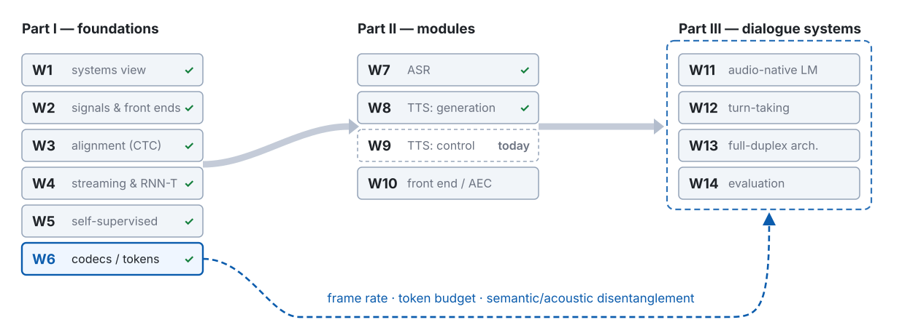

---
# 此檔由 bin/publish_slides.py 從投影片正本產生（中文講稿區塊已剝除），請勿直接編輯。正本在 private repo 的 <course>/slides/。
title: "Speech Synthesis II: Who Is the Judge — Controllability, Post-Training, Evaluation, and Misuse"
subtitle: "Speech Processing & Human–Machine Interaction · Week 9"
author: "Hung-Shin Lee"
lang: en
format:
  revealjs:
    theme: [default, theme.scss]
    slide-number: c/t
    show-slide-number: all
    # 目標顯示尺寸：1280×800（16:10）。設成剛好填滿。
    # margin 預設 0.1 會把 deck 縮到 90% 才顯示（1152×720），白白損失一成字級。
    width: 1280
    height: 800
    margin: 0.04
    center: false
    progress: true
    transition: none
    # 章節標題會產生垂直堆疊；linear 讓左右鍵逐張前進，講課時才不會跳章
    navigation-mode: linear
    incremental: false
    # inline SVG 的 fragment（）在 ?print-pdf 裡要全部可見，不要每個 fragment 一頁
    pdf-separate-fragments: false
    chalkboard:
      buttons: true
    html-math-method:
      method: katex
      url: "https://cdn.jsdelivr.net/npm/katex@0.18.7/dist/"
    # 講稿（notes 區塊）裡的數學只輸出 MathML（與 w02.qmd～w08.qmd 相同的做法）。
    # presenter view 是另一個視窗，沒有 KaTeX 的 CSS；KaTeX 預設同時輸出 HTML 與 MathML，
    # 沒有 CSS 時兩份都會顯示，符號就重複了（例如 ℓℓ）。MathML 由瀏覽器原生排版，不需要 CSS。
    # 本 deck 自用：表格首欄允許換行（theme 的 .reveal table 首欄是 nowrap，首欄是句子的表要包在 ::: {.wrap1} 裡）。
    include-in-header:
      - text: |
          
    include-after-body:
      - text: |
          
---

# Who says it spoke well? {.section-title}

## Where we are: week 9 of 14

{width="100%"}

## Last week, in one picture



::: {.claim}
W8 answered **how one reading gets drawn**. Nothing in W8 says whether the one that was drawn is **a good one** — that takes a second party.
:::

::: {.fragment fragment-index=1}
::: {.small}
Four questions, one structure: a generator, and a judge that scores it — **the fourth supervision is the judge's score.**
:::
:::

::: {.footer}
W8 p10 one-to-many · W8 p86: the fourth supervision, previewed only · W8 p89: WER as a judge
:::

## The problem this week handles, in one picture



::: {.fragment fragment-index=2}
::: {.claim .warn}
The question in every part: **who is the judge, what can it not see — and does the generator learn exactly that?**
:::
:::

::: {.footer}
whose voice → in what manner → a reward → its blind spots → judging the judges → the adversary
:::

## Today's route: six stops, in two halves



::: {.claim .fragment fragment-index=2}
**First half:** the judge moves into training. **Second half:** what it cannot see.
:::

::: {.footer}
six stops = the six section pages · half-time: p51 · answered: p93
:::

## Notation for today

| Symbol | Meaning |
|:--------|:------------------|
| $\ell$, $\mathbf{X}$, $\mathbf{x}$, $\hat{\mathbf{x}}$, $\mathbf{k}$, $\mathbf{c}$; $\mathbf{x}^{\text{p}}$, $\mathbf{k}^{\text{p}}$, $\ell^{\text{p}}$; $w$, $\tau$, $\mathbf{X}_\tau$, $\mathbf{v}_\theta$, $\mathbf{u}_\tau$, $p_\tau$, $h$ | W8: text, mel, waveform, generated waveform, tokens, condition; the prompt; CFG weight and the flow's symbols |
| $\ell^{\text{ins}}$; $E_{\text{spk}}(\cdot)$; $\mathrm{SIM}$ | an instruction, as text; a speaker encoder; a cosine between two of its outputs |
| $\pi_\theta(\mathbf{k} \mid \mathbf{c})$, $\pi_{\text{ref}}$, $\pi_{\theta_{\text{old}}}$, $\pi^{*}$; $r(\mathbf{c}, \mathbf{k})$; $\beta$; $Z(\mathbf{c})$ | the policy — **W8's $P_\theta(\mathbf{k} \mid \ell, \dots)$ renamed**; frozen reference, last round's, optimum; reward; KL weight; normaliser |
| $\mathbf{k}^{+}$, $\mathbf{k}^{-}$; $\mathrm{sigm}(z)$; $\mathrm{KL}(\cdot \,\Vert\, \cdot)$ | a preferred / dispreferred pair; $1/(1 + e^{-z})$ (**not** $\sigma$); the Kullback–Leibler divergence |
| $N_{\text{grp}}$, $\mathbf{k}_n$, $k_{n,t}$, $r_n$, $\hat{A}_n$, $\rho_{n,t}$, $\varepsilon$; $\lambda_{\text{wer}}$, $\lambda_{\text{sim}}$, $\lambda_{\text{mos}}$ | group size, the $n$-th draw, its $t$-th token, reward, advantage, probability ratio, clip range; reward weights |
| $g_\tau$, $\mathbf{B}_\tau$, $\boldsymbol{\epsilon}$ | SDE: diffusion coefficient, Brownian motion, per-step noise |
| $o_{a,j,m}$, $\mu_a$, $b_j$, $u_m$, $\varepsilon_{a,j,m}$; $\sigma_b^2$, $\sigma_u^2$, $\sigma_\varepsilon^2$; $J$, $M$ | a rating: system $a$, rater $j$, sentence $m$; its four parts; their variances; counts |
| $s(\mathbf{x})$, $\vartheta$; $P_{\text{miss}}$, $P_{\text{fa}}$, $P_{\text{spoof}}$, $C_{\cdot}$; $\mathrm{Emb}$, $\mathrm{Det}$, $\mathbf{x}^{\text{wm}}$ | detector score, threshold (**not** $\theta$); real rejected, fake accepted, prior, costs; watermark embedder, detector, marked audio |

::: {.footer}
$\ln$ throughout · vectors bold, scalars italic, functions upright · the outline's notation
:::

## Six things to leave with today

1. **Three shapes of the condition** in zero-shot cloning — a speaker embedding, prompt continuation, a factorized codec — what each keeps and what each leaks, and an experiment that measures the leak.
2. **Three generations of style and emotion control**, why emotion is entangled with speaker, text and lexical tone, and why "did it follow the instruction" needs a judge of its own.
3. **DPO, derived**: the closed-form optimum of reward maximisation under a KL constraint, the reward solved for, Bradley–Terry, the loss. **GRPO**: the group-relative advantage and the clipped objective — and how an AR codec LM and a flow each connect to a reward.
4. **A reward for TTS, and how each one breaks alone**: WER, SIM, a MOS predictor, human preferences — reward hacking, with the measured evidence.
5. **Evaluation**: four dimensions, a listening test and what it must report, why ratings are clustered, why MOS is not comparable across tests, and how a MOS predictor's training differs from its use.
6. **Two threat models**: anti-spoofing and watermarking — EER, DCF, the precision of one alarm at a realistic base rate, and where each defence is known to fail.

::: {.footer}
outline 〈Learning objectives〉 1–6 · derivations stay on the slides, revealed step by step
:::

# Whose voice: where the reference goes in {.section-title}

## (a) A speaker embedding: the reference passes a bottleneck



::: {.claim}
$\mathbf{c} = E_{\text{spk}}(\mathbf{x}^{\text{p}}) \in \mathbb{R}^{d}$: the generator sees **a vector, never the recording**. What the vector keeps was decided when $E_{\text{spk}}$ was trained.
:::

::: {.fragment fragment-index=1}
::: {.small}
$E_{\text{spk}}$ was trained to recognise one person across recording conditions: channel and noise are what it was **asked to drop**. The price: a lower ceiling on similarity, and the manner of the reference does not come along.
:::
:::

::: {.footer}
Jia et al., NeurIPS 2018 · x-vector: Snyder et al. 2018 · YourTTS, ICML 2022 · W8 p12, p38
:::

## (b) Prompt continuation: the reference goes in whole



::: {.claim}
$\mathbf{c} = (\mathbf{k}^{\text{p}}, \ell^{\text{p}})$: $P_\theta(\mathbf{k} \mid \ell, \mathbf{k}^{\text{p}}, \ell^{\text{p}})$ — every frame of the prompt is in the context. **No bottleneck, so nothing is filtered.**
:::

::: {.fragment fragment-index=1}
::: {.small}
W8 p30: a prior large enough to resemble — the same mechanism copies the room, the hum, the mood of that one sentence. **"Copy only the timbre" is not a promise this scheme can make.**
:::
:::

::: {.footer}
VALL-E (W8 p27–p30) · F5 (W8 p58) · Wang et al., Interspeech 2024 · Lu et al., Interspeech 2025
:::

## (c) Factorized: split the reference, then choose



::: {.claim}
$\mathbf{c} = (\mathbf{k}^{\text{p}}_{\text{timbre}}, \mathbf{k}^{\text{p}}_{\text{prosody}}, \dots)$: each group can come from a **different** reference. The bottleneck is designed, not inherited.
:::

::: {.fragment fragment-index=1}
::: {.small}
Splitting them is an admission: **by default they arrive glued together.**
:::
:::

::: {.footer}
NaturalSpeech 3, ICML 2024 (FACodec) · IndexTTS2, AAAI 2026 · W8 p33–p36
:::

## The bottleneck sets the leak — not the generator

| | (a) speaker embedding | (b) prompt continuation | (c) factorized |
|:---|:------|:------|:------|
| $\mathbf{c}$ | $E_{\text{spk}}(\mathbf{x}^{\text{p}}) \in \mathbb{R}^{d}$ | $(\mathbf{k}^{\text{p}}, \ell^{\text{p}})$ or $(\mathbf{X}^{\text{p}}, \ell^{\text{p}})$ | $(\mathbf{k}^{\text{p}}_{\text{timbre}}, \mathbf{k}^{\text{p}}_{\text{prosody}}, \dots)$ |
| the bottleneck | a fixed-size vector | none | one per factor, by design |
| timbre | kept, up to a ceiling | kept | kept |
| manner: prosody, emotion, rate | not carried | **continued** | selectable |
| channel, noise, music | **?** — Demo 1 measures it | **continued** | wherever the split puts them |
| what it promises | "this speaker" | "more of this recording" | "this from here, that from there" |

::: {.ask}
The prompt has an air conditioner humming in it. Which of the three schemes produces speech with the hum?
:::

::: {.footer}
outline 〈關鍵數學 1〉 · Demo 1 measures (a) and (b)
:::

## Before Demo 1: which outputs carry the prompt's noise?

::: {.prose}
| | |
|:---|:-----------------|
| **Why** | p10–p13 argued from the architecture that a bottleneck filters and continuation does not. This measures it here: **one speaker's prompt in four versions, through three ways of conditioning.** |
| **What runs** | A 4.9 s prompt of one LibriSpeech dev-clean speaker (W8 Demo 1's), made into four: clean, with white noise (signal-to-noise ratio, SNR, $10$ dB), with music at the same SNR, telephone band (low-passed at 3.4 kHz). The same sentence through SpeechT5 (an x-vector: **a bottleneck**), F5-TTS (prompt mel, a flow: **none**), Qwen3-TTS (prompt tokens, AR: **none**). Twelve outputs. For each: the noise floor in the pauses, the energy above 4 kHz, SIM against the clean prompt and against that version, WER by W7's Whisper. |
| **Watch for** | Before listening: which of the three carry the noise into the output? With a telephone-band prompt, do the high frequencies come back? After: which system scores the **higher** SIM against the noisy prompt — and is that a good thing? |
:::

::: {.footer}
Demo 1 · demos/w09_d1_cloning_leak · rehearsed 2026-11-14 · nothing is trained today
:::

## Demo 1 — four prompts, three ways to condition

::: {.ask}
**Demo 1.** A noisy prompt goes into all three. Which outputs have the noise? A telephone-band prompt: do the frequencies above 4 kHz come back?
:::

::: {.fragment .wrap1 fragment-index=1}
| prompt version | SpeechT5 (x-vector) | F5-TTS (prompt mel) | Qwen3-TTS (prompt tokens) |
|:---------|:-----|:-----|:-----|
| clean — noise floor in pauses (dB re speech) | $-41.8$ | $-42.3$ | $-42.2$ |
| + noise | $-26.5$ | $-33.2$ | $-31.5$ |
| + music | $-28.3$ | $-34.2$ | $-26.7$ |
| telephone band — energy above 4 kHz (dB; clean) | $-41.5$ ($-13.8$) | $-52.0$ ($-7.8$) | $-45.8$ ($-17.8$) |
| SIM vs the clean prompt / vs that version (+ noise row) | $0.864$ / $0.893$ | $0.874$ / $0.932$ | $0.907$ / $0.948$ |
| what we heard | | | |
:::

::: {.footer}
Demo 1 · rehearsed 2026-11-14, M5 Max · one draw per cell · w09-metrics.json → demo1
:::

## Demo 1 — a mood and an accent ride along

::: {.ask}
A prompt spoken with an obvious mood; the sentence to read is neutral. A Mandarin speaker's prompt; the sentence to read is English. What does a continuation model do?
:::

::: {.fragment .wrap1 fragment-index=1}
| the prompt | the text to read | F5-TTS | Qwen3-TTS |
|:---------|:-----|:----|:----|
| one sentence in an obvious mood (the lecturer's own voice; $F_0$ span $17.3$ semitones) | a neutral sentence | span $11.3$ | span $17.1$ |
| a Mandarin prompt (the lecturer's own voice) | an English sentence | | |
:::

::: {.claim}
Continuation continues **that recording** — its mood, its rate, its speaker's whole way of pronouncing — not "that speaker's timbre".
:::

::: {.footer}
Demo 1, the extra row · rehearsed 2026-11-14 · the lecturer's own voice, not published
:::

## SIM: one speaker encoder, judging

$$
\mathrm{SIM} \;=\; \cos\!\big(E_{\text{spk}}(\hat{\mathbf{x}}),\; E_{\text{spk}}(\mathbf{x}^{\text{p}})\big)
$$

| the number depends on | because |
|:---|:---------|
| **which** $E_{\text{spk}}$ | a different encoder, a different number — Seed-TTS: a WavLM-large fine-tuned for speaker verification (W8 p89) |
| the reference: **SIM-o** or **SIM-r** | against the *original* prompt, or against the prompt *resynthesised* through the codec or vocoder (Voicebox). SIM-r is not comparable across systems with different vocoders; VALL-E reports the second kind |
| what $E_{\text{spk}}$ was trained to ignore | it scores "the same person to this encoder" — not natural, not intelligible, not "sounds like them to a listener" |

::: {.claim}
The one measuring and the thing measured are **the same kind of network**. SIM is not comparable across papers.
:::

::: {.footer}
Voicebox, NeurIPS 2023, §4 · Seed-TTS §3.1 · SMOS: similarity mean opinion score (p61)
:::

## MC 1 — "voice cloning copies the timbre"

::: {.claim .warn}
Prompt continuation has no bottleneck: it copies **everything in the prompt** — the room, the noise, the microphone, that sentence's mood and rate, the speaker's accent. A speaker embedding narrows the reference to one vector — and in Demo 1 that vector still carried the noise and the bandwidth. **Neither route copies "only the timbre".**
:::

| | what is copied | the price |
|:---|:---------|:---------|
| prompt continuation | the recording | whatever came with it comes along |
| a speaker embedding | what speaker verification kept — the channel too (Demo 1) | a ceiling on similarity; no manner |
| a factorized codec | what you select | only as clean as the split |

::: {.footer}
W8 MC 4 (W8 p38), one step further · Demo 1 (p15–p16)
:::

## MC 2 — "a high SIM means it sounds like them"

::: {.claim .warn}
SIM is one speaker encoder's cosine. Change the encoder and the number changes; compute it against the original or the resynthesised prompt and it changes again. It rewards **"that encoder thinks so"** — and when it is used as a reward, training becomes unstable and the model may never emit its stop symbol.
:::

::: {.wrap1}
| a high SIM tells you | it does not tell you |
|:---------|:---------|
| this $E_{\text{spk}}$ maps the two recordings close together | that a listener hears the same person (that is SMOS) |
| the output shares what this encoder attends to | that the speech is natural, or says the right words |
| — including the prompt's noise (Demo 1: $0.932$ vs $0.874$) | that another paper's number, from another encoder, is comparable |
:::

::: {.footer}
Voicebox: SIM-o / SIM-r · Shin et al., ICASSP 2026, §4.4 (SIM as a reward) · p54
:::

# In what manner: style, emotion, an instruction {.section-title}

## Three generations of control

::: {.wrap1}
| generation | what you hand the model | what it buys | what it costs |
|:---------|:------|:-----|:------|
| **explicit prosodic parameters** — FastSpeech 2 (W8 p19) | pitch, energy, duration: values | interpretable, one dial each | labels or extraction; dials, not "angry" |
| **a reference encoder; Global Style Tokens (GST)** — 2018 | a recording → a prosody vector; or learned style embeddings | no annotation | no guarantee what was learned |
| **a natural-language description** — PromptTTS; Lyth & King; CosyVoice, Qwen3-TTS | a sentence: $\ell^{\text{ins}}$ | the most natural interface | the coarsest control |
:::

::: {.claim}
How **strongly** the condition is applied is still W8's dial: the CFG weight $w$.
:::

::: {.footer}
PromptTTS, ICASSP 2023 · Lyth & King, arXiv:2402.01912 (45k hours, synthetic labels) · W8 p55
:::

## Entanglement: emotion is not a separate dial

::: {.wrap1}
| "angry" moves… | so it collides with… |
|:---|:---------|
| speaking rate, loudness | the duration model; the text (the same label on different sentences sounds very different) |
| the range of $F_0$ | the speaker (a wide range is also who they are) — and, in a tone language, **the word** |
| voice quality: breathy, pressed | timbre — what cloning was asked to keep |
| so IndexTTS2 takes **separate prompts** for timbre and for emotion | an admission that, by default, the two arrive glued together |
:::

::: {.claim .warn}
**A prediction, not a result**: "raise the pitch to sound excited" is not a free move where $F_0$ carries lexical tone (W2). We found no systematic evidence to cite.
:::

::: {.footer}
IndexTTS2, AAAI 2026 · W2: $F_0$ is physical, pitch perceptual; tone lives in the source
:::

## An instruction needs a judge of its own

::: {.wrap1}
| level (InstructTTSEval) | the instruction asks for | who can tell whether it was followed |
|:---|:---------|:---------|
| acoustic-parameter specification | "low pitch, fast, loud" | partly measurable: $F_0$, rate, energy |
| descriptive style | "tired, and a little impatient" | an emotion classifier; a listener |
| role-play | "a night-shift nurse at the end of her shift" | only something that understands the sentence: an LLM, a person |
:::

::: {.claim}
One sentence has far fewer degrees of freedom than prosody has. And an instruction the judge cannot hear, **the generator has no reason to learn**.
:::

::: {.footer}
InstructTTSEval, arXiv:2506.16381 — judged by Gemini · emotion2vec, ACL Findings 2024
:::

## CFG is a judge that lives in inference

$$
\tilde{\mathbf{v}} \;=\; \mathbf{v}_\theta(\mathbf{X}_\tau, \tau) \;+\; w\,\big(\mathbf{v}_\theta(\mathbf{X}_\tau, \tau, \mathbf{c}) - \mathbf{v}_\theta(\mathbf{X}_\tau, \tau)\big)
$$

| read as | |
|:---|:---------|
| a score | a step of $(w - 1)$ times $\nabla_{\mathbf{X}} \ln p(\mathbf{c} \mid \mathbf{X})$ beyond the conditional field: **the model's own implicit classifier** of "does this sound match the condition?" |
| a judge | the first one today — and it already has today's illness: at large $w$ the output drifts to an extreme of the condition (heard in W8 Demo 2) |
| a bill | two forward passes at every step |

::: {.footer}
W8 p55 · W8 p62: the $w$ sweep · FlowTTS-GRPO: RL converges faster with CFG off
:::

## Where the judge lives, and what inference pays



::: {.fragment fragment-index=2}
::: {.claim}
Moving the judge **from inference into training** is why post-training matters in a dialogue system.
:::
:::

::: {.footer}
best-of-$N$: generate $N$, a judge picks one · W8 p82: the first-packet cell · p33: why picking works
:::

## MC 3 — "emotion control is one emotion embedding"

::: {.claim .warn}
Emotion is entangled with rate, loudness, the range of $F_0$ and voice quality; a discrete label has far less expressive power than prosody; the same "angry" on different text sounds very different. Systems that take separate prompts for timbre and emotion are dealing with the fact that the two arrive glued together — and in a tone language, the $F_0$ that emotion wants to move is the word.
:::

::: {.wrap1}
| a label gives | prosody needs |
|:---------|:---------|
| one of a handful of categories | a contour over every syllable: $F_0$, duration, energy, voice quality |
| the same vector for every sentence | a realisation that depends on the text |
| no account of the speaker | a range relative to *this* speaker's |
:::

::: {.footer}
p22 · IndexTTS2 · W2: $F_0$ and pitch; source and filter in a tone language
:::

## MC 4 — "the more detailed the instruction, the finer the control"

::: {.claim .warn}
A sentence has fewer degrees of freedom than prosody does — and **whether it was followed has to be judged by another model** (InstructTTSEval uses Gemini, and reports that current systems are still far from following instructions). An instruction the judge cannot hear, the generator has no reason to learn.
:::

::: {.wrap1}
| adding detail to the instruction | does not add |
|:---------|:---------|
| more words in $\ell^{\text{ins}}$ | more dimensions the model was trained to tie to words |
| a more specific request | a judge that can check the more specific request |
:::

::: {.footer}
p23 · Huang et al., InstructTTSEval, arXiv:2506.16381 (abstract)
:::

# Turning the judge into a reward {.section-title}

## An AR codec LM is already a policy

::: {.wrap1}
| the word in reinforcement learning (RL) | what it is in W8's model |
|:------|:---------|
| a **policy** $\pi_\theta(\mathbf{k} \mid \mathbf{c})$ | W8's $P_\theta(\mathbf{k} \mid \ell, \mathbf{k}^{\text{p}}, \dots)$ — the same network, the same weights |
| an **action** | one token, drawn from the softmax |
| $\ln \pi_\theta(\mathbf{k} \mid \mathbf{c})$ | minus W8's AR cross-entropy, summed over the sequence — already computed |
| a **reward** $r(\mathbf{c}, \mathbf{k})$ | a judge's score for one finished draw: one number |
:::

::: {.wrap1}
| what goes wrong in AR TTS (W8 p31) | a frozen judge that scores it, with no human |
|:------|:---------|
| dropped words, repeated phrases, never stopping | W7's ASR → WER |
| the voice drifting away from the prompt | a speaker encoder → SIM |
:::

::: {.claim}
Sample the same condition $N$ times and there are $N$ different results to compare — **the judge and the variation are both free**.
:::

::: {.footer}
W8 p31: the stop symbol, length instability · W7 p75: GRPO with WER as the reward
:::

## At a glance: Direct Preference Optimization (DPO)

::: {.prose}
| | |
|:---|:-----------------|
| **Name** | **Direct Preference Optimization: Your Language Model is Secretly a Reward Model** — Rafailov, Sharma, Mitchell, Ermon, Manning & Finn, NeurIPS 2023. Written for text LLMs; carried over to AR TTS unchanged. |
| **The question** | All we have is pairs — "this output is preferred to that one". Must we first train a reward model on the pairs and then run RL against it? |
| **The idea** | Under a KL constraint the best policy has a **closed form** in terms of the reward — so the reward can be written in terms of policies. Substitute that into a model of pairwise preference and fit the policy directly. |
| **What it added** | A loss that looks like classification, on pairs collected beforehand: **no reward model, no sampling inside the training loop.** |
| **What it leaves open** | Who made the pairs (p37) — and whether "no reward model" means "no reward hacking" (p38). The derivation is the next six slides (p31–p36). |
:::

::: {.footer}
Rafailov et al., arXiv:2305.18290 — Eq. 3 objective, 4 optimum, 5 reward, 7 loss; §4 gradient
:::

## Step 1 — more reward, on a leash

$$
\max_{\pi}\;\; \mathbb{E}_{\mathbf{k} \sim \pi(\cdot \mid \mathbf{c})}\big[\, r(\mathbf{c}, \mathbf{k}) \,\big] \;-\; \beta\; \mathrm{KL}\big(\pi(\cdot \mid \mathbf{c}) \,\Vert\, \pi_{\text{ref}}(\cdot \mid \mathbf{c})\big)
$$

$$
\mathrm{KL}\big(\pi \,\Vert\, \pi_{\text{ref}}\big) \;=\; \mathbb{E}_{\mathbf{k} \sim \pi}\Big[\ln \frac{\pi(\mathbf{k} \mid \mathbf{c})}{\pi_{\text{ref}}(\mathbf{k} \mid \mathbf{c})}\Big] \;\geq\; 0, \qquad = 0 \ \text{only when}\ \pi = \pi_{\text{ref}}
$$

| | |
|:---|:---------|
| $\pi_{\text{ref}}$ | the model as it was before post-training — frozen |
| $\beta \to \infty$ | the leash is rigid: nothing moves |
| $\beta \to 0$ | no leash: all the probability goes to the highest-reward output |

::: {.footer}
DPO Eq. 3 · the same objective, with the same $\beta$, returns inside GRPO (p42)
:::

## Step 2 — complete it into one KL: the optimal policy

$$
\pi^{*}(\mathbf{k} \mid \mathbf{c}) \;=\; \frac{1}{Z(\mathbf{c})}\; \pi_{\text{ref}}(\mathbf{k} \mid \mathbf{c})\; e^{\,r(\mathbf{c}, \mathbf{k})/\beta}, \qquad Z(\mathbf{c}) = \sum_{\mathbf{k}} \pi_{\text{ref}}(\mathbf{k} \mid \mathbf{c})\; e^{\,r(\mathbf{c}, \mathbf{k})/\beta}
$$

::: {.fragment fragment-index=1}
$$
\mathbb{E}_{\pi}[\,r\,] - \beta\,\mathrm{KL}(\pi \,\Vert\, \pi_{\text{ref}})
\;=\; -\beta\; \mathbb{E}_{\pi}\Big[\ln \frac{\pi}{\pi_{\text{ref}}\, e^{r/\beta}}\Big]
\;=\; -\beta\; \mathrm{KL}\big(\pi \,\Vert\, \pi^{*}\big) \;+\; \beta \ln Z(\mathbf{c})
$$
:::

::: {.fragment fragment-index=2}
::: {.claim}
The second term does not depend on $\pi$; a KL is never negative. The maximum is at $\pi = \pi^{*}$.
:::
:::

::: {.footer}
DPO Eq. 4 · $Z(\mathbf{c})$: the partition function — it only makes $\pi^{*}$ sum to one
:::

## What $\pi^{*}$ looks like: the old model, reweighted



::: {.claim}
**Best-of-$N$** is a draw from $\pi^{*}$ at $\beta \to 0$: the judge stays in inference (p25).
:::

::: {.footer}
toy numbers, computed: w09-data.json → pi_star · Demo 2 does exactly this with $N = 12$
:::

## Step 3 — solve for the reward; $Z$ is in the way

$$
r(\mathbf{c}, \mathbf{k}) \;=\; \beta \ln \frac{\pi^{*}(\mathbf{k} \mid \mathbf{c})}{\pi_{\text{ref}}(\mathbf{k} \mid \mathbf{c})} \;+\; \beta \ln Z(\mathbf{c})
$$

| | |
|:---|:---------|
| the first term | **a reward written with policies**: how much more the optimal model likes $\mathbf{k}$ than the reference did |
| the second term | $Z(\mathbf{c}) = \sum_{\mathbf{k}} \pi_{\text{ref}}\, e^{r/\beta}$ — a sum over **every possible token sequence**. It cannot be computed. |

::: {.claim}
The third time such a sum appears: W3's "all paths" (a dynamic programme summed it), W8's CNF likelihood (a different loss avoided it). This time the way out is to **make it cancel**.
:::

::: {.footer}
DPO Eq. 5 · W3: the forward algorithm · W8 p44–p45: why a CNF is expensive, and the way round
:::

## Step 4 — Bradley–Terry: only the difference counts, so $Z$ cancels

$$
P\big(\mathbf{k}^{+} \succ \mathbf{k}^{-} \mid \mathbf{c}\big) \;=\; \mathrm{sigm}\big(\, r(\mathbf{c}, \mathbf{k}^{+}) - r(\mathbf{c}, \mathbf{k}^{-}) \,\big), \qquad \mathrm{sigm}(z) = \frac{1}{1 + e^{-z}}
$$

::: {.fragment fragment-index=1}
$$
=\; \mathrm{sigm}\Big(\, \beta \ln \frac{\pi^{*}(\mathbf{k}^{+} \mid \mathbf{c})}{\pi_{\text{ref}}(\mathbf{k}^{+} \mid \mathbf{c})} \;-\; \beta \ln \frac{\pi^{*}(\mathbf{k}^{-} \mid \mathbf{c})}{\pi_{\text{ref}}(\mathbf{k}^{-} \mid \mathbf{c})} \,\Big)
$$
:::

::: {.fragment fragment-index=1}
::: {.claim}
$\beta \ln Z(\mathbf{c})$ appears in both rewards — **the same $\mathbf{c}$** — and subtracts away. The probability of a preference is now written with policies only.
:::
:::

::: {.footer}
Bradley & Terry, Biometrika 1952 · DPO Eq. 6 · $\mathbf{k}^{+}$, $\mathbf{k}^{-}$ are the paper's $y_w$, $y_l$
:::

## Step 5 — the DPO loss, and how to read its gradient

$$
\mathcal{L}_{\text{DPO}} \;=\; -\,\mathbb{E}\Big[\ln \mathrm{sigm}\Big(\beta \ln \frac{\pi_\theta(\mathbf{k}^{+} \mid \mathbf{c})}{\pi_{\text{ref}}(\mathbf{k}^{+} \mid \mathbf{c})} \;-\; \beta \ln \frac{\pi_\theta(\mathbf{k}^{-} \mid \mathbf{c})}{\pi_{\text{ref}}(\mathbf{k}^{-} \mid \mathbf{c})}\Big)\Big]
$$

::: {.fragment fragment-index=1}
$$
\nabla_\theta \mathcal{L}_{\text{DPO}} \;=\; -\,\beta\; \mathbb{E}\Big[\, \underbrace{\mathrm{sigm}\big(\hat{r}_\theta(\mathbf{k}^{-}) - \hat{r}_\theta(\mathbf{k}^{+})\big)}_{\text{how wrongly the pair is ranked}} \;\big(\nabla_\theta \ln \pi_\theta(\mathbf{k}^{+} \mid \mathbf{c}) - \nabla_\theta \ln \pi_\theta(\mathbf{k}^{-} \mid \mathbf{c})\big) \Big]
$$

::: {.small}
with the implicit reward $\hat{r}_\theta(\mathbf{k}) = \beta \ln \dfrac{\pi_\theta(\mathbf{k} \mid \mathbf{c})}{\pi_{\text{ref}}(\mathbf{k} \mid \mathbf{c})}$
:::
:::

::: {.claim}
Raise the likelihood of $\mathbf{k}^{+}$, lower that of $\mathbf{k}^{-}$ — **harder, the more wrongly the current model ranks them.**
:::

::: {.footer}
DPO Eq. 7; the gradient: §4 · maximum likelihood on the pairs, with $\pi^{*}$ replaced by $\pi_\theta$
:::

## DPO on TTS: where the pairs come from

::: {.wrap1}
| who makes the pair $(\mathbf{k}^{+}, \mathbf{k}^{-})$ | example | the judge that comes in with it |
|:---|:------|:------|
| **people**, listening A / B | Shin et al. 2026: 200 pairs per round; $\pi_{\text{ref}}$ replaced by the previous round's model | human preference — expensive, small |
| **real versus generated** | SpeechAlign: the codec tokens of a real recording as $\mathbf{k}^{+}$, the model's own as $\mathbf{k}^{-}$ | "be like the recordings" |
| **an automatic ranking** by WER or SIM | pairs sorted by a frozen ASR or speaker encoder | that model — **with its blind spots, unchanged** |
:::

::: {.claim}
DPO has no reward *model*. It still has a reward — implicit in the ratio of policies, and **defined by whoever made the pairs**.
:::

::: {.footer}
Shin et al., ICASSP 2026 · SpeechAlign, NeurIPS 2024 · Tian et al. 2025 · Koel-TTS 2025
:::

## MC 5 — "DPO has no reward model, so no reward hacking"

::: {.claim .warn}
DPO has a reward — implicit in the ratio of policies, and **defined by the pairs**. If the pairs were ranked automatically by WER or SIM, that judge's blind spots come in unchanged. Only pairs labelled by people change the judge.
:::

| pairs made by | the judge DPO inherits |
|:---|:---------|
| WER from a frozen ASR | the ASR: blind to prosody, rate, naturalness |
| SIM from a speaker encoder | the encoder: blind to content and naturalness |
| people, A / B | human preference — a different judge, with its own costs (§5) |

::: {.footer}
p36–p37 · Shin et al., ICASSP 2026, §4.5: 200 human pairs per round
:::

## At a glance: Group Relative Policy Optimization (GRPO)

::: {.prose}
| | |
|:---|:-----------------|
| **Name** | **Group Relative Policy Optimization** — introduced in *DeepSeekMath*, Shao et al. (11 authors), arXiv 2024, §4.1; a variant of Proximal Policy Optimization (PPO; Schulman et al. 2017). |
| **The question** | The judge gives **a number** to any sample — not a pair. To learn from it we must know whether a sample did better than *usual*. Must a second network be trained just to estimate "usual"? |
| **The idea** | Draw a **group** of $N_{\text{grp}}$ samples for the same condition. The group's own mean is "usual"; divide by the group's standard deviation. Put that into PPO's clipped objective, plus a KL term to $\pi_{\text{ref}}$. |
| **What it added** | No value network; rewards on different scales (WER, SIM, a predicted MOS) become comparable after normalisation. |
| **What it leaves open** | $N_{\text{grp}}$ generations per condition; a group whose samples all tie carries no signal (p41); and everything the judge cannot see (§4). W7 p75 used it with WER on the ASR side. |
:::

::: {.footer}
Shao et al., arXiv:2402.03300 — §4.1, Eq. 3; advantage: §4.1.2 · PPO: arXiv:1707.06347
:::

## The log-derivative trick: the reward need not be differentiable

$$
\nabla_\theta\; \mathbb{E}_{\mathbf{k} \sim \pi_\theta}\big[\, r(\mathbf{c}, \mathbf{k}) \,\big] \;=\; \mathbb{E}_{\mathbf{k} \sim \pi_\theta}\big[\; r(\mathbf{c}, \mathbf{k})\; \nabla_\theta \ln \pi_\theta(\mathbf{k} \mid \mathbf{c}) \;\big]
$$

::: {.fragment fragment-index=1}
::: {.small}
because $\;\nabla_\theta \sum_{\mathbf{k}} \pi_\theta(\mathbf{k} \mid \mathbf{c})\, r = \sum_{\mathbf{k}} r\, \nabla_\theta \pi_\theta = \sum_{\mathbf{k}} \pi_\theta\; r\; \nabla_\theta \ln \pi_\theta$, $\;$ using $\;\nabla \pi = \pi\, \nabla \ln \pi$
:::
:::

::: {.fragment fragment-index=2}
| | |
|:---|:---------|
| what is differentiated | $\ln \pi_\theta$ — the model. **Never $r$**: WER passes through an argmax and an edit distance |
| what is needed | samples from the model, their rewards, their log-probabilities |
| a baseline | replace $r$ by $r - b(\mathbf{c})$: the expectation is unchanged, the variance is smaller. $r - b$ is the **advantage** |
:::

::: {.footer}
REINFORCE: Williams, Machine Learning 1992 · Seed-TTS §4.2 uses it, with SIM and WER
:::

## The baseline is the group: the advantage



::: {.claim}
**A tie teaches nothing.** And a noisier reward needs a larger group.
:::

::: {.footer}
toy numbers, computed: w09-data.json → group_advantage · DeepSeekMath §4.1.2
:::

## The clip, and the leash again: GRPO's objective

$$
\mathcal{J}_{\text{GRPO}}(\theta) = \mathbb{E}\Big[\frac{1}{N_{\text{grp}}}\sum_{n=1}^{N_{\text{grp}}} \frac{1}{|\mathbf{k}_n|}\sum_{t}\Big(\min\big(\rho_{n,t}\,\hat{A}_n,\; \mathrm{clip}(\rho_{n,t},\, 1 - \varepsilon,\, 1 + \varepsilon)\,\hat{A}_n\big) - \beta\,\mathrm{KL}\big(\pi_\theta \,\Vert\, \pi_{\text{ref}}\big)\Big)\Big]
$$

$$
\rho_{n,t} \;=\; \frac{\pi_\theta(k_{n,t} \mid \mathbf{c}, \mathbf{k}_{n,<t})}{\pi_{\theta_{\text{old}}}(k_{n,t} \mid \mathbf{c}, \mathbf{k}_{n,<t})}
$$

| piece | what it does |
|:---|:---------|
| $\rho_{n,t}\,\hat{A}_n$ | the samples were drawn by last round's model $\pi_{\theta_{\text{old}}}$; the ratio corrects for that. Raise a token's probability if its draw did better than the group |
| $\mathrm{clip}(\cdot,\, 1 - \varepsilon,\, 1 + \varepsilon)$ | **PPO**: no credit for moving a probability by more than a factor $1 \pm \varepsilon$ in one round |
| $\beta\,\mathrm{KL}(\pi_\theta \,\Vert\, \pi_{\text{ref}})$ | step 1's leash (p31), unchanged |

::: {.footer}
DeepSeekMath §4.1, Eq. 3 · PPO: Schulman et al. 2017 · $\rho_{n,t}$ is our symbol for the ratio
:::

## Training and use are two different pictures



::: {.fragment fragment-index=2}
::: {.claim .warn}
The judge is present **only in training** — its blind spots stay in the weights.
:::
:::

::: {.footer}
the fifth shape: W5 p46 · W6 p32 · W7 p69 · W8 p53 · W9: training has a judge, use does not
:::

## DPO's picture, and the fifth shape



::: {.claim}
Seed-TTS §4.2: a reward model **targets attributes**; DPO is **simpler to implement**.
:::

::: {.fragment fragment-index=1}
::: {.small}
Use is W8's graph in both cases: **the inference cost does not change.**
:::
:::

::: {.footer}
Seed-TTS, arXiv:2406.02430, §4.2 · p37: who made the pairs · W5 p46, W6 p32, W7 p69, W8 p53
:::

## MC 6 — "RL makes inference slower" / "RL is an inference-time trick"

::: {.claim .warn}
Post-training changes **the weights only**. The inference graph is W8's, and the first packet is unchanged. What is slower is keeping the judge in inference: CFG (two forward passes per step) and best-of-$N$ ($N$ generations, no streaming).
:::

| | at training | at inference |
|:---|:------|:------|
| DPO, GRPO | pairs or groups, judges, $\pi_{\text{ref}}$ | **nothing extra** |
| CFG | (condition dropout) | 2 passes per step |
| best-of-$N$ | — | $N$ generations; cannot stream |

::: {.footer}
p25 · p43–p44 · W8 p55, p82
:::

## Flow matching: there is no step probability to differentiate



::: {.claim}
ODE: each step **determined**, no $\ln \pi_\theta$. SDE, **same marginals**: each step a draw.
:::

::: {.fragment fragment-index=2}
::: {.small}
Same marginals, checked on this toy: over 4000 starting points, the spread at $\tau = 0.5$ is $0.704$ (ODE) and $0.713$ (SDE); theory $0.707$.
:::
:::

::: {.footer}
toy, computed: w09-data.json → ode_vs_sde · W8 p50, p54, p56 · Flow-GRPO, NeurIPS 2025
:::

## Route one: a stochastic differential equation with the same marginals

$$
\mathrm{d}\mathbf{X}_\tau \;=\; \Big[\, \mathbf{u}_\tau(\mathbf{X}_\tau) \;+\; \frac{g_\tau^2}{2}\, \nabla_{\mathbf{X}} \ln p_\tau(\mathbf{X}_\tau) \Big]\, \mathrm{d}\tau \;+\; g_\tau\, \mathrm{d}\mathbf{B}_\tau
$$

| term | what it does |
|:---|:---------|
| $\mathbf{u}_\tau(\mathbf{X}_\tau)\,\mathrm{d}\tau$ | W8's ODE: follow the marginal field |
| $g_\tau\,\mathrm{d}\mathbf{B}_\tau$ | the added noise — a small Gaussian kick at every instant; $g_\tau$ sets its size |
| $\dfrac{g_\tau^2}{2}\,\nabla_{\mathbf{X}} \ln p_\tau\;\mathrm{d}\tau$ | the correction: a drift **toward higher density** that undoes the spreading the noise causes |

::: {.fragment fragment-index=1}
$$
\text{straight-line path (W8 p54):} \qquad \nabla_{\mathbf{X}} \ln p_\tau(\mathbf{X}) \;=\; \frac{\tau\,\mathbf{u}_\tau(\mathbf{X}) - \mathbf{X}}{1 - \tau}
$$
:::

::: {.footer}
Flow-GRPO, NeurIPS 2025, Eq. 7: the same SDE, time reversed ($t = 1$ is noise) — opposite signs
:::

## Euler–Maruyama: every step becomes a Gaussian policy

$$
\mathbf{X}_{\tau + h} \;=\; \mathbf{X}_\tau \;+\; \Big[\, \mathbf{v}_\theta \;+\; \frac{g_\tau^2}{2(1 - \tau)}\big(\tau\,\mathbf{v}_\theta - \mathbf{X}_\tau\big) \Big]\, h \;+\; g_\tau \sqrt{h}\;\boldsymbol{\epsilon}, \qquad \boldsymbol{\epsilon} \sim \mathcal{N}(\mathbf{0}, \mathbf{I})
$$

| | |
|:---|:---------|
| the policy | $\pi_\theta(\mathbf{X}_{\tau + h} \mid \mathbf{X}_\tau, \mathbf{c})$: a Gaussian — mean, the first two terms; standard deviation $g_\tau\sqrt{h}$ |
| $\ln \pi_\theta$ | closed form: a squared distance to the mean |
| KL to $\pi_{\text{ref}}$ | closed form too: two Gaussians of the same variance differ only by the squared distance between their means |
| what follows | **GRPO applies unchanged** — the "token" is now one solver step |

::: {.claim}
An action is no longer a token: it is **where the solver lands next**.
:::

::: {.footer}
FlowTTS-GRPO, Interspeech 2026, Eq. 7: term by term the same, time running our way
:::

## Routes two and three — and a fourth

::: {.wrap1}
| route | what changes | who |
|:---|:---------|:------|
| **1. ODE → SDE** | sampling gains noise; every step is a Gaussian policy | Flow-GRPO; FlowTTS-GRPO (CosyVoice 3, F5-TTS) |
| **2. output a distribution** | the last layer predicts a mean **and a variance** of the velocity: a probability directly | F5R-TTS |
| **3. no sampling: a differentiable reward** | the reward is computed **on the tokens** — an ASR-like model reads $\tilde{\mathbf{k}}$, a Gumbel-softmax sample (W5 p24–p25), and $\ln P_{\text{ASR}}(\ell \mid \tilde{\mathbf{k}})$ back-propagates into the LM; no waveform, no policy gradient | DiffRO; adopted by CosyVoice 3 |
| **4. RL on the duration only** | the $T$ that a flow must be handed from outside (W8 p58) is tuned by the reward | DMOSpeech 2 |
:::

::: {.claim .warn}
Route 3's price, in RRPO's abstract: a **differentiable** reward model is easier to exploit.
:::

::: {.footer}
F5R-TTS, arXiv:2504.02407 · DiffRO, Interspeech 2025 · DMOSpeech 2 · RRPO, ICASSP 2026
:::

## MC 7 — "flow matching is deterministic, so it cannot do RL"

::: {.claim .warn}
Three routes: replace the ODE by an SDE with the same marginals (every step a Gaussian policy); let the model output a distribution over the velocity; or make the reward differentiable with respect to the tokens and do not sample at all.
:::

::: {.wrap1}
| the obstacle | the way round |
|:---------|:---------|
| no probability of a step | add noise that leaves $p_\tau$ unchanged (p47–p48) |
| no probability of a step | predict a variance as well as a mean (F5R-TTS) |
| the reward is not differentiable | compute it on tokens, through Gumbel-softmax (DiffRO) |
:::

::: {.footer}
W8 MC 5 (W8 p56): "ODE or SDE decides whether RL has a stochastic policy" — delivered
:::

## Half-time: the judge is inside training — what can it not see?



::: {.claim}
**So far:** the judge is inside training now. **From here:** **what happens where it cannot see?**
:::

::: {.footer}
the route: p6 · first half: p9–p50 · second half: p52–p89 · answered: p93
:::

# What the judge cannot see {.section-title}

## A reward is a sum of judges — each with a blind spot

$$
r \;=\; \lambda_{\text{wer}}\,(1 - \mathrm{WER}) \;+\; \lambda_{\text{sim}}\,\mathrm{SIM} \;+\; \lambda_{\text{mos}}\,\widehat{\mathrm{MOS}} \;+\; \cdots
$$

| the judge | what it cannot see |
|:---|:---------|
| WER — a frozen ASR | prosody, speaking rate, naturalness (W8 p89) |
| SIM — a frozen speaker encoder | the words, naturalness |
| $\widehat{\mathrm{MOS}}$ — a MOS predictor | anything outside the systems and listeners it was trained on (§5) |
| an emotion classifier | whether the cue it responds to is speech at all |
| a length penalty | everything but the length |

::: {.claim}
**Goodhart's law**: a judge that is optimised against has its blind spots learned. It has appeared twice already, unnamed — the discriminators $\Phi_j$ of W6 and W8, and the vocoder artefacts they could not see.
:::

::: {.footer}
FlowTTS-GRPO §2.3–2.4 · Multi-Reward GRPO: a length penalty · W6 p31 · W8 p65–p68
:::

## Predict first: optimise one judge alone

::: {.ask}
Post-train a good AR TTS model with **WER as the only reward**. What does it sound like afterwards?
:::

::: {.fragment .wrap1 fragment-index=1}
| the reward | what was measured | where |
|:------|:---------|:-----|
| WER | "slower and more clearly pronounced utterances" — naturalness sacrificed | Seed-TTS §4.2 |
| CER / negative log-likelihood (NLL) | lowest CER; log-$F_0$ **narrows**; human preference (Elo) *drops* | Shin et al. 2026 §4.3 |
| + SIM | unstable training; CER worse; no stop symbol: it keeps talking | Shin et al. 2026 §4.4 |
| an emotion classifier | artefacts that fool the reward model; quality degrades | RRPO (ICASSP 2026) |
| any single one | that metric rises, the others fall | FlowTTS-GRPO §2.4 |
:::

::: {.claim .warn}
Four papers, one event: **the dimension the judge cannot see is traded for score.**
:::

::: {.footer}
Seed-TTS §4.2 · Shin et al. and RRPO, ICASSP 2026 · FlowTTS-GRPO, Interspeech 2026
:::

## Before Demo 2: twelve draws, three judges

::: {.prose}
| | |
|:---|:-----------------|
| **Why** | p54's evidence took weeks of training. The same signal is visible without training: **draw the same sentence twelve times and let each judge pick its favourite.** If the judges disagree with each other — and with our ears — that disagreement is what a reward would be optimising. |
| **What runs** | A tongue-twister — the same few words, repeated in a new order: hard for an AR model (one English, one Mandarin). Qwen3-TTS, the same prompt, $N_{\text{grp}} = 12$ draws. Each draw through three judges: WER (Whisper), SIM, a MOS predictor. Two descriptors that are **not** judges: syllables per second, and the standard deviation of log-$F_0$. A $12 \times 5$ table; then $\hat{A}_n$ per judge. |
| **Watch for** | Is there a long tail — a draw that drops words, repeats, or does not stop? Which column of $\hat{A}_n$ carries no signal? And the draw the WER judge ranks first: is it **faster or slower**, **flatter or livelier** than the rest? |
:::

::: {.footer}
Demo 2 · demos/w09_d2_judges_pick · not RL: $\pi^{*}$ at $\beta \to 0$, $N = 12$ (p33)
:::

## Demo 2 — the table: twelve draws, three judges, two descriptors

::: {.ask}
**Demo 2.** The same sentence, twelve times. Before the table: will the draw with the lowest WER be faster or slower than the others — flatter or livelier?
:::

::: {.fragment .wrap1 fragment-index=1}
| draw | WER | SIM | predicted MOS | syllables / s | std of log-$F_0$, semitones |
|:----------|:---|:---|:---|:---|:---|
| $\mathbf{k}_1$ … $\mathbf{k}_{12}$ (the screen shows all twelve) | $0$–$80\%$; five at $0$ | $0.887$–$0.947$ | $3.82$–$4.26$ | $3.69$–$4.69$ | $4.18$–$5.81$ |
| the long tail, by WER: draw 1 — Whisper wrote one sentence of four | $80\%$ | $0.938$ | $3.86$ | $3.86$ | $5.21$ |
| group mean; group std | $33.8$; $37.7$ | $0.930$; $0.017$ | $4.08$; $0.16$ | $4.21$; $0.32$ | $4.90$; $0.43$ |
:::

::: {.footer}
Demo 2 · rehearsed 2026-11-14, M5 Max → w09-metrics.json → demo2 · last two columns: not judges
:::

## Demo 2 — who does each judge pick?

| the judge | its first choice | syllables / s | std of log-$F_0$, semitones | what we heard |
|:---|:---|:---|:---|:---|
| WER (Whisper) | draw 2 — tied with 7, 8, 9, 12 | $3.90$ (the five: $4.07$) | $5.81$ (the five: $4.93$) | |
| SIM | draw 8 | $4.22$ | $5.19$ | |
| predicted MOS | draw 2 | $3.90$ | $5.81$ | |
| the lecturer, by ear (blind) | draw 8 | $4.22$ | $5.19$ | |

::: {.ask}
Are the four first choices the same draw?
:::

::: {.claim}
This is **not RL**: it is best-of-12, the judge kept in inference. Post-training moves the same *picking* into the weights — and with it, whatever the judge picked for.
:::

::: {.footer}
Demo 2 · rehearsed 2026-11-14; blind pick 2026-11-16 · group mean $4.21$, $4.90$ · on screen: rank against rate and $F_0$ spread
:::

## Many judges watch each other; what none can see goes back to people

::: {.wrap1}
| the remedy | what it does | what it does not do |
|:-------|:---------|:-------|
| **several rewards at once** — WER + SIM + MOS + length | each judge guards another's blind spot | cover a dimension **no** judge sees |
| **human preference** — Shin et al. §4.5 | 200 A / B pairs per round, DPO: prosody restored | scale; and people are a judge too (§5) |
| **a judge trained to be more like people** — SpeechJudge, GSRM | a generative reward model trained on many human preferences | stop being a learned judge |
:::

::: {.claim}
Many rewards make the judges **watch one another**. What none of them sees — whether the prosody is natural — only people can supply.
:::

::: {.footer}
Multi-Reward GRPO, arXiv:2511.21270 · GLM-TTS · SpeechJudge, arXiv:2511.07931 · GSRM
:::

## MC 8 — "RL post-training makes TTS better across the board"

::: {.claim .warn}
It pushes the model **toward the reward**; the dimensions the reward cannot see are traded for score. Optimise WER alone and the speech turns slower, over-articulated, flat in pitch (Seed-TTS §4.2; Shin et al.'s log-$F_0$).
:::

| "better" on the judge's sheet | what happened to the speech |
|:---|:---------|
| WER down | slower; every syllable spelled out; prosody monotone |
| SIM up | unstable training; no stop symbol |
| emotion-classifier accuracy up | artefacts that fool the classifier |

::: {.footer}
p54 · Demo 2 (p56–p57): the same question, asked without training
:::

# Judging the judges: people and machines {.section-title}

## Four dimensions, and who judges each

| dimension | ask people | ask a model | the model fails when |
|:---|:------|:------|:------|
| **intelligibility** | transcribe what you heard | WER / CER — **which ASR, which text normalisation** (W7) | its prior repairs a mumbled sound (W8 p89) |
| **naturalness** | MOS, CMOS, MUSHRA | a MOS predictor (UTMOS and its kin) | outside its training systems and listeners |
| **similarity** | SMOS | SIM — **which $E_{\text{spk}}$, original or resynthesised prompt** | p17 |
| **controllability** | did it do as told? | an emotion classifier; an LLM as judge (InstructTTSEval: Gemini) | the instruction needs understanding, not acoustics |

::: {.claim}
Behind every cell of the "ask a model" column is **a frozen model**. Change the model and the number changes: WER, SIM and MOS are not comparable across papers — one sentence, three times.
:::

::: {.footer}
outline 〈關鍵數學 9〉 · a review: Cooper et al., Acoust. Sci. & Tech. 45, 2024
:::

## MOS: a mean over raters and sentences

$$
\mathrm{MOS}_a \;=\; \frac{1}{JM} \sum_{j=1}^{J} \sum_{m=1}^{M} o_{a,j,m}, \qquad o_{a,j,m} \in \{1, 2, 3, 4, 5\}
$$

::: {.wrap1}
| test | what a rater does | the scale |
|:--------|:---------|:---|
| **MOS** — mean opinion score, by absolute category rating (ACR) | hears one stimulus, rates it | 1 bad … 5 excellent |
| **CMOS** — comparison MOS | hears A then B, rates B *relative to* A | $-3 \dots +3$ |
| **MUSHRA** — multiple stimuli with hidden reference and anchor | hears all systems for one sentence side by side, with a hidden reference and a deliberately poor anchor | 0 … 100 |
:::

::: {.claim}
The scale is **ordinal**: the step from 1 to 2 is not the step from 4 to 5. Averaging it, and running a $t$-test on the averages, is a convention — not a theorem.
:::

::: {.footer}
ITU-T P.800, P.808 · ITU-R BS.1534 (MUSHRA): specifications, not papers · W8 p68
:::

## Ratings come in clusters



$$
o_{a,j,m} = \mu_a + b_j + u_m + \varepsilon_{a,j,m}
\qquad\Longrightarrow\qquad
\mathrm{Var}\big(\mathrm{MOS}_a\big) = \frac{\sigma_b^2}{J} + \frac{\sigma_u^2}{M} + \frac{\sigma_\varepsilon^2}{JM}
$$

::: {.fragment fragment-index=5}
::: {.claim .warn}
Treated as 400 independent ratings: s.e. $0.049$ — really $0.136$. **Only more raters shrink the first term.**
:::
:::

::: {.footer}
assumed $\sigma$'s, computed: w09-data.json → mos_variance · additive model, no interactions
:::

## Paired designs cancel the rater and the sentence

$$
o_{a,j,m} - o_{a',j,m} \;=\; (\mu_a - \mu_{a'}) \;+\; (\varepsilon_{a,j,m} - \varepsilon_{a',j,m})
$$

| design | the same rater and the same sentence judge both systems? | so |
|:---|:------|:------|
| two separate MOS tests | no | $b_j$ and $u_m$ stay in each mean; the difference inherits both |
| CMOS, A / B preference | yes, in one trial | $b_j$ and $u_m$ **cancel** in the difference |
| MUSHRA | yes — all systems on one screen | they cancel; the hidden reference and the anchor pin the two ends of the scale |

::: {.claim}
A paired test asks an easier question — **which of these two** — and removes the two largest sources of noise from the answer.
:::

::: {.footer}
outline 〈關鍵數學 8〉 · Bradley–Terry (p35) is the model of exactly this kind of data
:::

## MC 9 — "enough ratings, and the interval is narrow enough"

::: {.claim .warn}
Ratings are clustered: one rater's forty ratings are not forty independent samples. Only **more raters** shrink the rater term; more sentences per rater do not. Paired designs — CMOS, A / B, MUSHRA — cancel the rater and sentence offsets, which is why they are sensitive.
:::

$$
\mathrm{Var}\big(\mathrm{MOS}_a\big) = \frac{\sigma_b^2}{J} + \frac{\sigma_u^2}{M} + \frac{\sigma_\varepsilon^2}{JM}
$$

::: {.footer}
p63–p64 · Wester et al., Interspeech 2015: *Are we using enough listeners? No!*
:::

## MOS is relative: the range-equalizing bias



::: {.fragment fragment-index=2}
::: {.small}
Listeners spread whatever they are given over the whole scale. Measured (Cooper & Yamagishi 2023): 187 systems, re-tested as the top 93, then 46, 23 and 11 — the lowest-ranked of the top 11 fell **1.28 MOS points** below its score in the full test.
:::
:::

::: {.claim .warn}
**No common zero**: "4.5 here, 4.3 there" compares two rooms, not two systems.
:::

::: {.footer}
Cooper & Yamagishi, Interspeech 2023, Table 4: 1.28 points · the dots are schematic
:::

## What a listening test must report

::: {.wrap1}
| report | because |
|:---------|:---------|
| how raters were recruited and screened; native language, location | rater offsets $b_j$ differ by population |
| the instructions, **verbatim**; payment; stimuli per rater | the wording changes the scores; clustering (p63) |
| the reference, the anchors, the other systems in the test | the range the scale was stretched over (p66) |
| headphones or loudspeakers | which artefacts could be heard at all |
:::

::: {.claim}
Chiang, Huang & Lee (2023): of over 80 Interspeech 2022 papers on speech synthesis, **none** gave enough detail to reproduce its test; three well-known systems came out in **at least three orders** under different settings.
:::

::: {.footer}
Chiang et al. 2023 · Kirkland et al., SSW 2023 · Wester et al. 2015 · Le Maguer et al. 2024
:::

## MC 10 — "MOS 4.5 in this paper, 4.3 in that one: this one is better"

::: {.claim .warn}
Two listening tests have no common zero: raters fill the scale, so a score depends on who else was in the test (range-equalizing). Change the instructions, the rater pool or the payment, and the same systems come out in a different order (Chiang et al. 2023).
:::

::: {.wrap1}
| comparable | not comparable |
|:---------|:---------|
| two systems **in the same test**: same raters, same sentences, same session | a number from one test against a number from another |
| better still: a paired test of the two (p64) | "MOS 4.5" with nothing said about the test |
:::

::: {.footer}
p66–p67 · W8 p68: "find the rating conditions first" · MOS is not comparable across papers
:::

## At a glance: UTMOS

::: {.prose}
| | |
|:---|:-----------------|
| **Name** | **UTMOS: UTokyo-SaruLab System for VoiceMOS Challenge 2022** — Saeki, Xin, Nakata, Koriyama, Takamichi & Saruwatari, Interspeech 2022. "UT" is the team (the University of Tokyo), not an acronym of the method. |
| **The question** | Listening tests are slow and costly. Can a model listen to one utterance and **predict the score people would give**? |
| **The idea** | Fine-tune an SSL encoder (W5) to regress the rating — and tell it **which listener** gave it (listener-dependent), because each listener uses the scale differently. An ensemble of strong and weak learners. |
| **What it added** | The representative of the *learned judge*: one number per utterance, no listeners. Now the default "naturalness" metric — and a reward (p53). |
| **What it leaves open** | It was trained on one test's listeners and systems (BVCC: 187 English TTS and voice-conversion (VC) systems). Everything else is out of distribution (p70–p71). |
:::

::: {.footer}
Saeki et al., Interspeech 2022, pp. 4521–4525 · VoiceMOS Challenge 2022 · earlier: MOSNet, 2019
:::

## UTMOS: training and use are two different pictures



::: {.fragment fragment-index=2}
::: {.claim .warn}
It estimates what **those listeners, in that test,** would have said on average — elsewhere it is out of distribution.
:::
:::

::: {.footer}
UTMOS §3.1.3: at inference, the "mean listener" embedding · p66: nothing to be relative to
:::

## System-level is not utterance-level



::: {.claim}
Ranking systems is one use. **Scoring one utterance of one system — a reward — is another: the weak case.**
:::

::: {.footer}
synthetic data: w09-data.json · UTMOS §4.2: SRCC 0.897 (utterances, pooled), 0.936 (systems)
:::

## Distribution-level metrics: compare sets, not sentences

| | a per-utterance metric (WER, SIM, a predicted MOS) | a distributional metric (TTSDS, TTSDS2) |
|:---|:---------|:---------|
| the unit | one utterance → one number | a **set** of synthetic speech against sets of real speech |
| the question | is this utterance good? | does the synthetic set vary the way real speech varies, factor by factor? |
| what it catches | a bad utterance | a model whose every utterance is fine — and all alike |

::: {.claim}
W8's "regress to the mean" model is clear in every sentence and **narrow as a distribution**. Per-utterance metrics cannot see that; Shin et al.'s narrowed log-$F_0$ (p54) is the same picture.
:::

::: {.footer}
TTSDS: Text-to-Speech Distribution Score, SLT 2024 · TTSDS2 · Varadhan et al. 2025
:::

## MC 11 — "a MOS predictor can replace listeners"

::: {.claim .warn}
It was trained on one set of listeners and one set of systems. A high system-level correlation does not make single utterances reliable; unseen systems, a range zoomed in on the best systems, and another language are all out of distribution. Good for relative ranking during development — not as a conclusion, not across papers, not as an unconstrained reward.
:::

::: {.wrap1}
| use | fit? |
|:-----------|:------|
| ranking your own checkpoints, same setup, during development | yes |
| the headline number of a paper; a comparison with another paper's number | no |
| a reward, alone and unconstrained | no — the generator walks out of its training distribution (p53–p54) |
:::

::: {.footer}
p70–p71 · VoiceMOS Challenge 2024, Track 1
:::

# When the judge is the adversary {.section-title}

## Two threat models: who cooperates, who is the adversary

| | **anti-spoofing** — a countermeasure (CM) | **watermarking** |
|:---|:---------|:---------|
| the idea | inspect the audio for traces a generator leaves | mark the audio when it is generated; look for the mark later |
| who must cooperate | **nobody** | **the generating side** |
| the adversary | the generating side | anyone who later holds the audio |
| the analogy | a banknote checker: it knows the flaws of known forgeries | a security thread woven in at the mint |

::: {.claim}
They defend against **different people**. And synthetic speech is not counterfeit money: most uses are legitimate, so "block everything" is not on the menu.
:::

::: {.footer}
outline 〈直覺比喻〉 (c) · the full comparison closes this part (p88)
:::

## A countermeasure: trained on yesterday's generators

| | |
|:---|:---------|
| **what it is** | a score $s(\mathbf{x}) \in \mathbb{R}$; above a threshold $\vartheta$, the audio is called **bona fide** (genuine) |
| **front ends, over time** | hand-crafted features — linear-frequency cepstral coefficients (LFCC) → a graph-attention network on the raw waveform (AASIST) → an SSL front end: wav2vec 2.0 XLS-R, then AASIST (W5 returns) |
| **training** | bona fide speech and the output of **known** generators — ASVspoof 2019's logical-access (LA) set: the TTS and voice-conversion systems of its day |
| **use** | whatever was built **after** the training set was frozen |
| **the benchmark moves** | ASVspoof 2019 (synthesised, converted, replayed) → 2021 (deepfakes "in the wild") → ASVspoof 5 (crowdsourced speech, adversarial attacks, neural-codec compression; 53 teams) |

::: {.claim}
Training and use differ by **time**: the judge was fitted to the past, and is used on the future.
:::

::: {.footer}
AASIST, ICASSP 2022 · Tak et al., Odyssey 2022 · ASVspoof 2019, 2021, 5
:::

## EER, and why ASVspoof 5 moved to DCF



::: {.fragment fragment-index=2}
::: {.small}
**Equal error rate (EER)**: the $\vartheta$ where the two areas match — here $6.7\%$. Move $\vartheta$ to $0.8$: real rejected $24.2\%$, fake accepted $1.1\%$ — the right trade depends on the costs, and on how rare fakes are.
:::
:::

$$
\mathrm{DCF}(\vartheta) \;=\; C_{\text{miss}}\,(1 - P_{\text{spoof}})\,P_{\text{miss}}(\vartheta) \;+\; C_{\text{fa}}\,P_{\text{spoof}}\,P_{\text{fa}}(\vartheta)
$$

::: {.footer}
EER: equal error rate · DCF: detection cost function, ASVspoof 5 §III-A · w09-data.json → eer
:::

## The base rate: what one alarm is worth

::: {.ask}
A detector with an EER of 1%. One call in a thousand is synthetic. The alarm rings: how likely is it that the call is really a fake?
:::



::: {.fragment fragment-index=2}
::: {.claim .warn}
About **ten alarms in eleven are real people**. The benchmark was half fake; the deployment is not.
:::
:::

::: {.footer}
assumed numbers, computed: w09-data.json → base_rate · hence TPR at a fixed low FPR (p83)
:::

## MC 12 — "an EER of 1%: ready to deploy"

::: {.claim .warn}
EER is measured on a half-genuine, half-fake set, with the threshold chosen afterwards. In deployment fakes are rare: plug in an assumed base rate and **most alarms are real people**. The threshold must be fixed in advance, and the two errors do not cost the same — which is why ASVspoof 5 moved its primary metric to DCF.
:::

$$
P(\text{spoof} \mid \text{alarm}) \;=\; \frac{P_{\text{spoof}}\,(1 - P_{\text{fa}})}{P_{\text{spoof}}\,(1 - P_{\text{fa}}) + (1 - P_{\text{spoof}})\,P_{\text{miss}}} \;\approx\; 9\% \quad \text{at } P_{\text{spoof}} = 10^{-3},\ \text{EER } 1\%
$$

::: {.footer}
p77–p78 · as with "DER depends on the collar": a number does not travel without its conditions
:::

## Four measured failures to generalise

::: {.wrap1}
| the detector meets… | what was measured | where |
|:------|:---------|:------|
| **real-world recordings** | models trained on ASVspoof degrade sharply on audio collected in the wild | Müller et al., Interspeech 2022 |
| **codec-based synthesis** | detectors trained on the usual sets fail to recognise speech from codec-based systems | CodecFake, Interspeech 2024; CodecFake+ |
| **neural-codec compression, adversarial attacks** | performance degrades under both | ASVspoof 5 (2026) |
| **another language** | detectors trained on English do not generalise to tonal South-East Asian languages | SEA-CF, IJCAI-ECAI 2026 (abstract) |
:::

::: {.claim .warn}
And the other direction: **genuine speech** that has passed through an enhancer or a codec may be called fake. A detector trained on vocoded real speech learns the vocoder's traces (Wang & Yamagishi 2023) — not "syntheticness".
:::

::: {.footer}
Müller et al., Interspeech 2022 · CodecFake · SEA-CF, arXiv:2606.15968 · W6 p31, W8 p65
:::

## MC 13 — "a detector recognises synthetic speech"

::: {.claim .warn}
It recognises **the traces left by the generators it was trained on**. A codec-based system, one pass through a neural codec, another language, a real-world recording — each has a measured degradation. Genuine speech that has been through an enhancer may be called fake.
:::

::: {.wrap1}
| what it learned | what it did not learn |
|:---------|:---------|
| the artefacts of the vocoders in its training set | "this was not spoken by a person" |
| a boundary that held on the benchmark | a boundary that holds for next year's decoder |
:::

::: {.footer}
p80 · Demo 3 (p86) · W10: enhancement makes speech sound better — and may make it look fake
:::

## AudioSeal: two halves, on two sides



::: {.claim}
Trained **together**. One probability **per sample**: it can say *which seconds*.
:::

::: {.footer}
San Roman et al., ICML 2024 — §3.2: masked sample-level detection; §6: detector secret · W6 p32
:::

## A watermark is a hypothesis test — and what it survives depends on the conditions

| | |
|:---|:---------|
| **the test** | null hypothesis: "no watermark here". Report the **true-positive rate (TPR) at a fixed, very low false-positive rate (FPR)** — after each kind of damage |
| **with a message** | $b$ extra bits (16 in AudioSeal's experiments): which model, which user — attribution |
| **two attacks** | **removal**, and **forgery**: a real recording made to look "AI-generated" |
| **AudioMarkBench** (2024) | 3 watermarks, 15 perturbations, 3 access levels. Removal succeeds at every level; forgery is easy only white-box. **EnCodec at 1.5–24 kbps: over 85% of marks missed, AudioSeal's included** (Fig. 3) |
| **two other tests** | after EnCodec, AudioSeal is **still detected** — its own Table 3 ($n_q = 16$): TPR 0.98; Zhong et al. 2026 (24 kbps): TPR 100 — while WavMark is gone. **BigVGAN v2 mel resynthesis** removes AudioSeal |

::: {.claim .warn}
Not "a codec washes it out": **which watermark, which codec, which bitrate** (W6's $n_q$ dial) — and published tests of the same pair **disagree**.
:::

::: {.footer}
AudioMarkBench, NeurIPS 2024 · AudioSeal Table 3 · Zhong et al., arXiv:2609.29040 · W6 p27
:::

## The missing control: unmarked audio, through the same damage

| who measured | the threshold was fixed on | unmarked audio after EnCodec, AudioSeal's detector |
|:------|:---------|:---------|
| **AudioSeal**, Table 3 | each edit separately: the best-accuracy threshold on **edited** clips, marked and unmarked | FPR 0.01 at $n_q = 16$ — but after its high-pass filter, TPR / FPR is 0.82 / **0.60** |
| **AudioMarkBench**, Fig. 3 | once, on **clean** audio: FPR and FNR both below 0.01 | FPR climbs to about **0.1** at 1.5 kbps (read off the figure); the other watermarks stay near 0 |
| **KeyBound**, App. A.1 (2026 preprint) | 1% FPR on **clean** clips — then the FPR is measured again after every attack | 6 kbps, 1 s clips: FPR **0.58**. The reported TPR of 0.85 becomes **0.09** once the threshold is matched |

::: {.claim}
A TPR means something only next to the FPR **measured after the same processing**. The null hypothesis is "no watermark" — not "no watermark, and never touched".
:::

::: {.footer}
AudioSeal Table 3 · AudioMarkBench Fig. 3 · Zhu et al., arXiv:2609.26235 (preprint), A.1
:::

## Before Demo 3: where does each line of defence break?

::: {.prose}
| | |
|:---|:-----------------|
| **Why** | p80 and p83 gave the literature's answers — which, for a watermark through a codec, disagree. Here: **the sounds this course has already made**, through a detector trained on 2019 data — and a watermark through W6's codec and W8's vocoder. |
| **What runs** | (1) An AASIST trained on ASVspoof 2019 LA scores, one by one: real recordings (dev-clean; one sentence into the microphone), W2's Griffin-Lim, W8–W9 outputs (SpeechT5 + HiFi-GAN, F5 + Vocos, Kokoro, Qwen3-TTS, MMS-TTS `nan`), and **real speech resynthesised** by Mimi and EnCodec (W6 Demo 1). (2) AudioSeal marks one F5 output: A / B, the per-sample curve, a splice into a real recording; then resampling, noise, MP3 — and **regeneration**: EnCodec from high to low $n_q$, Mimi, Vocos, each with an **unmarked control**. |
| **Watch for** | Does a 2019 detector catch 2025–2026 generators? Is **real** speech that went through a codec called fake? After EnCodec, is the watermark still detected — and down to which $n_q$? That is the cell where published results disagree. |
:::

::: {.footer}
Demo 3 · demos/w09_d3_two_defences · rehearsed 2026-11-16 · AASIST (2019 LA weights), `audioseal` 0.2.1
:::

## Demo 3 — the detector: a 2019 judge meets 2025 generators

::: {.ask}
**Demo 3, first half.** A detector trained on 2019 data. Does it catch F5, Qwen3-TTS, Kokoro? And real speech that has been through Mimi or EnCodec: genuine, or fake?
:::

::: {.fragment .wrap1 fragment-index=1}
| the audio | the score $s(\mathbf{x})$ | called |
|:----------|:-----|:-----|
| real: dev-clean; the lecturer, live | $+1.90$ · rehearsal take: $-5.58$ | bona fide · **spoof** |
| W2 Demo 2: Griffin-Lim | $-4.53$ | spoof |
| W8: SpeechT5 + HiFi-GAN · F5 + Vocos | $-2.23$ · $-0.82$ | spoof · spoof |
| W8: Kokoro · Qwen3-TTS · MMS-TTS `nan` | $+3.41$ · $+1.65$ · $-3.89$ | **bona fide · bona fide** · spoof |
| **real speech** through Mimi · through EnCodec (W6 Demo 1) | $+3.46$ · $+0.33$ at $n_q = 8$ | bona fide · bona fide |
:::

::: {.footer}
Demo 3 · rehearsed 2026-11-16 → w09-metrics.json → demo3 · threshold $0$, fixed in advance · 40 real speakers: 11 called spoof
:::

## Demo 3 — the watermark: localise, then regenerate

::: {.ask}
**Demo 3, second half.** A watermarked utterance is generated again. Where does detection stop?
:::

::: {.fragment .wrap1 fragment-index=1}
| what happened to the audio | marked: mean of $\mathrm{Det}$ | unmarked, same path | detected? |
|:----------|:-----|:-----|:----|
| nothing; spliced into a real recording (the curve) | $1.00$; inside $0.999$, outside $0.014$ | $0.006$ | yes; found $2.00$–$4.50$ s |
| resampling · noise 30, 20, 10 dB · MP3 64, 16 kbps | $1.00$ · $0.82$, $0.38$, $0.17$ · $1.00$, $0.80$ | $\leq 0.01$ | yes · **30 dB only** · yes |
| EnCodec, $n_q$ = 32, 16, 8, 4, 2 | $0.90$, $0.78$, $0.44$, $0.46$, $0.44$ | $0.17$, $0.24$, $0.28$, **$0.41$**, $0.32$ | at 32 and 16 only |
| Mimi, $n_q$ = 32, 8 | $0.10$, $0.05$ | **$0.49$**, $0.19$ | no |
| Vocos: mel, then back to a waveform | $0.03$ | $0.03$ | no |
:::

::: {.claim}
The detector breaks on **what it has not seen**; the watermark breaks on **being generated again**. W6's codec and W8's vocoder are the breach on both sides — and $n_q$ is the dial.
:::

::: {.footer}
Demo 3 · rehearsed 2026-11-16 · one utterance, one run · p83: published results disagree
:::

## Two defences, side by side

::: {.wrap1}
| | anti-spoofing | watermarking |
|:------|:---------|:---------|
| who must cooperate | nobody | the generating side |
| the adversary | the generating side | anyone who holds the audio |
| a generator that appeared after training | **fails** | works — if that generator adds the mark |
| after one pass through a neural codec | degrades; genuine speech may be called fake | depends on watermark, codec, bitrate |
| localisation, attribution | no | yes: per sample; a message of $b$ bits |
| neighbours | voice anonymisation (VoicePrivacy 2020) | proactive defence: perturb your own recordings (AntiFake) |
:::

::: {.claim}
Complementary, not interchangeable: one is for the generator that **will not** cooperate, the other for tracing the one that **does**.
:::

::: {.footer}
Tomashenko et al., CSL 2022 · Yu, Zhai & Zhang, CCS 2023 · W10: with speaker verification
:::

## MC 14 — "a watermark prevents deepfakes"

::: {.claim .warn}
A watermark's threat model is **a cooperating generator, traced afterwards** — not an adversary. Someone who does not cooperate does not add it; someone who holds the audio can resynthesise it or enhance it; someone who holds the detector can forge it. Against the generator that will not cooperate, the tool is anti-spoofing. The two are complementary.
:::

| who | what they do | the watermark |
|:---|:---------|:---------|
| a platform's own TTS | adds it | traceable |
| a user of open weights | switches it off | absent |
| anyone with the file | mel resynthesis; speech enhancement | removed — depending on watermark and conditions |
| anyone with the detector | gradient attack | removed, or **forged onto a real recording** |

::: {.footer}
p83 · p88 · AudioSeal §6 · AudioMarkBench: removal at every access level; forgery white-box
:::

# Back to the three axes {.section-title}

## The three axes: a fourth supervision, and where the judge sits

| axis | this week |
|:---|:---------|
| **supervision** — the main axis | the **fourth kind**: not paired (text, speech) but preferences and scores. Where rewards come from: cheap and verifiable (a frozen ASR, a frozen speaker encoder); learned (a MOS predictor: people's biases, plus its own out-of-distribution failures); people themselves (a few hundred pairs per round restore prosody) |
| **representation** | where "who" and "how" live in W6's tokens: no bottleneck (continuation), a fixed-size one (an embedding), a designed one (a factorized codec). And where the reward is computed: on the waveform — synthesise first — or on the tokens (DiffRO) |
| **latency** | no new cell in W1's budget. One contrast: post-training changes **the weights, not inference** — the first packet is W8's; CFG and best-of-$N$ keep the judge in the inference path and pay in latency |

::: {.claim}
**The week in one sentence**: every score is some judge's opinion; a judge that is optimised against has its blind spots learned — so ask, of every number, *who judged, and what could they not see*.
:::

::: {.footer}
outline 〈定位〉 three axes · W5 p72 · W6 p60 · W7 p85 · W8 p86
:::

## Local languages: four things this week

::: {.wrap1}
| | what we know | its status |
|:-----|:-----------|:-----|
| **1. The judges are weak** | the best Taiwanese ASR on Breeze Taigi's benchmark: 30.13% CER — as a reward it teaches that recogniser's errors. MOS predictors: English ratings. Detectors trained on English fail on tonal South-East Asian languages | cited: abstracts |
| **2. Is tone still in the token?** | SSL k-means units lose tone (Osakuade & King); "tone shift" in Mandarin from discrete units (ToneUnit); an ASR-supervised tokenizer at low frame rate hurts Mandarin more than English (Zhang et al. — by ASR error) | three pieces; **no direct probe, nothing for Taiwanese** |
| **3. Emotion moves $F_0$; $F_0$ is the word** | "raise the pitch to sound excited" is not a free move | **a prediction** |
| **4. Cloning carries the accent** | a Mandarin prompt reading English or Taiwanese; low-resource languages often take the embedding route (VoxHakka) | Demo 1 |
:::

::: {.footer}
Breeze Taigi · Osakuade & King 2026 · ToneUnit · Zhang et al. 2025 · VoxHakka · W8 p87
:::

## The opening question, answered

::: {.ask}
p5: who is the judge, what can it not see — and does the generator learn exactly that?
:::

::: {.prose}
| | |
|:----|:-----------------|
| **1 · Whose voice** | Neither route copies only the timbre: what came with the prompt comes along. (p18) |
| **2 · In what manner** | An instruction the judge cannot hear, the generator has no reason to learn. (p23) |
| **3 · A reward** | Yes: post-training changes only the weights. The judge is in training, not in use. (p43, p45) |
| **4 · Blind spots** | Goodhart's law: what the judge cannot see is traded for score. Many judges watch one another; the rest only people supply. (p53–p54, p58) |
| **5 · Judging the judges** | MOS is relative: two listening tests have no common zero. A MOS predictor estimates *those* listeners, in *that* test. (p66, p70) |
| **6 · The adversary** | A detector knows the traces of the generators it was trained on; a watermark traces a generator that cooperates. (p81, p88–p89) |
:::

::: {.footer}
the route: p6 · half-time: p51 · the week in one sentence: p91
:::

## Reading, and next week

**Read this week**

- Rafailov et al., *Direct Preference Optimization*, NeurIPS 2023 — §3–4 (Eq. 3–7): today's five steps in the original; the week's "if you read one paper"
- ITU-T P.808 — the specification for crowdsourced listening tests: read it before running one
- Shin, Ahn, Kim & Jeon, *No Verifiable Reward for Prosody*, ICASSP 2026 — §4.3–4.5: reward hacking measured, and repaired with 200 pairs

**If one thing today was new to you, make it this one**

- Shao et al., *DeepSeekMath*, arXiv:2402.03300 — §4.1 only: GRPO in two pages; read it with p41–p42 open

**Next week — the physical layer of full duplex**

Every judge today heard **a finished recording**. In a conversation the microphone hears more than the user. Next: VAD, echo cancellation, enhancement, separation, and who is speaking.

## Acronyms in this deck, A–D

| | |
|:----|:----------------|
| AASIST | Audio Anti-Spoofing using Integrated Spectro-Temporal graph attention networks: a detector (p76) |
| ACR | absolute category rating (p62) |
| AR | autoregressive (W8) |
| ASR | automatic speech recognition (W1) |
| ASVspoof | the Automatic Speaker Verification Spoofing and Countermeasures challenge (p76) |
| CER, WER | character / word error rate (W7) |
| CFG | classifier-free guidance (W8) |
| CM | countermeasure: a spoofing detector (p75) |
| CMOS | comparison mean opinion score (p62) |
| CNF | continuous normalizing flow (W8) |
| DCF | detection cost function (p77) |
| DiffRO | Differentiable Reward Optimization (p49) |
| DPO | Direct Preference Optimization (p30) |

## Acronyms in this deck, E–N

| | |
|:----|:----------------|
| EER | equal error rate (p77) |
| $F_0$ | fundamental frequency (W2) |
| FACodec | NaturalSpeech 3's factorized codec (p12) |
| FPR, TPR | false-positive rate, true-positive rate (p83) |
| GRPO | Group Relative Policy Optimization (p39) |
| GST | Global Style Tokens (p21) |
| KL | Kullback–Leibler divergence (p7, p31) |
| LA | logical access: ASVspoof's synthesised-and-converted-speech condition (p76) |
| LFCC | linear-frequency cepstral coefficients (p76) |
| LM, LLM | language model; large language model (W1) |
| MOS | mean opinion score (p62) |
| MUSHRA | multiple stimuli with hidden reference and anchor (p62) |
| NLL | negative log-likelihood (p54) |

## Acronyms in this deck, O–W

| | |
|:----|:----------------|
| ODE, SDE | ordinary differential equation (W8); stochastic differential equation (p47) |
| PPO | Proximal Policy Optimization (p39) |
| RL | reinforcement learning (p29) |
| RRPO | Robust Reward Policy Optimization (p49) |
| s.e., std | standard error; standard deviation (p63, p41) |
| SIM | speaker similarity: a cosine between two speaker embeddings (p17) |
| SMOS | similarity mean opinion score (p17) |
| SNR | signal-to-noise ratio (p14) |
| SSL | self-supervised learning (W5) |
| TTS | text-to-speech (W1) |
| TTSDS | Text-to-Speech Distribution Score (p72) |
| UTMOS | the UTokyo-SaruLab MOS-prediction system — "UT" is the team, not a method (p69) |
| VC | voice conversion (p69) |
