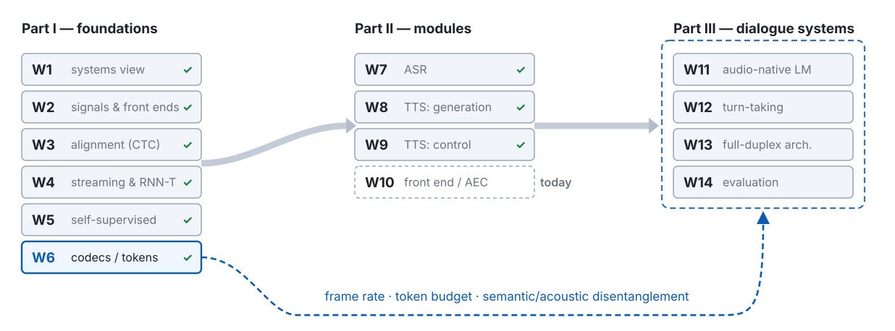

---
# 此檔由 bin/publish_slides.py 從投影片正本產生（中文講稿區塊已剝除），請勿直接編輯。正本在 private repo 的 <course>/slides/。
title: "The Physical Layer of Full Duplex: The Microphone Hears More Than the User"
subtitle: "Speech Processing & Human–Machine Interaction · Week 10"
author: "Hung-Shin Lee"
lang: en
format:
  revealjs:
    theme: [default, theme.scss]
    slide-number: c/t
    show-slide-number: all
    # 目標顯示尺寸：1280×800（16:10）。設成剛好填滿。
    # margin 預設 0.1 會把 deck 縮到 90% 才顯示（1152×720），白白損失一成字級。
    width: 1280
    height: 800
    margin: 0.04
    center: false
    progress: true
    transition: none
    # 章節標題會產生垂直堆疊；linear 讓左右鍵逐張前進，講課時才不會跳章
    navigation-mode: linear
    incremental: false
    # inline SVG 的 fragment（）在 ?print-pdf 裡要全部可見，不要每個 fragment 一頁
    pdf-separate-fragments: false
    chalkboard:
      buttons: true
    html-math-method:
      method: katex
      url: "https://cdn.jsdelivr.net/npm/katex@0.18.7/dist/"
    # 講稿（notes 區塊）裡的數學只輸出 MathML（與 w02.qmd～w09.qmd 相同的做法）。
    # presenter view 是另一個視窗，沒有 KaTeX 的 CSS；KaTeX 預設同時輸出 HTML 與 MathML，
    # 沒有 CSS 時兩份都會顯示，符號就重複了（例如 ℓℓ）。MathML 由瀏覽器原生排版，不需要 CSS。
    # 本 deck 自用：表格首欄允許換行（theme 的 .reveal table 首欄是 nowrap，首欄是句子的表要包在 ::: {.wrap1} 裡）。
    include-in-header:
      - text: |
          
    include-after-body:
      - text: |
          
---

# The microphone hears more than the user {.section-title}

## Where we are: week 10 of 14

{width="100%"}

## Last week, in one picture



::: {.claim .fragment fragment-index=2}
W7–W9 each assumed **the audio that comes in is what the user said.** A system that speaks while it listens hears **itself** as well.
:::

::: {.footer}
W8: a generator draws $\hat{\mathbf{x}}$ · W9 p5: every judge scores a finished recording · W9 p97: next week
:::

## The problem this week handles, in one picture



::: {.claim .warn .fragment fragment-index=2}
For each term that is not the user: **by what right do we remove it — what is left behind, and who pays for that?**
:::

::: {.footer}
outline 〈key maths 1〉 · the four terms return on p9, one row each
:::

## Today's route: seven stops, in two halves



::: {.claim .fragment fragment-index=2}
**First half:** by what right. **Second half:** what is left — and which one is the user.
:::

::: {.footer}
seven stops = the seven section pages · half-time: p45 · answered: p93
:::

## Notation for today

| Symbol | Meaning |
|:--------|:------------------|
| $n$, $t$, $k$, $\Delta$, $L$, $f_s$; $\hat{\mathbf{x}}$; $E_{\text{spk}}$, $\mathrm{SIM}$, $\vartheta$, $P_{\text{miss}}$, $P_{\text{fa}}$; $D_{\text{alg}}$ | W1–W9: sample, frame, bin, shift, window, rate; generated waveform; speaker encoder, its cosine, threshold, two error rates; algorithmic delay |
| $y(n)$, $s(n)$, $s_j(n)$, $v(n)$; $\Lambda_t$, $T_{\text{hang}}$ | microphone, user, talker $j$ (**a source index today**), noise; a likelihood ratio, hangover length in frames |
| $x(n)$, $\mathbf{x}(n)$, $L_h$; $\mathbf{h}$, $\hat{\mathbf{h}}(n)$; $e(n)$, $e_u(n)$; $\mu$, $\delta$ | what the system plays, its last $L_h$ samples; the echo path, our estimate; the residual, its undisturbed part; step size, regulariser |
| $Y$, $S$, $V$, $\hat{S}(t,k)$; $G(t,k)$; $\sigma_s^2$, $\sigma_v^2$, $\xi$ | STFT coefficients; a gain or mask (**not** W8's generator); speech and noise power in a cell, a-priori SNR |
| $\mathbf{s}_{\text{target}}$, $\mathbf{e}_{\text{noise}}$, $\mathbf{e}_{\text{artif}}$; $\mathbf{P}_{s}$, $\mathbf{P}_{s,v}$; $\omega$ | three parts of an enhanced signal; two projections; how much input is mixed back |
| $N_{\text{mic}}$, $\mathbf{y}(t,k)$, $\mathbf{w}(k)$, $\mathbf{d}(k)$; $\mathbf{R}_{ss}$, $\mathbf{R}_{vv}$, $\mathbf{u}_{\text{ref}}$ | microphones, their observations, beamformer weights, steering vector; spatial covariances, a one-hot reference |
| $\varphi \in \mathcal{S}_J$; $\mathbf{x}^{\text{enr}}$; $a_{t,j}$ | a permutation (**not** $\pi$); an enrolment recording; is talker $j$ active in frame $t$ |

::: {.footer}
vectors and matrices bold, scalars italic, functions upright · the outline's notation
:::

## Seven things to leave with today

1. **One sum, four terms** — and, for each term, the side information that lets us remove it; what happens with none (a permutation).
2. **VAD as a hypothesis test**: its two errors, what the hangover costs, where that lands in W1's budget — and why a VAD cannot say "the user has finished".
3. **AEC as system identification**: NLMS from one "minimal disturbance" step, why $0 < \mu < 2$, why double-talk breaks it, and what no linear filter can remove.
4. **The Wiener gain and three masks**; how discriminative and generative enhancement each fail; and **why SNR can rise while WER gets worse** — the target / noise / artifact split, and observation adding.
5. **MVDR from a constrained minimisation**; what "distortionless" has to do with artifacts; who does what in mask-based beamforming.
6. **What PIT solves and what it does not** — the outputs have no identity — and when blind separation, target speaker extraction or a personal VAD fits.
7. **Speaker verification and diarization**: two errors again; DER and its two switches; latency online; and why "is this addressed to me?" is not an acoustic question.

::: {.footer}
outline 〈Learning objectives〉 1–7 · derivations stay on the slides, revealed step by step
:::

## One sum, four terms: what is known about each?

| term | what we know | what must be estimated | the module |
|:---|:--------|:--------|:-----|
| the echo, $\mathbf{h}^{\top}\mathbf{x}(n)$ | **$x$ itself** — we played it | one path, $\mathbf{h}$: $L_h$ numbers | AEC |
| noise, $v(n)$ | only how speech and noise **tend to look** | a gain $G$ for every cell | enhancement |
| other talkers, $s_j(n)$ | nothing — unless an **array**, or an **enrolment** | $J$ whole waveforms | beamforming · separation · extraction |

::: {.claim .fragment}
The weaker the side information, the more the model has to **guess from a prior** — and the less natural what it leaves behind.
:::

::: {.footer}
outline 〈key maths 1〉 · side information: anything known besides $y$ itself
:::

## One chain: where each module sits



::: {.claim .fragment fragment-index=2}
The **linear** AEC goes first: it assumes the echo in $y$ is a linear function of $x$ — anything non-linear placed before it breaks that.
:::

::: {.footer}
order: Hänsler & Schmidt (2004) · the fold-back: W8–W9's output is W10's input
:::

# Is anyone speaking? {.section-title}

## VAD is a hypothesis test

$$
\Lambda_t \;=\; \frac{p(\text{frame } t \mid H_1)}{p(\text{frame } t \mid H_0)} \;\gtrless\; \vartheta
\qquad H_0\text{: noise only} \quad H_1\text{: speech + noise}
$$



::: {.footer}
VAD: voice activity detection · Sohn, Kim & Sung, IEEE SPL 6(1), 1999 · the curves are a sketch
:::

## Two errors, and what each costs downstream

| the VAD's error | what the next module receives | what the user experiences |
|:------|:---------|:---------|
| **miss**: speech called non-speech | a word with its start or end cut off | the system "did not hear" a short word; a soft onset is lost |
| **false alarm**: non-speech called speech | noise, sent to a recogniser with a strong prior | W7: **a fluent sentence nobody said** — hallucination enters here |

::: {.fragment}
::: {.claim}
The costs are **not symmetric**, and both are amplified downstream. The threshold only trades one for the other — and the base rate of speech sets what one trigger is worth.
:::
:::

::: {.footer}
W7 p31: flat evidence → the prior · W7 p39: four stations · W9 p80: the base rate
:::

## The hangover: bridging pauses, at a price



::: {.claim .fragment fragment-index=3}
Every endpoint is late by $T_{\text{hang}}\,\Delta$ — **a setting, not a computation.** It sits in W1's "endpoint" cell; shortening it buys cut-off sentences.
:::

::: {.footer}
W1 p43: the response budget · W1 p50: Demo 2 measured this cell · full refill: p90
:::

## A learned VAD is the same test

| | the score for frame $t$ | then |
|:----|:--------|:------|
| **statistical** (Sohn et al. 1999) | a likelihood ratio, in closed form from the a-priori SNR $\xi$ | threshold + hangover |
| **neural** (Silero VAD; pyannote's segmentation model) | a network's $P(H_1 \mid \text{frame } t)$ | threshold + hangover |
| **personal VAD** (Ding et al. 2020) | three classes: non-speech · **the target speaker** · someone else | — the border with speaker recognition |

::: {.claim .fragment}
A network changes **where the score comes from** — not the two errors, not the threshold, not the hangover.
:::

::: {.footer}
Ding et al. 2020 · Bredin & Laurent 2021 · Silero VAD: software, not a peer-reviewed paper
:::

## MC 1 — "a VAD detects the user speaking"

::: {.ask}
The system is in the middle of a sentence; the user is silent. **What does this VAD output right now?**
:::

::: {.fragment}
::: {.claim .warn}
It detects **something that looks like speech** — the television, a bystander, **the system's own voice coming back**. A barge-in trigger built on it is interrupted by itself.
:::

- "Is it **the user**?" — add a speaker condition (p72, p78).
- "Is it **meant for me**?" — add meaning: not an acoustic question (p87).
- "Has the user **finished**?" — a prediction, not a detection (W12).
:::

::: {.footer}
MC: misconception · the loudest "speech" in the mic is the echo: stop 2 · W1 p35: MC 3
:::

# Removing our own voice {.section-title}

## Before Demo 1: can the system subtract what it just said?

::: {.prose}
| | |
|:---|:-----------------|
| **Why** | Of the three terms to remove, the echo is the one we know most about: **we played it.** So the obvious move is to subtract it. The demo starts with the obvious move, and with why it fails. |
| **What runs** | This laptop plays a sentence from W8's TTS through its own loudspeaker and records with its own microphone, at the same time: $x(n)$ out, $y(n)$ in. Three recordings — the system alone; the system while I talk over it; the loudspeaker turned up until it distorts. Everything after that is a few dozen lines of `numpy`. |
| **Watch for** | Step one today: subtract $x$ from $y$ — as played, then shifted to line up. **How much of the echo is gone?** The rest of the demo (p33–p34) returns once the method is on the slides. |
:::

::: {.footer}
Demo 1 · demos/w10_d1_echo_nlms · no neural network is trained this week
:::

## Demo 1 — step one: $y - x$

::: {.ask}
**Demo 1, step one.** We know every sample we played. Subtract it from the microphone. Before you hear it: how much of the echo is gone?
:::

::: {.fragment fragment-index=1}
| what is subtracted from $y(n)$ | what is left, by ear | residual level, re. the microphone |
|:----------|:--------|:--------|
| nothing — the raw microphone | | $0$ dB, by definition |
| $x(n)$, as played | | |
| $g\,x(n - D)$: delayed to line up with the echo, scaled to fit | | |
:::

::: {.footer}
Demo 1 · demos/w10_d1_echo_nlms · the table is filled at rehearsal → w10-metrics.json → demo1
:::

## MC 2 — "AEC subtracts the played signal from the microphone"

::: {.claim .warn}
It subtracts $\hat{\mathbf{h}}^{\top}\mathbf{x}(n)$ — the played signal **after** the loudspeaker, the room and the microphone have delayed, filtered and reverberated it. What has to be learned is **the path** — and the path moves.
:::

| | what is subtracted | what has to be known |
|:---|:------|:---------|
| the misconception | $x(n)$ | nothing |
| a fixed delay | $x(n - \text{delay})$ | one number |
| AEC | $\hat{\mathbf{h}}^{\top}\mathbf{x}(n)$: a weighted sum of the last $L_h$ samples played | $L_h$ numbers — re-learned whenever someone moves |

::: {.footer}
Demo 1, step one (p19) · the path as a list of numbers: p22
:::

## At a glance: normalised least mean squares (NLMS)

::: {.prose}
| | |
|:---|:-----------------|
| **Name** | **Normalised least mean squares (NLMS)**: an adaptive filter — a filter whose weights are corrected at every sample. One commonly cited origin: Nagumo & Noda, *A Learning Method for System Identification*, IEEE Trans. Automatic Control, 1967. |
| **The question** | We know what we played, $x$, and we hear $y$. The path between them is unknown and keeps moving. Can it be learned **while it is being used**? |
| **The idea** | Guess the path. Use the guess to predict the echo; subtract. Whatever is left says how wrong the guess was — so correct the guess, by the **smallest change** that would have got this sample right. Repeat, every sample. |
| **What it added** | No training data and no training phase; it follows a path that changes; the cost per sample is a few thousand multiplications. |
| **What it leaves open** | The user speaking at the same time (p27–p29) · what no linear path can model (p30) · whether a full-duplex model can do without it (p35). The derivation is the next four slides (p22–p25). |
:::

::: {.footer}
textbook: Hänsler & Schmidt (2004) · AEC, acoustic echo cancellation: the task this filter serves
:::

## The echo path is a list of numbers



::: {.claim .fragment fragment-index=2}
Each number in $\mathbf{h}$ says how much of the sample played $i$ steps ago arrives **now**. The echo is their weighted sum — W2's convolution, once more.
:::

::: {.footer}
W2 p12: the source–filter model · here the "filter" is the room, the "source" our loudspeaker
:::

## System identification: the user's voice is not subtracted

$$
\min_{\hat{\mathbf{h}}}\; \mathbb{E}\Big[\big(y(n) - \hat{\mathbf{h}}^{\top}\mathbf{x}(n)\big)^2\Big]
\qquad\Longrightarrow\qquad
\mathbf{R}_{xx}\,\hat{\mathbf{h}} \;=\; \mathbf{r}_{xy}
$$

::: {.fragment}
$$
y(n) = \mathbf{h}^{\top}\mathbf{x}(n) + \underbrace{s(n) + v(n)}_{\text{uncorrelated with } x}
\qquad\Longrightarrow\qquad
\hat{\mathbf{h}} = \mathbf{h}
$$
:::

::: {.fragment}
::: {.claim}
The best filter is the true path — **and nothing else.** The user's voice has nothing in common with what we played, so no filter of $x$ can cancel it: **it stays in the residual.**
:::
:::

::: {.footer}
$\mathbf{R}_{xx} = \mathbb{E}[\mathbf{x}\mathbf{x}^{\top}]$, $\mathbf{r}_{xy} = \mathbb{E}[\mathbf{x}\,y]$: the Wiener–Hopf equations · residual $e(n) = y(n) - \hat{\mathbf{h}}^{\top}\mathbf{x}(n)$
:::

## Step 1 — the smallest change that gets this sample right



$$
\min\, \big\lVert \hat{\mathbf{h}}(n{+}1) - \hat{\mathbf{h}}(n) \big\rVert^2
\;\;\text{s.t.}\;\; \hat{\mathbf{h}}^{\top}(n{+}1)\,\mathbf{x}(n) = y(n)
\quad\Longrightarrow\quad
\hat{\mathbf{h}}(n{+}1) = \hat{\mathbf{h}}(n) + \frac{e(n)\,\mathbf{x}(n)}{\lVert \mathbf{x}(n) \rVert^2}
$$

::: {.footer}
"minimal disturbance": the textbook derivation of NLMS · one Lagrange multiplier
:::

## Step 2 — a step size, and why $0 < \mu < 2$

$$
\hat{\mathbf{h}}(n{+}1) \;=\; \hat{\mathbf{h}}(n) \;+\; \mu\, \frac{e(n)\,\mathbf{x}(n)}{\lVert \mathbf{x}(n) \rVert^2 + \delta}
$$

::: {.fragment}
$$
e^{+}(n) \;=\; y(n) - \hat{\mathbf{h}}^{\top}(n{+}1)\,\mathbf{x}(n) \;=\; (1 - \mu)\; e(n)
\qquad\Longrightarrow\qquad |1 - \mu| < 1
$$
:::

::: {.fragment}
| | $\mu = 0.5$ | $\mu = 1$ | $\mu = 2$ | $\mu > 2$ |
|:---|:---|:---|:---|:---|
| the same sample, recomputed | half the error | zero | the same size, sign flipped | **larger** — diverges |

::: {.small}
**Why divide by $\lVert\mathbf{x}\rVert^2$:** speech power moves by tens of dB within tens of milliseconds. Without the division, one step size is too large in the loud parts and too small in the quiet ones.
:::
:::

::: {.footer}
$\delta$: a small constant, so that silence in $x$ does not divide by zero · this is the whole of NLMS
:::

## How well, and how fast: ERLE and convergence

$$
\mathrm{ERLE}(n) \;=\; 10 \log_{10} \frac{\mathbb{E}\big[y^2(n)\big]}{\mathbb{E}\big[e^2(n)\big]} \quad \text{(dB)}
$$



::: {.footer}
ERLE: echo return loss enhancement — valid only while the user is silent · w10-data.json → nlms
:::

## Double-talk: the error has three parts

$$
e(n) \;=\; \underbrace{\big(\mathbf{h} - \hat{\mathbf{h}}(n)\big)^{\top}\mathbf{x}(n)}_{e_u(n)\text{: echo not yet cancelled}}
\;+\; \underbrace{s(n)}_{\text{the user}} \;+\; \underbrace{v(n)}_{\text{noise}}
$$

::: {.fragment}
What each part does to the update:

- $e_u(n)$ — points **towards** the true path: the only useful part.
- $s(n)$ — zero on average, but with a variance that grows with **how loud the user is**.
- $v(n)$ — the same, usually much smaller.
:::

::: {.fragment}
::: {.claim .warn}
**Double-talk**: user and system speak at once. The filter takes the user's voice for echo it has not yet cancelled — and "corrects" a path that was not wrong.
:::
:::

::: {.footer}
outline 〈key maths 4〉 · in the literature $s(n)$ is "near-end" speech, the system's "far-end"
:::

## The best step size is the echo's share of the error

$$
\mu_{\text{opt}}(n) \;\approx\; \frac{\mathbb{E}\big[e_u^2(n)\big]}{\mathbb{E}\big[e^2(n)\big]}
$$



::: {.small}
**Hard** — a double-talk detector freezes the filter (Geigel; cross-correlation). **Soft** — estimate the ratio itself (Valin 2007), or treat $\mathbf{h}$ as a drifting state and let a Kalman filter set the step (Enzner & Vary 2006).
:::

::: {.footer}
Valin, IEEE TASLP 15(3), 2007, Eq. 9 · toy simulation: w10-data.json → nlms · lower is better
:::

## MC 3 — "double-talk is a corner case"

::: {.claim .warn}
In a phone call, perhaps. In full-duplex dialogue, **barge-in and backchannels are double-talk**: the moment the system most needs to hear is the moment its adaptive filter is easiest to mis-teach.
:::

| what the user does | who is speaking | for the echo canceller |
|:------|:------|:---------|
| listens quietly | the system only | the easy case: it adapts |
| **barges in** — "no, wait" | both | double-talk |
| **backchannels** — "mm-hm" | both | double-talk |
| answers after the system stops | the user only | nothing to cancel |

::: {.footer}
W1 p25: MC 1 · W1 p56: the stop budget · backchannels: W12
:::

## The linear ceiling: what no linear filter can subtract



::: {.fragment fragment-index=2}
::: {.small}
**What breaks "the echo is a linear, slowly changing function of $x$":** a small loudspeaker driven hard · the device's own automatic gain control (AGC) · delay jitter and clock drift between playback and capture. **So, after the linear filter:** a non-linear residual-echo suppressor — today a neural network — or one model for echo, noise and reverberation together (DeepVQE, 2023).
:::
:::

::: {.footer}
AEC Challenge: Sridhar et al. 2021; Cutler et al. 2024 · DeepVQE: Indenbom et al. 2023
:::

## MC 4 — "with neural networks, AEC needs no linear filter"

::: {.claim .warn}
Both designs have strong results. On devices, most systems **keep the linear stage**: it adds nothing of its own to the signal, and it adapts to each device. Neither has replaced the other.
:::

| | linear filter + neural post-filter | one network for everything |
|:---|:---------|:---------|
| **an example** | LMPAN (2026): reference, linear-AEC output and microphone, aligned, then fused | DeepVQE (2023): echo, noise and reverberation in one model |
| **the argument for it** | the linear stage is the one with the answer sheet; the network only handles what is left | no hand-built stage to tune; strong results on the challenge test sets |

::: {.footer}
LMPAN: Liu et al., Interspeech 2026 · "most keep the linear stage": this course's reading
:::

## Training and use: there is no training phase



::: {.claim .fragment fragment-index=2}
The only module in this course whose weights move **at inference** — which is exactly why it can be mis-taught at inference.
:::

::: {.footer}
W5 p46 · W6 p32 · W7 p69 · W8 p54 · W9 p44–p45 · today's other shapes: p44, p73, p79
:::

## Demo 1 — convergence, double-talk, the ceiling

::: {.ask}
**Demo 1, continued.** The filter has converged; now I talk over the system. Predict the ERLE **while** I talk — and in the second **after** I stop.
:::

::: {.fragment fragment-index=1}
| the recording, and the step-size rule | what the screen shows | measured |
|:----------|:--------|:----|
| system alone · NLMS from zero | time to converge; ERLE reached | |
| I talk over it · fixed $\mu$ | ERLE during; echo after I stop | |
| I talk over it · Geigel freeze | the same two | |
| I talk over it · soft step (residual-to-error ratio) | the same two | |
| loudspeaker distorting · NLMS | the ERLE ceiling | |
:::

::: {.footer}
Demo 1 · measured at rehearsal → w10-metrics.json → demo1 · the method: p24–p25, p28
:::

## Demo 1 — what the next model hears: VAD and Whisper

::: {.ask}
The same recording — the system speaking, then I interrupt — goes to a VAD and to Whisper, **before** and **after** echo cancellation. What does each one report?
:::

::: {.fragment fragment-index=1}
| | Silero VAD: when is it active? | Whisper small: what does it write? |
|:----|:---------|:---------|
| **before AEC**: the raw microphone | | |
| **after AEC**: the residual $e(n)$ | | |
:::

::: {.fragment fragment-index=2}
::: {.small}
p16's question, on real audio: a barge-in trigger placed **before** the echo canceller is triggered by the system itself.
:::
:::

::: {.footer}
Demo 1 · demos/w10_d1_echo_nlms · Silero VAD: open-source software (p15) · Whisper small: W7
:::

## The full-duplex model's side: headphones, or two answers

| | what it does about its own echo | status |
|:----|:-----------|:------|
| **a model trained on clean two-channel data** | nothing: it has never heard itself. Moshi's own instructions: no echo cancellation — **wear headphones** | the official README |
| **answer 1: a front end, tuned for what follows** | an AEC whose post-processing is set separately for the VAD and for the ASR (Jiang & Biao 2025); LMPAN (2026) | ICASSP 2025; Interspeech 2026 |
| **answer 2: let the model learn to ignore it** | SALMONN-omni reports echo cancellation as a learned ability of the model itself | **the authors' own report**, in a preprint; not independently verified |

::: {.footer}
Jiang & Biao, arXiv:2508.07561 · SALMONN-omni: Yu et al., arXiv:2505.17060 · W13
:::

## MC 5 — "a full-duplex model is end-to-end; it needs no front end"

::: {.claim .warn}
A model trained on clean two-channel recordings has never heard its own echo, or a bystander. Whether the front end stays **outside** the model or is learned **inside** it is open — but the term $\mathbf{h}^{\top}\mathbf{x}(n)$ is in the microphone either way.
:::

| where the fix sits | 2025–2026 examples |
|:------|:-----------|
| in front of the model | an AEC tuned for the downstream (p35) · a reliability gate on the user's audio (IRAF) · token repair from lip video (AV-STE) |
| inside the model | "learned" echo cancellation — so far, an author's claim (p35) |

::: {.footer}
IRAF: Zhong et al., arXiv:2606.06559 (preprint) · AV-STE: Godiva, Kim & Ro, EMNLP 2026
:::

# Removing the noise {.section-title}

## No reference: all that is left is a prior

$$
Y(t,k) = S(t,k) + V(t,k)
\qquad\qquad
\hat{S}(t,k) = G(t,k)\; Y(t,k)
$$

What stands in for the missing reference:

- a **statistical assumption** about speech and noise — $G$ from a formula (p39–p40)
- a **learned mask** — a network trained on (noisy, clean) pairs predicts $G$ (p41–p42)
- a **generative model** of clean speech — draw $\hat{S}$ from $P(S \mid Y)$: no mask at all (p43)

::: {.claim .fragment}
With no reference, all that is left is **a prior** about what speech looks like. Each step trusts it more than the one before.
:::

::: {.footer}
frame $t$, bin $k$: W2 p24 · the mask view, surveyed: Wang & Chen, IEEE/ACM TASLP 2018
:::

## The Wiener gain: one number per cell



::: {.claim}
$\xi = \sigma_s^2 / \sigma_v^2$: speech power over noise power **in this one cell**. Every mask-based method estimates this gain, or a variant of it.
:::

::: {.footer}
the minimum-mean-square-error gain, per cell · w10-data.json → wiener · Loizou (2013)
:::

## The gain needs the answer: decision-directed, and musical noise

| | how it estimates $\xi$ for this cell | what goes wrong |
|:----|:-----------|:--------|
| **use this frame only** | from what was just observed, minus the noise estimate | the estimate jumps from frame to frame |
| **decision-directed** (Ephraim & Malah 1984) | a weighted average: **last frame's output** and this frame's observation | heavy smoothing: more residual noise, slower onsets |

::: {.fragment}
::: {.claim .warn}
With little smoothing, isolated cells switch on and off at random — short tones that were in neither the speech nor the noise: **musical noise**. The processing made them.
:::

::: {.small}
Something in the output that neither the speech nor the noise contained has a general name: an **artifact**. It had a name in the statistical era (Cappé 1994) — it returns as the centre of stop 4.
:::
:::

::: {.footer}
Ephraim & Malah, IEEE TASSP 1984 · Cappé, IEEE TSAP 1994 · spectral subtraction: Boll 1979
:::

## Learned masks: IRM, PSM, cIRM

| the training target | defined as | what it does about phase |
|:------|:-----------|:---------|
| **ideal ratio mask (IRM)** | $\left(\dfrac{\lvert S\rvert^2}{\lvert S\rvert^2 + \lvert V\rvert^2}\right)^{1/2}$ — the square root of the Wiener gain | nothing: real, magnitude only; **the noisy phase is reused** |
| **phase-sensitive mask (PSM)** | $\dfrac{\lvert S\rvert}{\lvert Y\rvert}\cos(\angle S - \angle Y)$ | still real — but shrinks cells whose phase is far off |
| **complex ideal ratio mask (cIRM)** | $S / Y \in \mathbb{C}$ | estimates real and imaginary parts: corrects the phase too |

::: {.fragment}
::: {.small}
**"Ideal"**: computed from the clean speech — available only in training, where we made the mixture ourselves (p44). The network learns to predict the mask from $Y$ alone.
:::
:::

::: {.footer}
PSM: Erdogan et al. 2015 · cIRM: Williamson, Wang & Wang 2016 · Wang & Chen (2018), Eq. 2, 4, 5
:::

## Consistency returns: a masked STFT is not an STFT

$$
G \cdot Y \;\notin\; \mathcal{C}
\qquad\Longrightarrow\qquad
\mathrm{STFT}\big(\mathrm{iSTFT}(G \cdot Y)\big) \;\neq\; G \cdot Y
$$

::: {.claim}
Neighbouring frames overlap, so their cells must agree with one another. Scale each cell on its own and they no longer do: **what you hear is not the spectrogram you built.**
:::

::: {.fragment}
**One way round it:** leave the STFT. Conv-TasNet (Luo & Mesgarani 2019) learns its own analysis and synthesis filters and works on the waveform.
:::

::: {.footer}
W2 p45: the consistent set $\mathcal{C}$ · Luo & Mesgarani, IEEE/ACM TASLP 27(8), 2019
:::

## A generative model: draw the clean speech

| | what it computes | when the evidence is weak |
|:----|:---------|:---------|
| **discriminative** — a mask, or a waveform mapping | one output: the best single estimate of $S$ given $Y$ | it hedges: over-suppressed, smeared |
| **generative** — SGMSE+ (Richter et al. 2023) | **a draw** from $P(S \mid Y)$: a diffusion model, conditioned on the noisy $Y$ | it commits: something clean and natural — **from the prior** |

::: {.claim .fragment}
W8, at the front end: one noisy input, many plausible clean versions — pick one. It sounds clean **because the model knows what clean speech sounds like.**
:::

::: {.footer}
SGMSE+: Richter et al., IEEE/ACM TASLP 2023 · W8 p10: one text, many readings
:::

## Training and use: synthetic pairs



::: {.claim .fragment fragment-index=2}
The label is free **because we made the mixture** — and that is also the gap: good on synthetic test sets, clearly worse on real recordings.
:::

::: {.footer}
DNS: the Deep Noise Suppression Challenge, Reddy et al. 2020 · W5 p64: domain shift
:::

## Half-time: by what right — and what is left?



::: {.claim}
**So far:** weaker evidence, more guessing. **From here:** it sounds cleaner — **does the next model agree?**
:::

::: {.footer}
the route: p6 · first half: p11–p44 · second half: p46–p88 · answered: p93
:::

# What removal leaves behind {.section-title}

## Every metric is a judge

| the number | needs the clean signal? | what it was built to track |
|:-----|:----|:-----------|
| **SNR, SI-SDR** | yes | the energy of the error — any error, weighted equally |
| **PESQ**: perceptual evaluation of speech quality (Rix et al. 2001) | yes | perceived quality, on telephone networks and codecs |
| **STOI**: short-time objective intelligibility (Taal et al. 2011) | yes | intelligibility, for human listeners |
| **DNSMOS** (Reddy et al. 2021) | no | a learned MOS predictor — UTMOS's kin (W9 p71) |
| **WER** of the recogniser that comes next | a transcript | whether **the next model** still gets the words |

::: {.claim .fragment}
The first four are judges that enhancement is **optimised against** — MetricGAN+ trains on PESQ directly. The last one is the judge that **matters downstream**.
:::

::: {.footer}
SI-SDR: Le Roux et al. 2019 (W2 p72) · MetricGAN+: Fu et al. 2021 · W9 p54: judges' blind spots
:::

## Before Demo 2: does the recogniser agree that it is cleaner?

::: {.prose}
| | |
|:---|:-----------------|
| **Why** | The judges enhancement is trained against were built for human ears, or count energy. The judge that matters here is the recogniser. Do the two kinds agree? This is one of the course's six core failure cases. |
| **What runs** | 40 LibriSpeech sentences, with white noise added at $20$, $10$, $5$, $0$ and $-5$ dB SNR. **Three front ends**: none; a statistical one written in `numpy`; a neural one trained with PESQ as its target (MetricGAN+). **Two recognisers**, chosen to differ: a CTC model that has only heard clean read speech (W3), and Whisper small (W7). |
| **Watch for** | At 0 dB: which has the lower WER — the noisy sentence, or the enhanced one? **Is the answer the same for both recognisers?** And when each recogniser fails on enhanced speech: what does the failure look like? |
:::

::: {.footer}
Demo 2 · demos/w10_d2_enhance_wer · no model is trained: inference only
:::

## Demo 2 — WER against SNR, with and without enhancement

::: {.ask}
**Demo 2.** At 0 dB: noisy as it is, or enhanced — which gets the lower WER? Is it the same answer for the CTC model and for Whisper?
:::

::: {.fragment fragment-index=1}
| recogniser | front end | $20$ dB | $10$ dB | $5$ dB | $0$ dB | $-5$ dB |
|:-----|:-----|:--|:--|:--|:--|:--|
| CTC, clean-trained (W3) | none | $3.9$ | $19.3$ | $55.6$ | $93.9$ | $100.0$ |
| | statistical | $3.9$ | $10.2$ | $26.2$ | $58.7$ | $87.9$ |
| | MetricGAN+ | $4.5$ | $21.5$ | $55.3$ | $92.2$ | $99.5$ |
| Whisper small (W7) | none | $3.8$ | $6.2$ | $11.1$ | $40.5$ | $53.1$ |
| | statistical | $3.8$ | $5.9$ | $12.0$ | $23.4$ | $56.6$ |
| | MetricGAN+ | $6.0$ | $17.4$ | $43.3$ | $86.6$ | $99.1$ |
:::

::: {.footer}
Demo 2 · WER (%), normalised as in W7 · white noise · 40 sentences · measured 2026-11-23
:::

## The error, split by two projections



$$
\hat{\mathbf{s}} \;=\; \underbrace{\mathbf{P}_{s}\,\hat{\mathbf{s}}}_{\mathbf{s}_{\text{target}}}
\;+\; \underbrace{\big(\mathbf{P}_{s,v} - \mathbf{P}_{s}\big)\,\hat{\mathbf{s}}}_{\mathbf{e}_{\text{noise}}}
\;+\; \underbrace{\big(\mathbf{I} - \mathbf{P}_{s,v}\big)\,\hat{\mathbf{s}}}_{\mathbf{e}_{\text{artif}}}
$$

::: {.footer}
Vincent et al., IEEE TASLP 2006 · Iwamoto et al., Interspeech 2022, Eq. 1, 4–6 · redrawn, not copied
:::

## Three ratios: enhancement trades SAR for SNR

$$
\mathrm{SNR} = \frac{\lVert \mathbf{s}_{\text{target}} \rVert^2}{\lVert \mathbf{e}_{\text{noise}} \rVert^2}
\qquad
\mathrm{SAR} = \frac{\lVert \mathbf{s}_{\text{target}} + \mathbf{e}_{\text{noise}} \rVert^2}{\lVert \mathbf{e}_{\text{artif}} \rVert^2}
\qquad
\mathrm{SDR} = \frac{\lVert \mathbf{s}_{\text{target}} \rVert^2}{\lVert \mathbf{e}_{\text{noise}} + \mathbf{e}_{\text{artif}} \rVert^2}
$$

::: {.fragment}
- the microphone, untouched, $\mathbf{y} = \mathbf{s} + \mathbf{v}$: SNR low; SAR **infinite**, because $\mathbf{e}_{\text{artif}} = \mathbf{0}$
- after single-channel enhancement: SNR **higher**; SAR finite
:::

::: {.fragment}
::: {.claim .warn}
Enhancement **buys SNR and pays in SAR.** A recogniser turns out to be far more sensitive to artifacts than to the noise that was left — and SDR, which adds the two errors together, cannot tell them apart.
:::
:::

::: {.footer}
in dB · SAR: signal-to-artifacts ratio; SDR: signal-to-distortion ratio · Iwamoto et al. 2022
:::

## MC 6 — "SNR and PESQ went up, so ASR will improve"

::: {.claim .warn}
The metric and the WER can move in **opposite directions.** The mechanism is the artifact: SAR is spent to buy SNR, and the recogniser minds the artifact more. But it is **not** "enhancement hurts ASR" either — it depends on the front end, on what the back end was trained on, and on the SNR.
:::

| three ways to repair it | where |
|:------|:-----|
| mix a little of the unprocessed signal back in | p53–p54 |
| retrain the back end on enhanced speech, or train the two jointly | Kinoshita et al. 2020: a time-domain front end that **does** help a strong back end |
| use a front end that makes no artifacts — a linear one | stop 5 |

::: {.footer}
Kinoshita et al., ICASSP 2020 · Whisper-class back ends: single studies only (Islam et al. 2026)
:::

## Observation adding: mix a little of the input back

$$
\hat{\mathbf{s}}^{\text{OA}} \;=\; \hat{\mathbf{s}} \;+\; \omega\, \mathbf{y}, \qquad \omega \geq 0
$$



::: {.fragment fragment-index=2}
::: {.small}
$\mathbf{y}$ lies wholly in the plane, so $\mathbf{e}_{\text{artif}}$ does not change while $\mathbf{s}_{\text{target}} + \mathbf{e}_{\text{noise}}$ grows: **SAR rises for every $\omega$, as long as $\langle \hat{\mathbf{s}}, \mathbf{y} \rangle > 0$** (Iwamoto et al., Proposition 1).
:::
:::

::: {.footer}
OA: observation adding · Iwamoto et al. 2022, Eq. 8, Prop. 1 · journal: Ochiai et al. 2024
:::

## One knob, two errors: SAR back, SNR down



::: {.claim .fragment fragment-index=2}
Mixing the input back **buys SAR with SNR** — the trade of p51, run in reverse. Where to stop is decided by the next model's WER, not by either curve.
:::

::: {.footer}
toy vectors: $\hat{\mathbf{s}} = 0.9\,\mathbf{s} + 0.2\,\mathbf{v} + 0.3\,\mathbf{a}$, $\mathbf{a} \perp \mathbf{s}, \mathbf{v}$ · w10-data.json → observation_adding
:::

## Demo 2 — SAR against WER, the $\omega$ sweep, and a second judge

::: {.ask}
**Demo 2, continued.** Mix the noisy input back into the enhanced one, a little at a time. What happens to SAR — and to Whisper's WER? And one more judge: W9's spoofing detector, on **real** speech that has been enhanced.
:::

::: {.fragment fragment-index=1}
| at 0 dB, MetricGAN+ | $\omega = 0$ | $0.1$ | $0.3$ | $1$ | no enhancement |
|:-------|:--|:--|:--|:--|:--|
| SNR, SAR (dB) | $20.9$, $-3.2$ | $9.5$, $1.8$ | $5.2$, $6.6$ | $2.2$, $14.3$ | $0$, $\infty$ |
| WER — CTC; Whisper | $92.2$; $86.6$ | $85.6$; $38.9$ | $87.7$; $28.9$ | $91.6$; $25.3$ | $93.9$; $40.5$ |
| real speech called spoof by AASIST (W9 Demo 3) | $40/40$ | $36/40$ | $40/40$ | $40/40$ | $40/40$ |
:::

::: {.footer}
Demo 2 · white noise · 40 sentences · measured 2026-11-23 · SNR, SAR as on p51, no delays
:::

## Generative enhancement: when the evidence is flat

| who reports it | at what input | what the output contains |
|:------|:-----|:----------|
| the SGMSE+ authors, in their own paper (Richter et al. 2023) | very low input SNR | "vocalizing" artifacts · breathing sounds · **phonetic confusions** |
| a review of diffusion models for audio restoration (Lemercier et al. 2024) | negative input SNR | **hallucination**: speech painted into regions that held only noise |

::: {.claim .warn .fragment}
W7's formula, at the front end: when the evidence is flat, the output falls to the prior — clean, natural, **and not what the user said.** A metric that compares energies may not notice.
:::

::: {.footer}
W7 p31: flat evidence → the prior · Lemercier et al., IEEE Signal Processing Magazine, 2024
:::

## MC 7 — "generative enhancement sounds cleanest, so it is best"

::: {.claim .warn}
**Sounding clean and being correct are two different things.** With weak evidence a generative model fills in from its prior; the phoneme it fills in may not be the one that was spoken — and neither a reference-based metric nor a listener is sure to catch it.
:::

| the output | a listener says | a metric of energy says | what was said |
|:-----|:-----|:-----|:-----|
| noisy, untouched | unpleasant | poor | all there |
| discriminative enhancement | cleaner, perhaps a little odd | better | there, plus artifacts |
| generative enhancement | **cleanest** | — | **possibly replaced** |

::: {.footer}
p43, p56 · the three rows are the ladder of p38: each trusts the prior more
:::

# Subtracting with space {.section-title}

## What a second microphone gives



::: {.claim .fragment fragment-index=2}
A second microphone adds a dimension that has nothing to do with the spectrum: **where the sound comes from.** Stack one cell from every microphone: the vector $\mathbf{y}(t,k)$.
:::

::: {.footer}
steering vector $\mathbf{d}(k)$: one direction's delays, as a phase per bin · Vincent, Virtanen & Gannot (2018)
:::

## At a glance: the MVDR beamformer

::: {.prose}
| | |
|:---|:-----------------|
| **Name** | **Minimum-variance distortionless response (MVDR)**: a beamformer — one weight per microphone, per frequency bin. Capon, *High-Resolution Frequency-Wavenumber Spectrum Analysis*, Proceedings of the IEEE, 1969. |
| **The question** | Several microphones hear the same scene with different delays. How should they be combined so that the user's direction is kept and everything else is turned down? |
| **The idea** | Take a weighted sum of the microphones. Among all weightings that pass the target direction **unchanged**, choose the one that lets the **least power** through from everywhere else. |
| **What it added** | The output is **linear in what the microphones heard** — nothing is drawn in. A closed form: it needs two statistics, not a trained model. |
| **What it leaves open** | Where the direction and the noise statistics come from (p63) · a scene that moves; two talkers in one direction (p64). Derivation: p61. |
:::

::: {.footer}
textbook: Benesty, Chen & Huang (2008) · for ASR: Haeb-Umbach et al., Proc. IEEE 109(2), 2021
:::

## MVDR: one constraint, one Lagrange step

$$
\hat{S}(t,k) \;=\; \mathbf{w}^{H}(k)\; \mathbf{y}(t,k)
$$

$$
\min_{\mathbf{w}}\; \mathbf{w}^{H}\mathbf{R}_{vv}\,\mathbf{w}
\quad \text{s.t.} \quad \mathbf{w}^{H}\mathbf{d} = 1
\qquad\Longrightarrow\qquad
\mathbf{w} \;=\; \frac{\mathbf{R}_{vv}^{-1}\,\mathbf{d}}{\mathbf{d}^{H}\mathbf{R}_{vv}^{-1}\,\mathbf{d}}
$$

::: {.fragment}
| | in words |
|:----|:-----------|
| $\mathbf{w}^{H}\mathbf{d} = 1$ | **the constraint** — sound from the target's direction passes with gain exactly 1: *distortionless* |
| $\mathbf{w}^{H}\mathbf{R}_{vv}\,\mathbf{w}$ | **the objective** — the power the noise leaves in the output: *minimum variance* |
| $\mathbf{R}_{vv} = \mathbb{E}[\mathbf{v}\mathbf{v}^{H}]$ | the noise's **spatial covariance**: how the noise at one microphone relates to the noise at another |
:::

::: {.footer}
$^{H}$: conjugate transpose · Capon (1969) · the same shape as p24: a constraint, then a minimum
:::

## Distortionless, read through the decomposition



::: {.claim}
A beamformer's output is a weighted sum of what the microphones heard — it **cannot leave the plane.** That is why a multichannel front end helps ASR where single-channel enhancement often does not.
:::

::: {.footer}
Iwamoto et al. 2022, fn. 1 · the plane: speech and noise as each microphone heard them
:::

## Mask-based beamforming: who does what



$$
\hat{\mathbf{R}}_{vv}(k) \;=\; \frac{\sum_t G_v(t,k)\; \mathbf{y}(t,k)\,\mathbf{y}^{H}(t,k)}{\sum_t G_v(t,k)}
\qquad\qquad
\mathbf{w} \;=\; \frac{\mathbf{R}_{vv}^{-1}\mathbf{R}_{ss}}{\mathrm{tr}\big(\mathbf{R}_{vv}^{-1}\mathbf{R}_{ss}\big)}\; \mathbf{u}_{\text{ref}}
$$

::: {.footer}
Heymann et al., ICASSP 2016 · Erdogan et al., Interspeech 2016 · right: Souden et al. 2010
:::

## Three limits — and one more knob

| the limit | why |
|:------|:-------------|
| **it needs an array** — and the target's direction, or statistics that can be estimated | one microphone has no spatial dimension at all |
| **the scene moves** | people walk; in full duplex the system's own loudspeaker is a strong interferer in a fixed direction; $\mathbf{R}_{vv}$ is not constant |
| **two talkers in the same direction** | space selects **a direction, not an identity** |

::: {.fragment}
::: {.small}
**The knob:** $\mathbf{R}_{vv}$ is an average over a stretch of time. A long window is accurate and slow to follow; a short one follows and is noisy — another trade between latency and accuracy.

**Training and use:** the mask network is trained on synthetic mixtures, as on p44; the statistics and the weights are computed **in use**, from the scene in front of it.
:::
:::

::: {.footer}
overview: Gannot, Vincent, Markovich-Golan & Ozerov, IEEE/ACM TASLP 25(4), 2017
:::

## MC 8 — "beamforming is old technology, replaced by neural networks"

::: {.claim .warn}
What was replaced is the half that **found the direction by geometry**. The half that subtracts is still linear — on purpose: **the network estimates the mask, the linear filter does the subtracting**, because that step leaves no artifact.
:::

| | then | now |
|:----|:------|:------|
| who says where the noise is | geometry: array shape, a direction estimate | a network's mask → $\hat{\mathbf{R}}_{vv}$, $\hat{\mathbf{R}}_{ss}$ |
| who subtracts | a linear filter, $\mathbf{w}^{H}\mathbf{y}$ | **the same linear filter** |

::: {.footer}
MVDR: 1969 · the neural mask estimator: 2016 · the same division of labour as p31
:::

# Pulling voices apart — and finding the one {.section-title}

## The permutation problem



::: {.claim .fragment fragment-index=3}
With no side information a network can pull two voices apart — but nothing says **which output is whose.** Fix one pairing in training, and the same voice is "output 1" in one example and "output 2" in the next.
:::

::: {.footer}
the cocktail-party problem: Cherry, JASA 25(5), 1953 · the number of sources is $J$; here $J = 2$
:::

## At a glance: permutation-invariant training (PIT)

::: {.prose}
| | |
|:---|:-----------------|
| **Name** | **Permutation-invariant training (PIT)** — Yu, Kolbæk, Tan & Jensen, ICASSP 2017. One pairing for a whole utterance (uPIT): Kolbæk, Yu, Tan & Jensen, 2017. |
| **The question** | A network has $J$ outputs and there are $J$ target voices. Any assignment of outputs to targets is as good as another. Which one should the loss use? |
| **The idea** | **Do not choose.** Compute the loss under every pairing; keep the smallest; back-propagate through that one. The network decides which output takes which voice, example by example. |
| **What it added** | Any separation network can be trained end to end on a signal-level loss — time-domain models followed: Conv-TasNet, DPRNN, SepFormer, TF-GridNet. |
| **What it leaves open** | Three things (p69) — above all, **the outputs still have no identity.** PIT returns in diarization (p82), and in W13's multi-stream models. |
:::

::: {.footer}
an earlier answer, by clustering: Hershey et al., ICASSP 2016 · $\mathcal{S}_J$: the $J!$ permutations
:::

## PIT: the loss — and three things it leaves unsolved

$$
\mathcal{L}_{\text{PIT}} \;=\; \min_{\varphi \in \mathcal{S}_J}\; \sum_{j=1}^{J} -\,\mathrm{SI\text{-}SDR}\big(s_{\varphi(j)},\; \hat{s}_j\big)
$$

::: {.fragment}
1. **$J!$ pairings — and $J$ must be known in advance.** Two talkers: 2. Five: 120. And the network has a fixed number of outputs.
2. **One pairing per utterance says nothing across chunks.** A long recording is processed in pieces; the order can differ from one piece to the next.
3. **The output index has no identity.** After training, "output 1" is still not "the user".
:::

::: {.fragment}
::: {.claim .warn}
PIT solves the pairing **in training**. In use, the question "which track is the user?" is exactly where it was.
:::
:::

::: {.footer}
$\varphi$: a permutation of $\{1, \dots, J\}$ · SI-SDR: W2 p72 · outline 〈key maths 8〉
:::

## Benchmarks are not conversations



::: {.fragment fragment-index=2}
::: {.small}
**LibriMix** (Cosentino et al. 2020, a preprint): models trained on the standard two-speaker benchmark lose much of their performance on another dataset. **LibriCSS** (Chen et al. 2020): continuous, partly overlapped recordings — and signal-level metrics correlate only weakly with ASR accuracy.
:::
:::

::: {.footer}
LibriMix: arXiv:2005.11262 · LibriCSS: Chen et al. 2020 · CSS: continuous speech separation
:::

## MC 9 — "two-speaker benchmarks are nearly solved, so separation is solved"

::: {.claim .warn}
That benchmark is **fully overlapped, pre-cut, with the number of speakers given.** Change the dataset and the score drops; a real conversation has one talker most of the time; and the score is not the recogniser's opinion.
:::

| what the benchmark fixes | in a conversation |
|:------|:---------|
| two speakers, always | unknown, and changing |
| overlap from start to end | brief, at turn changes and backchannels |
| a few seconds, cut to length | minutes, processed chunk by chunk — the order can swap |
| scored by SI-SDR | scored by what the next model does with it |

::: {.footer}
p69–p70 · the third row is Demo 3's first half (p75)
:::

## Target speaker extraction: the enrolment is the condition

$$
\hat{s} \;=\; f_\theta\Big(y,\; E_{\text{spk}}\big(\mathbf{x}^{\text{enr}}\big)\Big)
$$



::: {.footer}
TSE: target speaker extraction · VoiceFilter: Wang et al. 2019 · SpeakerBeam: Žmolíková et al. 2019
:::

## Training and use: the absent target

| | in training | in use |
|:----|:---------|:---------|
| **the enrolment** | another utterance by the same speaker, from the same corpus | recorded once, at sign-up: another day, another room, another microphone |
| **the target in the mixture** | **always there** | may say nothing at all in this stretch |
| **what comes out** | the target | **a voice, anyway** |

::: {.claim .warn .fragment}
Most extraction systems were never shown a mixture without the target — so they extract someone. "Inactive target speaker" heads the list of open issues in the 2023 overview.
:::

::: {.footer}
Žmolíková et al., IEEE Signal Proc. Magazine 2023 · W9 Demo 1: the embedding carries the channel
:::

## Before Demo 3: which track is the user?

::: {.prose}
| | |
|:---|:-----------------|
| **Why** | Stops 6 and 7 make three claims that are easy to say and better seen: the output order is arbitrary; an enrolment can pick the user — and picks someone even when the user is silent; and one diarization output can be given three different error rates. |
| **What runs** | Two LibriSpeech speakers; one is "the user", with a second sentence of theirs as the enrolment. Two mixtures: fully overlapped, as in a benchmark; and a 40-second "conversation" spliced from sentences, with brief overlaps. A separation model (SepFormer) processes it in 4-second chunks. Two speaker encoders score each output track against the enrolment. |
| **Watch for** | The model returns two tracks. **Which one holds the user — and in the next chunk?** Do the two encoders give the same number for the same pair of voices? And in the chunk where the user says nothing: what gets picked? |
:::

::: {.footer}
Demo 3 · demos/w10_d3_whose_track · public-corpus voices only · no model is trained
:::

## Demo 3 — first half: separate, swap, pick by enrolment

::: {.ask}
**Demo 3.** The separation model returns two tracks for every chunk. In which track is the user — and in the next chunk?
:::

::: {.fragment fragment-index=1}
| chunk of the "conversation" | SIM to the enrolment: track 1 · track 2 (ECAPA) | the same, WavLM-SV | the track picked | the user is really in |
|:------|:------|:-----|:---|:---|
| 1 ($0$–$4$ s) | $-0.04$ · $0.52$ | $0.73$ · $0.94$ | 2 | track 2 |
| 3 ($8$–$12$ s) | $0.57$ · $0.30$ | $0.95$ · $0.89$ | 1 | track 1 |
| 7 ($24$–$28$ s) | $-0.07$ · $0.31$ | $0.63$ · $0.90$ | 2 | track 2 |
| 8 ($28$–$32$ s) | $0.48$ · $0.11$ | $0.89$ · $0.59$ | 1 | track 1 |
| 5 ($16$–$20$ s): the user is silent | $0.11$ · $0.04$ | $0.64$ · $0.64$ | 1 / 2 | neither |
:::

::: {.footer}
Demo 3 · measured 2026-11-23 → w10-metrics.json → demo3 · 5 of 10 chunks shown · SIM: W9 p18
:::

## MC 10 — "track 1 of a separation model is the user"

::: {.claim .warn}
A model trained with PIT was taught **not to care** about the order of its outputs — so it does not. The index is arbitrary, and can swap from one chunk to the next. An identity has to come from somewhere else: **an enrolment, or space.**
:::

| to know which track is the user | it costs |
|:------|:---------|
| an enrolment + a speaker encoder | a sign-up step; a threshold; errors when the channel changes |
| a direction (an array) | hardware; fails when two talkers share a direction |
| nothing — hope | — |

::: {.footer}
p69 · Demo 3 (p75) · the speaker encoder itself: stop 7
:::

# Who is who — and is it addressed to me? {.section-title}

## Speaker verification is another hypothesis test

$$
\mathrm{SIM}\Big(E_{\text{spk}}(\mathbf{x}),\; E_{\text{spk}}\big(\mathbf{x}^{\text{enr}}\big)\Big) \;\gtrless\; \vartheta
$$



::: {.claim .fragment fragment-index=2}
**Three tests, one picture:** a score, a threshold, two errors that only trade.
:::

::: {.footer}
p12's picture, with new labels · W9 p79: the same picture for a spoofing detector · W9 p18: SIM
:::

## The speaker encoder: training and use



::: {.claim .fragment fragment-index=2}
Trained to **classify** thousands of known speakers; used to **compare** speakers it has never heard. The head is discarded — W5's shape again.
:::

::: {.footer}
x-vector: W9 p10 · ECAPA-TDNN: Desplanques et al. 2020 · GE2E: Wan et al. 2018 · VoxCeleb
:::

## MC 11 — "a speaker embedding contains only the speaker"

::: {.claim .warn}
W9's Demo 1 measured it: the embedding carried the prompt's **noise and bandwidth** along. The score moves with channel, noise, duration and language — and **a different encoder gives a different SIM**: a threshold cannot be carried over.
:::

| what moved the score | where it was seen |
|:------|:---------|
| the recording channel | W9 Demo 1 (W9 p16): noise and bandwidth passed through an x-vector |
| the dataset | CN-Celeb: systems that do well on VoxCeleb degrade clearly on multi-genre Mandarin data |
| the encoder itself | Demo 3 today (p75): two encoders, two numbers for the same pair |

::: {.footer}
CN-Celeb: Fan et al., ICASSP 2020 — a genre and channel mismatch, not evidence about language
:::

## Judge it together with the detector: three kinds of trial

| the audio is… | the right answer | whose job |
|:------|:-----|:---------|
| **the user**, really speaking | accept | — |
| **someone else**, really speaking | reject | speaker verification |
| **synthetic**, made to sound like the user | reject | the spoofing detector (W9) |

::: {.claim .fragment}
Cloning is built to make exactly this score high. So the two are scored **as one system**: the tandem cost (t-DCF), and the three kinds of trial of the Spoofing-Aware Speaker Verification challenge (SASV).
:::

::: {.footer}
t-DCF: Kinnunen et al. 2020 (W9) · SASV 2022: Jung et al., Interspeech 2022
:::

## Diarization: who spoke when



| | how | the catch |
|:----|:---------|:------|
| **clustering** | cut into segments → one $E_{\text{spk}}$ vector each → cluster the vectors | the number of clusters is known only once all the audio is in |
| **end-to-end (EEND)** | one network fills the grid directly: $J$ yes/no labels per frame | the rows have no fixed order — **trained with PIT** |

::: {.small}
Later: an unknown $J$ (attractors) · overlap as its own class (powerset) · rows ordered by arrival, so no PIT (Sortformer).
:::

::: {.footer}
EEND: Fujita et al. 2019 · Horiguchi et al. 2020 · Plaquet & Bredin 2023 · Park et al. 2025
:::

## DER: three terms, two switches

$$
\mathrm{DER} \;=\; \frac{T_{\text{FA}} + T_{\text{miss}} + T_{\text{conf}}}{T_{\text{speech}}}
$$



::: {.fragment fragment-index=3}
| one output, three scorings | collar, no overlap | collar, overlap | no collar, overlap |
|:------|:---|:---|:---|
| DER (collar: 0.25 s) | $4.0\%$ | $5.9\%$ | $15.9\%$ |
:::

::: {.footer}
DER: diarization error rate · toy: w10-data.json → der · last column: DIHARD's rule
:::

## Demo 3 — second half: one output, three DERs

::: {.ask}
**Demo 3, continued.** A diarization pipeline labels our 40-second "conversation". We know exactly who spoke when. One output, scored three ways: how far apart will the three numbers be?
:::

::: {.fragment fragment-index=1}
| pyannote's output on the "conversation" | collar 0.25 s, overlap skipped | collar 0.25 s, overlap scored | no collar, overlap scored |
|:------|:---|:---|:---|
| DER | | | |
| of which: false alarm · missed · wrong speaker | | | |
| DER of a home-made clustering, one speaker per frame | $0.7\%$ | $8.1\%$ | $15.4\%$ |
:::

::: {.footer}
Demo 3 · last row measured 2026-11-23 → w10-metrics.json → demo3 · pyannote: Bredin et al. 2020
:::

## MC 12 — "DER can be compared across papers"

::: {.claim .warn}
Ask first: **how wide was the collar? Was overlap scored? Was the number of speakers given?** One output can be given very different numbers.
:::

| the number | cannot be compared until you know… | where |
|:-----|:---------|:---|
| WER | the text normalisation | W7 |
| MOS | the listeners, the instructions, the other systems in the test | W9 |
| SIM | which speaker encoder | W9 · p80 |
| **DER** | the collar · whether overlap counts · whether $J$ was given | p83 |

::: {.footer}
p83–p84 · Park et al., *A Review of Speaker Diarization*, Computer Speech & Language 72, 2022
:::

## MC 13 — "diarization is an offline task"

::: {.claim .warn}
For meeting minutes, yes. A dialogue system needs it **online, with low latency, and aware of overlap** — and there, latency is traded directly for error.
:::

| | offline | online |
|:----|:------|:------|
| sees | the whole recording | only the past, and a little look-ahead |
| the number of speakers | decided at the end | must be decided as it goes |
| the trade | — | Coria et al. (2021): latency adjustable from 500 ms to 5 s, with its cost in error rate measured |

::: {.footer}
Coria et al., ASRU 2021, arXiv:2109.06483 · Streaming Sortformer, Interspeech 2025
:::

## "Is this addressed to me?" is not an acoustic question

| | what it uses | what it outputs |
|:----|:---------|:------|
| Shriberg et al. (2012) | prosody and words, in human–human–computer dialogue | system-addressed, or not |
| Mallidi et al. (2018) | acoustics + ASR decoder features + the text | device-directed, or not |
| Cocktail-Talker (2026, a preprint) | the dialogue model itself, post-trained with GRPO (W9) | **an action, before any reply**: respond · keep listening · ignore |

::: {.claim .fragment}
The audio can be clean and the speaker can be right — and the sentence still was not meant for the system. This is no longer a front-end problem: it is **a dialogue problem**.
:::

::: {.footer}
Shriberg et al. 2012 · Mallidi et al. 2018 · Cocktail-Talker: Jiang et al., arXiv:2607.27756
:::

## MC 14 — "a VAD can decide when to respond"

::: {.claim .warn}
A VAD knows whether there is sound **now**. "Has the user finished?" is a prediction about what comes **next** — a pause and an ending sound alike. Shortening the hangover only turns mid-sentence pauses into endings.
:::

| everything today | the question W12 asks |
|:------|:---------|
| is there speech? is it the user? is it for me? — **detection**: about the present | should I speak **now**? — **prediction**: about the next few hundred milliseconds |

::: {.footer}
p14: the hangover · p16: MC 1 · W1 p35: "just make the VAD faster" · W12: turn-taking
:::

# Back to the three axes {.section-title}

## Latency: two budgets, one new cell in each

$$
D_{\text{alg}}^{\text{fe}} \;=\; \frac{L}{f_s} \;+\; \text{look-ahead}
$$

| W1's budget | what this week adds | its nature |
|:------|:-----------|:---------|
| **the response budget**: user stops → system starts | $D_{\text{alg}}^{\text{fe}}$, and the hangover $T_{\text{hang}}\,\Delta$ — the "endpoint" cell | the hangover is usually ten times the larger — and it is **a setting** |
| **the stop budget**: user starts → system stops | "barge-in detection" = the echo canceller, then a VAD | with the filter unconverged, this cell does not get longer — it becomes **a false trigger** |

::: {.fragment}
::: {.small}
**Anchors, from public challenges:** processing plus look-ahead within 40 ms (DNS Challenge 2020, real-time track); algorithmic plus buffering latency of 20 ms (AEC Challenge 2023). A model that is natively full-duplex has no "endpoint" cell — but $D_{\text{alg}}^{\text{fe}}$ and the echo it cannot escape.
:::
:::

::: {.footer}
W1 p38, p43: the response budget · W1 p56: the stop budget · W2 p31: window and look-ahead
:::

## The three axes this week

| axis | where this week sits |
|:----|:-----------------|
| **representation** | the only week that stays **before the token** from start to end: waveforms and the complex STFT. Phase is back (p41–p42). |
| **latency** | two cells refilled (p90): the endpoint cell is a hangover; the barge-in cell is an echo canceller plus a VAD. |
| **supervision** | two kinds not seen as leads before: an adaptive filter with **no training phase** (p32); and **synthetic pairs** — free labels, paid for in the gap to real recordings (p44). |

::: {.claim}
Each term is removed **on the strength of some evidence** — and what removal leaves behind is judged by the next model, not by the ear.
:::

::: {.footer}
W9 p94 · W8 p89 · W5 p72 · Part II ends here: the modules on both sides are in place
:::

## Local languages: three things, three strengths of evidence

| | the claim | how strong the evidence is |
|:--|:---------|:---------|
| 1 | the **learned** blocks — VAD, enhancement, speaker encoders, diarization — are trained mostly on English and Mandarin; they degrade across datasets | **measured** across datasets (CN-Celeb): a mismatch of genre and channel — not direct evidence about language. Taiwanese, Hakka: **no numbers found** |
| 2 | enhancement may damage lexical **tone**: an artifact on the harmonics lands on $F_0$ | **a prediction** — no direct evidence found |
| 3 | no public two-channel or multi-party corpus in Taiwanese → no diarization or overlap benchmark | a gap in the resources, noted in W1 |

::: {.footer}
W2 p64: tone and intonation share one $F_0$ curve · W2 p65: tone is lexical, carried by the source
:::

## The opening question, answered

::: {.ask}
p5: for each term that is not the user — by what right do we remove it, what is left behind, and who pays?
:::

::: {.prose}
| | |
|:------|:-----------------|
| **1 · Anyone speaking?** | A statistical difference: enough to detect — speech, not the user. |
| **2 · Our own voice** | Identify one linear path. It breaks at double-talk — that is, barge-in. |
| **3 · The noise** | Only a prior — statistics, a mask, a generative model: each trusts it more. |
| **4 · What is left** | An artifact: SAR is spent to buy SNR; the next model minds it more. |
| **5 · Space** | A linear sum leaves no artifact — but picks a direction, not a person. |
| **6 · Which track** | Outputs have no identity; an enrolment finds one — even a silent one. |
| **7 · Who, to whom** | Three tests, one picture; scores have switches; all of it is detection. |
:::

::: {.footer}
p6 · p45 · p91 · drawn from p16, p23, p29, p38, p51, p62, p64, p69, p73, p78, p83, p88
:::

## Reading, and next week

**Read this week**

- Iwamoto et al., *How Bad Are Artifacts?*, Interspeech 2022 — four pages plus references: the decomposition (Eq. 1, 4–6), observation adding (Eq. 8), and the experiment behind p51; the week's "if you read one paper"
- Haeb-Umbach et al., *Far-Field Automatic Speech Recognition*, Proceedings of the IEEE, 2021 — how dereverberation, beamforming and separation connect to a recogniser
- Vincent, Virtanen & Gannot (eds.), *Audio Source Separation and Speech Enhancement*, 2018 — Ch 5 (spectral masking and filtering), Ch 10 (spatial filtering)

**If one thing today was new to you, make it this one**

- Valin, *On Adjusting the Learning Rate in Frequency Domain Echo Cancellation With Double-Talk*, 2007 — five pages; read Eq. 8–9 with p27–p28 open

**Next week — Part III begins: audio-native language models**

Listening, speaking and today's front end are separate modules. Next: put them into **one model** — and ask which of today's modules it can absorb.

## Acronyms in this deck, A–D

| | |
|:----|:----------------|
| AASIST | Audio Anti-Spoofing using Integrated Spectro-Temporal graph attention networks: a detector (W9) |
| AEC | acoustic echo cancellation (p21) |
| AGC | automatic gain control (p30) |
| ASR, TTS | automatic speech recognition; text-to-speech (W1) |
| AV-STE | audio-visual speech token enhancement: a system (p36) |
| cIRM | complex ideal ratio mask (p41) |
| CSS | continuous speech separation (p70) |
| CTC | connectionist temporal classification (W3) |
| DCF, EER, t-DCF | detection cost function; equal error rate; tandem DCF (W9) |
| DeepVQE | Deep Voice Quality Enhancement: a model (p30) |
| DER | diarization error rate (p83) |
| DNS | deep noise suppression, as in the DNS Challenge (p44) |
| DNSMOS | a MOS predictor from the DNS Challenge (p47) |

## Acronyms in this deck, E–O

| | |
|:----|:----------------|
| ECAPA-TDNN | Emphasized Channel Attention, Propagation and Aggregation in a time-delay neural network: a speaker encoder (p79) |
| EEND | end-to-end neural diarization (p82) |
| ERLE | echo return loss enhancement (p26) |
| GE2E | generalized end-to-end loss, for speaker verification (p79) |
| GRPO | Group Relative Policy Optimization (W9) |
| IRAF | Interference-Resilient Adaptive Fusion: a system (p36) |
| IRM | ideal ratio mask (p41) |
| LMPAN | Lightweight Multi-Path Alignment Network: a model (p31) |
| LMS, NLMS | least mean squares; normalised LMS (p21) |
| MC | misconception (p16) |
| MOS | mean opinion score (W9) |
| MVDR | minimum-variance distortionless response (p60) |
| OA | observation adding (p53) |

## Acronyms in this deck, P–W

| | |
|:----|:----------------|
| PESQ | perceptual evaluation of speech quality (p47) |
| PIT, uPIT | permutation-invariant training; utterance-level PIT (p68) |
| PSM | phase-sensitive mask (p41) |
| SAR, SDR | signal-to-artifacts ratio; signal-to-distortion ratio (p51) |
| SASV | spoofing-aware speaker verification (p81) |
| SGMSE+ | score-based generative model for speech enhancement: a diffusion model (p43) |
| SI-SDR, SNR | scale-invariant SDR; signal-to-noise ratio (W2) |
| SIM | speaker similarity: a cosine between two speaker embeddings (W9) |
| STFT | short-time Fourier transform (W2) |
| STOI | short-time objective intelligibility (p47) |
| TSE | target speaker extraction (p72) |
| VAD | voice activity detection (p12) |
| WER | word error rate (W7) |
