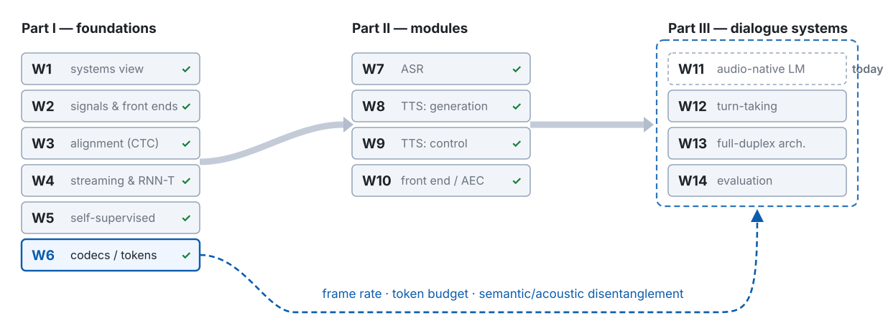

---
# 此檔由 bin/publish_slides.py 從投影片正本產生（中文講稿區塊已剝除），請勿直接編輯。正本在 private repo 的 <course>/slides/。
title: "Audio-Native Language Models: Where Does the Text Go?"
subtitle: "Speech Processing & Human–Machine Interaction · Week 11"
author: "Hung-Shin Lee"
lang: en
format:
  revealjs:
    theme: [default, theme.scss]
    slide-number: c/t
    show-slide-number: all
    # 目標顯示尺寸：1280×800（16:10）。設成剛好填滿。
    # margin 預設 0.1 會把 deck 縮到 90% 才顯示（1152×720），白白損失一成字級。
    width: 1280
    height: 800
    margin: 0.04
    center: false
    progress: true
    transition: none
    # 章節標題會產生垂直堆疊；linear 讓左右鍵逐張前進，講課時才不會跳章
    navigation-mode: linear
    incremental: false
    # inline SVG 的 fragment（）在 ?print-pdf 裡要全部可見，不要每個 fragment 一頁
    pdf-separate-fragments: false
    chalkboard:
      buttons: true
    html-math-method:
      method: katex
      url: "https://cdn.jsdelivr.net/npm/katex@0.18.7/dist/"
    # 講稿（notes 區塊）裡的數學只輸出 MathML（與 w02.qmd～w10.qmd 相同的做法）。
    # presenter view 是另一個視窗，沒有 KaTeX 的 CSS；KaTeX 預設同時輸出 HTML 與 MathML，
    # 沒有 CSS 時兩份都會顯示，符號就重複了（例如 ℓℓ）。MathML 由瀏覽器原生排版，不需要 CSS。
    # 本 deck 自用：表格首欄允許換行（theme 的 .reveal table 首欄是 nowrap，首欄是句子的表要包在 ::: {.wrap1} 裡）。
    include-in-header:
      - text: |
          
    include-after-body:
      - text: |
          
---

# Where does the text go? {.section-title}

## Where we are: week 11 of 14

{width="100%"}

## Last week, in one picture



::: {.claim .fragment fragment-index=2}
Every module exists. The most direct way to join them passes **only text** from one model to the next.
:::

::: {.footer}
W10 p10: the chain · W1 p15: the cascade · W7: ASR · W8–W9: TTS
:::

## The problem this week handles, in one picture



::: {.claim .warn .fragment fragment-index=2}
Join them into **one model**. Where does the text go — **what do we lose by removing it, and what do we pay for keeping it?**
:::

::: {.footer}
outline 〈positioning〉 · W1 p27: where each architecture narrows the channel
:::

## Today's route: six stops, in two halves



::: {.claim .fragment fragment-index=2}
**First half:** is the text there, and at which end — a bill paid in **ability**. **Second half:** how far ahead is it — a bill paid in **time**.
:::

::: {.footer}
six stops = the six section pages · half-time: p47 · answered: p87
:::

## Notation for today

| Symbol | Meaning |
|:--------|:------------------|
| $\ell$, $U$; $k_{t,i}$, $\mathbf{k}$, $f_r$, $N_q$, $R_{\text{tok}}$; $\mathbf{e}_{1:J}$, $\mathbf{p}$; $D_{\text{prefill}}$, $D_{\text{token}}$, $D_{\text{voc}}$, $D_{\text{buf}}$ | W3–W10: text tokens; codec tokens, frame rate, levels, token rate; speech embeddings entering an LLM, the prompt; four latency cells |
| $\mathbf{X}^{\text{usr}}$, $\ell^{\text{usr}}$, $\hat{\ell}^{\text{usr}}$; $\ell^{\text{sys}}$, $\mathbf{k}^{\text{sys}}$ | **whose it is**: the user's speech, its words, an ASR transcript of it; the reply's text, the reply's speech tokens |
| $\theta_0$, $\theta$; $\mathrm{Acc}(\text{model}, \text{input})$ | the original text LLM, the model after it was taught to hear; accuracy of a model on an input |
| $\ell^{\text{th}}$, $U_{\text{th}}$; $\tilde{\ell}_t$ | reasoning text that is never spoken, its length; a text stream aligned to audio frames (tokens or padding) |
| $n_{\text{txt}} : n_{\text{aud}}$; $R_{\text{txt}}$; $U_{\text{lead}}$, $n_{\text{first}}$, $N_{\text{step}}$ | the interleaving ratio; text tokens per second of speech; text tokens before the first speech token, frames in the first chunk, passes per frame |
| $\mathbf{h}_u$, $P_{\text{thk}}$, $P_{\text{tlk}}$; $D_{\text{ep}}$, $D_{\text{resp}}$ | a Thinker's hidden state, the Thinker, the Talker; the endpoint cell, the response latency |

::: {.footer}
vectors and matrices bold, scalars italic, functions upright · the outline's notation
:::

## Seven things to leave with today

1. **Five places for the text** — the interface of a cascade; absent; in the weights and at the output; text first and speech after; never spoken — and what each keeps and costs.
2. **Token-rate arithmetic**: why a language model on speech tokens alone learns meaning slowly — a slope, not a wall.
3. **How speech enters a text LLM**; the **modality gap** as forgetting plus misalignment; four conditions that measure it; why it is not a recognition error.
4. **Why the LLM is its own best teacher** — and why an audio LLM answers from its text prior when it hears little.
5. **Four ways for speech to follow text** — whole answer first, interleaved, frame-aligned, two models — in data, in train-versus-use, in latency.
6. **The response latency of a half-duplex model**: which of W1's cells merge, which remain; two conditions on the interleaving ratio.
7. **What "think before speaking" costs**, three places to move the thinking, a 30-minute context — and three limits of half duplex.

::: {.footer}
outline 〈Learning objectives〉 1–7 · every sum this week is bookkeeping: no new loss
:::

# Text is the only interface {.section-title}

## The cascade: three models, three equations

$$\hat{\ell}^{\text{usr}} = \arg\max_{\ell} P_{\text{ASR}}(\ell \mid \mathbf{X}^{\text{usr}}) \qquad \ell^{\text{sys}} \sim P_{\text{LLM}}(\cdot \mid \hat{\ell}^{\text{usr}}) \qquad \mathbf{k}^{\text{sys}} \sim P_{\text{TTS}}(\cdot \mid \ell^{\text{sys}})$$

| | reads | writes | from |
|:---|:------|:------|:---|
| the recogniser | the user's speech $\mathbf{X}^{\text{usr}}$ | **one** transcript $\hat{\ell}^{\text{usr}}$ | W7 |
| the language model | that transcript | the reply's text $\ell^{\text{sys}}$ | a text LLM, unchanged |
| the synthesiser | the reply's text | the reply's speech tokens $\mathbf{k}^{\text{sys}}$ | W8–W9 |

::: {.ask}
When the synthesiser reads the reply aloud — does it know the user was laughing when they asked?
:::

::: {.footer}
W1 p15–p16: the cascade · three complete models; nothing is retrained to join them
:::

## One chain rule, two substitutions



::: {.claim .warn .fragment fragment-index=3}
These two substitutions **are** the text bottleneck — everything W1 said a cascade loses is lost at one of them.
:::

::: {.footer}
outline 〈key maths 1〉 · the first line holds for every system this week
:::

## What the two substitutions buy

| what the text interface keeps | why it matters |
|:--------|:-----------------|
| **the LLM's whole ability** | nothing was retrained: $\theta_0$ reads text exactly as it did before — no forgetting, by construction |
| **swappable parts** | a better recogniser, a new LLM, another voice: change one box, keep the other two |
| **a readable trace** | the transcript and the reply exist as text: they can be logged, filtered, audited, edited |
| **every component already exists** | for a language with a recogniser and a synthesiser, a cascade can be built today |

::: {.claim .fragment}
On benchmarks of **meaning**, a recogniser plus the same LLM still often beats the end-to-end model. Demo 2 (p35) puts it to the test on this laptop.
:::

::: {.footer}
W1 p16 · VoiceBench (Chen et al. 2024): pipelines outperform end-to-end models
:::

## Three latencies, added

| the cascade's cells | measured here, W1 Demo 2 (median) |
|:-----------|------:|
| endpoint: wait until the user has stopped | 1000 ms |
| ASR tail | 70 ms |
| LLM first token | 94 ms |
| TTS first packet | 124 ms |
| playout buffer | 100 ms |
| **total** | **1388 ms** |

::: {.small}
A vendor's account of the same shape: before GPT-4o, ChatGPT's Voice Mode was "a pipeline of three separate models", with average latencies of 2.8 s (GPT-3.5) and 5.4 s (GPT-4) — a company blog post, with no measurement protocol.
:::

::: {.claim .fragment}
Three models, three waits, in series. **Which cell is the largest — and is it one of the three models?**
:::

::: {.footer}
W1 p38: the budget · W1 p48–p50: Demo 2 · OpenAI, *Hello GPT-4o*, May 2024 (not a paper)
:::

## Five places for the text, one equation



::: {.footer}
outline 〈key maths 1〉 · not five generations: most public systems of 2026 sit in place 3
:::

## The parts — and two places where speech meets text



::: {.claim .fragment fragment-index=2}
The **first** meeting is the first half of today; the **second** is the second half.
:::

::: {.footer}
outline 〈formalisation〉 · parts from W5–W8 · the Transformer starts from a text LLM
:::

## Half duplex: one turn at a time

| | half duplex — **every model today** | full duplex — W12–W13 |
|:---|:-----------|:-----------|
| while the model speaks | new input is **not processed** | input keeps entering the computation |
| who decides the user has finished | an **external** endpoint detector | the model, on every frame |
| the shape of the data | "user turn, model turn" — fixed by the template | two streams on one time axis |

::: {.claim}
Half duplex first: every part of a full-duplex model — how speech enters, how text and speech are ordered, how tokens are generated — must already be settled here, **with one variable fewer**.
:::

::: {.footer}
W1 p23–p25 · the test (W1): while the model speaks, does its input reach its computation?
:::

## MC 1 — "it can be interrupted, so it is full duplex"

::: {.claim .warn}
Stopping playback when a voice-activity detector fires is still **half duplex**: while the model spoke, nothing it heard entered its computation. Something outside it pulled the plug.
:::

| | what happens when the user barges in | is the input processed while speaking? |
|:---|:----------|:------|
| a VAD-gated half-duplex model | the VAD fires; playback is cut; a new turn starts | no |
| a full-duplex model (W13) | the model itself, hearing the user, chooses to stop — or to keep going | yes |

::: {.footer}
W1 p25: MC 1 · W10 p16: a VAD detects speech, not the user · all of today's models: row 1
:::

# Take the text away {.section-title}

## At a glance: Generative Spoken Language Modeling (GSLM)

::: {.prose}
| | |
|:---|:-----------------|
| **Name** | **Generative Spoken Language Modeling (GSLM)**: Lakhotia et al., *On Generative Spoken Language Modeling from Raw Audio*, TACL 2021. The line of work it started is called **textless**. |
| **The question** | Children learn to speak before they can read. Can a language model be learned from **raw audio alone** — no transcripts, no text, at any stage? |
| **The idea** | Turn speech into W5's discrete units; train an ordinary language model to predict the next unit; turn the generated units back into sound. Three stages, each trained on its own. |
| **What it added** | A language model with no text anywhere in it — so nothing is lost at a text interface, and a language needs no writing system to have one. |
| **What it leaves open** | What the continuation **means** (Demo 1, p21–p23) · why meaning is the hard part (p24–p25) · how hard (p26). Its two-channel successor returns in W13. |
:::

::: {.footer}
W5 p53–p59: units · place 1 on p14 · with prosody: pGSLM (Kharitonov et al. 2022)
:::

## Three stages — and three levels



::: {.claim .fragment fragment-index=2}
Both are **next-token prediction over speech tokens** — W4's objective, with no $\ell$ in the equation: $P_\theta(\mathbf{k}) = \prod_t P_\theta(k_t \mid \mathbf{k}_{<t})$.
:::

::: {.footer}
GSLM: Lakhotia et al. 2021 · AudioLM: Borsos et al. 2023 · three parts, trained apart
:::

## Before Demo 1: it sounds like speech — what did it say?

::: {.prose}
| | |
|:---|:-----------------|
| **Why** | A language model with no text keeps everything the cascade threw away. Before any theory: **what does one actually produce?** This is the week's "play the broken one first". |
| **What runs** | A speech-only language model on this laptop continues a three-second prompt, several times. The next slide draws the path; we listen before we read. |
| **Watch for** | Two separate questions. **Does it sound like the same person, speaking naturally?** And: **does what it says mean anything — and does it stay on the subject?** |
:::

::: {.footer}
Demo 1 · demos/w11_d1_speech_continuation · model: llm-jp/Llama-Mimi-1.3B
:::

## Demo 1: how it runs



::: {.footer}
Demo 1 · Mimi: W6 p36 · Whisper small: W7 · the text LLM: W1 Demo 2
:::

## Demo 1 — continue a three-second prompt

::: {.ask}
**Demo 1.** Three seconds of a real voice; the model continues. Write two answers before we listen: the same voice? — and does it mean anything?
:::

::: {.fragment fragment-index=1}
| | what we observed |
|:---------|:-----------|
| by ear: the same voice? a natural rhythm? | |
| by transcript: grammatical? on the subject? for how long? | Sentences in all four draws; none stays with Mr Quilter. The cooler draw ($0.5$) starts to circle. |
| the text LLM, continuing the same words | On the subject, all four: "He is the prophet of the moderate, the high priest of the temperate, …" |
| the prompt: 3.2 s = 40 frames × 4 = 160 speech tokens — and as text tokens | $11$ text tokens: $14.5\times$ fewer |
| generation: tokens per second; real-time factor | about $105$ per second; $0.48$ (real time needs $50$) |
| speaker similarity, prompt against continuation (W9's SIM) | $0.93$–$0.95$; same speaker, another sentence: $0.96$; another speaker: $0.59$ |
:::

::: {.footer}
Demo 1 · measured 2026-11-27 on the M5 Max → w11-metrics.json · no meaning score is computed live
:::

## Token-rate arithmetic: the same second, two rulers



::: {.claim .fragment fragment-index=2}
The words of a sentence sit **one to two orders of magnitude further apart** in speech tokens than in text tokens. The same context window holds that much less language.
:::

::: {.footer}
W6 p51: the bill · W6 p57: MC 9 · Demo 1's model: 50 tokens/s, about 15× English text
:::

## Where the loss goes

$$\ln P(\text{one frame}) \;=\; \underbrace{\ln P(\text{content})}_{\text{one token}} \;+\; \underbrace{\ln P(\text{acoustic detail} \mid \text{content})}_{N_q - 1 \text{ tokens, or more}}$$

::: {.fragment}
| three measurements that fit this reading | what was observed |
|:-----------|:-----------------|
| AudioLM models semantic and acoustic tokens in **separate stages** | meaning is decided before any detail is generated |
| Llama-Mimi flattens $Q$ levels into one sequence; $Q$ from 2 to 8 | audio quality and speaker similarity **rise**; content quality **falls** |
| Moshi weights the loss on the semantic token far above the others | one of its ablated design choices |
:::

::: {.claim .fragment}
Most of the gradient teaches the model to predict **how it sounds** — which is why it is slow at meaning, and why it is worth doing.
:::

::: {.footer}
outline 〈key maths 2〉 · this split is the course's reading, not any one paper's equation
:::

## Scaling: a slope, not a wall



::: {.claim .fragment fragment-index=2}
Text does not "help at inference". It lets a speech model **inherit a scaling curve that has already been climbed** a long way.
:::

::: {.footer}
Cuervo & Marxer, EMNLP 2024 · Maimon et al., COLM 2025 · slopes drawn, not data
:::

## A warm start is not enough — and who still needs this road

| | what was done | what it showed |
|:---|:---------|:-----------------|
| **TWIST** (Hassid et al., NeurIPS 2023) | start the unit LM from a **text** LM's weights; change nothing else | it helps — and both model scale and data scale still matter |
| **SpeechSSM** (Park et al., ICML 2025) | generate many minutes in one pass, with a state-space model | existing textless models lose coherence past **tens of seconds** |
| **an unwritten language** (Chen et al., ACL Findings 2023) | English ↔ Taiwanese Hokkien speech translation, built on units | the best-known use of this road — and it still borrowed **Mandarin text** as supervision |

::: {.claim}
Speech-only modelling is slow at meaning, **not a dead end**: it is the only road for a language without a widely used orthography — and the research frontier for long, expressive generation.
:::

::: {.footer}
outline 〈where it breaks〉 · W4 p71: a state that does not grow returns on p81
:::

## MC 2 — "a bigger model will fix the loss of meaning"

::: {.claim .warn}
The bottleneck is not capacity. It is **the shape of the sequence** and **which side the data is on**: a speech-only LM climbs the same law up to three orders of magnitude more slowly.
:::

| spend the same compute on … | what happens |
|:-----------|:-----------------|
| a larger speech-only LM | it improves — along the shallow slope (p26) |
| a model that starts from a text LLM and interleaves | it improves more efficiently — and the best split shifts toward **model size**, away from training tokens |

::: {.footer}
Cuervo & Marxer 2024 · Maimon et al. 2025 · p24–p26
:::

## MC 3 — "a lower token rate is always better"

::: {.claim .warn}
What matters is **what the token keeps**, not only how many there are per second.
:::

| make the tokens coarser by … | result |
|:-----------|:-----------------|
| compressing W5's units a second time, to a lower rate | linguistic performance got **worse** (Cuervo & Marxer 2024) |
| training a single-level tokenizer with **ASR supervision**, at 12.5 Hz | workable — the basis of a speech-to-speech system (Zeng et al. 2025) |

::: {.footer}
W6 p52: MC 6, "lower bitrate is always better" · W6 p53: frame rate
:::

## MC 4 — "textless is a dead end"

::: {.claim .warn}
A child learns to speak without text. So "no text, no meaning" is **not a limit of principle** — it is a limit of **data efficiency**, and today's methods are very far from the child.
:::

| who still takes this road | why |
|:-----------|:-----------------|
| languages with no widely used orthography | there is no text to keep — though even the best-known work borrowed another language's (p27) |
| long, expressive generation | the research frontier for many minutes of speech in one pass (SpeechSSM) |
| anyone who wants tone of voice modelled, not appended | the only row of p14 with no $\ell$ in its equation: nothing has to pass through text |

::: {.footer}
outline, analogy (c) and where it fails · break here · the route returns at p47
:::

# Bring the text back: listening {.section-title}

## W7's picture returns: an encoder, an adapter, a text LLM



::: {.claim .fragment fragment-index=2}
W7's LLM-based recogniser was the special case whose prompt says "transcribe". The model **hears** — and answers **in text**: $\ell^{\text{sys}} \sim P_\theta(\cdot \mid \mathbf{e}_{1:J}, \mathbf{p})$.
:::

::: {.footer}
W7 p67–p68: SLAM-ASR · SALMONN (Tang et al. 2024) · Qwen-Audio · place 2 on p14
:::

## Before Demo 2: the same question, typed and spoken

::: {.prose}
| | |
|:---|:-----------------|
| **Why** | A text LLM has been taught to hear. Did its ability to **answer** come across with it? One number will not tell us where a loss comes from — four will. |
| **What runs** | Fifty questions written for this class, in Mandarin (and again in English), put to the models **four ways** (next slide): typed or spoken; the original text LLM or the model that hears; and a recogniser in front as a control. |
| **Watch for** | **How do the four numbers rank?** Typed against spoken — how many questions apart? And where does "recognise first, then ask the text LLM" land? |
:::

::: {.footer}
Demo 2 · demos/w11_d2_typed_vs_spoken · $\theta$: Ming-3.0-audio-tiny · $\theta_0$ (approx.): Ling-3.0-tiny
:::

## Demo 2: how it runs



::: {.footer}
Demo 2 · demos/w11_d2_typed_vs_spoken · scoring and intervals: score.py
:::

## Demo 2 — four numbers

::: {.ask}
**Demo 2.** Same questions, four ways in. Rank a, b, c, d before the table appears — and say how far apart typed and spoken will be.
:::

::: {.fragment fragment-index=1}
| | the question arrives as | answered by | Mandarin, of 39 | English, of 40 |
|:--|:---------|:---------|:----|:----|
| **a** | text | $\theta_0$: the original text LLM (approx.) | $33$ $[28, 37]$ | $37$ $[33, 40]$ |
| **b** | text | $\theta$: the audio model | $34$ $[30, 38]$ | $36$ $[32, 39]$ |
| **c** | speech, a TTS voice | $\theta$: the audio model | $36$ $[32, 39]$ | $39$ $[37, 40]$ |
| **c′** | speech, my own voice | $\theta$: the audio model | $7$ of $9$ (TTS: $8$) | — |
| **d** | speech → Whisper small → text | $\theta_0$ | $33$ $[28, 37]$ | $34$ $[29, 38]$ |
| | format kept: a · b · c · d | | $7 \cdot 9 \cdot 9 \cdot 7$ of $9$ | $10 \cdot 10 \cdot 9 \cdot 10$ of $10$ |
:::

::: {.claim .fragment fragment-index=2}
No gap on these questions: spoken is answered as well as typed.
:::

::: {.footer}
Demo 2 · rehearsed 2026-11-28 → w11-metrics.json · [ ]: 95% bootstrap interval · 2–3 questions apart is not a gap
:::

## The gap is an identity: forgetting plus misalignment



::: {.fragment fragment-index=1}
$$\underbrace{a - c}_{\text{text–speech understanding gap}} \;=\; \underbrace{a - b}_{\text{forgetting}} \;+\; \underbrace{b - c}_{\text{misalignment: the modality gap}}$$
:::

::: {.footer}
schematic, as papers report it — on p35 no term exceeds a few questions · Cuervo et al. 2025: $a - c$; Xiang et al. 2025: $b - c$
:::

## MC 5 — "the modality gap is a recognition error"

::: {.claim .warn}
The model can transcribe the question **correctly** and still answer it **wrongly**. Recognition explains part of the gap — not all of it.
:::

::: {.wrap1}
| the evidence | what it rules out |
|:-----------|:-----------------|
| an ASR transcript fed to the same LLM, as a control | recognition explains part of the gap in some settings — not all |
| the same model transcribes the question correctly | it knows the words; the answer is still worse |
| speech and text **align** in the middle layers; the last layers still separate | aligned in geometry is not equivalent in function (Hsu et al. 2026) |
:::

::: {.footer}
Hsu et al., NeurIPS 2026 · Xiang et al., EMNLP 2025 · our Demo 2 had no gap to split (p35)
:::

## MC 6 — "end-to-end is always better than a cascade"

::: {.claim .warn}
On benchmarks of **meaning**, a recogniser plus the same LLM still often wins. End-to-end wins on tone of voice and on the seams between latencies — and the first of those is often not delivered.
:::

| | a cascade | an end-to-end model |
|:---|:--------|:--------|
| what the LLM knows and can reason about | **all of it** — nothing was retrained | part of it is forgotten; speech and text are not aligned |
| tone, emotion, who is speaking | lost at the first text line | **enters the model** — whether it is used is another matter (p43) |
| latency | three cells in series | the seams merge (p77) |

::: {.footer}
W1 p16, p21 · VoiceBench (Chen et al. 2024) · Cuervo et al. 2025
:::

## Where forgetting comes from: training and use

| | in training | in use |
|:---|:-----------|:-----------|
| the tasks | mostly ones with **nearly one right answer**: transcribe, describe the sound | any instruction — most of them never seen |
| what the model learns about its own output | "given audio, the reply is narrow and nearly certain" | it applies that habit: asked for a story, it **transcribes** |
| the name | — | **task over-fitting** (SALMONN) |

::: {.fragment style="margin-top: 1.1em;"}
| the same erosion, measured by two other groups | |
|:-----------|:-----------------|
| Speech-IFEval (Lu et al. 2025) | most speech-aware LLMs follow basic instructions — a format, a word limit — far worse than the text LLM they came from; a **forgetting rate** |
| Moshi's ablation (p57) | drop the text-only batches in pre-training and knowledge accuracy falls: a warm start alone does not keep what the text model knew |
:::

::: {.footer}
outline 〈training and use〉 (ii) · SALMONN: Tang et al. 2024 · the format column of p35
:::

## MC 7 — "fine-tune a little; the abilities carry over"

::: {.claim .warn}
Fine-tuning to hear **erodes** what the model could do with text. Keeping it takes deliberate work — it does not come for free with the weights.
:::

| what goes wrong | what it takes to keep the ability |
|:-----------|:-----------------|
| instructions followed worse; sensitive to how the prompt is worded | train on targets that the text LLM **itself** would produce (p41) |
| asked anything, it transcribes | — or never stop mixing in text-only batches (Moshi) |
| knowledge drops when text is left out of training | — or do not touch the LLM at all: a cascade (p12) |

::: {.footer}
Speech-IFEval · SALMONN · Moshi §5 · outline misconception table
:::

## The remedy: let the LLM be its own teacher



$$\min_\theta \; \mathrm{KL}\big(P_{\theta_0}(\cdot \mid \ell^{\text{usr}}, \mathbf{p}) \,\big\|\, P_\theta(\cdot \mid \mathbf{e}_{1:J}, \mathbf{p})\big)$$

::: {.footer}
BLSP (Wang et al. 2023) · DiVA (Held et al. 2025) · DeSTA2.5-Audio (Lu et al. 2026) · KL: W9
:::

## All of these are post-training: W9's picture returns



::: {.claim .fragment fragment-index=2}
The weights change; the inference graph does not. From outside you cannot tell which remedy a model had — **you can only measure**: the four conditions of p34.
:::

::: {.footer}
W9 p44–p46: weights change, inference does not · Wang et al. 2026 · Step-Audio 2 (2025)
:::

## MC 8 — "speech input is just transcription, then text"

::: {.claim .warn}
Wrong in both directions. Papers find it **worse** than that — the modality gap (our Demo 2 did not, p35). And it should be **better** than that — the voice carries more than the words — yet models often hear the cue and do not use it.
:::

| | what the model was asked | what was found |
|:---|:-----------|:-----------------|
| SD-Eval (Ao et al., NeurIPS 2024) | respond to the same words under different emotion, accent, age, background sound | the starting point: models attend to the words and neglect the rest |
| StyleTalk (Lin et al., ACL 2024) | the same sentence, said in different styles | a different style should get a different reply — and often does not |

::: {.small}
Why: the teacher of p41 only ever read text. The information comes in; nothing in training taught the model to act on it.
:::

::: {.footer}
outline 〈where it breaks〉: "heard, not used" · Demo 2's tone probe (p46)
:::

## When the evidence is weak, the prior answers

$$P_\theta(\ell^{\text{sys}} \mid \mathbf{e}_{1:J}, \mathbf{p}) \;\longrightarrow\; P_\theta(\ell^{\text{sys}} \mid \mathbf{p}) \qquad \text{as } \mathbf{e}_{1:J} \text{ carries less and less information}$$

| | W7: a recogniser | today: an audio LLM |
|:---|:-----------|:-----------|
| the prior | a decoder trained on transcripts | **an LLM trained on trillions of text tokens** |
| the evidence turns weak when | silence, noise, a clipped segment | too short, too noisy, nobody speaking |
| what comes out | a fluent sentence nobody said | a fluent, plausible **answer** to a question nobody asked |

::: {.claim .fragment}
Asked "is this sound in the clip?", audio LLMs answer poorly (Kuan et al. 2024): a yes-or-no about the **audio** is exactly where a text prior has nothing to say — and says something anyway.
:::

::: {.footer}
W7 p31: flat evidence, the argmax falls to the prior · Kuan, Huang & Lee, Interspeech 2024
:::

## MC 9 — "it answered, so it listened"

::: {.claim .warn}
An answer is evidence that the model **can talk** — not that it **heard**. With nobody speaking, it still produces a fluent reply.
:::

| a quick test for any voice model | what a model that listened would do |
|:-----------|:-----------------|
| five seconds of silence, then: "What did I just say?" | say that it heard nothing |
| white noise, the same question | the same |
| a yes-or-no question about what is in the audio | answer from the audio, not from what is likely |

::: {.footer}
Kuan et al. 2024 · W7 p33–p36: W7 Demo 1, the prior alone · tested next, on this laptop
:::

## Demo 2 — two probes, and one more column

::: {.ask}
**Demo 2, continued.** Silence, then "What did I just say?" — will it say it heard nothing? And "I got the job," said happily and said flatly: will the two replies differ?
:::

::: {.fragment fragment-index=1}
| the probe | what goes in | observed |
|:----|:-------------|:--------------------|
| **silence** | 5 s of silence, or of white noise — alone, then with the typed "What did I just say?" | alone: "no valid question"; "white noise or static" — it heard. The typed question over white noise: "You just said 'What did I just say?'" |
| **tone** | "I got the job.", delighted and dejected, in my own voice · the same follow-up · then "How do I sound?" | the same list of ways to celebrate, twice. Asked directly: "joy and pride" against "natural, professional" — heard, not used |
| **noise** | rows c and d again, babble at 5 dB — which is hurt first? | Mandarin: c $36 \to 33$, d $33 \to 28$ · English: c $39 \to 40$, d $34 \to 35$ |
:::

::: {.footer}
Demo 2 · probes are read, not scored · babble: built as in W10 Demo 2, from the other questions
:::

## Half-time: is the text there — and how far ahead is it?



::: {.claim}
**So far:** the further the text retreats, the heavier the bill for **meaning**. **From here:** it can hear, but it only answers in text — **how do text and speech share one output?**
:::

::: {.footer}
the route: p6 · first half: p10–p46 · second half: p49–p83 · answered: p87
:::

# Speaking: how far ahead is the text? {.section-title}

## Listen in continuous vectors, speak in discrete tokens



::: {.claim .fragment fragment-index=2}
The asymmetry is not laziness: **listening need not sample; speaking must.** Side effect: the model's own past speech and the user's speech sit in its history as two different representations (W13).
:::

::: {.footer}
outline 〈key maths 4〉 · a majority, not a law: the exceptions are on p82
:::

## Four ways for speech to follow text



::: {.footer}
violet: text tokens · blue: speech tokens · red line: the first speech token
:::

## Four ways: what each one pays

| | text leads by $U_{\text{lead}}$ | what the training data must have | training against use |
|:-----|:--------|:-----------|:-----------|
| **chain of modality** | $U$: the whole answer | text–speech pairs; nothing aligned in time | the same picture |
| **interleaving** | $n_{\text{txt}}$: one span | pairs cut at a fixed ratio — can be synthesised from text corpora | at use, the text is the model's own |
| **frame-aligned streams** | $\approx 0$ | **word-level timestamps**, from a recogniser | alignment given in training, self-made in use (p58) |
| **Thinker–Talker** | the Thinker's first tokens | two models; a Talker trained to read a Thinker | reference text in training, sampled text in use (p61) |

::: {.claim .fragment}
Lead more: the first sound waits. Lead less: the speech runs out of text to stand on. **Every move toward one model swaps an interface for an alignment that training has to solve.**
:::

::: {.footer}
outline 〈key maths 6〉 · W7 asked where the prior goes; W8, where length and variation go
:::

## The whole text first: chain of modality

| | what is generated, in order | note |
|:---|:-----------|:-----------------|
| **SpeechGPT** (Zhang et al., EMNLP Findings 2023) | the reply's text → the reply's speech tokens | the name "chain of modality" comes from here |
| **Spectron** (Nachmani et al., ICLR 2024) | the transcript of what was heard → the reply's text → the reply's speech | all in one decoding pass; it works on spectrograms, not discrete tokens |

::: {.small}
A different thing with a similar name: **SpiRit-LM** (Nguyen et al., TACL 2025) interleaves text and speech tokens **in the training data**, switching modality at word boundaries — so that one model shares both vocabularies. It is not a streaming scheme.
:::

::: {.claim}
Most accurate — the speech is conditioned on the complete text — and slowest: $U_{\text{lead}} = U$.
:::

::: {.footer}
place 3a · Moshi's report says the same: the whole text must exist before any speech
:::

## Interleaving: thirteen text tokens, twenty-six speech tokens



::: {.claim .fragment fragment-index=2}
The ratio is not a detail. It is "chosen to ensure that text generation is consistently faster than speech" — the text must **always already be there**.
:::

::: {.footer}
GLM-4-Voice (Zeng et al. 2024), streaming thoughts · same shape: Step-Audio 2, LFM2-Audio
:::

## Two conditions that bracket the ratio

**(i) The text stays ahead** — one round's text must cover the speech that follows it:

$$n_{\text{txt}} \;\geq\; R_{\text{txt}} \cdot \frac{n_{\text{aud}}}{f_r} \quad\Longleftrightarrow\quad \frac{n_{\text{txt}}}{n_{\text{aud}}} \;\geq\; \frac{R_{\text{txt}}}{f_r}$$

**(ii) Generation outruns playback** — one round's passes must finish before its audio has played:

$$(n_{\text{txt}} + n_{\text{aud}} N_{\text{step}})\, D_{\text{token}} \;\leq\; \frac{n_{\text{aud}}}{f_r} \quad\Longleftrightarrow\quad D_{\text{token}} \;\leq\; \frac{n_{\text{aud}}}{(n_{\text{txt}} + n_{\text{aud}} N_{\text{step}})\, f_r}$$

::: {.fragment}
| | $f_r$ | text tokens per second | (i): needs $\geq R_{\text{txt}}$ | (ii): $D_{\text{token}} \leq$ |
|:----------------------|:----|:----------|:------------|:------|
| GLM-4-Voice, $13 : 26$ · LFM2-Audio's default, $6 : 12$ | 12.5&nbsp;Hz | 6.25 | 2.8–3.4, measured (W6) | 53 ms |
:::

::: {.claim .fragment}
Whatever (ii) leaves over — the time between generating a chunk and finishing playing it — is **slack**. Station 5 spends it.
:::

::: {.footer}
outline 〈key maths 6〉 · derived in this course, not taken from a paper · rates: W6 Demo 2
:::

## At a glance: Inner Monologue

::: {.prose}
| | |
|:---|:-----------------|
| **Name** | **Inner Monologue**: the text stream of **Moshi** — Défossez et al. (Kyutai), *Moshi: A Speech-Text Foundation Model for Real-Time Dialogue*, 2024. A technical report, not a peer-reviewed paper. |
| **The question** | A model that generates speech tokens directly is fluent and fast, but weak on meaning (station 2). Can it borrow the text model's linguistic quality **without waiting for the text**? |
| **The idea** | Give the model a text stream **aligned to the audio frames**. In every frame it predicts a text token first, then that frame's speech tokens — the text is a prefix of the speech, frame by frame. |
| **What it added** | Streaming and text at once; and the cleanest ablation of the week — the same model with and without the text stream (p57). |
| **What it leaves open** | The alignment needs **word-level timestamps** in training (p58) · most of the stream is padding (p56) · the whole architecture, and both speakers at once, are W13. |
:::

::: {.footer}
place 3c · W6 p36: Mimi, Moshi's codec · only §3.4.4 and Table 8 are used this week
:::

## A text stream aligned to frames — mostly padding



::: {.claim .fragment fragment-index=3}
$P_\theta(\tilde{\ell}_t, k_{t,1}, \dots, k_{t,N_q} \mid \text{everything before frame } t)$ — one text token and $N_q$ speech tokens per frame, text first.
:::

::: {.footer}
Moshi §3.4.4 · PAD: nothing starts here · EPAD: a word comes next · $\tilde{\ell}_t$ is Moshi's $W_t$
:::

## The ablation: one more token per frame

| spoken question answering, accuracy (%) | Web Questions | LlaMA Questions | Audio Trivia QA |
|:-----------------|---:|---:|---:|
| Moshi **without** Inner Monologue (speech tokens only) | 9.2 | 21.0 | 7.3 |
| **Moshi** | **26.6** | **62.3** | **22.8** |
| Moshi, no text-only batches in pre-training | 23.2 | 61.3 | 18.3 |
| Helium — Moshi's text LLM, reading the questions as text | 32.3 | 75.0 | 56.4 |

::: {.claim .fragment}
Each frame costs 17 tokens instead of 16 — and accuracy is "almost tripling". The last row is today's first half, in one line: **the text model, reading, is still ahead.**
:::

::: {.footer}
Défossez et al. 2024, Table 8; questions read by a TTS engine · row 3: p39 · row 4: p36
:::

## Inner Monologue, interleaving: training and use



::: {.claim .fragment fragment-index=2}
The alignment comes from **another model**; the user's voice in training is mostly **synthetic**. The modules of earlier weeks have not gone away — they moved into the training pipeline.
:::

::: {.footer}
outline 〈training and use〉 (iii) · Moshi: Whisper timestamps · Zeng et al. 2025: synthetic data
:::

## At a glance: Thinker–Talker

::: {.prose}
| | |
|:---|:-----------------|
| **Name** | **Thinker–Talker**: the architecture of Qwen2.5-Omni (Xu et al., 2025) and its successors. Technical reports, not peer-reviewed papers. |
| **The question** | One set of weights must both reason in text and render sound, and the two objectives pull against each other (p25). What if they are **two models**? |
| **The idea** | A **Thinker** — a multimodal LLM — hears, and writes the reply as text. A **Talker** — a second autoregressive model — reads what the Thinker produces and emits speech tokens, starting before the Thinker has finished. |
| **What it added** | The Thinker stays close to a text LLM; speech streams out behind it. By 2026 it is the shape of most "omni" models. |
| **What it leaves open** | **What exactly the Talker reads** changed between generations (p60) · the Talker's output never returns to the Thinker (p61) · full-duplex versions: W13–W14. |
:::

::: {.footer}
place 3d · smallest version: LLaMA-Omni (Fang et al. 2025) — hidden states to units, with CTC
:::

## What the Talker reads: two generations



::: {.claim .fragment fragment-index=2}
$P_{\text{tlk}}(k_t \mid \mathbf{k}_{<t}, \mathbf{h}_{1:u}, \ell_{1:u})$ — then the text representations were taken out, so that **something outside the model can change the text** before it is spoken.
:::

::: {.footer}
Qwen2.5-Omni report · Qwen3-Omni report §2.1; its Figure 2 caption still shows the older design
:::

## Thinker–Talker: training and use



::: {.claim .fragment fragment-index=2}
The mouth cannot tell the brain it misspoke — and once the text can be edited in between, what is spoken and what was thought are **two different documents**.
:::

::: {.footer}
outline 〈training and use〉 (iv) · the analogy's second failure point
:::

## $N_q$ tokens in every frame: three answers, and a fourth

| | how the frame's tokens are produced | steps / s | what waits |
|:----|:-----------------|:---|:-------------|
| **flatten** | one long sequence, level after level | $f_r N_q$ | everything: the sequence is $N_q$ times longer |
| **delay pattern** | level $i$ shifted by $i - 1$ frames; all heads fire in parallel | $f_r$ | the last level: complete $N_q - 1$ frames later |
| **depth transformer** | one backbone step per frame; a small model runs $N_q$ times inside it | $f_r$ | a second, smaller model on every frame |
| **do not ask the LM** | the LM emits one semantic level; a flow-matching detokeniser adds the detail | $f_r$ | the first packet waits for a chunk (W8) |

::: {.claim}
More levels: better sound, worse language (p25). Today only the bill: $N_{\text{step}} = N_q$ when flattened, $1$ otherwise.
:::

::: {.footer}
W6 p51 · Moshi: a full delay pattern at 12.5 Hz, 8 levels, is 640 ms · architectures: W13
:::

## Before Demo 3: how far ahead is the text, on this machine?

::: {.prose}
| | |
|:---|:-----------------|
| **Why** | The lead of the text over the speech has been a symbol all afternoon — $U_{\text{lead}}$. It is also something a stopwatch can see. And the interleaving ratio is a knob: turn it, and both conditions of p54 should show. |
| **What runs** | One model that writes text and speech tokens into a single output. Every token is printed as it is generated, coloured by kind and stamped with its time (next slide). In English — the reason is on the next slide. |
| **Watch for** | Give the model **less** text per round: it should start speaking **sooner**. **Does what it says still match what it wrote?** |
:::

::: {.footer}
Demo 3 · demos/w11_d3_text_lead · LFM2.5-Audio-1.5B: its ratio is set at inference
:::

## Demo 3: how it runs



::: {.footer}
Demo 3 · demos/w11_d3_text_lead · the endpoint cell is not measured: the question is a recorded file
:::

## Demo 3 — first half: who leads, and by how much

::: {.ask}
**Demo 3.** Less text per round: sooner to speak. Predict — at which ratio does the speech stop matching the text?
:::

::: {.fragment fragment-index=1}
| setting | first text token | first speech frame | first sound | real-time factor | WER vs. its own text | blank text tokens |
|:--------|:---|:---|:---|:---|:---|:---|
| all the text first (two passes) | $0.03$ s | $0.79$ s | $0.85$ s | $0.17$ | $44\%$ | $0\%$ |
| interleaved $6 : 12$ (default, trained on) | $0.03$ s | $0.08$ s | $0.15$ s | $0.19$ | $8\%$ | $1\%$ |
| interleaved $2 : 12$ | $0.04$ s | $0.06$ s | $0.12$ s | $0.17$ | $141\%$ | $2.5\%$ |
| interleaved $12 : 12$ | $0.04$ s | $0.12$ s | $0.19$ s | $0.25$ | $67\%$ | $4.5\%$ |
| interleaved $24 : 12$ | $0.03$ s | $0.19$ s | $0.26$ s | $0.33$ | $97\%$ | $76\%$ |
| cascade (W1 Demo 2), same question | — | — | $0.31$ s | — | — | — |
:::

::: {.footer}
Demo 3 · measured 2026-11-27 → w11-metrics.json · only $6 : 12$ was seen in training
:::

## MC 10 — "end-to-end means there is no text"

::: {.claim .warn}
In almost every usable system the text is still there — in **three** places. The one line of work with truly no text is textless research (station 2).
:::

| where the text is | in an "end-to-end" speech-to-speech model |
|:-----------|:-----------------|
| in the **weights** | the Transformer started as a text LLM (p15) |
| in the **output** | text tokens come before the speech tokens they govern (p50) |
| in the **training data** | word alignments from a recogniser; dialogues written as text, then synthesised (p58) |

::: {.footer}
p14: the difference between systems is which condition is deleted — not whether there is text
:::

## MC 11 — "end-to-end needs no ASR and no TTS"

::: {.claim .warn}
They did not disappear. They **moved into the training pipeline** — and one of them is still on the inference path under another name.
:::

| the module | where it is now |
|:-----------|:-----------------|
| the recogniser (W7) | gives the word timestamps that align text to frames; supervises some tokenisers; scores "does the speech match the text" (Demo 3) |
| the synthesiser (W8–W9) | reads out the training dialogues; **the Talker is a streaming TTS** conditioned on a Thinker |
| the front end (W10) | still in front: a half-duplex model hears noise and bystanders, and does not hear itself |

::: {.footer}
outline, supervision axis: ability from other models · W8 p79: the first packet · W10 p36
:::

# Thinking: text that is never spoken {.section-title}

## Think, then speak: what the silence costs

$$\text{silence before the first sound} \;=\; U_{\text{th}} \, D_{\text{token}} \qquad \text{— added on top of everything else in } D_{\text{resp}}$$

| | |
|:---|:-----------------|
| $\ell^{\text{th}}$ | reasoning text: generated, kept in the context, **never sent to the speech tokens** |
| $U_{\text{th}}$ | how many tokens of it — **not known in advance**, and with no upper bound |
| $D_{\text{token}}$ | the time one token takes on this machine (measured in Demo 3) |

::: {.ask}
The reasoning will take ten seconds. What should the system do for those ten seconds?
:::

::: {.footer}
outline 〈key maths 8〉 · place 4 on p14 · a chat window can show a spinner; a voice cannot
:::

## Three places to move the thinking — and a fourth that hides it



::: {.footer}
speaking: STITCH, Mini-Omni-Reasoner · listening: SHANKS, chronological thinking · latent: FLAIR
:::

## What each move buys, and what it costs

| the reasoning goes | the silence becomes | the new constraint |
|:-----------|:-----------|:-----------------|
| **before** the answer | $U_{\text{th}}\,D_{\text{token}}$ of silence | none — and no bound either |
| **into speaking time** | none | per round, at most $\dfrac{n_{\text{aud}} / f_r}{D_{\text{token}}} - (n_{\text{txt}} + n_{\text{aud}} N_{\text{step}})$ tokens; the first words leave before the thinking is done |
| **into listening time** | none | strictly causal; a chunk of length $c$ seconds buys $c / D_{\text{token}}$ tokens; cut off when the user stops |
| **into latent states** | none | no tokens, no context used — and nothing to read |

::: {.claim .fragment}
"Thinking improves quality" and "thinking slows the reply" are **each half true**: report quality and latency together — and say **where in time** the thinking was put.
:::

::: {.footer}
outline 〈key maths 8〉 · row 2 is the slack of p54 · bounds derived in this course
:::

## The data format is the latency

::: {.ask}
On paper. One training example has three kinds of token: the reasoning $\ell^{\text{th}}$, the reply's text $\ell^{\text{sys}}$, the reply's speech $\mathbf{k}^{\text{sys}}$ — and the user's speech before them. **Write them in an order. Then mark where the first sound falls.**
:::

::: {.fragment}
| an order someone might write | where the first sound falls | which row of p71 |
|:-----------|:-----------|:------|
| user · $\ell^{\text{th}}$ · $\ell^{\text{sys}}$ · $\mathbf{k}^{\text{sys}}$ | after all the reasoning and all the text | before the answer; chain of modality |
| user · $\ell^{\text{th}}$ · ($\ell^{\text{sys}}$ · $\mathbf{k}^{\text{sys}}$) repeated | after all the reasoning and one span of text | before the answer; interleaved |
| user · ($\ell^{\text{sys}}$ · $\mathbf{k}^{\text{sys}}$ · $\ell^{\text{th}}$) repeated | after one span of text | into speaking time |
| (user chunk · $\ell^{\text{th}}$) repeated · ($\ell^{\text{sys}}$ · $\mathbf{k}^{\text{sys}}$) repeated | after one span of text | into listening time |
:::

::: {.claim .fragment}
Nothing in the model's architecture distinguishes these four. **The order in the training sequence is the design** — and the order is the delay.
:::

::: {.footer}
outline, learning objective 7 · next-token prediction throughout: only the sequence changes
:::

## Demo 3 — second half: the silence before the first sound

::: {.ask}
**Demo 3, continued.** The same two-step arithmetic question, answered as the model goes, and answered after it has reasoned in text first. How long is the silence — and is the answer better?
:::

::: {.fragment fragment-index=1}
| | text tokens before the first sound, $U_{\text{th}}$ | silence before the first sound | predicted: $U_{\text{th}}\,D_{\text{token}}$ | correct? |
|:-----------|:---|:---|:---|:---|
| answer as you go ($6 : 12$) | $6$ | $0.15$ s | $0.04$ s | no |
| reason in text first, say only the answer | $139$ | $1.00$ s | $0.85$ s | no: it reached $36$, then went on to $48$ |
:::

::: {.footer}
Demo 3 · measured 2026-11-27 → w11-metrics.json · the second row is two passes of one model, not a thinking mode
:::

## MC 12 — "thinking always helps" · "thinking always slows it"

::: {.claim .warn}
Each is half true. Reasoning placed before the answer costs silence, **token for token** — and it does not always help. Moved elsewhere in time, it costs no delay — and something else.
:::

| | when it is true | when it is not |
|:---|:-----------|:-----------------|
| "it improves the answer" | where the bottleneck was reasoning | where the bottleneck was **hearing**: one report found gains on speech understanding and losses on sound and music — hallucinations introduced while thinking |
| "it slows the reply" | reasoning before the answer: $U_{\text{th}}\,D_{\text{token}}$ | reasoning moved into speaking, listening or latent states (p71) |

::: {.footer}
MiMo-Audio report (2025), limitations · Demo 3 (p73) · W7 p31: prior and weak evidence
:::

# The bill, and the boundary {.section-title}

## One expression for the first sound

$$D_{\text{resp}} \;=\; D_{\text{ep}} \;+\; D_{\text{prefill}}(J) \;+\; \big(U_{\text{lead}} + n_{\text{first}} N_{\text{step}}\big)\, D_{\text{token}} \;+\; D_{\text{voc}}(n_{\text{first}}) \;+\; D_{\text{buf}}$$

| the term | what it is | who decides it today |
|:---|:-----------|:-----------------|
| $D_{\text{ep}}$ | waiting to be sure the user has finished | **nobody inside the model** |
| $D_{\text{prefill}}(J)$ | reading $J$ speech embeddings of the user's turn | the encoder's frame rate; streaming or not |
| $U_{\text{lead}}$ | text tokens before the first speech token | which of the four ways (p51) — plus $U_{\text{th}}$ if it thinks first |
| $n_{\text{first}} N_{\text{step}}$ | speech frames needed before any sound can be decoded, times passes per frame | the codec and its decoder; flattening or not (p62) |
| $D_{\text{voc}}$, $D_{\text{buf}}$ | decoding that first chunk; the playout buffer | W8 |

::: {.footer}
outline 〈key maths 6〉 · GLM-4-Voice itemises the same sum: prefill, $13 + 10$ tokens, decode 10
:::

## W1's budget, refilled



::: {.footer}
W1 p38 · W7 p84 and W8 p85 predicted two of these changes · W10 p93: the endpoint's floor
:::

## MC 13 — "latency figures compare across papers"

::: {.claim .warn}
Four sources, four ways of counting. Ask of each number: theoretical or measured — cold start or mid-dialogue — first token or first audible sound — **and is $D_{\text{ep}}$ in it?**
:::

| the figure | what it is | where it comes from |
|:-----------|:-----------------|:------|
| Moshi: 160 ms | a **theoretical** value — one frame plus one frame of acoustic delay; 200 ms in practice. Full duplex: there is no $D_{\text{ep}}$ | a technical report |
| Qwen3-Omni: 234 ms | **cold start**, theoretical, end-to-end first packet | a technical report |
| GPT-4o: 232 ms / 320 ms | the **shortest** and the **average** response to audio | a company blog; no protocol |
| LLaMA-Omni: 226 ms or 236 ms | the same paper, two versions of its abstract | an ICLR paper |

::: {.footer}
W1 p61: four questions for every paper · same family as MOS, SIM, DER, WER
:::

## MC 14 — "it speaks sooner, so its latency is lower"

::: {.claim .warn}
The first sound can be a filler. And the less the text leads, the sooner the model speaks — and the more easily what it says and what it wrote come apart.
:::

| what makes the first sound early | what it costs |
|:-----------|:-----------------|
| start with "well, …" or "let me think" | nothing was answered sooner; the content arrives when it arrives |
| shrink $U_{\text{lead}}$ (Demo 3's sweep) | the speech outruns its text |
| ignore the largest cell | $D_{\text{ep}}$ is outside the model: W1 Demo 2 measured it at about 70% of the total |

::: {.small}
And lower is not always better: the target is the distribution of human turn-transition times — answering too early is as damaging as answering late (W1 p32; W12).
:::

::: {.footer}
Demo 3 (p65) · p77 · W1 p32: MC 2
:::

## MC 15 — "synthetic users are enough"

::: {.claim .warn}
A real voice — its accent, age, noise and disfluencies — is **out of distribution** for a model whose "users" were a TTS engine.
:::

| where synthetic speech stands in for the user | what a real user adds |
|:-----------|:-----------------|
| the training dialogues (p58) | hesitations, restarts, a child's voice, a regional accent |
| the benchmark questions (p57: read out by a TTS engine) | a room, a microphone, someone else talking |
| our own Demo 2, rows c and d | row c′: nine questions in my own voice — and a second TTS voice alone cost six (p35) |

::: {.footer}
VoiceBench (Chen et al. 2024): real recordings · W5: domain shift · W10 p45: synthetic pairs
:::

## Thirty minutes of conversation: what the context holds

| kept in the history, after 30 minutes | the sum | positions |
|:-----------------------------|:--------------|-------:|
| **text only**, both sides (a cascade's memory): last turn's tone is gone | $2.84 \times 1800$ | about 5 k |
| + the user as embeddings (12.5 /s), the model as **one** level (12.5 /s) | $+\,(12.5 + 12.5) \times 900$ | about 28 k |
| + the user as embeddings, the model as **eight** flattened levels (100 /s) | $+\,(12.5 + 100) \times 900$ | about 106 k |

::: {.fragment style="margin-top: 1.1em;"}
| four answers to "how does the state stay bounded?" | |
|:-----------|:-----------------|
| a sliding window | forget the oldest turns |
| summarise old turns back into **text** | the text returns once more — as memory |
| make the context larger | a selling point of recent reports (their authors' claim) |
| a sequence model with a **constant-size state** | SpeechSSM: many minutes in one pass (p27) |
:::

::: {.footer}
arithmetic: w11-data.json; each side speaks half the time · rates: W6 p51 · KV cache: W4 p71
:::

## Six systems of 2025–2026, one table

| | where the text is | speech in → speech out | duplex | Mandarin |
|:-----|:-----------|:-----------|:---|:---|
| **LFM2.5-Audio-1.5B** ‡ | interleaved, ratio set at inference | continuous → discrete | half | English only |
| **MiMo-Audio-7B-Instruct** ‡ | one LM writes both; a thinking mode | **discrete** → discrete | half | yes |
| **MiniCPM-o 4.5** | interleaved; a thinking mode | continuous → discrete | **both** | yes |
| **Qwen3-Omni-30B-A3B** | Thinker–Talker, text decoupled | continuous → discrete | half | yes |
| **Ming-3.0-audio-tiny** ‡ | a Thinker, an **optional** Talker | continuous → **continuous** | half | yes |
| **Haru-4B** | a text token in every frame | **continuous → continuous** | **full** | yes |

::: {.claim}
Six orderings, **none without text**. Continuous in, discrete out is common, not a law.
:::

::: {.footer}
‡ in today's demos · sources: model cards, technical reports, released configuration files
:::

## Three things half duplex cannot do — by construction

| the limit | why it is structural | who takes it up |
|:-----------|:-----------------|:---|
| It waits for an **external** decision that the user has finished | the largest cell of the budget is not in the model (p77) | W12 |
| It **does not listen while it speaks** | backchannels and barge-in can only be handled by a VAD that cuts playback (MC 1); W10's echo problem is avoided, not solved | W12–W13 |
| Turns are **written into the data format** | "user segment, model segment": the template has no place for overlap | W13 |

::: {.claim}
The modules are joined. What is left is **time**: when to speak — and how to listen and speak on one axis.
:::

::: {.footer}
outline 〈where it breaks〉: half duplex itself · p16: the definition
:::

# Back to the three axes {.section-title}

## The three axes this week

| axis | where this week sits |
|:----|:-----------------|
| **representation** | input and output use **different** representations for the first time: most systems listen in continuous vectors and speak in discrete tokens (p49). Both sides have settled near 12.5 Hz — for one reason: the LLM's sequence length. |
| **latency** | W1's budget refilled (p77): the ASR tail goes, two cells merge, prefill grows — and **the endpoint cell does not move**. |
| **supervision** | for the first time, ability comes from **other models**: meaning from a text LLM, dialogues from a synthesiser, alignment from a recogniser (p58). |

::: {.claim}
The week in one sentence: **the text retreats, it does not leave** — and every step toward one model swaps an interface for an alignment that training has to solve.
:::

::: {.footer}
W10 p94 · W9 p94 · W8 p89 · Part III begins here
:::

## Local languages: three things, three strengths of evidence

::: {.wrap1}
| | the claim | how strong |
|:-----|:------------------------|:--------|
| **Which text?** | For Taiwanese Hokkien the question becomes "**which** text". The best-known textless work, English–Hokkien speech translation, borrowed **Mandarin** text as supervision. | the paper's own abstract (Chen et al. 2023) |
| **Coverage is inherited** | from the text LLM and the synthesiser. Taiwanese Mandarin: one first attempt, which had to fine-tune a TTS first. Hokkien, Hakka: **no end-to-end dialogue model that we could find** — so today, a cascade. | a technical report; a search that found nothing |
| **Does tone survive the output tokens?** | W9's three pieces of evidence concern Mandarin. For Hokkien — citation tones plus tone sandhi — there is none. | a **prediction** |
:::

::: {.footer}
Yang et al. 2024 · Lan et al. 2026, Breeze Taigi: the parts of a cascade · W9 p95
:::

## The opening question, answered

::: {.ask}
p5: join them into one model — where does the text go; what is lost by removing it, what is paid for keeping it?
:::

::: {.prose}
| | |
|:------|:-----------------|
| **1 · The only interface** | Tone and timing are lost at two substitutions; the LLM's whole ability and a readable trace are kept. |
| **2 · No text** | Everything in the voice is kept; meaning is learned along a slope a thousand times shallower. |
| **3 · Text back: listening** | Papers: worse than it reads — forgetting plus misalignment, not mis-hearing. Ours did not. |
| **4 · Speaking** | Four orders; the less the text leads, the sooner the sound, the harder the alignment. |
| **5 · Thinking** | Unspoken text is silence, token for token — unless it is moved into speaking or listening time. |
| **6 · The bill** | The seams between three models are saved; the largest cell, the endpoint, is untouched. |
:::

::: {.footer}
1: p11, p12 · 2: p23, p26 · 3: p36, p37 · 4: p51 · 5: p71 · 6: p77
:::

## Reading, and next week

**Read this week**

- Défossez et al., *Moshi: A Speech-Text Foundation Model for Real-Time Dialogue*, 2024 (a technical report) — §3.4.4, the Inner Monologue, and Table 8 with the paragraph around it; the week's "if you read one"
- Arora et al., *On The Landscape of Spoken Language Models: A Comprehensive Survey*, TMLR 2025 — organised by where the text is: speech-only, speech-plus-text, speech-aware text LMs
- Zeng et al., *GLM-4-Voice*, 2024 (a preprint) — the section on streaming thoughts, and "Overall Latency": the sum on p76 in its original form

**If one thing today was new to you, make it this one**

- Lu, Kuan & Lee, *Speech-IFEval*, Interspeech 2025 — a short paper: how to tell "it did not hear" from "it did not follow the instruction"

**Next week — full duplex I: turn-taking**

The largest cell of the budget is still outside the model. Next: stop **waiting** for the user to finish — and **predict** when they will.

## Acronyms in this deck, A–L

| | |
|:----|:----------------|
| ASR, TTS | automatic speech recognition; text-to-speech (W1) |
| CTC | connectionist temporal classification (W3) |
| EPAD, PAD | end-of-padding and padding: the two special tokens of Moshi's text stream (p56) |
| GSLM | Generative Spoken Language Modeling (p19) |
| KL | Kullback–Leibler divergence (W9) |
| LLM, LM | large language model; language model (W1, W4) |

## Acronyms in this deck, M–W

| | |
|:----|:----------------|
| MC | misconception (the numbered slides) |
| RAG | retrieval-augmented generation: fetching documents for the LLM to read (p60) |
| RL | reinforcement learning (W9) |
| RVQ | residual vector quantisation (W6) |
| SIM | speaker similarity: the cosine between two speaker embeddings (W9) |
| SSL | self-supervised learning (W5) |
| SSM | state-space model: a sequence model with a constant-size state (p27) |
| VAD | voice activity detection (W10) |
| WER | word error rate (W7) |
